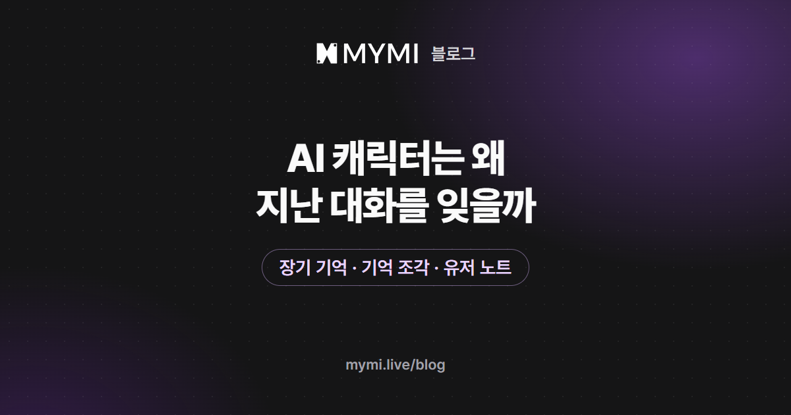

AI 캐릭터가 지난 일을 잊는 건, AI가 답할 때마다 함께 읽는 글의 양에 한계가 있어서예요.



{/* truncate */}

어제 한 약속을 처음 듣는 것처럼 말하거나, 한참 전에 정한 호칭을 다르게 부르거나, 이미 끝난 사건을 다시 꺼낼 때가 있어요. 캐릭터가 대충 대답해서가 아니라 AI가 이야기를 읽는 방식 때문에 생기는 일이에요. 왜 그런지, MYMI는 기억을 어떻게 이어 가는지, 잊었을 때 무엇부터 하면 되는지 차례로 정리했어요.

## AI 캐릭터는 대화를 어떻게 기억하나요?

AI 모델은 지난 대화를 따로 쌓아 두지 않아요. 답을 쓸 때마다 서비스가 그 순간 건네준 글을 읽고, 거기에 이어질 다음 장면을 써요. 건네주는 글에는 보통 이런 것이 들어가요.

- 작품을 만든 크리에이터가 적어 둔 캐릭터와 세계관 설정
- 지금까지의 줄거리를 줄여 쓴 요약
- 최근에 주고받은 대화
- 내가 꼭 기억해 달라고 적어 둔 메모

이 묶음에 담을 수 있는 분량에는 한계가 있어요. 대화가 짧을 때는 처음부터 지금까지를 통째로 넣을 수 있지만, 길어지면 오래된 대화부터 원문 그대로는 들어가지 못해요. 그래서 서비스는 오래된 부분을 줄거리로 줄여 넣고, 지금 장면에 필요한 기억을 골라 다시 꺼내 줘요.

## 왜 하필 중요한 일을 잊나요?

줄거리로 줄이면 큰 흐름은 남지만 작고 구체적인 내용은 빠지기 쉬워요. 이야기에서는 그 작은 내용이 중요할 때가 많아서 '하필 그걸 잊었다'는 느낌이 들어요.

| 잊히기 쉬운 것 | 왜 빠지나요 |
|---|---|
| 약속한 장소와 시간, 주고받은 물건 | 줄거리를 줄일 때 큰 흐름만 남고 세부가 빠져요 |
| 한참 전에 정한 이름이나 호칭 | 처음 정한 장면이 최근 대화 밖으로 밀려나요 |
| 도중에 바뀐 관계나 설정 | 예전 내용과 바뀐 내용이 함께 남아 어느 쪽이 맞는지 헷갈려요 |
| 긴 묘사 속에 지나가듯 쓴 한 줄 | 긴 메시지 안에서 다른 내용에 묻혀요 |

빈자리가 생기면 AI가 그럴듯한 내용으로 메우기도 해요. 그래서 잊었다기보다 없던 일을 기억하는 것처럼 보일 때도 있어요.

## MYMI는 기억을 어떻게 이어 가나요?

2026년 11월 5일 기준으로 MYMI 채팅방에는 기억을 붙잡는 장치가 세 가지 있어요. 최근 대화는 대략 10~15번 주고받은 만큼 원문 그대로 들어가고, 그보다 앞의 일은 이 장치들로 이어져요.

| 구분 | 무엇을 붙잡나요 | 만드는 쪽 | AI가 읽는 때 |
|---|---|---|---|
| 장기 기억 | 지금까지 일어난 일을 차례로 적은 줄거리 | 자동, 대화 10번마다 새로 생긴 일을 덧붙여요 | 답할 때마다 |
| 기억 조각 | 다툼·데이트·여행처럼 한 번 있었던 일 하나하나 | 자동, 장기 기억을 덧붙일 때 함께 | 지금 장면이나 방금 보낸 메시지와 닮은 일이 있으면 몇 개 |
| 유저 노트 | 꼭 지켜야 할 관계와 설정 | 내가 직접, 2,000자까지 | 답할 때마다 |

세 장치는 채팅방 오른쪽 위 ⋮ 메뉴에 있어요. 장기 기억과 기억 조각은 아래쪽 '기억 관리' 묶음에, 유저 노트는 그 위 '채팅 설정' 묶음에 있어요.

<Screenshot src={require('./img/ai-character-memory/memory-menu.webp').default} alt="채팅방 점 세 개 메뉴 아래쪽 기억 관리 묶음에 장기 기억과 기억 조각이 있는 화면" caption="⋮ 메뉴 → 기억 관리" device="part" />

설명을 위해 지어낸 이야기로 예를 들면, 장기 기억에는 '둘이 처음 등대에 갔다', '하람이 거짓말을 들켰다'처럼 일어난 일이 한 줄씩 쌓여요. 그날 등대에서 누가 무엇을 하고 무엇을 약속했는지는 기억 조각에 사실 위주로 남을 수 있지만, 어느 장면을 남길지는 AI가 정해요.

장기 기억 탭 맨 위 칸에는 다음 정리까지 남은 대화 수가 나와요. 그 자리에 '다음 대화 때'가 보이면, 다음 메시지를 보낼 때 AI가 그동안 생긴 일을 줄거리에 이어 적어요.

<Screenshot src={require('./img/ai-character-memory/long-term.webp').default} alt="메모리 화면의 장기 기억 탭 맨 위에 첫 줄거리 정리까지 대화가 아홉 번 남았다는 칸이 있는 화면" caption="장기 기억 탭 맨 위 칸. 다음 정리까지 남은 대화 수가 보여요(첫 정리 전 화면)" device="part" />

기억 조각 탭에는 AI가 남긴 조각이 모이고, 장면이나 이름으로 찾아볼 수 있어요.

<Screenshot src={require('./img/ai-character-memory/fragments.webp').default} alt="기억 조각 탭에 장면과 이름으로 찾는 칸과 아직 남겨진 기억이 없다는 안내가 있는 화면" caption="기억 조각 탭. 대화가 쌓이면 AI가 남긴 조각이 여기에 모여요" device="part" />

장기 기억에도 길이 한도가 있어요. 대화가 길어지면 오래된 줄은 몇 줄씩 짧게 합쳐지고, 그래도 넘치면 일부가 지워져서 처음 정한 설정이나 초반 사건은 장기 기억에서도 흐려지거나 사라질 수 있어요. 장기 기억과 기억 조각은 내가 손으로 고칠 수 없으니, 끝까지 지켜야 할 것은 유저 노트에 적어 두는 편이 확실해요.

## 잊은 일을 다시 떠올리게 하려면?

1. 방금 받은 답에서 잊었다면, 다음 메시지를 보내기 전에 그 답을 다시 생성하거나 직접 고쳐요. 고칠 수 있는 건 가장 마지막 답뿐이에요.
2. 장기 기억을 열어 빠지거나 어긋난 줄이 보이면, 맞는 사실을 유저 노트에 한 줄로 남겨요. 장기 기억은 손댈 수 없어서 노트가 고쳐 쓴 기록 역할을 해요.
3. 이어 보낼 메시지의 대사나 지문에 그 일의 장소·물건·이름을 직접 넣어요. 기억 조각은 지금 장면과 방금 보낸 메시지에 닮은 것을 골라 꺼내기 때문에, 메시지에 구체적인 낱말이 들어 있으면 맞는 조각이 떠오르기 쉬워요.

같은 이야기라면 다음 메시지는 이렇게 쓸 수 있어요.

```text
*주머니에서 은색 열쇠를 꺼내 보인다* 이거, 그날 등대 앞에서 네가 나한테 맡긴 거잖아.
```

이야기가 크게 어긋났다면 어긋나기 전의 답변에 북마크를 걸고, 그 지점에서 분기한 새 채팅방으로 다시 해 볼 수도 있어요. 새 채팅방이 물려받는 장기 기억과 기억 조각은 북마크한 장면까지의 것뿐이고, 유저 노트와 페르소나는 분기하는 순간 적혀 있던 내용이 그대로 복사돼요. 옮겨 간 유저 노트에 어긋난 뒤의 일이 적혀 있다면 새 채팅방에서 지워 두세요. 북마크를 건 답변과 그 위쪽 대화는 그 뒤로 손댈 수 없게 돼요.

북마크를 걸 때 뜨는 창에도 고칠 수 없게 된다는 경고가 나와요.

<Screenshot src={require('./img/ai-character-memory/bookmark.webp').default} alt="북마크 추가 창에 이 지점부터 대화를 분기할 수 있다는 설명과 그 앞의 메시지는 고치거나 지울 수 없다는 경고가 있는 화면" caption="답 아래 책갈피 버튼으로 여는 북마크 추가 창" device="part" />

'기억 조각 사용' 스위치와 조각을 찾는 법은 [장기 기억과 기억 조각](https://www.mymi.live/guide/chatting/memory-book) 안내에 있어요.

## 유저 노트는 어떻게 써야 잘 통하나요?

유저 노트는 줄거리를 옮겨 적는 곳이 아니라 앞으로도 지켜야 할 사실을 적는 곳이에요. 이렇게 쓰면 AI가 덜 헷갈려요.

- 지금 시점의 사실을 짧은 문장으로 적어요. '사흘 전'처럼 시간이 지나면 틀려지는 말은 피해요.
- 이름과 호칭은 한 번 정한 그대로 써요.
- 관계나 설정이 바뀌면 예전 문장을 지우고 새 문장으로 바꿔요. 두 문장이 함께 있으면 어느 쪽을 따를지 헷갈려요.
- 2,000자를 다 채우기보다 중요한 것부터 적어요.

```text
은색 열쇠는 하람이 등대 앞에서 나에게 맡겼고, 지금 내가 가지고 있다.
하람은 등대에서 거짓말을 들킨 뒤로 나에게 거짓말하지 않는다.
하람은 나를 '선배'라고 부른다.
```

내 성격·말투·역할처럼 나에 대한 설정은 페르소나의 상세정보에 1,000자까지 적을 수 있고, 캐릭터가 답할 때마다 함께 읽어요. 채팅방마다 시작할 때의 페르소나가 따로 저장돼 있으니, 대화 중인 방에서 바꾸려면 그 방의 채팅 설정 → 페르소나를 열어요. 방법은 [페르소나 설정](https://www.mymi.live/guide/account/persona) 안내에 있어요.

유저 노트는 적은 채팅방 하나에만 붙어 있어서, 같은 작품이라도 새 대화를 열면 다시 적어야 해요. 적는 곳은 [채팅방 설정하기](https://www.mymi.live/guide/chatting/chat-room-settings)에 있어요.

## 처음부터 덜 잊게 하려면?

- 중요한 일은 긴 묘사 사이에 지나가듯 넣지 말고, 따로 한 문장으로 분명하게 남겨요. '나중에 거기서'보다 '내일 정오, 시계탑 앞에서'처럼 적어 두면 AI도 나도 다시 짚기 쉬워요.
- 같은 사람이나 물건을 여러 이름으로 부르지 않아요.
- 장면이 크게 바뀔 때는 지금 상황을 한두 문장으로 정리해 주면 AI가 흐름을 따라오기 쉬워요.
- 끝까지 지켜야 할 설정은 대화 초반에 유저 노트에 적어 둬요. 장기 기억은 길어지면 오래된 일부터 줄이거나 지우지만, 유저 노트는 내가 지우기 전까지 그대로 남아요.

## 자주 묻는 질문

<details>
<summary>대화가 아주 길어지면 처음 일은 완전히 잊나요?</summary>

장기 기억에도 길이 한도가 있어서, 대화가 길어지면 오래된 일은 짧게 합쳐지고 그래도 넘치면 일부가 지워져요. 그래서 초반 일은 흐려지거나 빠질 수 있어요. 기억 조각으로 남은 일은 비슷한 장면이 오거나 메시지에서 그 일을 짚으면 다시 떠오를 수 있지만, 처음부터 끝까지 지켜야 할 설정은 유저 노트에 적어 두는 것이 가장 확실해요.

</details>

<details>
<summary>캐릭터가 없던 일을 기억한다고 해요</summary>

빈자리를 AI가 그럴듯하게 채운 것일 수 있어요. 그 답이 마지막 답이라면 다시 생성하거나 직접 고치고, 실제로 있었던 일을 유저 노트에 적어 두세요.

</details>

<details>
<summary>로그인하지 않고 체험할 때도 기억하나요?</summary>

네. 체험은 다시 생성하기까지 합쳐 많아야 5번이라, 첫 장면부터 지금까지 오간 글을 빠짐없이 함께 읽고 답해요. 체험 중에는 장기 기억이 생길 만큼 대화가 길어지지 않고, 기억 조각은 꺼내 쓰지 않아요. 유저 노트도 로그인해야 열려요. 체험하던 채팅방은 그 채팅방을 연 브라우저나 앱에서 로그인 버튼을 눌러 새로 가입해야 새 계정으로 옮겨져요. 같은 휴대폰이라도 다른 브라우저나 앱을 따로 열어 가입하면 옮겨지지 않아요. 자세한 조건은 [로그인 없이 AI 채팅할 수 있나요?](https://www.mymi.live/guide/faq/chat-without-login)에 있어요.

</details>

<details>
<summary>유저 노트는 다른 채팅방에도 적용되나요?</summary>

아니요. 노트는 적은 채팅방 하나에만 붙어 있어서, 같은 작품이라도 새 대화를 열면 빈 노트로 시작해요. 북마크에서 분기한 채팅방만 예외로, 분기할 때 적혀 있던 노트를 가져가요. 노트는 기기가 아니라 그 채팅방에 저장돼서 휴대폰과 PC 어디서 열어도 같아요.

</details>

이어 가던 이야기가 있다면 [MYMI](https://www.mymi.live/ko?utm_source=mymi_blog&utm_medium=referral&utm_campaign=global_content_2026q4&utm_content=ko_blog_ai_character_memory)에서 그 채팅방의 ⋮ 메뉴부터 열어 보세요. AI 인터랙티브 소설이 처음이라면 [AI 인터랙티브 소설이란?](./ai-interactive-novel.md)부터 읽어 보면 좋아요. 새로 시작할 작품은 [남성향 AI 채팅 추천](./male-oriented-ai-chat.md)과 [여성향 AI 연애 채팅 추천](./female-oriented-ai-chat.md)에서 골라 볼 수 있고, 다른 글은 [MYMI 블로그](https://www.mymi.live/blog)에 모여 있어요.

_2026년 11월 5일 고침: 답마다 떠올리는 기억 조각 설명, 장기 기억이 길어질 때 줄이는 방식, 체험한 대화가 새 계정으로 옮겨지는 조건을 지금 동작에 맞게 바로잡고, 화면 그림을 더했어요._
