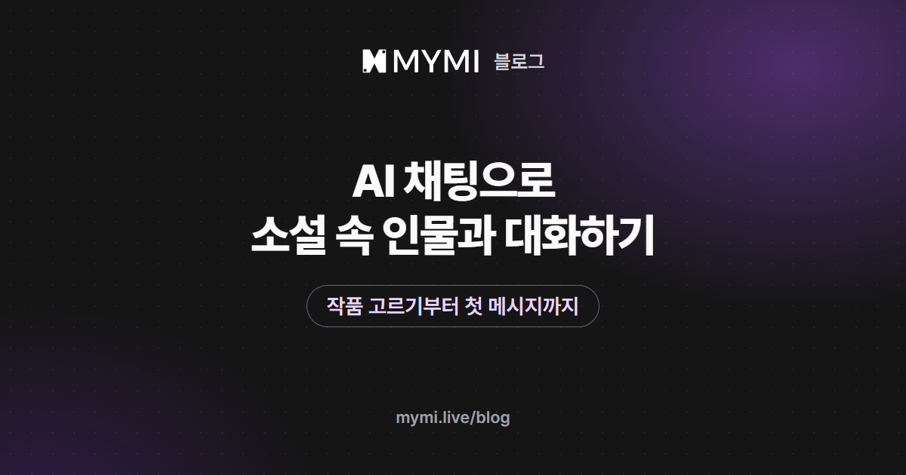

AI 채팅은 작품 하나를 골라 첫 장면 끝에 내 몸짓과 한마디를 덧붙여 보내면 시작돼요.



{/* truncate */}

AI 채팅이라는 말은 넓게 쓰여서, 궁금한 것을 묻는 챗봇을 떠올리는 사람도 있고 좋아하는 캐릭터와 이야기를 나누는 서비스를 떠올리는 사람도 있어요. 이 글은 그중 두 번째, 작품 속 인물과 함께 장면을 만들어 가는 AI 채팅을 처음 해 보는 분을 위한 안내예요. 작품을 고르는 눈, 첫 장면을 읽는 법, 첫 메시지를 쓰는 요령을 실제 화면과 함께 차례로 짚어요.

## 질문에 답하는 챗봇과는 무엇이 다른가요?

챗봇과의 대화는 내가 묻고 AI가 답하는 데서 끝나는 경우가 많아요. 캐릭터 채팅에서는 AI가 작품에 정해진 인물이 되어 그 성격과 말투로 내 말에 반응하고, 장면의 서술까지 이어 써요. 나도 이야기 속 한 사람으로 들어가 말하고 움직이니, 주고받은 대화가 그대로 함께 쓰는 소설이 돼요.

| 견줄 것 | 질문하는 AI 대화(챗봇) | AI 캐릭터 채팅 |
|---|---|---|
| AI가 맡는 것 | 묻는 말에 답하는 도우미 | 작품 속 인물과 장면의 서술 |
| 내가 하는 것 | 묻고 부탁하기 | 이야기 속 인물로 말하고 행동하기 |
| 대화가 쌓이면 | 필요한 답을 얻으면 대개 끝나요 | 장면이 이어지며 이야기가 자라요 |
| 잘 맞는 때 | 정보 찾기, 요약, 글쓰기 도움 | 연애·모험·추리처럼 몰입해서 즐기는 이야기 |

MYMI에서는 이런 이야기 하나하나를 작품이라고 불러요. 작품마다 인물과 세계, 이야기가 열리는 장면이 미리 만들어져 있어서, 빈 화면 앞에서 무엇부터 쓸지 고민하지 않고 바로 이야기 안으로 들어갈 수 있어요. 이런 방식을 넓게 설명한 글은 [AI 인터랙티브 소설이란?](./ai-interactive-novel.md)이에요.

## 처음 대화할 작품은 무엇을 보고 고르나요?

어떤 관계를 겪어 보고 싶은지부터 정하면 고르기 쉬워요. 홈 위쪽 탭은 2026년 11월 4일 현재 추천·랭킹·장르·검색 넷이에요. 랭킹에서 많이 읽히는 작품을 둘러보거나, 장르 탭에서 로맨스·판타지·무협처럼 끌리는 쪽으로 좁히거나, 검색창에 바라는 분위기를 적어 찾아보세요. 작품을 눌렀다면 세 군데를 보세요.

- **그림과 한 줄 소개:** 인물의 분위기와 둘 사이의 관계가 가장 빨리 드러나는 곳이에요. 그림이 여러 장인 작품이 많아 넘겨 보며 인상을 잡을 수 있어요.
- **태그:** 장르와 함께 여성향·남성향 같은 성향 태그가 붙어 있어 누구를 위해 쓴 이야기인지 알 수 있어요.
- **도입부:** 대화가 실제로 열리는 첫 장면이에요. 이 장면 안에 들어가 보고 싶은지가 가장 믿을 만한 기준이에요.

<Screenshot src={require('./img/ai-chat-start/work.webp').default} alt="작품 화면 위쪽에 인물 그림, 그림 목록, 작품 이름이 있고 맨 아래에 대화 시작하기 버튼이 있는 화면" caption="작품 화면 위쪽. 그림을 넘겨 보고, 이름 아래로 내리면 한 줄 소개와 태그가 나와요(화면 속 작품 「한이겸」 · 초코바나나딸기)" device="part" />

어디서부터 고를지 막막하다면, 운영팀이 성향별로 골라 작품마다 시작 장면까지 소개한 [남성향 AI 채팅 추천](./male-oriented-ai-chat.md)과 [여성향 AI 연애 채팅 추천](./female-oriented-ai-chat.md)부터 열어 보세요.

## 첫 장면에서는 무엇을 읽으면 되나요?

도입부에는 내가 지금 어디에 있고, 상대가 방금 무슨 말과 행동을 했는지가 담겨 있어요. 도입부가 여럿인 작품은 작품 화면에서 시작할 장면을 바꿔 고를 수 있으니, 그날 기분에 맞는 장면으로 들어가면 돼요.

<Screenshot src={require('./img/ai-chat-start/intro.webp').default} alt="작품 화면의 도입부 칸에 시작할 장면 이름이 적힌 선택 칸과 그 장면의 그림, 첫 문단이 보이는 화면" caption="도입부 칸. 장면이 여러 개인 작품은 여기서 바꿔요(화면 속 작품 「한이겸」 · 초코바나나딸기)" device="part" />

작품 화면 아래 대화 시작하기로 들어가면 채팅방 맨 위에 그 장면이 펼쳐져요. 끝까지 읽었다면 마지막 줄을 한 번 더 보세요. 첫 장면은 대개 상대의 질문이나 행동으로 끝나는데, 거기가 내가 답할 자리예요. 위 작품의 첫 장면은 상대가 "마실 겁니까, 말 겁니까."라고 묻는 데서 멈춰요.

<Screenshot src={require('./img/ai-chat-start/first-scene.webp').default} alt="새 채팅방 맨 위에 인물 그림과 도입부 장면의 서술과 대사가 이어지고, 아래에 메시지 입력창이 있는 화면" caption="새 채팅방을 열면 첫 장면부터 보여요(화면 속 작품 「한이겸」 · 초코바나나딸기)" device="part" />

## 첫 메시지는 어떻게 쓰나요?

길게 쓰지 않아도 돼요. 장면에 바로 이어지는 행동 하나와 말 한마디면 충분해요. 몸짓은 앞뒤에 별표(*)를 붙여 대사와 갈라 주고, 말은 따옴표 없이 그대로 써요. 별표는 입력창 옆 ✱를 누를 때마다 하나씩 들어가요. 위 장면에서는 이렇게 보내 봤어요.

```text
*앞치마를 벗어 의자에 걸며* 그럼 딱 한 그릇만이에요. 마감 정리는 내일 일찍 와서 할게요.
```

보낸 행동은 이야기의 서술처럼 자리를 잡고, 상대는 그 말과 몸짓을 받아 다음 장면을 써 내려가요. 첫 메시지를 쓸 때 이 네 가지를 떠올리면 좋아요.

- 상대가 마지막에 던진 말이나 행동에 먼저 답해요.
- 내 캐릭터의 마음은 설명보다 몸짓으로 보여 줘요. '설렌다'고 적기보다 잔을 만지작거리는 쪽이 장면을 살려요.
- 상대의 대사나 행동은 내가 정해 버리지 않아요. 그 몫을 AI에게 남겨야 이야기가 주고받는 대화가 돼요.
- 상대가 반응할 거리를 하나 남겨요. 짧은 질문이나 작은 행동이면 돼요.

<Screenshot src={require('./img/ai-chat-start/first-message.webp').default} alt="첫 장면 끝에 내가 보낸 행동이 서술처럼 기울어진 글씨로, 대사가 파란 글씨로 붙고, 그 아래 인물 그림과 함께 이어진 답이 나오는 화면" caption="내가 보낸 첫 메시지와 이어서 나온 답(화면 속 작품 「한이겸」 · 초코바나나딸기, 캐릭터의 답변은 AI가 생성한 내용)" device="part" />

로그인하지 않았다면 이야기 속의 나는 'Guest'라는 이름으로 불려요. 위 화면의 첫 장면에도 그 이름이 나오죠. 작품에 제작자가 준비한 추천 페르소나가 있으면, 로그인하기 전에도 대화 시작하기 옆 버튼에서 그 역할을 골라 들어갈 수 있어요. 내 이름과 캐릭터 설정을 직접 정해 두려면 로그인해야 해요.

## 말투와 관계는 어떻게 맞춰 가나요?

로그인하면 내 캐릭터를 페르소나로 정해 둘 수 있어요. 이름과 함께 내 역할·성격·말투·상대와의 관계를 적어 두고(2026년 11월 4일 기준 1,000자까지), 새 대화를 열 때 그 페르소나로 들어가면 돼요. 이야기를 하다가 바뀐 관계나 끝까지 지켜야 할 설정은 그 채팅방의 유저 노트에 적어 두면 답마다 함께 읽혀요(같은 날 기준 2,000자까지).

<Screenshot src={require('./img/ai-chat-start/settings.webp').default} alt="채팅방 점 세 개 메뉴의 채팅 설정 묶음에 유저 노트, 페르소나, 문체 스타일(소설형)이 차례로 있는 화면" caption="⋮ 메뉴 → 채팅 설정의 유저 노트·페르소나·문체 스타일" device="part" />

문장의 결은 문체 스타일로 바꿔요. 로그인하지 않아도 고를 수 있고, 같은 장면이라도 묘사를 넉넉히 풀거나 전개를 서두르는 식으로 결이 달라져요. 분위기를 바꾸는 여러 방법은 [AI 채팅 이야기를 원하는 분위기로 이끌려면?](./ai-story-mood.md)에 모아 두었어요.

## 대화가 막히거나 어긋나면?

답이 어색하게 나왔다면 마지막 답 밑 버튼으로 한 번 더 받아 보거나 문장을 손수 다듬으면 돼요. 다음 메시지를 보내고 나면 지난 답은 그대로 굳으니, 손볼 답은 바로 그 자리에서 손보세요. 휴지통을 누르면 답만이 아니라 바로 앞에 보낸 내 메시지까지 함께 없어져요. 확인 창의 '내 메시지를 입력창에 다시 넣기'에 체크하면 그 말을 입력창으로 돌려받아 고쳐 보낼 수 있어요.

<Screenshot src={require('./img/ai-chat-start/actions.webp').default} alt="답 끝 아래에 다시 생성하기, 메시지 수정, 메시지 삭제, 북마크 추가, 스냅샷 버튼이 한 줄로 있고 그 아래 입력창이 있는 화면" caption="2026년 11월 4일 소설 보기의 마지막 답 아래 버튼. 왼쪽부터 다시 생성하기, 메시지 수정, 메시지 삭제, 북마크 추가, 스냅샷(화면 속 작품 「한이겸」 · 초코바나나딸기, 캐릭터의 답변은 AI가 생성한 내용)" device="part" />

무슨 말을 해야 할지 떠오르지 않을 때는 입력창을 비운 채 오른쪽 ≫ 버튼을 눌러 보세요. 시간을 건너뛸지, 장면을 바꿀지, 사건을 일으킬지 고르는 창이 떠서 이야기가 다시 움직여요. 로그인했다면 입력창이 비었을 때 ✱ 왼쪽에 보이는 전구 버튼으로 지금 장면에 어울리는 보낼 말 세 가지를 받아 볼 수도 있어요(2026년 11월 4일 기준 10스파크). 대화가 길어지며 생기는 일은 따로 다뤘어요. 앞에서 정한 약속을 캐릭터가 잊는다면 [AI 캐릭터는 왜 지난 대화를 잊을까?](./ai-character-memory.md)를, 내 캐릭터의 말까지 AI가 써 버린다면 [AI가 내 대사까지 쓸 때](./ai-writes-my-lines.md)를 보세요.

## 자주 묻는 질문

<details>
<summary>회원 가입 없이도 대화해 볼 수 있나요?</summary>

네. 2026년 11월 4일 기준으로 로그인하지 않아도 작품을 바꿔 가며 답을 다섯 개까지 받아 볼 수 있고, 다시 생성한 답도 그 다섯 개에 들어가요. 계속하고 싶어지면 체험하던 브라우저나 앱의 로그인 버튼으로 바로 가입하세요. 그래야 그동안의 채팅방이 새 계정으로 옮겨 와요.

</details>

<details>
<summary>대화할 때마다 비용이 드나요?</summary>

로그인한 뒤에는 답 하나를 받을 때마다 그때 고른 AI 모델의 값만큼 스파크를 써요. 모델마다 값이 달라서, 입력창 왼쪽 ⚡ 버튼으로 모델을 고를 때 값을 함께 보세요. 값을 어떻게 견줄지는 [AI 캐릭터 채팅 앱 고르는 법](./choose-ai-character-chat-app.md)에 정리했어요.

</details>

<details>
<summary>휴대폰 앱에서도 똑같이 할 수 있나요?</summary>

네. 웹과 Android·iPhone 앱 모두 같은 계정으로 쓰고, 채팅방도 계정에 남아 어느 쪽에서 열어도 이어져요. 다만 문체 스타일 같은 화면 설정은 계정이 아니라 쓰는 브라우저나 앱에 저장돼서, 휴대폰 앱과 PC 브라우저를 오가면 각각 맞춰 둬야 해요.

</details>

<details>
<summary>첫 장면에 내 캐릭터가 한 일이 이미 적혀 있으면요?</summary>

그 대목은 이미 일어난 일로 두고, 장면이 멈춘 바로 다음 순간부터 이어 쓰면 돼요. 흐름이 마음에 들지 않아도 지난 일을 고쳐 쓰기보다 지금 할 행동으로 방향을 트는 편이 자연스러워요.

</details>

첫 장면이 마음에 드는 작품을 찾았다면 [MYMI](https://www.mymi.live/ko?utm_source=mymi_blog&utm_medium=referral&utm_campaign=global_content_2026q4&utm_content=ko_blog_ai_chat_start)에서 그 장면에 한 줄을 보내 보세요. 다른 궁금증이 생기면 [MYMI 블로그](https://www.mymi.live/blog)에서 질문별로 찾아 읽어 보세요.
