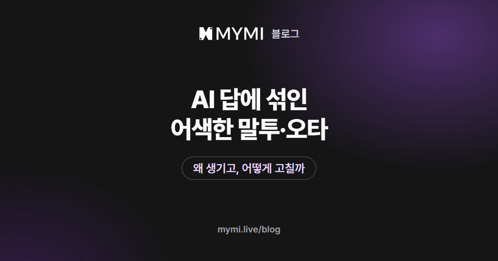

AI가 글 조각을 이어 붙이다가 어긋난 조각을 고르거나, 작품과 대화의 말투를 따라 해서 생겨요.



{/* truncate */}

몰입해서 읽던 장면에 '했었었다'처럼 말이 겹친 오타가 끼거나, 인물이 갑자기 번역한 책 같은 말투로 말하면 이야기에서 툭 빠져나오게 돼요. 한두 군데는 연필 버튼으로 직접 고치고, 답 전체가 어색하면 바라는 점을 적어 다시 받으면 돼요. 이런 문장이 어디서 오는지 알면 덜 생기게 하는 법도 보여요. 이 글의 예시 문장은 설명을 위해 지어낸 것이에요.

## AI 답에는 왜 오타나 어색한 말이 섞이나요?

AI는 답을 앞에서부터 짧은 글 조각 단위로 이어 써요. 답하기 전에 먼저 생각을 거치는 모델도 있지만, 글을 내보낼 때는 지금까지 쓴 글 뒤에 올 법한 조각을 하나 고르고, 그 조각을 붙인 글을 다시 보며 다음 조각을 고르는 일을 답이 끝날 때까지 되풀이해요. 조각을 고를 때 가장 그럴듯한 하나만 고집하지 않고 조금씩 다르게 고르기 때문에, 같은 장면을 다시 받아도 답이 매번 달라져요. 덕분에 표현이 새로워지지만, 드물게 어울리지 않는 조각이 뽑히면 조사가 어긋나거나 같은 글자가 겹쳐요. 한 번 붙인 조각은 되돌리지 않고 그 뒤를 이어 쓰니, 어긋난 조각 하나가 문장 끝까지 어색함을 끌고 가기도 해요.

번역투도 어색함의 한 갈래예요. 많은 AI 모델은 영어로 된 글을 가장 많이 배워서, 한국어로 답할 때도 영어 문장을 옮긴 듯한 표현이 섞이기 쉬워요. 배운 한국어의 양과 결은 모델마다 달라서, 같은 장면을 맡겨도 문장이 얼마나 자연스러운지가 모델에 따라 갈려요.

| 보이는 모습 | 이렇게 생겨요 |
|---|---|
| 글자가 겹치거나 조사가 어긋나요('했었었다', '나를을') | 조각을 고를 때 어울리지 않는 조각이 뽑혀요. 모델에 따라 더 잦기도 해요 |
| 번역한 책 같은 말투가 나와요('그녀는'의 되풀이, '그 말은 큰 의미를 가지고 있다', '바람에 의해 문이 열렸다') | 영어 글을 많이 배운 모델의 습관이 한국어 답에 묻어나요 |
| 낯선 줄임말이나 사투리가 이어져요 | 작품 글이나 지난 대화의 말투를 따라 해요(다음 절) |
| 내 이름 뒤 조사가 어긋나요('지훈를', '지훈는') | 작품 글이나 가입 전 'Guest'로 불리던 자리에 내 이름을 끼워 넣을 때, 뒤의 조사는 그대로 남아요(아래 자주 묻는 질문) |

## 작품과 지난 대화의 말투도 따라 하나요?

네. AI는 답을 쓸 때마다 작품에 적힌 설정과 최근에 주고받은 대화를 다시 읽고 그 글의 말투를 이어 써요. 도입부도 대화 초반에는 최근 대화로 함께 읽혀서 첫 답들의 말투를 크게 좌우해요. 원문이 짧게 끊어 말하면 답도 짧게 끊기고, 원문에 줄임말이 많으면 답에도 줄임말이 늘기 쉬워요. 대화 중에 한 번 나온 어색한 표현도 기록에 남아 다음 답이 다시 쓰기 쉬워서, 그냥 넘긴 오타가 몇 번 뒤에 또 나타나기도 해요.

<Screenshot src={require('./img/ai-chat-typos/intro.webp').default} alt="기울임 글씨 서술 사이로 노란 글씨 대사가 나오는 작품 도입부 화면" caption="채팅방을 열면 나오는 작품 도입부. 대화 초반에는 AI가 이 글의 말투를 이어 써요(화면 속 작품 「이찬희」 · 초코바나나딸기)" device="part" />

다만 틀려 보이는 말이 모두 실수는 아니에요. 사투리를 쓰는 인물이나 메시지를 줄여 치는 인물처럼, 제작자가 일부러 정한 말투일 수 있어요. 고치기 전에 작품 소개와 도입부에서 그 인물이 원래 어떻게 말하는지 먼저 보세요.

채팅 설정의 문체 스타일도 말투를 바꿔요. 처음에는 소설형이 골라져 있어 그 문체로 쓰라는 주문이 함께 가고, '작품 그대로'로 바꾸면 이 주문이 빠져 작품 원문의 말투가 기준이 돼요. '작품 그대로'에서 원문의 말투가 거칠다면 다른 문체로, 소설형 같은 문체 주문 탓에 말이 어색해졌다면 '작품 그대로'로 바꿔 견줘 보세요. 문체 스타일은 ⋮ 메뉴의 채팅 설정에 있고, 문체마다 무엇이 달라지는지는 [AI 채팅 이야기를 원하는 분위기로 이끌려면?](./ai-story-mood.md)에 표로 정리해 두었어요.

## 한두 글자가 틀렸다면 어떻게 고치나요?

오타가 한두 군데뿐이라면 다시 받기보다 직접 고치는 편이 빨라요. 마지막 답 아래 연필 버튼(메시지 수정)을 누르면 답이 글 상자로 바뀌고, 고친 뒤 저장 버튼을 누르면 끝이에요. 고치는 데는 스파크가 들지 않고, 로그인하기 전 체험 횟수도 줄지 않아요.

고친 문장은 화면에서만 바뀌는 게 아니에요. 저장하면 그 답의 내용 자체가 바뀌어서, 다음 답부터 AI가 읽는 지난 대화에도 고친 문장이 들어가요. 오타를 남겨 두면 AI가 그 표기를 다시 쓸 수 있으니, 거슬리는 오타는 다음 메시지를 보내기 전에 고쳐 두는 편이 좋아요.

글 상자에서는 화면에 없던 표시가 그대로 보여요. 화면에서는 별표(*)로 감싼 문장이 기울어진 서술로, 따옴표로 감싼 대사는 따옴표 없이 보여요. `img:[…]`·`` 줄은 그 자리의 그림이고, `<`로 시작하는 줄은 작품의 상태창 같은 칸이에요. 별표나 그림 줄을 지우면 서술이 대사처럼 보이거나 그림이 빠지니, 표시는 그대로 두고 글자만 고치세요.

<Screenshot src={require('./img/ai-chat-typos/edit.webp').default} alt="수정 중 표시 아래 별표로 감싼 서술, img 줄, 따옴표로 감싼 대사가 보이는 글 상자" caption="메시지 수정 중인 글 상자(화면 속 작품 「이찬희」 · 초코바나나딸기, 캐릭터의 답변은 AI가 생성한 내용)" device="part" />

연필 버튼은 가장 마지막 답에만 있어요. 그보다 앞선 답이나 북마크를 건 답(북마크를 지운 뒤에도)은 고칠 수 없어요. 같은 표기가 다시 나올까 걱정되면 다음 메시지 끝에 `(OOC: '했었었다'가 아니라 '했었다')`처럼 짧게 알려 주세요. 버튼 위치와 순서는 유저가이드 [대화하기](https://www.mymi.live/guide/chatting/chat-with-character)에 있어요.

## 답 전체가 어색하면 어떻게 하나요?

말투가 통째로 어색하거나 오타가 여러 군데라면 새 답을 받는 편이 나아요. 마지막 답 아래 둥근 화살표(다시 생성하기)를 누르고, 다시 생성 창 맨 아래 칸에 바라는 점을 짧게 적어 보내세요. '맞춤법 지켜서 자연스럽게 써 줘', '번역투 없이 우리말 소설처럼' 같은 한 줄이면 돼요. 인물의 말투가 작품 설정에서 벗어났다면 창의 '캐릭터 설정대로'를 고르는 것도 방법이에요. 칸에 적은 요청은 이번에 받는 답에만 쓰여요(150자까지, 2026년 11월 5일 기준).

<Screenshot src={require('./img/ai-chat-typos/regenerate-request.webp').default} alt="다시 생성 창 아래쪽 칸에 맞춤법 지켜서 자연스럽게 써 줘라고 적힌 화면" caption="다시 생성 창 맨 아래 칸에 바라는 점을 적은 모습" device="part" />

새 답은 앞의 답을 지우지 않고 옆에 쌓여요. 답 아래 ‹ › 로 넘겨 가며 견주고, 더 자연스러운 쪽을 띄워 둔 채 대화를 이어 가세요. 답을 넘겨 보는 것만으로는 스파크가 빠지지 않고, 띄워 둔 답이 다음 답의 지난 대화로 이어져요. 둘 다 아쉽다면 나은 쪽을 띄운 뒤 연필 버튼으로 몇 군데만 손보면 돼요.

<Screenshot src={require('./img/ai-chat-typos/regenerated.webp').default} alt="다시 받은 답 끝에 다시 생성, 수정, 삭제 버튼과 두 번째 답임을 보여 주는 넘김 표시가 있는 화면" caption="다시 받은 답. ‹ › 로 앞의 답과 넘겨 볼 수 있어요(화면 속 작품 「이찬희」 · 초코바나나딸기, 캐릭터의 답변은 AI가 생성한 내용)" device="part" />

다시 생성은 답을 하나 더 받는 것이라 그만큼 스파크가 들고, 로그인하기 전에는 체험 횟수에서도 한 번 빠져요.

## 같은 실수가 계속 되풀이된다면?

답마다 같은 번역투나 같은 오타가 나온다면 한 번 고치는 것으로는 모자라요. 로그인했다면 그 채팅방의 유저 노트에 문장 규칙을 적어 두세요. 유저 노트는 이 채팅방의 모든 답에 함께 가는 메모라, 맞춤법 같은 부탁은 한 번만 적어 두면 돼요. 예를 들면 이렇게요.

```text
문장 규칙: 맞춤법과 띄어쓰기를 지킨다.
'그녀는'을 되풀이하지 않고 이름이나 호칭으로 부른다.
'의미를 가지다'·'관심을 가지다' 같은 '가지다', '~에 의해' 같은 번역투 대신 우리말 소설처럼 쓴다.
```

모델을 바꿔 보는 것도 방법이에요. 로그인하면 입력창 왼쪽 ⚡ 버튼에서 모델을 고를 수 있고, 모델을 바꾼 뒤 다시 생성하면 같은 장면을 새 모델로 받아 문장의 결을 바로 견줄 수 있어요. 모델을 바꾸면 답 한 번에 드는 스파크도 달라질 수 있어요. 로그인하기 전에는 정해진 체험 모델이 답해서 모델을 바꿀 수 없어요. 모델 소개와 가격은 유저가이드 [AI 모델 안내](https://www.mymi.live/guide/chatting/ai-models)에, 모델마다 값을 어떻게 견줄지는 [AI 캐릭터 채팅 앱 고르는 법](./choose-ai-character-chat-app.md)에 있어요.

## 자주 묻는 질문

<details>
<summary>고친 답을 AI가 다음에도 기억하나요?</summary>

네. 저장한 문장이 그 답의 내용이 되어, 다음 답부터 AI가 읽는 지난 대화에 고친 문장이 들어가요. 고칠 수 있는 것은 가장 마지막 답뿐이니, 지나간 답의 내용은 다음 메시지에서 바로잡아 주세요. 로그인했다면, 오래 지켜야 할 설정이 어긋났을 때는 [AI 캐릭터는 왜 지난 대화를 잊을까?](./ai-character-memory.md)에서 다룬 유저 노트가 더 맞는 자리예요.

</details>

<details>
<summary>직접 고치는 데도 스파크가 드나요?</summary>

아니요. 메시지 수정은 새 답을 받지 않아서 스파크가 들지 않고, 로그인하기 전 체험 횟수에서도 빠지지 않아요. 다시 생성은 새 답을 하나 받는 만큼 들어요.

</details>

<details>
<summary>가입한 뒤 지난 답에서 내 이름 뒤 조사가 어색해요</summary>

로그인하지 않고 대화하는 동안 이야기 속 나는 'Guest'로 불려요. 체험하던 채팅방을 가입한 계정으로 옮기면 그 자리에 내 이름이 들어가는데, 뒤의 조사는 'Guest'에 맞춘 그대로라 받침이 있는 이름은 '지훈는'처럼 보일 수 있어요. 작품 도입부에서 내 이름이 들어가는 자리도 마찬가지예요. 마지막 답이라면 연필 버튼으로 고치고, 도입부와 지나간 답은 고칠 수 없어요.

</details>

<details>
<summary>답에 갑자기 영어나 다른 나라 글자가 섞여요</summary>

모델에 따라 가끔 생겨요. 작품에 다른 언어로 적힌 이름이나 글이 있으면 그대로 따라 쓰기도 해요. 몇 글자뿐이면 연필 버튼으로 고치고, 여러 군데라면 다시 생성 창에 '한국어로만 써 줘'라고 적어 다시 받으세요. 로그인했다면 같은 채팅방에서 자주 그럴 때 유저 노트에 같은 규칙을 적거나 다른 모델로 바꿔 보세요.

</details>

고쳐 보고 싶은 장면이 있다면 [MYMI](https://www.mymi.live/ko?utm_source=mymi_blog&utm_medium=referral&utm_campaign=global_content_2026q4&utm_content=ko_blog_ai_chat_typos)에서 대화하던 작품을 열고, 마지막 답 아래 연필 버튼부터 눌러 보세요. 답에 내 대사까지 섞여 든다면 [AI가 내 대사까지 쓸 때](./ai-writes-my-lines.md)에서 원인과 막는 법을 볼 수 있어요. 설정이 있는 자리는 유저가이드 [채팅방 설정하기](https://www.mymi.live/guide/chatting/chat-room-settings)에, 다른 궁금증은 [MYMI 블로그](https://www.mymi.live/blog)에 모아 두었어요.
