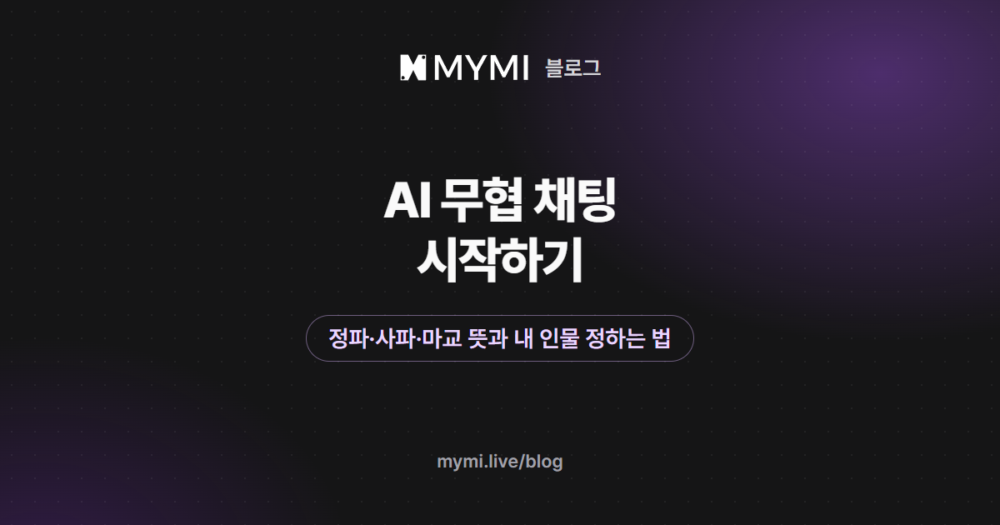

AI 채팅으로 무협을 즐기려면 내 인물의 소속과 실력, 풀어야 할 은원 세 가지를 먼저 정하고 시작하면 돼요.



{/* truncate */}

무협은 해 보고 싶은데 강호니 정파니 하는 말부터 낯설어서 첫 메시지가 막힌다면, 이 글에서 시작해 보세요. 무협 작품에 자주 나오는 말 여덟 개를 풀고, 세 가지를 어떻게 정하는지와 첫 메시지 예시를 보여 드려요. 글에 실은 인물 설정과 첫 메시지 예시는 설명을 위해 지어낸 것이고, 「서린」의 대사는 실제 작품 화면에 있는 것이에요.

## 무협은 어떤 이야기인가요?

무협(武俠)은 무술과 협의를 소재로 한 장르예요. 위키백과는 수련과 전투가 주로 그려진다고 설명해요. 무공을 익힌 사람들이 이루는 사회를 **무림** 또는 **강호**라고 부르는데, 무협 이야기에서 인물들이 부딪치는 곳이 바로 여기예요.

무협 작품의 소개 글을 읽을 때는 누가 어느 세력에 속하고 누구와 맞서는지부터 찾아보세요. 세력 이름 몇 개만 알아 두면 처음 보는 작품의 소개도 훨씬 빨리 읽혀요.

## 강호·정파·사파·구파일방은 무슨 뜻인가요?

무림의 세력은 흔히 정파와 사파로 나누고, 마교를 따로 떼어 세 갈래로 부르기도 해요. 아래 표는 처음 읽을 때 알아 두면 좋은 말 여덟 개예요.

| 말 | 뜻 |
|---|---|
| 무림·강호 | 무공을 익힌 사람들의 사회. 두 말을 같은 뜻으로 써요 |
| 정파 | 바른 길을 내세우는 문파들. 소림사·무당파·화산파 같은 문파를 묶어 부르는 구파일방, 남궁세가·사천당가 같은 무림세가가 여기에 들고, 이들의 연합을 무림맹이라고 해요 |
| 사파 | 정파가 아닌 문파를 한데 모아 이르는 말. 산적 무리인 녹림, 하오문처럼 흑도라 불리는 무리가 여기에 들고, 연합은 사도련이라고 해요 |
| 마교 | 천마신교처럼 종교 집단으로 그려지는 세력. 사파에 넣기도 하고 따로 나누기도 해요 |
| 내공 | 기운을 몸 안에 쌓고 돌리고 뿜어내는 기술 |
| 경공 | 먼 거리를 움직이는 기술. 눈을 밟아도 자국이 남지 않을 만큼 가볍게 움직인다는 '답설무흔'이 그 가운데 하나예요 |
| 은원 | 은혜와 원한을 함께 이르는 말. 무협에서는 인물 사이에 주고받은 은혜와 원한을 가리킬 때 써요 |
| 금의위 | 황실 쪽 정보 기관. 무협에는 무림 바깥의 힘으로 황실이 나오기도 해요 |

<Screenshot src={require('./img/ai-murim-chat/factions.webp').default} alt="무림의 세력을 정파, 사파, 마교 세 칸으로 나누고 칸마다 속하는 세력 이름과 연합 이름을 적은 그림" caption="무림의 세력 세 갈래(이름과 나누는 법은 작품마다 달라요)" device="part" />

세력의 이름과 짜임은 작품마다 달라요. 아래에서 볼 「서린」도 정파 연맹을 '구천맹', 사파 연합을 '흑련'이라는 이름으로 불러요. 표의 말은 사전처럼 외우기보다, 작품 소개에서 '어느 쪽이 어느 쪽과 맞서는지'를 읽는 데 쓰면 충분해요.

## AI 무협 채팅에서 내 인물은 무엇을 정하나요?

내가 누구인지를 작품이 정해 두지 않았다면, 아래 세 가지를 정하면 첫 장면에서 할 말이 생겨요.

- **소속:** 정파 문파의 제자인지, 사파 쪽 사람인지, 어디에도 속하지 않은 떠돌이인지. 상대가 나를 믿을지 경계할지가 여기서 갈릴 수 있어요.
- **실력:** 막 입문한 제자인지, 이름이 알려진 고수인지. 싸움이 벌어졌을 때 내 인물이 맞설지 피할지를 정하는 기준이 돼요.
- **은원:** 누구에게 은혜를 입었고 누구에게 원한이 있는지. 내 인물이 무엇을 하러 왔는지가 여기서 나와요.

<Screenshot src={require('./img/ai-murim-chat/three.webp').default} alt="내 인물에 대해 정할 세 가지인 소속, 실력, 은원을 위아래 세 줄로 놓고 줄마다 고를 수 있는 보기를 적은 그림" caption="첫 메시지를 쓰기 전에 정할 세 가지" device="part" />

로그인했다면 이 세 가지를 페르소나 상세정보에 적어 두고 대화를 시작할 때 고르면 돼요. 상세정보는 1,000자까지 쓸 수 있어요([페르소나 설정](https://www.mymi.live/guide/account/persona)). 지어 본 예시는 이래요.

```text
이름: 한서율(스물여덟 살)
소속: 망한 상단의 호위 무사였던 사람. 지금은 어느 문파에도 속하지 않음
실력: 호신할 정도의 검술. 이름난 고수와 맞서면 버티기 어렵다
은원: 상단을 무너뜨린 자의 이름을 모른다. 단서는 불탄 서신 한 장뿐
말투: 처음 보는 사람에게는 짧고 조심스럽게 말한다
```

로그인하지 않았다면 같은 내용을 첫 메시지에 한두 줄로 녹여 쓰면 돼요.

## 실제 무협 작품은 어떻게 시작하나요?

크리에이터 reerer(@wewewe)의 「[서린](https://www.mymi.live/ko/contents/6a987def0159b91377c83216/profile?utm_source=mymi_blog&utm_medium=referral&utm_campaign=global_content_2026q4&utm_content=ko_blog_ai_murim_chat)」을 예로 들어 볼게요. 상세 설명에 따르면 무대는 황실의 힘이 약해지고 무림의 세력이 커진 '월하강호'이고, 정파 연맹 구천맹과 사파 연합 흑련이 맞서고 있어요. 상대 인물은 '묵월검 서린'으로 불리는 스물아홉 살 검객이에요.

도입부 '산 아래 객잔'은 해 질 무렵, 피비린내가 나는 객잔에 내가 들어서는 장면으로 시작해요. 창가에 앉은 서린이 나를 멈춰 세우고, 화산의 제자 둘이 죽었으며 그들이 죽기 전에 남긴 이름이 내 이름이라고 알려요. 그때 객잔 밖에서 말발굽 소리가 몰려와요.

<Screenshot src={require('./img/ai-murim-chat/seorin-lines.webp').default} alt="작품 서린의 도입부 산 아래 객잔에서 서린이 하는 대사 가운데 네 줄을 차례로 적은 그림" caption="「서린」 도입부 '산 아래 객잔'에 실린 서린의 대사 가운데 네 줄" device="part" />

도입부가 '화산과 무슨 은원이 있소?'라는 물음으로 끝나서, 내 첫 메시지는 자연스럽게 내 소속과 은원을 밝히는 답이 돼요. 작품 화면의 크리에이터 이름 아래 적힌 말에는 내 인물의 성별·나이·출신을 자유롭게 정해도 된다고 적혀 있고, 어울리는 자리로 아래 여섯 가지를 권해요.

| 크리에이터가 권한 내 자리 | 이 글의 세 가지로 보면 |
|---|---|
| 구천맹 산하 문파의 제자 | 소속이 정파 |
| 몰락하거나 멸문한 세가의 후손 | 은원이 먼저 정해짐 |
| 표사·상인·정보상 | 문파 바깥의 자리 |
| 황실 또는 금의위 별부와 이어진 인물 | 무림 바깥의 소속 |
| 흑련과 거래하거나 흑련에 속한 무인 | 사파 쪽 |
| 서린과 은혜나 원한을 주고받은 적이 있는 사이 | 서린과의 은원 |

도입부는 작품 화면의 **도입부**에서 미리 읽을 수 있어요([대화하기](https://www.mymi.live/guide/chatting/chat-with-character)).

## 이 장면에 첫 메시지를 쓴다면?

같은 객잔 장면이라도 내 소속에 따라 첫마디가 달라져요. 세 가지 자리로 지어 보면 이래요.

<Screenshot src={require('./img/ai-murim-chat/firsts.webp').default} alt="객잔에서 검객이 나를 멈춰 세운 같은 장면에서 정파 문파의 제자, 사파 쪽 사람, 소속 없는 떠돌이가 각각 쓰는 첫 메시지를 위아래로 적은 그림" caption="같은 장면, 소속이 다른 세 가지 첫 메시지" device="part" />

앞에서 만든 한서율이라면 이렇게 답할 수 있어요.

```text
*문턱에서 걸음을 멈추고, 품 안의 불탄 서신을 옷 위로 눌러 쥔다* 화산과는 은원이 없습니다. 저는 망한 상단의 호위였을 뿐입니다. 다만 그 이름이 왜 제 것인지는 저도 알아야겠습니다.
```

「서린」의 도입부에서 서린은 '멈추시오', '있소?'처럼 하오체로 말하지만, 내 인물까지 옛 말투를 써야 하는 것은 아니에요. 처음 고른 말투를 이어 가는 쪽이 읽기에 더 자연스러워요. 행동과 말을 나눠 쓰는 법은 [AI 채팅으로 소설 속 인물과 대화하기](./ai-chat-start.md)에 정리해 두었어요.

## MYMI에는 무협 작품이 얼마나 있나요?

많지는 않아요. 2026년 11월 11일 기준, 로그인하지 않아도 웹에서 볼 수 있는 작품 가운데 태그 '무협'이 붙은 작품은 16편이에요. 여성 캐릭터 작품이 10편, 남성 캐릭터 작품이 6편이에요. 이 16편 가운데 14편에는 태그 '동양풍'이 함께 붙어 있고, '다수 인물'이 7편, '게임'이 5편에 붙어 있어요. 태그는 작품에 붙는 것이라, 여러 인물이 나오는 작품과 게임처럼 진행하는 작품이 섞여 있다는 정도로 읽으면 돼요.

「서린」처럼 내 자리를 열어 둔 작품을 만났다면, 위의 세 가지부터 정하고 도입부의 마지막 대사에 답해 보세요.

## 자주 묻는 질문

<details>
<summary>무협 용어를 잘 몰라도 AI 무협 채팅을 할 수 있나요?</summary>

할 수 있어요. 이 글의 표에 있는 여덟 개 정도면 작품 소개에서 누가 어느 편인지 읽는 데는 충분해요. 내 인물을 강호에 막 나온 사람으로 정하면, 모르는 말을 대화 안에서 상대에게 묻는 것도 자연스러운 장면이 돼요.

</details>

<details>
<summary>무협 채팅에서는 꼭 옛 말투로 말해야 하나요?</summary>

아니에요. 「서린」처럼 도입부가 하오체로 쓰인 작품에서도 내 말투는 내가 정해요. 존댓말이든 반말이든 처음 고른 말투를 이어 가면 돼요.

</details>

<details>
<summary>로그인하지 않고도 무협 작품을 해 볼 수 있나요?</summary>

네. 가입하지 않아도 모든 작품을 합쳐 최대 다섯 번까지 답을 받아 볼 수 있어요([로그인 없이 AI 채팅할 수 있나요?](https://www.mymi.live/guide/faq/chat-without-login)). 로그인하기 전에는 내 페르소나를 만들 수 없어서, 내 인물의 소속과 은원은 첫 메시지에 적어 주세요.

</details>

대화가 원하는 쪽으로 가지 않을 때는 [AI 채팅 이야기를 원하는 분위기로 이끌려면?](./ai-story-mood.md)을 읽어 보세요. 궁정과 귀족 사회가 무대인 이야기가 더 끌린다면 [로판 뜻](./rofan-meaning.md)도 있어요. 다른 글은 [MYMI 블로그](https://www.mymi.live/blog) 첫 화면에, 작품은 [MYMI 홈](https://www.mymi.live/ko?utm_source=mymi_blog&utm_medium=referral&utm_campaign=global_content_2026q4&utm_content=ko_blog_ai_murim_chat)에 있어요.
