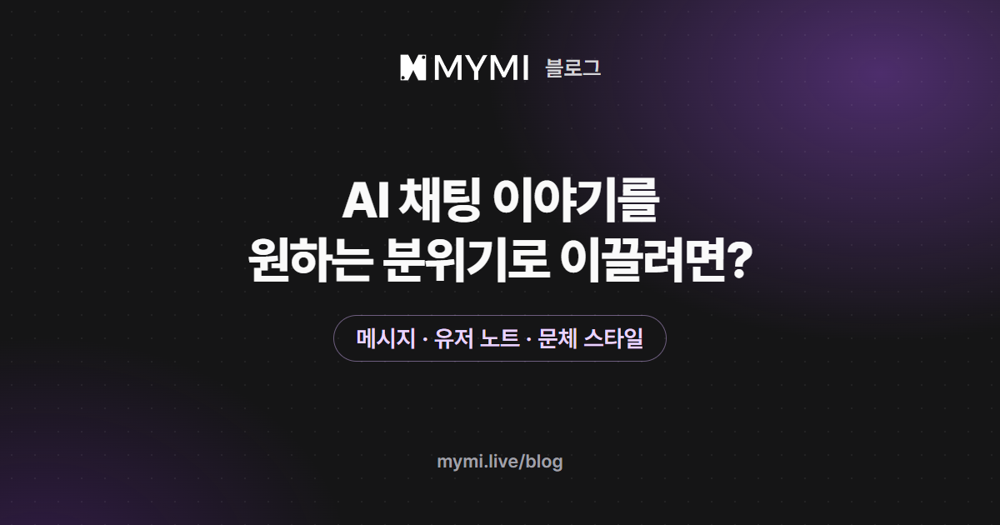

지금 장면은 내 메시지로 이끌고, 이야기 내내 지킬 분위기는 유저 노트에 적어 두세요.



{/* truncate */}

잔잔한 일상을 바랐는데 장면마다 사건이 터지고, 숨죽인 추리를 기대했는데 대화가 자꾸 풀어져 버리곤 해요. 분위기를 돌리는 손잡이는 한 곳에 모여 있지 않아서, 얼마나 오래 바꾸고 싶은지부터 정하면 어디를 만질지 고르기 쉬워요.

## 답의 분위기는 무엇이 정하나요?

AI는 답을 쓸 때마다 작품에 적힌 인물과 세계 설정, 채팅 설정에서 고른 문체 스타일, 최근에 주고받은 대화, 방금 보낸 내 메시지를 함께 읽어요. 작품 설정은 매번 들어가는 바탕이라, 작품의 성격과 정반대인 분위기는 잠깐 나와도 오래 이어지지 않기 쉬워요. 몇 번 이어진 분위기도 다음 답으로 그대로 넘어가기 쉬워서, 흐름이 굳기 전에 손대는 편이 수월해요.

MYMI에서 분위기를 바꿀 수 있는 곳을 바뀌는 범위로 나누면 이래요(2026년 11월 4일 기준).

| 바꾸고 싶은 범위 | 쓸 것 | 있는 곳 |
|---|---|---|
| 지금 장면 | 내가 보내는 메시지 | 입력창 |
| 답 한 번(다음 답이나 방금 받은 답) | 이어서 진행 창이나 다시 생성 창의 선택지 | 입력창을 비웠을 때 나오는 ≫ 버튼, 마지막 답 아래 둥근 화살표 |
| 이 채팅방 내내 | 유저 노트(로그인했을 때) | ⋮ 메뉴의 채팅 설정 |
| 이 브라우저나 앱에서 여는 모든 채팅방 | 문체 스타일, 스토리 부스터, AI 모델(로그인했을 때) | ⋮ 메뉴의 채팅 설정, 입력창 왼쪽 ⚡ 버튼 |

표의 채팅 설정은 채팅방 오른쪽 위 ⋮ 메뉴를 열면 가운데 '채팅 설정' 묶음에 모여 있어요.

<Screenshot src={require('./img/ai-story-mood/settings.webp').default} alt="채팅방 점 세 개 메뉴를 열면 보이는 채팅 설정 묶음에 유저 노트, 페르소나, 문체 스타일(소설형), 스토리 부스터, 사칭 허용, 한 컷이 차례로 있는 화면" caption="⋮ 메뉴 → 채팅 설정" device="part" />

## 지금 장면은 메시지로 어떻게 이끄나요?

'분위기를 달달하게 해 줘'라고 부탁하기보다, 내 캐릭터가 그 분위기에 맞게 움직이고 장면에 그 분위기의 재료를 놓아 주는 쪽이 이야기 안에서 자연스럽게 이어져요. AI는 내 메시지에 담긴 행동과 말, 주변의 소리나 빛을 받아 다음 장면을 그리기 때문이에요. 퇴근길 버스 정류장에서 상대 캐릭터와 마주친 순간을 설명을 위해 지어내, 바라는 분위기에 따라 세 가지로 써 봤어요.

| 바라는 분위기 | 보내는 메시지 | 담은 재료 |
|---|---|---|
| 다정하게 | `*우산을 상대 쪽으로 조금 기울인다* 오늘 꽤 춥죠. 따뜻한 거 하나 사 갈래요?` | 작은 배려, 느긋한 말 |
| 긴장감 있게 | `*휴대폰을 내밀며 목소리를 낮춘다* 모르는 번호로 온 문자예요. 우리 둘 이름이 같이 적혀 있어요.` | 설명되지 않은 일, 낮고 짧은 말 |
| 가볍게 | `*눈앞에서 떠나는 버스를 멍하니 본다* 저 버스, 방금 저 보고 웃으면서 간 거 맞죠?` | 엉뚱한 말, 과장된 반응 |

메시지의 길이와 빠르기도 분위기를 만들어요. 짧은 대사를 빠르게 주고받으면 장면이 급해지고, 감각과 망설임을 천천히 적으면 장면도 느려지기 쉬워요.

이야기 밖에서 짧게 부탁하고 싶다면 메시지 끝에 괄호로 적어도 돼요. 역할극에서 '캐릭터 밖의 말'이라는 뜻으로 흔히 쓰는 OOC 표시를 붙여 `(OOC: 이 장면은 큰 사건 없이 잔잔하게 이어 줘)`처럼 쓰면, AI가 이야기 속 대사와 구분하기 쉬워요. 보낸 메시지는 대화 기록에 남아 뒤의 답에서도 다시 읽히니, 한 장면에만 쓸 부탁이었다면 장면이 바뀔 때 다음 메시지에서 풀어 주세요.

## 차례를 넘길 때는 방향을 어떻게 고르나요?

내 차례를 건너뛰고 싶다면 입력창을 비워 두세요. 보내기 버튼이 ≫(이어서 진행)으로 바뀌고, 누르면 이야기를 어느 쪽으로 이어 갈지 고르는 창이 떠요. '그냥 이어서' 아래의 방향을 고르면, 그 방향이 이번 답 한 번에만 AI에게 요청으로 붙어요. '그냥 이어서'를 포함해 어느 줄을 골라도 내 캐릭터의 말과 행동은 쓰지 말라는 요청이 함께 가요.

<Screenshot src={require('./img/ai-story-mood/direction.webp').default} alt="입력창을 비운 채 이어서 진행 버튼을 누르면 열리는 창에 그냥 이어서, 시간 경과, 장면 전환, 사건 발생, 새 인물 등장 다섯 줄이 있는 화면" caption="이어서 진행 창(화면 속 작품 「한이겸」 · 초코바나나딸기)" device="part" />

| 고르는 방향 | AI에게 가는 요청 | 분위기를 바꿀 때 |
|---|---|---|
| 시간 경과 | 시간이 흐른 뒤로 넘어가고, 그사이 일은 짧게 정리하기 | 감정이 가라앉을 시간을 두고 싶을 때 |
| 장면 전환 | 새 장소나 상황으로 옮기기 | 무거워진 장면을 끝내고 숨을 돌리고 싶을 때 |
| 사건 발생 | 예상치 못한 사건으로 이야기를 움직이기 | 늘어진 장면에 긴장을 넣고 싶을 때 |
| 새 인물 등장 | 지금 장면에 새 인물을 들이기 | 둘만 있던 장면에 다른 기류를 더하고 싶을 때 |

어느 방향을 골라도 답 하나를 새로 받는 것이라 그만큼 스파크가 들어요. 고른 방향은 그 답에 함께 남아서, 그 답을 다시 생성하면 다시 생성 창에서 무엇을 고르든 처음 방향이 따라붙어요. '사건 발생'으로 받은 답은 다시 받을 때마다 사건을 일으켜 달라는 요청이 다시 붙으니, 다른 방향으로 받고 싶다면 그 답을 휴지통 버튼으로 지우고 ≫ 버튼에서 다시 고르세요. 다시 생성해 받은 다른 버전도 함께 지워지고, 지운 답은 다시 살릴 수 없어요.

## 방금 받은 답만 어긋났다면?

마지막 답 아래 둥근 화살표는 다시 생성 창을 열어요. 창 아래 칸에는 바라는 결을 직접 적을 수 있는데(2026년 11월 4일 기준 150자까지), '대사는 줄이고 빗소리를 길게' 같은 짧은 주문이면 충분해요. 유저 노트에 적어 둔 분위기에서 벗어났다면 '유저 노트대로'를, 같은 몸짓과 대사가 되풀이돼 늘어졌다면 '반복 없이'를 고르면 돼요. 여기서 고른 요청은 이번 다시 생성에만 쓰이고, 새 답 하나를 받는 만큼 스파크가 들어요.

<Screenshot src={require('./img/ai-story-mood/regenerate.webp').default} alt="마지막 답 아래 둥근 화살표로 연 다시 생성 창에 그냥 다시 생성, 캐릭터 설정대로, 유저 노트대로, 반복 없이, 내 행동 빼기와 바라는 결을 적는 칸이 있는 화면" caption="다시 생성 창. 맨 아래 칸에 바라는 결을 직접 적어요(화면 속 작품 「한이겸」 · 초코바나나딸기, 캐릭터의 답변은 AI가 생성한 내용)" device="part" />

## 이야기 내내 같은 분위기를 지키려면?

한 채팅방에서 오래 지키고 싶은 분위기는 유저 노트에 적어 두세요. 노트에 적은 글은 이 채팅방에서 받는 답마다 따라붙어서, 같은 부탁을 메시지마다 다시 쓰지 않아도 돼요. '달달하게'처럼 한 낱말로 적기보다 그 분위기에서 일어날 일과 일어나지 않을 일, 전개의 빠르기, 지금 두 인물 사이의 거리를 적으면 AI가 따라가기 쉬워요. 예를 들면 이렇게요.

```text
이 이야기는 잔잔한 일상물이다. 다치거나 목숨이 걸린 사건은 일어나지 않는다.
설렘은 우산을 나눠 쓰거나 커피를 사 오는 것 같은 작은 행동으로 천천히 쌓는다.
두 사람은 아직 서로의 이름 정도만 아는 사이라, 손을 잡는 장면은 서두르지 않는다.
```

유저 노트에는 3,000자까지 적을 수 있어요(2026년 11월 9일 기준). 길면 메시지마다 스파크가 더 들 수 있어요. 노트는 채팅방마다 따로라서, 새 대화로 시작한 채팅방이나 다른 작품에서는 비어 있어요. 로그인한 뒤에만 열리니, 가입 전 체험에서는 메시지로 분위기를 이끌어 주세요. 분위기를 바꾸고 싶어지면 노트부터 고쳐 두세요. 노트와 메시지가 서로 다른 분위기를 말하면 답이 오락가락하기 쉬워요. 잊어버린 설정을 노트로 메우는 법은 [AI 캐릭터는 왜 지난 대화를 잊을까?](./ai-character-memory.md)에서 다뤘어요.

## 문체 스타일과 스토리 부스터는 무엇을 바꾸나요?

이 두 가지는 채팅방마다 따로 고르는 값이 아니에요. 지금 쓰는 브라우저나 앱 하나에 값이 하나씩 남아서, 거기서 여는 모든 채팅방의 다음 답부터 쓰여요.

문체 스타일은 같은 장면을 어떤 문장과 빠르기로 풀어 갈지를 정해요.

<Screenshot src={require('./img/ai-story-mood/style.webp').default} alt="문체 스타일 창에 작품 그대로, 소설형(골라져 있음), 라노벨형, 웹소설형, 로맨스형이 있는 화면" caption="문체 스타일 창. 처음에는 소설형이 골라져 있어요" device="part" />

| 문체 스타일 | 답이 이렇게 달라져요 | 어울리는 이야기 |
|---|---|---|
| 작품 그대로 | MYMI가 문체를 따로 주문하지 않아, 작품 원문의 글맛이 기준이 돼요 | 제작자가 정한 문체를 그대로 느끼고 싶을 때 |
| 소설형(처음 설정) | 감각 묘사가 풍부하고, 감정과 긴장이 천천히 쌓여요 | 무게 있는 감정선, 깊은 몰입 |
| 라노벨형 | 가볍고 경쾌한 대사가 중심이고, 웃음이 섞여요 | 코미디, 게임·이세계 판타지. 다른 장르에도 스탯·레벨업 같은 게임 말이 섞일 수 있어요 |
| 웹소설형 | 문단이 짧고, 답마다 무언가가 바뀌며 이동이나 준비 장면은 건너뛰어요 | 빠른 전개, 사건과 액션 |
| 로맨스형 | 두 사람의 관계가 중심이고, 계기가 있을 때 마음이 조금씩 움직여요 | 천천히 가까워지거나 멀어지는 연애 |

처음 설정인 소설형은 긴장이 오르는 장면을 더 가깝고 아슬아슬하게 그리는 쪽이라, 가볍게 가고 싶다면 라노벨형, 잔잔하게 가고 싶다면 작품 그대로와 먼저 견줘 보세요. 같은 문체라도 모델마다 문장의 결이 달라요. 모델은 로그인한 뒤 입력창 왼쪽 ⚡ 버튼으로 고르고, 모델마다 답 한 번의 값이 다르니 모델 선택 창의 가격을 먼저 보세요.

스토리 부스터는 처음에 꺼져 있어요. 켜면 AI가 내 말과 행동에 반응하는 데 그치지 않고, 사건이나 갈등, 감정이 바뀌는 순간을 먼저 만들어 이야기를 밀어요. 긴장이나 친밀함을 차츰 키우라는 지시도 함께 가서, 모험이나 스릴러뿐 아니라 연애의 진도도 빨라질 수 있어요. 이 지시는 유저 노트 바로 뒤에 붙기 때문에, 노트에 큰 사건 없이 가자고 적어 둔 채팅방에서 켜 두면 두 말이 부딪쳐요. 모험물을 하며 켜 둔 부스터는 잔잔한 이야기로 돌아와도 그대로 걸려 있으니, 돌아올 때 꺼져 있는지 먼저 보세요.

## 자주 묻는 질문

<details>
<summary>캐릭터가 계속 차갑게만 굴어요. 다정해지게 할 수 있나요?</summary>

작품 설정에 적힌 성격은 답마다 함께 읽혀서, 다정하게 대해 달라는 부탁만으로는 오래가지 않기 쉬워요. 두 사람 사이에 마음이 움직일 만한 일을 이야기 안에서 만들어 보세요. 로맨스형 문체는 그런 계기가 있을 때 관계가 조금씩 움직이도록 쓰고, 부탁이나 친절만으로는 성격이 누그러지지 않게 해요. 차가운 성격이 작품의 중심이라면 성격은 그대로 두고 표현이 달라지는 쪽이 자연스러워요.

</details>

<details>
<summary>마음에 들었던 분위기의 장면으로 돌아가고 싶어요</summary>

지나간 답 아래에도 책갈피가 있어서, 그 장면에 북마크를 걸고 거기서부터 새 채팅방으로 갈라져 나갈 수 있어요. 북마크를 걸고 분기하는 차례는 유저가이드 [채팅방 설정하기](https://www.mymi.live/guide/chatting/chat-room-settings#북마크와-분기-만들기) 안내를 따라가면 돼요. 분위기를 되살릴 때 챙길 것은 설정이에요. 문체 스타일과 스토리 부스터는 지금 이 브라우저나 앱의 값으로, 유저 노트는 분기하는 때의 내용으로 이어지니, 그 장면 뒤에 분위기를 바꿔 두었다면 새 채팅방에서 먼저 되돌려 두세요. 북마크를 건 답과 그 앞의 대화는 북마크를 지운 뒤에도 다시 생성하거나 고치거나 지울 수 없어요.

</details>

<details>
<summary>가입하기 전에도 분위기를 바꿀 수 있나요?</summary>

네. 메시지로 이끄는 방법, 이어서 진행과 다시 생성 창, 채팅 설정의 문체 스타일과 스토리 부스터는 로그인하지 않아도 쓸 수 있어요. 이어서 진행이나 다시 생성으로 받은 답도 로그인 전 체험 횟수에서 한 번씩 빠져요. 유저 노트와 모델 바꾸기는 로그인해야 쓸 수 있어요.

</details>

<details>
<summary>분위기를 바꾸는 데도 스파크가 드나요?</summary>

설정을 바꾸거나 유저 노트를 저장하는 데는 들지 않아요. 이어서 진행 창에서 방향을 골라 답을 받거나 다시 생성으로 새 답을 받을 때는, 메시지를 보내 답을 받을 때처럼 답 하나만큼 들어요.

</details>

처음부터 원하는 분위기로 열고 싶다면 [남성향 AI 채팅 추천](./male-oriented-ai-chat.md)과 [여성향 AI 연애 채팅 추천](./female-oriented-ai-chat.md)에서 작품마다 어떤 장면으로 시작하는지 먼저 읽어 보고, [MYMI](https://www.mymi.live/ko?utm_source=mymi_blog&utm_medium=referral&utm_campaign=global_content_2026q4&utm_content=ko_blog_ai_story_mood)에서 고른 작품의 첫 메시지를 그 분위기로 보내 보세요. 분위기를 밀다가 답에 내 대사가 섞여 들면 [AI가 내 대사까지 쓸 때](./ai-writes-my-lines.md)가 이어 읽기 좋은 글이에요. 스위치가 있는 자리는 유저가이드 [채팅방 설정하기](https://www.mymi.live/guide/chatting/chat-room-settings)에 있고, 대화하다 막히는 다른 문제는 [MYMI 블로그](https://www.mymi.live/blog) 첫 화면에서 골라 읽을 수 있어요.

_2026년 11월 9일 고침: 유저 노트에 적을 수 있는 글자가 3,000자로 늘어난 것을 반영했어요._
