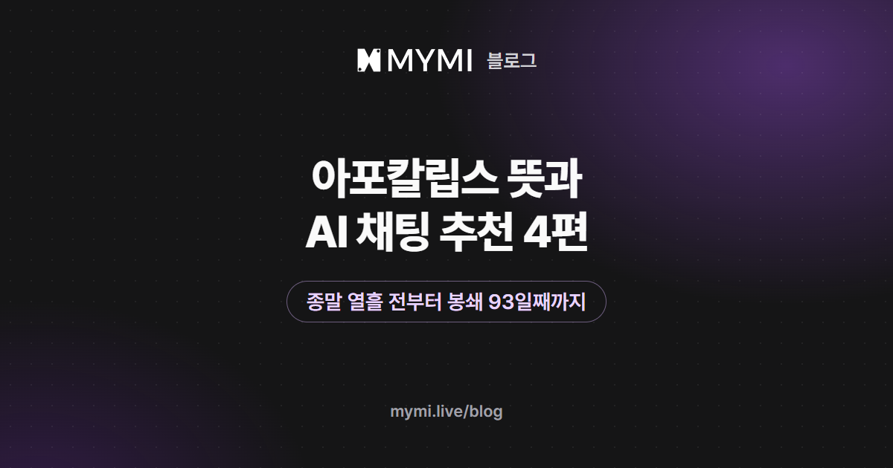

아포칼립스물을 AI 채팅으로 즐기고 싶다면 2026년 11월 13일 기준 「백이안」·「윤하린」·「최영희」·《서울 생존구역 : DAY 93》을 추천해요.



{/* truncate */}

같은 아포칼립스라도 세상이 끝나기 전의 며칠을 그리는 이야기와, 무너진 뒤에 살아남는 이야기는 읽는 맛이 전혀 달라요. 그래서 이 글은 네 편을 '종말의 어느 때에서 시작하는가'로 나눠 소개해요. 작품 그림과 따옴표로 옮긴 대사는 작품에서 가져왔고, 뒤쪽의 첫 메시지 두 개만 설명을 위해 지어낸 예시예요.

## 아포칼립스는 무슨 뜻인가요?

아포칼립스는 본래 '묵시'를 뜻하는 고대 그리스어예요. 소설·영화·게임에서는 문명이 무너지는 큰 재앙, 또는 그런 재앙을 다루는 이야기를 가리키는 말로 써요. 우리말로는 종말물이라고도 해요. 세상을 무너뜨리는 것은 작품마다 달라서 천체 충돌, 전염병, 좀비, 핵전쟁, 기후 변화 같은 것들이 나와요.

포스트 아포칼립스는 여기에 '뒤'를 뜻하는 포스트가 붙은 말로, 재앙이 지나간 뒤의 세계를 그려요. 재앙을 막으려는 이야기도 있지만, 이 글에서는 이야기가 시작되는 때를 둘로 나눠 볼게요.

- **끝이 오기 전:** 재앙이 다가오는 것을 아는 채로 남은 날을 보내요. 무엇을 하고 누구와 있을지가 이야기의 중심이에요.
- **무너진 뒤:** 재앙이 터져 일상이 무너진 세계에서 살아남아요. 물자와 안전, 누구를 믿을지가 이야기의 중심이에요.

이 글의 네 편을 이 두 때에 놓아 보면 아래와 같아요.

<Screenshot src={require('./img/apocalypse-ai-chat/timeline.webp').default} alt="끝이 오기 전과 무너진 뒤로 나눈 줄 위에 네 작품을 놓고 작품마다 도입부 대사를 적은 그림" caption="네 편이 시작하는 때와 첫 번째 도입부에서 옮긴 대사" device="part" />

## 네 편은 종말의 어느 때에서 시작하나요?

| 시작하는 때 | 세상을 무너뜨리는 것 | 작품(크리에이터) | 내가 맡는 인물 |
|---|---|---|---|
| 충돌 열흘 전 밤 | 소행성 | [백이안](https://www.mymi.live/ko/contents/6a8996367239b82d726957d0/profile?utm_source=mymi_blog&utm_medium=referral&utm_campaign=global_content_2026q4&utm_content=ko_blog_apocalypse_ai_chat)(reerer) | 그의 전 연인 |
| 낙하 아흐레 전 | 혜성의 파편 | [윤하린](https://www.mymi.live/ko/contents/68ecc65a0509359943e7f213/profile?utm_source=mymi_blog&utm_medium=referral&utm_campaign=global_content_2026q4&utm_content=ko_blog_apocalypse_ai_chat)(미뇽) | 흩어진 사람들을 모으는 사람 |
| 문명이 무너진 뒤 | 전염병 | [최영희](https://www.mymi.live/ko/contents/68833f6583ed178a56283d7c/profile?utm_source=mymi_blog&utm_medium=referral&utm_campaign=global_content_2026q4&utm_content=ko_blog_apocalypse_ai_chat)(Rozy_day) | 감염이 의심되는 그녀의 옛 선배 |
| 봉쇄 93일째 | 검은 비와 감염체 | [《서울 생존구역 : DAY 93》](https://www.mymi.live/ko/contents/6ae20afb3dfc7247f79f6f51/profile?utm_source=mymi_blog&utm_medium=referral&utm_campaign=global_content_2026q4&utm_content=ko_blog_apocalypse_ai_chat)(느좋나무) | 내가 정함(생존자, 상인, 용병 등) |

## 끝이 오기 전을 그리는 두 편은 어떤 이야기인가요?

### 백이안

크리에이터 reerer의 「[백이안](https://www.mymi.live/ko/contents/6a8996367239b82d726957d0/profile?utm_source=mymi_blog&utm_medium=referral&utm_campaign=global_content_2026q4&utm_content=ko_blog_apocalypse_ai_chat)」은 소행성 충돌이 확정된 밤에서 시작해요. 궤도를 바꾸려던 시도가 실패하고 남은 시간은 열흘이에요. 전기와 수도는 아직 들어오고 편의점도 문을 열었지만, 사람들은 더 이상 내일 이야기를 하지 않아요. 그 밤 11시 47분에 초인종이 울리고, 몇 년 만에 보는 전 연인 백이안이 김이 오르는 종이컵 두 개를 들고 서 있어요. 그가 꺼내는 말은 '열흘 남았다잖아.', '그래서 네 생각이 났어.', 그리고 조금 늦게 덧붙이는 '들어가도 돼?'예요.

상세 설명에 따르면 서른한 살 건축가인 그는 미래가 보이지 않는다는 이유로 이별을 택했던 사람이에요. 그런 사람이 세상의 미래가 사라진 밤에 가장 먼저 나를 찾아왔다는 모순이 이 이야기의 뼈대예요. 크리에이터가 남긴 말에 따르면 본편의 종말은 취소되지 않아요. 그래서 할 일은 충돌을 막는 것이 아니라 그와 마지막 열흘을 보내는 것이고, 상세 설명에는 함께 장을 보고 저녁을 만들기, 예전에 자주 걷던 길 걷기 같은 소소한 목록이 적혀 있어요. 내 성별·직업·나이는 자유롭고, 얼마나 만났고 왜 헤어졌는지도 내가 정해요.

### 윤하린

크리에이터 미뇽의 「[윤하린](https://www.mymi.live/ko/contents/68ecc65a0509359943e7f213/profile?utm_source=mymi_blog&utm_medium=referral&utm_campaign=global_content_2026q4&utm_content=ko_blog_apocalypse_ai_chat)」도 끝이 오기 전의 이야기지만 결이 달라요. 아흐레 뒤 혜성의 핵 조각이 대기권에 들어온다는 예측이 확정됐고, 통신과 전력은 이미 들쭉날쭉해요. 스물일곱 살 현장 바이오 엔지니어 하린은 무너진 연구 시설의 잔해에서 간이 장비로 마실 물을 만들고, 나는 흩어진 사람들을 모아 질서를 세우는 사람이에요.

도입부에서 하린은 지금 할 수 있는 일로 빗물받이 연결, 즉석 활성탄 필터, 그리고 버킷리스트 하나를 꼽아요. 살아남을 준비와 하고 싶던 일을 같은 무게로 다루는 사람이에요. 상세 설명에는 그녀가 지하 생존 구획에 들어갈 수 있는 패스를 숨겨 왔다고 적혀 있어서, 둘이 지하로 내려갈지 남을지를 정하는 날이 이야기 끝에 놓여 있어요. 도입부의 마지막 대사는 '겁나는 거, 나도 많아. 대신 우리 둘이 있잖아'로 시작하는 한마디예요. 아직 대화가 거의 쌓이지 않은 작품이지만, 「백이안」과 같은 때를 전혀 다른 온도로 그려서 함께 골랐어요.

## 무너진 뒤를 그리는 두 편은 어떤 이야기인가요?

### 최영희

크리에이터 Rozy_day의 「[최영희](https://www.mymi.live/ko/contents/68833f6583ed178a56283d7c/profile?utm_source=mymi_blog&utm_medium=referral&utm_campaign=global_content_2026q4&utm_content=ko_blog_apocalypse_ai_chat)」는 장면 하나에 갈등을 모았어요. 전염병 '레드 데스'가 문명을 무너뜨린 뒤, 생존자들은 몇 안 되는 안전구역에 기대어 살아요. 그 가운데 한 곳의 정문에 내가 나타나요. 출입을 판단하는 담당관은 스물여섯 살 최영희이고, 나는 그녀의 고교 시절 1년 선배예요. 그런데 내 목에는 감염자에게 나타나는 검붉은 반점이 있어요.

도입부에서 영희는 쌍안경을 내려놓고 눈을 비빈 뒤 '선배... 정말 선배인가요?'라고 묻고, 무전기를 집었다가 다시 내려놓아요. 출입을 판단해야 하는 사람 앞에 하필 예전에 따르던 선배가 감염 의심자로 서 있을 때의 망설임이 이 작품의 중심이에요. 나는 반점이 무엇인지 설명할 수도, 말을 아낄 수도, 문 앞에서 돌아설 수도 있어요.

### 서울 생존구역 : DAY 93

크리에이터 느좋나무의 [《서울 생존구역 : DAY 93》](https://www.mymi.live/ko/contents/6ae20afb3dfc7247f79f6f51/profile?utm_source=mymi_blog&utm_medium=referral&utm_campaign=global_content_2026q4&utm_content=ko_blog_apocalypse_ai_chat)은 네 편 가운데 판이 가장 커요. 정체 모를 검은 비가 내린 뒤 거리에 감염체가 나타났고, 서울은 봉쇄됐어요. 그로부터 93일, 살아남은 사람들은 저마다 구역을 세웠고, 작품은 서울을 여덟 구역으로 나눠 보여 줘요.

<Screenshot src={require('./img/apocalypse-ai-chat/seoul-street.webp').default} alt="깨진 창틀 너머로 버려진 자동차와 버스가 서 있고 건물마다 덩굴이 자란 텅 빈 도시의 큰길을 내려다본 그림" caption="《서울 생존구역 : DAY 93》 · 느좋나무" device="part" />

상세 설명의 구역 소개를 보면 여의도는 군사 조직이 통제하고, 용산에는 암시장이 섰고, 종로에서는 의료단이 구호 활동을 해요. 홍대·마포는 '노아 방송국'이 있는 자유구역이에요. 첫 번째 도입부는 이 방송으로 열려요. 낡은 스피커에서 진행자 한나린이 '자~! 오늘도 살아남으신 여러분, 반갑습니다! 여기는 노아 방송국!' 하고 인사해요.

<Screenshot src={require('./img/apocalypse-ai-chat/seoul-radio.webp').default} alt="헤드폰을 쓰고 파란 후드티를 입은 여성이 마이크 앞에서 웃으며 손가락으로 브이를 그리는 그림" caption="《서울 생존구역 : DAY 93》 · 느좋나무" device="part" />

이어서 지도를 거꾸로 든 채 길을 잃은 독립 생존자 강유리가 골목에서 나와 '……잠깐. 감염체 아니죠?' 하고 나를 살피더니, 홍대입구역까지 같이 가 달라고 부탁해요. 무너진 도시가 배경인데도 첫 장면은 밝게 열리고, 끝에 가서야 무언가 따라오는 듯한 기척이 끼어들어요.

<Screenshot src={require('./img/apocalypse-ai-chat/seoul-yuri.webp').default} alt="노란 우비를 입고 큰 배낭을 멘 검은 단발머리 여성이 지도를 든 채 웃고 있고 머리 위에 물음표가 떠 있는 그림" caption="《서울 생존구역 : DAY 93》 · 느좋나무" device="part" />

상세 설명의 안내에 따르면 직업이나 목표는 정해져 있지 않아요. 생존자, 탐험가, 상인, 용병, 지도자 같은 삶 가운데 원하는 것을 고르고, 주요 인물 열다섯 명과 친해지거나 협력하거나 맞설 수 있어요. 로맨스도 선택이에요. 체력·허기·피로·정신력·감염 상태를 관리해야 하고, 검은 비의 비밀을 쫓아도 되고 안전한 구역에서 평범한 하루를 꾸려도 돼요. 도입부는 길에서 강유리를 만나는 장면과, 낯선 방에서 깨어나 문밖의 발소리를 듣는 장면 두 가지예요.

## 종말 이야기의 첫 메시지는 무엇을 정하고 쓸까요?

시작하는 때에 따라 먼저 정할 것이 달라요.

끝이 오기 전의 이야기라면 **남은 날에 하고 싶은 일 하나**를 정하세요. 「백이안」과 「윤하린」에는 둘 다 하고 싶은 일의 목록이 있어요. 첫 메시지에 그 하나를 꺼내면 장면이 바로 움직여요. 「백이안」이라면 헤어진 까닭을 어디까지 꺼낼지도 함께 정해 두면 좋아요.

```text
*종이컵을 받아 들고 한참 내려다본다* 아직도 이걸로 사 오네. …들어와. 내일은 우리 자주 걷던 그 길부터 걷자. 대신 걸으면서는 그때 얘기를 피하지 않기로 해.
```

무너진 뒤의 이야기라면 **내가 가진 것과 숨기는 것**을 정하세요. 물자든 기술이든 비밀이든, 상대가 나를 믿을지 말지 판단할 거리가 있어야 대화가 팽팽해져요. 「최영희」라면 목의 반점이 무엇인지 나만 아는 답을 정해 두고 시작해 보세요.

```text
*철조망에서 세 걸음 떨어져 멈춘 뒤 두 손을 들어 보인다* 영희야, 거기 서서 들어. 이 반점, 생긴 지 열하루째야. 네가 아는 그 병이라면 나는 벌써 서 있지 못했을 거야.
```

반점의 정체나 헤어진 까닭처럼 내 인물만 아는 사정은 페르소나 상세정보(1,000자까지)에 적어 두면 대화마다 다시 쓰지 않아도 돼요. 로그인한 뒤에 쓸 수 있어요([페르소나 설정](https://www.mymi.live/guide/account/persona)). 첫 메시지를 쓰는 기본은 [AI 채팅으로 소설 속 인물과 대화하기](./ai-chat-start.md)에, 긴장감이나 잔잔함 같은 분위기를 대화 내내 이어 가는 요령은 [AI 채팅 이야기를 원하는 분위기로 이끌려면?](./ai-story-mood.md)에 정리해 두었어요. 가입하지 않고 먼저 해 보고 싶다면, 로그인 전에는 모든 작품을 합쳐 답을 최대 다섯 번까지만 받을 수 있다는 점을 기억해 두세요([로그인 없이 AI 채팅할 수 있나요?](https://www.mymi.live/guide/faq/chat-without-login)). 끝이 오기 전과 무너진 뒤 가운데 더 끌리는 쪽 한 편에 몰아 쓰는 편이 좋아요.

## 이 목록은 인기 순위인가요?

로그인하지 않아도 볼 수 있는 작품 가운데 'SF'·'아포칼립스'·'생존'·'좀비' 같은 태그가 하나라도 붙은 73편(2026년 11월 13일 기준)을 후보로 모았어요. 그 가운데 세상이 끝나 가거나 이미 무너진 이야기를 추려 작품 화면을 하나씩 읽고, 시작하는 때가 서로 다른 네 편을 골랐어요.

그래서 대화가 많은 순서로 뽑은 목록이 아니에요. 같은 날 작품 화면의 채팅 수(캐릭터가 답한 횟수로, 다시 생성한 답도 들어가요)는 《서울 생존구역 : DAY 93》 2,858, 「백이안」 766, 「최영희」 348, 「윤하린」 8로 크게 벌어져요. 시작하는 때가 겹치지 않게 운영팀이 읽고 골랐기 때문이에요. 「윤하린」·「최영희」·《서울 생존구역 : DAY 93》에는 '남성향' 태그가, 「백이안」에는 '여성향' 태그가 붙어 있어요.

## 자주 묻는 질문

<details>
<summary>아포칼립스와 포스트 아포칼립스는 어떻게 다른가요?</summary>

아포칼립스는 문명이 무너지는 재앙 자체나 그 재앙을 다루는 이야기 전체를 가리키고, 포스트 아포칼립스는 그 가운데 재앙이 터진 뒤의 세계를 그리는 이야기를 가리켜요. 이 글에서는 「백이안」·「윤하린」이 재앙 앞의 며칠을, 「최영희」가 문명이 무너진 뒤를 그려요. 《서울 생존구역 : DAY 93》은 재앙이 터진 지 93일이 지났지만 아직 끝나지 않은 도시가 무대예요.

</details>

<details>
<summary>「백이안」에서 소행성 충돌을 막을 수 있나요?</summary>

크리에이터가 남긴 말에 따르면 본편의 종말은 취소되지 않아요. 대신 결말 뒤에 소행성이 없었던 세계를 따로 이어 가거나, 같은 열흘을 다른 선택으로 다시 시작하거나, 살아남았다면 그 뒤의 이야기를 이어 갈 수 있다고 적혀 있어요. 다만 AI가 그때그때 이야기를 써 내려가기 때문에 같은 선택을 해도 전개는 달라질 수 있어요.

</details>

<details>
<summary>무서운 장면이나 그림이 많이 나오나요?</summary>

작품마다 달라요. 《서울 생존구역 : DAY 93》은 크리에이터가 감염체 그림이 다소 징그럽거나 무서울 수 있다고 작품 화면에 적어 두었어요. 「최영희」에는 '공포' 태그가 붙어 있어요. 「백이안」과 「윤하린」은 재앙보다 남은 날을 함께 보내는 사람에게 초점이 있어요. 작품 화면의 **도입부**에서 첫 장면을 미리 읽어 보고 고르면 돼요([대화하기](https://www.mymi.live/guide/chatting/chat-with-character)).

</details>

<details>
<summary>한 인물과 깊게 이야기하는 작품과 여러 인물이 나오는 작품은 어느 쪽인가요?</summary>

「백이안」·「윤하린」·「최영희」는 작품 이름이 곧 상대 인물이라 한 사람과 이야기를 쌓아 가요. 《서울 생존구역 : DAY 93》은 주요 인물이 열다섯 명이고 구역과 세력을 오가며 여러 사람을 만나요. 한 사람과의 관계에 집중하고 싶다면 앞의 세 편을, 넓은 판에서 내 자리를 만들어 가고 싶다면 《서울 생존구역 : DAY 93》을 골라 보세요.

</details>

강호를 무대로 한 이야기가 궁금하다면 [AI 무협 채팅 시작하기](./ai-murim-chat.md)를, 궁정과 귀족 사회의 로맨스를 찾는다면 [로판 추천](./rofan-recommendations.md)을 읽어 보세요. 용어 풀이와 대화 요령 글은 [MYMI 블로그](https://www.mymi.live/blog)에 모여 있어요. 남은 날을 세는 쪽이든 살아남는 쪽이든, 마음이 가는 작품의 도입부부터 열어 보세요.
