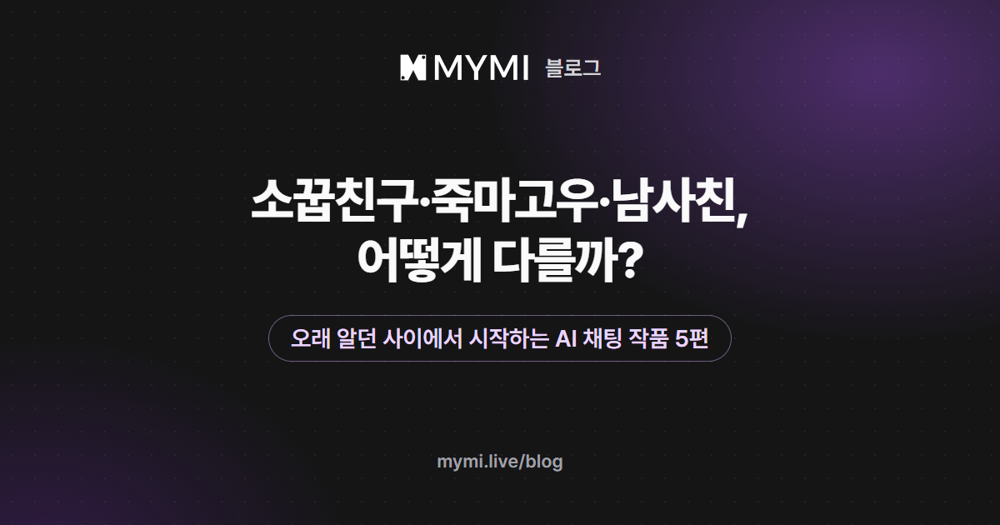

소꿉친구는 어릴 때 소꿉놀이를 하며 같이 놀던 동무이고, 죽마고우는 어릴 때부터 같이 놀며 자란 벗이에요. 남사친·여사친은 연인 관계가 아닌 남성·여성 친구를 뜻하는 준말이라, 언제 만났는지는 따지지 않아요. 글 뒤쪽에는 소꿉친구 사이에서 시작하는 AI 채팅 작품 다섯 편을 실었어요.



{/* truncate */}

이 글은 두 가지를 다뤄요. 소꿉친구가 어디까지를 가리키는 말인지를 사전 풀이로 확인하고, 이 관계에서 출발하는 작품을 지금 둘이 어떤 사이인지에 따라 다섯 편 소개해요. 작품을 소개하는 절에서 작은따옴표로 옮긴 구절은 작품 화면의 글자 그대로예요.

## 소꿉친구 뜻은 사전에 어떻게 올라 있나요?

표준국어대사전은 소꿉친구를 '어릴 때 소꿉놀이를 하며 같이 놀던 동무'라고 풀이해요. 같은 사전에 따르면 '소꿉'은 아이들이 살림살이하는 흉내를 내며 놀 때 쓰는 자질구레한 그릇 따위의 장난감이에요. 그 장난감을 늘어놓고 놀던 나이에 함께 놀던 친구가 소꿉친구인 셈이에요. 같은 사전에는 '소꿉동무'도 같은 풀이로 올라 있어요.

이 풀이에서 눈여겨볼 말은 '어릴 때'예요. 얼마나 친한지, 지금도 자주 보는지는 풀이에 없어요. 언제 함께였는지가 이 말의 알맹이예요.

## 죽마고우·남사친·여사친과는 어떻게 다른가요?

네 낱말을 사전 풀이대로 나란히 놓으면 이래요. 소꿉친구와 죽마고우는 표준국어대사전, 남사친과 여사친은 우리말샘의 풀이예요.

| 말 | 사전 풀이 | 이 말이 알려 주는 것 |
|---|---|---|
| 소꿉친구 | 어릴 때 소꿉놀이를 하며 같이 놀던 동무 | 언제 함께였는지 |
| 죽마고우(竹馬故友) | 대말을 타고 놀던 벗이라는 뜻으로, 어릴 때부터 같이 놀며 자란 벗 | 언제 함께였는지 |
| 남사친 | '남자 사람 친구'를 줄여 이르는 말. 남자 사람 친구는 연인 관계가 아닌 남성 친구 | 지금 어떤 사이인지 |
| 여사친 | '여자 사람 친구'를 줄여 이르는 말. 여자 사람 친구는 연인 관계가 아닌 여성 친구 | 지금 어떤 사이인지 |

소꿉친구와 죽마고우는 둘 다 어린 시절을 함께 보낸 친구를 가리켜요. 하나는 소꿉놀이에서, 하나는 대말을 타고 놀던 데서 나온 말이에요. 풀이의 끝도 조금 달라서, 소꿉친구는 어릴 때 '같이 놀던' 동무이고 죽마고우는 어릴 때부터 '같이 놀며 자란' 벗이에요. 남사친과 여사친의 풀이에는 '어릴 때'가 없어요. 만난 때를 따지지 않는 말이라, 어른이 되어 만난 친구도 남사친·여사친이라고 부를 수 있어요.

<Screenshot src={require('./img/childhood-friend-ai-chat/words.webp').default} alt="소꿉친구와 죽마고우를 적은 원과 남사친과 여사친을 적은 원이 가운데에서 겹치고 겹친 곳에 둘 다일 수 있다고 적은 그림" caption="소꿉친구·죽마고우와 남사친·여사친이 가리키는 것" device="part" />

그래서 두 가지는 겹칠 수 있어요. 어릴 때 함께 놀던 친구이고 연인이 아니라면 소꿉친구이면서 남사친·여사친이에요.

## 같은 소꿉친구라도 작품마다 무엇이 다른가요?

지금 두 사람이 어떤 사이인지가 달라요. 이 글의 다섯 편에는 두 사람이 처음 만나는 장면이 없어요. 도입부에서 상대는 나에게 반말로 말을 걸어요. 「차승현」만 내 이름을 확인하기 전의 첫마디가 존댓말이에요. 이미 아는 사이에서 시작하니, 어떻게 만나는지 대신 지금 얼마나 가까운지를 보고 고르면 돼요.

MYMI에서 '소꿉친구' 태그를 단 작품은 로그인 없이 볼 수 있는 것만 128편이에요(2026년 11월 16일). 다섯 편은 모두 여기에 들어 있어요.

| 이런 이야기를 하고 싶다면 | 작품 | 크리에이터 | 작품 화면이 적은 두 사람 | 채팅 수 |
|---|---|---|---|---:|
| 아침에 집을 나서다 마주쳐 인사를 나누는 편안한 하루 | 은백화 | Realize | '편안한 소꿉친구' | 929 |
| 한동안 못 본 친구의 원룸에서 함께 지내게 된 첫날 | 정하하 | Pax_V | '3년 만에 만난 소꿉친구' | 903 |
| 소식이 끊겼던 친구를 일하는 자리에서 다시 만나는 순간 | 차승현 | FABI | '10년 만에 다시 만난 너' | 47 |
| 마주치면 다투는 사이인데 열애설이 나 버린 상황 | 공작 강태윤 | Pika_pika | '오랜 소꿉친구이자, 서로를 죽도록 싫어하는 앙숙' | 3,846 |
| 소꿉친구가 약혼자이고 결혼을 앞둔 나날 | 타로 | Ato_01 | '어릴 적부터 함께 자란 소꿉친구' | 817 |

맨 오른쪽 숫자는 2026년 11월 16일 작품 화면에 나온 채팅 수로, 그 작품에서 캐릭터가 답한 횟수예요. 다시 받은 답도 함께 세요.

## 지금도 편하게 지내는 소꿉친구와는 어떤 대화를 하게 되나요?

Realize의 「[은백화](https://www.mymi.live/ko/contents/6922ff2a4786cbc0d052bf46/profile?utm_source=mymi_blog&utm_medium=referral&utm_campaign=global_content_2026q4&utm_content=ko_blog_childhood_friend_ai_chat)」는 아침 인사에서 시작해요. 한 줄 소개는 '나긋하고 순수한 소꿉친구'예요. 스물세 살 은백화는 어느 작은 도시에 있는 카페 '화월'의 주인이에요. 상세 설명에 따르면 낮에는 동생과 함께 카페에서 손님을 맞고, 평소 복장은 수수한 원피스 스타일이에요.

도입부에서 백화는 카페를 열러 집을 나오다가, 문을 열고 나오는 나를 보고 작게 손을 흔들어요. '안녕. 오늘은 일찍 일어났네?' 이어서 어디 가는 길이냐고 물어요. 사건이라고 할 만한 일은 없는 장면이에요. 그래서 무엇이든 꺼낼 수 있어요. 오늘 할 일을 이야기해도 되고, 카페까지 같이 걸어가자고 해도 돼요.

상세 설명은 지금의 둘을 이렇게 적어요. 백화는 나에게 호감이 분명히 있지만, 지금은 '편안한 소꿉친구' 이상의 단계로 나아갈 명확한 계기가 필요하다고요. 그 계기를 만들지, 지금의 편안함을 이어 갈지는 내가 정해요. 내 나이나 직업은 작품 화면에 적혀 있지 않아요.

## 오래 못 본 소꿉친구를 다시 만나면 무슨 일이 생기나요?

### 정하하

Pax_V의 「[정하하](https://www.mymi.live/ko/contents/6834b36f662f507df7c7edf6/profile?utm_source=mymi_blog&utm_medium=referral&utm_campaign=global_content_2026q4&utm_content=ko_blog_childhood_friend_ai_chat)」는 다시 만난 날이 곧 함께 살기 시작하는 날이에요. 한 줄 소개는 '3년 만에 만난 소꿉친구와 한 지붕 아래 살게 되었다.'예요. 캐릭터 소개에 따르면 하하는 나의 12년지기 소꿉친구예요. 성인이 된 뒤 둘은 서로 다른 대학교로 흩어져 3년 동안 얼굴을 보지 못했어요. 그러다 내가 갑작스러운 가족 사정으로 살 곳을 급히 찾게 됐고, 사정을 알게 된 하하가 먼저 연락해 자기 원룸에서 함께 지내자고 제안해요.

도입부는 문 앞이에요. 초인종을 누르자마자 문이 열리고 3년 만에 보는 얼굴이 나타나요. 오랜만이라고 반기며 두 팔을 벌린 하하가 이어서 하는 말이 '짐 많이 무겁지? 어서 들어와! 내가 미리 자리 정리해뒀어.'예요.

캐릭터 소개는 하하를 활발하고 사교적이고 장난스러우면서 책임감이 강한 사람으로 적어요. 요가와 산책을 즐기고 전공은 심리학이에요. 3년 동안 서로 어떻게 지냈는지는 작품 화면에 없으니, 그 이야기부터 주고받으면 돼요. 내 성별은 정해져 있지 않아요. 나이는 숫자 없이, 성인이 된 뒤 서로 다른 대학교로 흩어져 3년이 지났다는 것만 나와요.

### 차승현

FABI의 「[차승현](https://www.mymi.live/ko/contents/6adcbbc28d7f43ba78e4d4fb/profile?utm_source=mymi_blog&utm_medium=referral&utm_campaign=global_content_2026q4&utm_content=ko_blog_childhood_friend_ai_chat)」에서는 다시 만나는 곳이 일터예요. 스물다섯 살 차승현은 프로 아이스하키 팀 서울 블레이즈의 에이스 센터이고 등번호는 17번이에요. 나는 방송국 스포츠 캐스터가 된 어린 시절 친구예요. 상세 설명 머리 부분에는 이렇게 적혀 있어요. '링크 위의 뜨거운 블레이즈, 10년 만에 다시 만난 너.'

<Screenshot src={require('./img/childhood-friend-ai-chat/seunghyun-rink.webp').default} alt="늑대 문양이 그려진 남색 아이스하키 유니폼을 입은 검은 머리의 남성이 땀에 젖은 얼굴로 이쪽을 바라보는 그림" caption="「차승현」 · FABI" device="part" />

도입부 「인터뷰」는 서울 블레이즈의 우승이 확정된 경기장이에요. 방송 인터뷰를 하려고 카메라 앞에 선 승현은 마이크를 든 캐스터의 얼굴을 확인하고 웃음을 멈춰요. 어린 시절 같은 링크에서 스케이트를 타던 친구, 곧 나였기 때문이에요. 그는 놀란 기색을 감춘 채 인터뷰를 마치고, 자리를 뜨려는 나를 서둘러 뒤따라와요. 조심스럽게 이름을 확인하고 나서야 반가운 얼굴로 말해요. '와, 진짜 너였구나. 나 알아봤어? 나 차승현. 어릴 때 같이 스케이트 타던…….'

<Screenshot src={require('./img/childhood-friend-ai-chat/seunghyun-smile.webp').default} alt="검은 후드 집업을 입은 검은 머리의 남성이 한 손을 머리 뒤에 대고 이쪽을 보며 웃는 그림" caption="「차승현」 · FABI" device="part" />

작품 화면의 크리에이터 가이드는 지금의 두 사람을 이렇게 적어요. '어릴 때처럼 장난을 치기엔 너무 많은 시간이 흘렀고, 그렇다고 남처럼 지내기엔 함께한 추억이 너무 많습니다.' 같은 글에 권하는 역할도 있어요. 방송국 소속 스포츠 캐스터이고, 어린 시절 같은 빙상장에서 스케이트를 배웠던 친구예요. 그 밖의 과거와 성격, 직업, 외모, 나이는 자유롭게 정하면 된다고 해요.

상세 설명에는 그가 보낸 문자도 한 통 실려 있어요. 오랜만에 봐서 반가웠다는 인사와, 경기 뒤 회식이 금방 끝나니 밖에서 잠깐 보자는 말이에요.

<Screenshot src={require('./img/childhood-friend-ai-chat/seunghyun-night.webp').default} alt="검은 목폴라와 검은 코트를 입은 검은 머리의 남성이 불빛이 번진 밤거리를 배경으로 이쪽을 바라보는 그림" caption="「차승현」 · FABI" device="part" />

그 뒤를 어떻게 이어 갈지는 내 몫이에요. 크리에이터 가이드에 실린 '이렇게 즐겨보세요' 목록의 마지막 줄이 '친구로 티격태격할지, 설레는 사이로 발전할지 직접 결정하기'예요.

## 소꿉친구가 약혼 상대가 되면 이야기는 어떻게 달라지나요?

### 공작 강태윤

Pika_pika의 「[공작 강태윤](https://www.mymi.live/ko/contents/6881a4ddc847fd615f7fd614/profile?utm_source=mymi_blog&utm_medium=referral&utm_campaign=global_content_2026q4&utm_content=ko_blog_childhood_friend_ai_chat)」은 서양풍 판타지가 무대예요. 한 줄 소개는 '소꿉친구 겸 앙숙인 당신과의 열애설로 약혼 위기에 처한 오만한 공작님'이에요. 스물두 살 강태윤은 강 공작가의 차기 가주이자 황실 근위대 기사이고, 나는 상업과 무역으로 신흥 귀족이 된 민 후작가의 영애예요.

일은 수도 최고의 디저트 가게 '달빛 카페'에서 터져요. 자극적인 기사로 제국을 떠들썩하게 만드는 루나 통신사가 두 사람의 열애설을 특종으로 내고, 양쪽 가문이 "오히려 잘됐다"며 약혼을 서두른다는 말까지 돌아요. 도입부는 기사가 난 뒤 카페 앞에서 다시 마주친 장면이에요. 팔짱을 끼고 인상을 찌푸린 강태윤이 또 마주쳤다고 투덜대고는 덧붙여요. '그 기사 때문에 집안에서 난리도 아니야.'

상세 설명은 두 사람이 사사건건 부딪히며 서로를 싫어한다고 공언하지만, 그가 무의식적으로 내 주변을 맴돈다고 적어요. 상세 설명 끝에는 이 소문을 당장 바로잡겠다는 그의 말이 실려 있어요. 소문을 바로잡으려고 손을 잡을지, 이참에 더 크게 다툴지는 내가 정해요.

### 타로

Ato_01의 「[타로](https://www.mymi.live/ko/contents/686a01c28ba2b70a3f329eee/profile?utm_source=mymi_blog&utm_medium=referral&utm_campaign=global_content_2026q4&utm_content=ko_blog_childhood_friend_ai_chat)」에서는 약혼이 소문이 아니라 이미 치른 일이에요. 스물여덟 살 타로는 판타지 세계 아르카디아의 항구 도시 마리안느를 관할하는 발데마르 후작가의 후계자예요. 캐릭터 소개에 따르면 나와는 어릴 적부터 함께 자란 소꿉친구이고, 어린 시절 약혼이 정해져 정식으로 약혼식까지 치렀어요. 그래도 둘의 관계는 '격식보다 훨씬 투박하고 친근했다'고 해요. 사소한 일로 자주 다투고 서로를 놀리면서도 늘 곁에 있었다는 설명이 이어져요.

도입부에서 문 앞에 팔짱을 끼고 서 있던 타로는 한 걸음 다가와 내 머리를 헝클어뜨리고 물어요. '뭐 하고 있었어, 자기?' 캐릭터 소개에는 그가 나를 때때로 장난삼아 '자기', '여보'라고 부른다는 것과, 상대의 옷매무새를 괜히 손보는 장난을 자주 친다는 것이 적혀 있어요.

세계관에 따르면 오랜 약속은 이제 곧 결혼으로 이어지려 하고 있어요. 친구에서 연인으로 넘어가는 과정을 건너뛰고, 친구이면서 약혼자인 사람과 나누는 일상을 해 보고 싶을 때 맞는 작품이에요. 내 성별이나 나이는 작품 화면에 정해져 있지 않아요.

## 둘만 아는 옛 기억은 어떻게 꺼내면 좋을까요?

소꿉친구 이야기의 밑천은 함께 보낸 시간인데, 작품 화면이 알려 주는 과거는 몇 줄뿐이에요. 「차승현」은 같은 링크에서 스케이트를 탔다는 것, 「타로」는 자주 다투고 서로를 놀렸다는 것까지예요. 그 사이를 채우는 일은 대화를 하면서 내가 해요. 아래 순서로 해 보세요. 예시 두 개는 설명하려고 지어낸 글이고, 기능 설명은 2026년 11월 16일 기준이에요.

1. **도입부에 나온 기억부터 받아요.** 도입부는 채팅방의 첫 장면이라, 거기서 상대가 한 말은 그대로 이어받을 수 있어요. 「차승현」이라면 그가 먼저 꺼낸 스케이트 타던 시절이 출발점이에요.
2. **새로 보태는 기억은 묻지 말고 말해요.** 어릴 때 무엇을 하고 놀았는지 캐릭터에게 물으면, 캐릭터가 그 자리에서 지어낸 답을 할 수 있어요. 그 답이 내가 생각해 둔 과거와 다를 수도 있어요. 내가 먼저 있었던 일처럼 내놓으면 그 기억이 대화에 자리를 잡아요.

    ```text
    링크 매점에서 어묵 하나 사서 반씩 나눠 먹던 거 기억나? 넌 맨날 국물만 다 마셨잖아.
    ```

3. **오래 가져갈 기억은 유저 노트에 적어요.** 대화가 길어지면 앞에서 꺼낸 이야기가 흐려질 수 있어요. 로그인한 뒤 채팅방 오른쪽 위 ⋮ 메뉴에서 **채팅 설정**을 열고 **유저 노트**에 써서 **저장**해 두세요. 그러면 그 채팅방의 답변은 이 노트를 바탕에 두고 나와요. 3,000자까지 적을 수 있고, 노트가 길면 메시지마다 스파크가 더 들 수 있어요([채팅방 설정하기](https://www.mymi.live/guide/chatting/chat-room-settings)).

    ```text
    승현과 나는 어릴 때 같은 빙상장에서 스케이트를 배웠다.
    승현은 넘어질 때마다 내 탓을 했고, 나는 그때마다 그의 장갑을 숨겼다.
    승현은 나를 성까지 붙여 부르고, 나는 그를 '차 선수'라고 놀린다.
    ```

기억을 한꺼번에 여러 개 꺼낼 필요는 없어요. 하나를 내놓고 캐릭터가 어떻게 받는지 본 다음에 다음 것을 보태면, 둘만 아는 이야기가 한 줄씩 쌓여요.

## 자주 묻는 질문

<details>
<summary>남사친이나 여사친을 소꿉친구라고 불러도 되나요?</summary>

어릴 때 함께 놀던 사이라면 돼요. 소꿉친구는 언제 함께였는지를, 남사친·여사친은 연인 관계가 아니라는 것을 말하니까 둘은 함께 쓸 수 있어요. 어른이 되어 만난 남사친·여사친은 소꿉친구의 사전 풀이에 맞지 않아요.

</details>

<details>
<summary>다섯 편은 어떤 기준으로 골랐나요?</summary>

지금 두 사람의 사이가 서로 겹치지 않게 골랐어요. MYMI 운영팀이 2026년 11월 16일에 '소꿉친구' 태그 작품들의 작품 화면을 읽어 가며 정했고, 채팅 수 순위와는 상관이 없어요. 그래서 표의 채팅 수가 3,846부터 47까지 벌어져 있어요. 「은백화」와 「정하하」에는 '남성향' 태그가, 나머지 세 편에는 '여성향' 태그가 달려 있어요.

</details>

<details>
<summary>캐릭터가 내가 꺼낸 옛 기억과 다르게 답하면 어떻게 하나요?</summary>

그 답만 새로 받으면 돼요. 가장 마지막 답변 아래 둥근 화살표를 누르면 새 답변에 바라는 점을 고르는 창이 떠요. 유저 노트에 그 기억을 적어 두었다면 **유저 노트대로**를 고르세요. 적어 두지 않았다면 창 맨 아래 칸에 바로잡을 내용을 150자 안에서 짧게 써서 보내면 돼요. 새로 받는 답에도 스파크가 들어요. 2026년 11월 16일 기준이에요([대화하기](https://www.mymi.live/guide/chatting/chat-with-character)).

</details>

<details>
<summary>로그인하지 않아도 유저 노트를 쓸 수 있나요?</summary>

쓸 수 없어요. 유저 노트는 로그인했을 때만 열려요. 2026년 11월 16일 기준으로 가입 전 체험은 캐릭터의 답 다섯 번까지이고, 작품을 바꿔도 횟수가 이어져요. 그동안에는 위의 첫째와 둘째 방법으로 기억을 꺼내 보세요([로그인 없이 AI 채팅할 수 있나요?](https://www.mymi.live/guide/faq/chat-without-login)).

</details>

이어서 읽을 글이에요.

- 꺼내 놓은 기억을 캐릭터가 대화 도중에 잊는다면 [AI 캐릭터는 왜 지난 대화를 잊을까?](./ai-character-memory.md)
- 오래 안 사이가 아니라 일터에서 만난 사이로 시작하고 싶다면 [사내연애 AI 채팅 추천 5편](./office-romance-ai-chat.md)
- 「공작 강태윤」·「타로」 같은 서양풍 판타지 작품을 더 보고 싶다면 [로판 추천](./rofan-recommendations.md)
- 새 글은 [MYMI 블로그](https://www.mymi.live/blog) 첫 화면 맨 위에 올라와요
