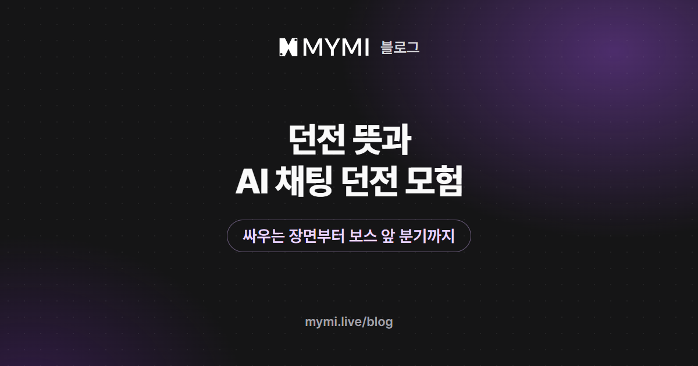

AI 채팅에서 던전을 헤쳐 나갈 때는 한 메시지에 내 행동과 그 목적만 적어 보내고, 어떻게 됐는지는 캐릭터의 답에 맡겨요. 던전은 우리말샘에 '주로 온라인 게임에서, 몬스터들이 모여 있는 소굴.'로 올라 있어요.

{/* truncate */}

## 던전은 원래 어떤 곳을 가리키던 말인가요?

옥스퍼드 영어 학습 사전의 어원 풀이로 보면, 처음에는 감옥보다 성의 탑을 가리키던 말이었을 수 있어요. 이 사전은 지금의 dungeon을 'a dark underground room used as a prison, especially in a castle'로 풀이해요. 특히 성에 있는, 감옥으로 쓰는 어두운 지하 방이라는 뜻이에요. 어원 풀이에 따르면 중세 영어에서는 성의 중심 탑('castle keep')이라는 뜻으로도 썼고, 옛 프랑스어에서는 처음에 '영주의 탑'이라는 뜻이었을 수 있다고 해요. 뿌리는 '영주, 주인'을 뜻하는 라틴어 dominus예요.

우리말의 '던전'은 주로 게임에서 쓰는 말이에요. 우리말샘은 '던전'을 앞의 풀이처럼 온라인 게임의 말로 싣고 있고, 표준국어대사전에는 '던전'이 표제어로 없어요.

우리말샘에는 '인스턴스 던전'도 올라 있어요. '온라인 게임에서, 특정한 개인이나 집단만 입장할 수 있도록 생성된 개별 공간.'이라는 풀이예요(표준국어대사전에는 없어요). AI 채팅의 던전은 이쪽에 가까워요. 같은 작품이라도 채팅방마다 이야기가 따로 흘러가서, 내가 들어간 던전은 내 채팅방에만 있어요.

## AI 채팅 속 던전은 버튼으로 움직이는 게임과 무엇이 다른가요?

버튼으로 공격하고 이동하는 온라인 게임과 견주면 세 가지가 달라요.

- **움직임은 주로 글로 적어요.** 작품에 따라 선택지 버튼이 뜨기도 하지만, 기본은 칼을 뽑거나 문을 미는 행동을 직접 적어 보내는 거예요. 행동을 별표(`*`) 사이에 넣으면 대사와 색이 갈려 장면이 한눈에 들어와요. 별표는 보내기 버튼 바로 왼쪽의 ✱ 버튼으로도 넣을 수 있고, 메시지 하나에는 1,000자까지 적을 수 있어요(2026년 11월 20일 기준).
- **길은 답으로 열려요.** 미리 그려 둔 지도가 없어도 캐릭터의 답이 다음 장면을 그려요. 잠긴 문을 부수고 들어가겠다고 적어도 되고, 문 앞을 지키는 괴물에게 말을 걸어 봐도 돼요. 그 행동이 어떻게 받아들여질지는 작품의 설정과 캐릭터의 답에 달려 있어요.
- **상태창의 숫자도 답의 일부예요.** 작품에 따라 채팅 중에 체력이나 소지품을 보여 주는 상태창이 뜨기도 해요. 크리에이터가 '컴포넌트'로 넣어 둔 이 화면은 숫자를 따로 계산하는 장치가 아니라, AI가 답에 적은 값을 화면으로 보여 줄 뿐이에요([컴포넌트 넣기](https://www.mymi.live/guide/create/components) 안내).

그래서 상태창의 숫자가 어긋날 때가 있어요. 물약을 마신 적이 없는데 체력이 가득 찼다면 다음 메시지에서 짚어 주세요. 설명을 위해 지어낸 예를 들면 `방금 물약은 안 마셨는데 체력이 왜 다 찼어?`처럼요.

<Screenshot src={require('./img/dungeon-ai-chat/compare.webp').default} alt="버튼으로 움직이는 게임과 AI 채팅 속 던전을 두 칸으로 나란히 놓고 움직이는 방법과 길이 열리는 방법과 체력 숫자를 정하는 쪽을 비교한 그림" caption="버튼으로 움직이는 게임과 AI 채팅 속 던전" device="part" />

## 싸우는 장면은 어떻게 주고받나요?

내가 적은 행동이 어떻게 끝났는지는 비워 두세요. 한 메시지에 내 행동 하나와 그 목적만 적으면, 막아 냈는지 놓쳤는지는 캐릭터의 답이 정해요. 결과까지 적어 버리면 캐릭터가 받아칠 자리가 줄어요. 설명을 위해 지어낸 두 메시지로 비교해 볼게요.

- 결과를 비운 메시지: `*방패를 들고 동료 앞으로 나선다* 내가 막을게, 그동안 주문 외워!`
- 결과까지 정한 메시지: `*검을 한 번 휘둘러 고블린 셋을 모두 쓰러뜨린다*`

앞의 메시지는 공격을 막아 냈는지, 동료의 주문이 제때 끝났는지를 캐릭터의 답에 맡겨요. 뒤의 메시지는 싸움을 혼자 끝내 버려서 다음 장면으로 넘길 긴장이 남지 않아요.

<Screenshot src={require('./img/dungeon-ai-chat/turn.webp').default} alt="지어낸 두 메시지를 나란히 놓은 그림으로 왼쪽은 방패를 들고 나서며 결과를 비운 메시지이고 오른쪽은 고블린 셋을 모두 쓰러뜨렸다고 결과까지 정한 메시지다" caption="결과를 비운 메시지와 결과까지 정한 메시지(지어낸 예시)" device="part" />

맡기는 것은 내가 적은 행동의 결과까지예요. 캐릭터의 답이 내가 적지 않은 행동이나 말까지 정해 버릴 때도 있어요. 막아서려던 내가 몸을 굴려 피했다거나, 하지 않은 말을 했다고 적는 식이에요. 그 답이 가장 마지막 답이라면 둥근 화살표(**다시 생성하기**)를 누르고 **내 행동 빼기**를 골라 다시 받아 볼 수 있어요. 다시 받는 답도 받을 때마다 스파크가 들어요. 이런 답이 왜 나오는지는 [AI가 내 대사까지 쓸 때](./ai-writes-my-lines.md)에서 다뤘어요.

## 던전에서 이야기가 멈추면 어떻게 하나요?

입력창을 비운 채 ≫ 버튼을 누르면 이야기를 이어 갈 방향을 고를 수 있어요. 같은 통로를 맴도는 것 같다면 **장면 전환**을 골라 다음 층으로 넘어가 보는 식이에요. 무엇이 나올지는 여전히 캐릭터의 답이 정하고, 이렇게 받는 답도 답 한 번이라 스파크가 들어요. 로그인 전이라면 남은 체험 횟수에서 하나가 줄어요. 던전 밖 장면까지 넓혀 방향마다 어울리는 때를 고르는 요령은 분위기를 다룬 글 [AI 채팅 이야기를 원하는 분위기로 이끌려면?](./ai-story-mood.md)에서 짚었어요.

## 보스에게 지면 문 앞부터 다시 할 수 있나요?

북마크와 분기로 할 수 있어요. 게임의 저장과 달리 미리 걸어 두지 않아도 돼요. 북마크는 지나간 답에도 걸 수 있어서, 싸움에 진 뒤에 문 앞 장면의 답을 찾아 북마크를 걸고 거기서 새 채팅방으로 갈라져 나가면 돼요. 처음 채팅방은 손대지 않은 채 남아 있어요. 버튼을 누르는 차례는 가이드 [채팅방 설정하기](https://www.mymi.live/guide/chatting/chat-room-settings#북마크와-분기-만들기)의 북마크 절에 정리돼 있어요.

던전에서 챙길 것은 두 가지예요.

- **새 채팅방의 유저 노트를 문 앞 때로 되돌리세요.** 새 채팅방에는 북마크를 건 지점이 아니라 분기하는 순간의 유저 노트가 옮겨 가요. 싸우는 동안 열쇠를 써 버리고 노트를 고쳤다면, 새 방의 노트에서 소지품과 위치를 문 앞 때로 되돌려 두세요.
- **마지막 답에 바로 걸 때는 다 다듬은 뒤에 거세요.** 북마크를 거는 순간 그 답까지의 대화가 잠겨서, 그 뒤로는 다시 받기도 고치기도 안 돼요. 북마크가 어디까지 잠그는지는 기억을 다룬 글 [AI 캐릭터는 왜 지난 대화를 잊을까?](./ai-character-memory.md)에도 적어 두었어요.

<Screenshot src={require('./img/dungeon-ai-chat/save.webp').default} alt="처음 채팅방의 대화 줄기에서 보스에게 진 뒤 지나간 문 앞 장면의 답에 북마크를 걸고 그 지점에서 갈라져 나온 새 채팅방 두 개가 서로 다른 공략으로 이어지는 모습과 챙길 점 두 가지를 그린 그림" caption="지나간 문 앞 장면에 북마크를 걸고 새 채팅방으로 갈라지기(예시)" device="part" />

## 긴 모험의 동료와 소지품은 어떻게 잊지 않게 하나요?

MYMI는 대화가 쌓이면 큰 흐름과 중요한 순간을 장기 기억과 기억 조각으로 알아서 정리해요. 다만 자동으로 줄인 정리라서, 지금 몇 층에 있고 무엇을 들고 있는지 같은 세세한 상태는 내가 챙기는 편이 마음 놓여요. 그럴 때 쓰는 곳이 채팅방마다 따로 저장되는 유저 노트예요. ⋮ 메뉴의 채팅 설정 안에 있고, 적을 수 있는 길이는 3,000자예요(2026년 11월 20일 기준). 로그인한 뒤에만 쓸 수 있고, 길게 적을수록 한 번 보낼 때 드는 스파크가 늘 수 있어요.

던전 모험이라면 파티, 지금 있는 곳, 가진 것, 지난 약속 네 줄이면 충분해요. 아래 그림은 설명을 위해 지어낸 노트예요.

<Screenshot src={require('./img/dungeon-ai-chat/note.webp').default} alt="지어낸 던전 모험 유저 노트 네 줄을 적고 줄마다 왜 적어 두는지 설명을 붙인 그림으로 파티와 지금 있는 곳과 가진 것과 지난 약속이 적혀 있다" caption="던전 모험 유저 노트 예(지어낸 예시)" device="part" />

노트는 답마다 함께 읽혀서, 고치지 않고 두면 지난 층이나 써 버린 물건이 다시 나올 수 있어요. 층을 옮기거나 물건을 쓰면 그때 고쳐 주세요. 장기 기억이 엉뚱하게 정리됐을 때 손보는 법은 [AI 캐릭터는 왜 지난 대화를 잊을까?](./ai-character-memory.md)와 가이드 [장기 기억과 기억 조각](https://www.mymi.live/guide/chatting/memory-book)에서 차례대로 볼 수 있어요.

## 자주 묻는 질문

게임에서 말하는 '레이드'는 사전에 어떻게 올라 있나요?

우리말샘에 두 군데 올라 있어요. 참여자 제안 정보의 '레이드'는 '게임 용어로, 여러 명의 플레이어가 보스몹 또는 던전 등을 공략하는 것.'이라고 풀고, 요즘은 혼자 해도 레이드라고 부른다고 덧붙여요. 전문가 감수 정보로는 '보스 레이드'가 '주로 온라인 게임에서, 보스 몬스터를 무찌르기 위해 다수의 공격대를 모아서 게임하는 일.'로 올라 있어요. 전문가 감수 정보의 '레이드' 자체는 일부 중복된 데이터를 여러 하드 디스크에 나눠 저장하는 정보·통신 기술이에요. 표준국어대사전에는 '레이드'도 '보스 레이드'도 없어요.

헌터물에 나오는 '게이트'도 던전과 같은 말인가요?

우리말샘에는 그런 뜻이 없어요. 우리말샘의 '게이트'에는 승마의 장애물, 경마의 출발 칸, 논리 회로, 컨테이너 터미널에서 화물을 주고받는 곳, 비리 의혹 사건 같은 뜻이 올라 있고, 표준국어대사전에서 '게이트'를 찾아도 첫 풀이는 승마의 장애물이에요. 헌터물의 게이트가 무엇인지는 작품마다 크리에이터가 정해요. 예를 들어 크리에이터 메실몽의 「[리제](https://www.mymi.live/ko/contents/690f1732903fe55434f08a78/profile?utm_source=mymi_blog&utm_medium=referral&utm_campaign=global_content_2026q4&utm_content=ko_blog_dungeon_ai_chat)」는 작품 화면의 상세 설명 속 '세계관 개요'에서 인류의 30%만 얻는 능력인 『각성현상』과 함께 게이트가 나타났다고 적고, 이렇게 정해 두었어요. '게이트를 일정 시간 내 클리어 못 할 시, 해당 지역 전체가 게이트로 변질된다.' 게이트 안이 어떤 곳인지까지는 작품 화면에 따로 적혀 있지 않아요.

로그인하지 않고도 던전 모험을 해 볼 수 있나요?

짧게는 해 볼 수 있어요. 가입하지 않아도 모든 작품을 합쳐 AI 답을 최대 5번 받을 수 있어요(2026년 11월 20일 기준). ≫로 이어 받은 답이나 다시 생성으로 새로 받은 답도 그 다섯 번에 들어가요. 다만 유저 노트는 로그인한 뒤에만 열려서, 층과 소지품을 적어 두며 긴 모험을 이어 가려면 가입해야 해요. 다섯 번이 어떻게 줄어드는지는 [로그인 없이 AI 채팅할 수 있나요?](https://www.mymi.live/guide/faq/chat-without-login) 안내에 정리돼 있어요.

던전 대신 강호로 떠나고 싶다면 [AI 무협 채팅 시작하기](./ai-murim-chat.md)가 그 세계의 말부터 풀어 줘요. 입력창과 버튼을 처음부터 차근차근 익히려면 가이드의 [대화하기](https://www.mymi.live/guide/chatting/chat-with-character)를 보세요. 던전 말고 다른 장르의 입구가 궁금하다면 [MYMI 블로그](https://www.mymi.live/blog) 첫 화면의 글 목록을 둘러보세요.
