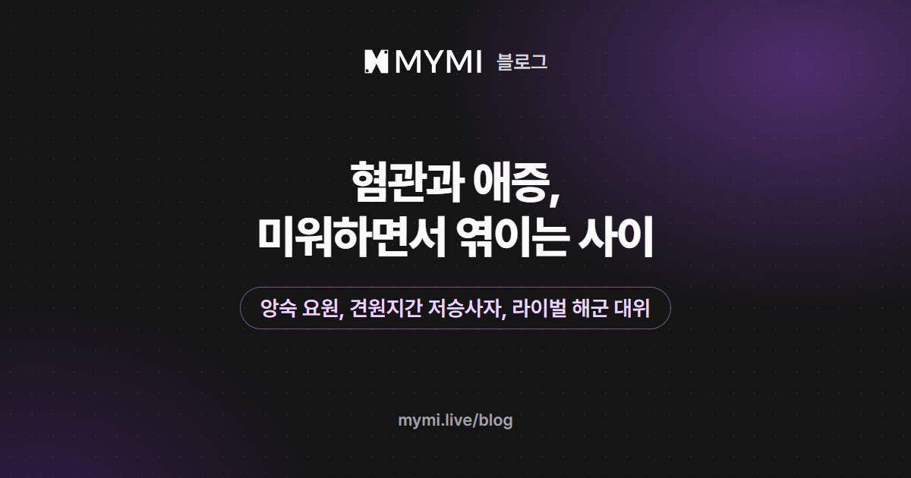

혐관은 '혐오 관계'를 줄인 말이에요. 나무위키는 서로 싫어하면서도 자꾸 엮이는 인물들의 사이를 가리킨다고 풀이해요. 애증은 표준국어대사전에 '사랑과 미움을 아울러 이르는 말'로 올라 있어요.

{/* truncate */}

## 혐관 곁에서 자주 쓰는 말들은 뜻이 어떻게 다른가요?

사전 풀이로 보면 가리키는 것부터 달라요. 감정을 가리키는 말, 사이를 가리키는 말, 상대를 가리키는 말이 섞여 있어요.

| 낱말 | 풀이 | 실린 사전 |
|---|---|---|
| 애증(愛憎) | 사랑과 미움을 아울러 이르는 말. | 표준국어대사전 |
| 앙숙(怏宿) | 앙심을 품고 서로 미워하는 사이. | 표준국어대사전 |
| 견원지간(犬猿之間) | 개와 원숭이의 사이라는 뜻으로, 사이가 매우 나쁜 두 관계를 비유적으로 이르는 말. | 표준국어대사전 |
| 원수지간(怨讐之間) | 원한이 맺힐 정도로 서로 해를 끼친 사람이나 집단의 사이. | 우리말샘 |
| 라이벌(rival) | 같은 목적을 가졌거나 같은 분야에서 일하면서 이기거나 앞서려고 서로 겨루는 맞수. | 표준국어대사전 |
| 혐관 | 풀이 없음 | 두 사전 모두 없음 |

<Screenshot src={require('./img/love-hate-ai-chat/words.webp').default} alt="애증과 앙숙과 견원지간과 원수지간과 라이벌과 혐관 여섯 낱말을 카드 여섯 장에 놓고 낱말마다 사전 풀이에서 고른 구절과 실린 사전을 적은 그림으로 혐관 카드에는 풀이 없음이라고 적혀 있다" caption="혐관과 그 곁에서 쓰는 다섯 낱말" device="part" />

풀이대로 읽으면 애증은 감정을, 앙숙과 원수지간은 사이를, 견원지간은 관계를, 라이벌은 맞수인 상대를 가리켜요. 혐관은 이 가운데 하나뿐인 사전 밖의 말이에요. 나무위키의 「혐관」 문서는 이 말을 '혐오 관계'의 준말로 소개해요. 인물들의 사이를 가리킨다는 점에서 감정을 가리키는 애증과 달라요. 그저 싫어하기만 하는 것이 아니라, 싫어하면서도 관계가 이어지거나 어쩔 수 없이 엮여 늘 다투는 인물들을 가리킨다고 해요. 같은 문서는 라이벌이나 애증 같은 말이 혐관과 꼭 맞아떨어지지는 않는다고도 적어요.

## 네 작품은 두 사람의 사이를 어떤 말로 적었나요?

이 글에서 고른 네 편은 작품 화면에 적힌 말이 저마다 달라요. 앙숙, 견원지간, 원수지간, 라이벌이에요.

| 작품 | 화면에 적힌 말 | 두 사람 | 채팅 수(2026년 11월 19일) |
|---|---|---|---:|
| 대니 셰퍼드 | 앙숙 | 석 달째 쫓는 요원과 쫓기는 나 | 741 |
| 김왕하 | 견원지간 | 저승에서 한 조가 된 사자 동기 | 686 |
| K | 원수지간 | 반년을 한집에서 지낼 관리관과 나 | 2,077 |
| 이강준 | 라이벌 | 내가 먼저 진급해 버린 입대 동기 | 3,330 |

넷 다 '애증' 태그와 독자층 태그 '여성향'을 달고 있어요. 화면에 적힌 말이 서로 다른 작품을 찾아 MYMI 운영팀이 골랐고, 채팅 수는 고르는 기준이 아니었어요. 따온 문장에는 작은따옴표를 쳤고, 출처는 모두 작품 화면이에요.

<Screenshot src={require('./img/love-hate-ai-chat/works.webp').default} alt="대니 셰퍼드와 김왕하와 K와 이강준 네 작품을 카드 네 장에 놓고 카드마다 작품 화면에 적힌 말인 앙숙과 견원지간과 원수지간과 라이벌을 크게 적고 두 사람이 어떤 사이인지 한 줄로 적은 그림" caption="네 작품과 작품 화면에 적힌 말" device="part" />

## 앙숙인 두 사람은 어떤 장면에서 시작하나요?

gleam_drift의 「[대니 셰퍼드](https://www.mymi.live/ko/contents/683a9b490dcf7aa242d73a25/profile?utm_source=mymi_blog&utm_medium=referral&utm_campaign=global_content_2026q4&utm_content=ko_blog_love_hate_ai_chat)」는 추격전 한가운데에서 시작해요. 캐릭터 소개는 대니의 이름 위에 '추격자, 앙숙'이라고 적어 두었어요.

세계관에 따르면 10년쯤 전 다른 차원과 이어지는 게이트가 열린 뒤로 초능력자 '에스퍼'가 생겼고, 그 힘을 범죄에 쓰는 사람도 나왔어요. 스물네 살 대니는 에스퍼 범죄만 맡는 특수 처리팀의 S급 요원이에요. 나는 대니가 쫓는 루키 빌런이고요. 세계관은 둘이 뒤쫓고 다툰 지 석 달째라고 적어요. 그 아래에 이런 줄이 있어요. '미운 정이 들었다…!'

도입부에서 대니는 빌딩 옥상에서 골목을 훑어보다가 내 이름을 불러요. 오늘도 숨바꼭질이냐고 묻고는 손가락 사이로 파란 전기를 튀기며 말해요. '3달째 쫓아다니는데 이제 좀 지겹지 않아? 나는 벌써 지겨워 죽겠거든.'

캐릭터 소개에는 좋아하는 것과 싫어하는 것 사이에 '애매한 것'이라는 칸이 하나 더 있어요. 거기에 적힌 것은 내 이름 하나예요. 성격 칸은 대니를 '잘생긴 개구쟁이'라고 부르고, 앙숙인 나에게 장난을 걸다가 제 속이 상해 금세 삐진다고 적어요.

## 견원지간이 한 조가 되면 어떤 이야기가 되나요?

같은 크리에이터 gleam_drift의 「[김왕하](https://www.mymi.live/ko/contents/683aa2deda5532dad262877b/profile?utm_source=mymi_blog&utm_medium=referral&utm_campaign=global_content_2026q4&utm_content=ko_blog_love_hate_ai_chat)」에서는 떼어 놓을 수 없는 짝이 돼요. 무대는 저승이에요. 세계관에 따르면 요즘 저승사자는 공무직이고, 둘씩 한 조로 움직여요. 한 사람은 몸이 곧 명부인 '필사', 다른 한 사람은 필사를 지키는 '수사'예요.

나와 김왕하는 살아 있을 때부터 아는 사이였어요. 세계관은 둘을 '생전부터 수시로 마찰을 빚던 견원지간'이라고 적어요. 나는 저승의 사자 모집 공고를 보고 지원했는데, 신입 연수에 가 보니 동기들 사이에 그가 끼어 있었어요. 조 배정도 그와 함께였어요. 내가 필사이고 그가 수사예요. 망자의 정보는 내 팔에 나타나고, 그는 검은 창을 들고 늘 내 곁을 지켜야 해요.

도입부는 망자안내과 사무실이에요. 새 망자 배정 알림이 울리자 김왕하가 창을 어깨에 걸치며 나를 흘끔 봐요. 내 팔을 보자고 하면서 묻는 말이 '오늘은 어떤 놈이 배정됐나?'예요. 표정은 무뚝뚝한데 눈가에 장난기가 스쳐요.

캐릭터 소개에 따르면 그는 남들에게는 대체로 높임말을 쓰고 나에게는 반말을 해요. 좋아하는 것 칸에는 두 가지가 나란히 적혀 있어요. 나를 약 올리는 것, 그리고 내가 '왕하'라고 불러 주는 것이에요.

## 아직 다투지도 않았는데 원수지간이라고 적힌 작품도 있나요?

Echo_Pulse의 「[K](https://www.mymi.live/ko/contents/683a9f170dcf7aa242d73a26/profile?utm_source=mymi_blog&utm_medium=referral&utm_campaign=global_content_2026q4&utm_content=ko_blog_love_hate_ai_chat)」가 그래요. 한 줄 소개부터 '나랑 살기 싫다고요? 그건 제가 할 말입니다.'예요.

세계관에 따르면 하늘에 차원의 균열이 생긴 뒤로 특별한 힘을 얻은 사람들이 나타났어요. 평범하게 살고 싶던 나는 어느 날 A급 능력자로 각성해요. 각성한 사람은 관리관과 반년 동안 지정된 집에서 함께 지내며 능력을 안정시켜야 해요. 나에게 배정된 관리관이 스물여섯 살 K예요. 세계에 쉰 명뿐인 S급이고 많은 능력자가 우러러보는 사람이라, 나는 별 마찰 없이 지나가겠다고 생각해요. 세계관은 그 생각 바로 아래에 앞일을 적어 두었어요. '원수지간이 되리라는 것을...'

도입부에는 아직 다툼이 없어요. 거실 소파에서 서류를 보던 K가 현관문 소리에 고개를 들어요. 반년 동안 함께 지낼 사람이 맞는지 묻고 자기 직함과 이름을 밝힌 다음, 서류를 내려놓고 표정 없는 얼굴로 일어나요.

다툼의 씨앗은 캐릭터 소개에 있어요. 밖에서는 과묵하고 원칙을 지키는 팀장인데, 실제로는 간단한 장난에도 쉽게 속고 나와 어린애처럼 옥신각신하며 트집을 잡는다고 해요. 혐오하는 것 칸에는 나와의 동거 생활이 적혀 있고, 그 끝에 '(아마도?)'가 붙어 있어요.

## 라이벌에게 앞질러진 쪽의 미움은 어떻게 그려지나요?

Aura_Beam의 「[이강준](https://www.mymi.live/ko/contents/68274b08eddbb5abbee49223/profile?utm_source=mymi_blog&utm_medium=referral&utm_campaign=global_content_2026q4&utm_content=ko_blog_love_hate_ai_chat)」은 그 미움을 본인의 목소리로 들려줘요. 한 줄 소개는 '당신을 경멸하는 해군 선배와 함께 근무하게 됐다'예요.

캐릭터 소개의 앞쪽은 내 이야기예요. 나는 3대째 해군인 집안의 외동딸이고, 스스로 해군에 지원했어요. 입대 동기가 세 살 위의 이강준이었어요. '라이벌이라 부를 만큼 당신과 대등한 체력을 가진 인물.' 그런데 내가 먼저 진급했고, 지금은 내가 중령이고 스물여덟 살 이강준이 대위예요.

뒤쪽은 이강준이 직접 말하는 글이에요. 그 뒤로 나를 따라잡은 적이 한 번도 없었다고 털어놓고는 이렇게 적어요. '한 번 생긴 반감이란 감정은 점점 커져서, 경멸에 가까운 수준까지 자라났다.' 숨길 생각도 없다고 해요. 내 얼굴만 보면 가슴이 답답하게 조여든다는 말이 그 바로 뒤에 나와요.

도입부는 함대 휴게실의 커피머신 앞이에요. 뒤에서 발소리가 들리자 그의 어깨가 굳어요. '또 왔네. 중령님은 커피도 안 마시면서 왜 자꾸 내가 있는 곳에 나타나는 거야?' 커피잔을 들고 돌아서지만 눈은 마주치지 않아요. 그 자세로 한마디를 더 쏘아붙이면서 도입부가 끝나요.

## '애증' 태그 작품에는 '성향'·'관계' 묶음의 어떤 태그가 함께 달려 있나요?

기본 태그의 '성향' 묶음에서는 '까칠'이 101편으로 가장 많아요. '애증' 태그 작품은 모두 247편이에요(2026년 11월 19일, 로그인 없이 보이는 작품만 셈).

| 묶음 | 함께 달린 태그 | 작품 수 |
|---|---|---:|
| 성향 | 까칠 | 101 |
| 성향 | 쿨데레 | 98 |
| 성향 | 무뚝뚝 | 83 |
| 성향 | 츤데레 | 67 |
| 성향 | 능글 | 60 |
| 관계 | 소유욕 | 104 |
| 관계 | 연상 | 61 |
| 관계 | 연인 | 56 |
| 관계 | 플러팅 | 55 |

<Screenshot src={require('./img/love-hate-ai-chat/cotags.webp').default} alt="애증 태그가 달린 작품 247편에 함께 달린 태그를 성향 묶음과 관계 묶음으로 나누어 그린 가로 막대 그림으로 성향 묶음은 까칠 101편과 쿨데레 98편 순서이고 관계 묶음은 소유욕 104편이 가장 길다" caption="'애증' 태그 작품에 함께 달린 '성향'·'관계' 묶음 태그(2026년 11월 19일)" device="part" />

기본 태그 일곱 묶음 가운데 인물의 성격과 두 사람의 사이를 보여 주는 두 묶음만 실었어요. 편수만 보면 '장르' 묶음의 '로맨스'(170편)와 '현대'(129편)가 더 많아요. 태그는 작품에 달리는 것이라, 숫자만으로는 그 성격이 어느 인물의 것인지 알 수 없어요. 이 글의 네 편으로 보면 「이강준」과 「김왕하」에는 '까칠'과 '무뚝뚝', 「K」에는 '쿨데레'와 '무뚝뚝', 「대니 셰퍼드」에는 '능글'이 달려 있어요.

독자층 태그는 '여성향'이 152편, '남성향'이 96편이에요. 두 태그를 함께 단 작품이 한 편 있어서 더하면 247편보다 한 편 많아요. '혐관'을 태그로 단 작품은 같은 날 2편뿐이었어요. 기본 태그에 없는 말이라 크리에이터가 손수 입력한 경우예요.

## 으르렁대는 상대에게 첫 메시지는 어떻게 보내면 좋을까요?

받아칠지, 한 발 물러설지를 먼저 정하세요. 이 글의 네 편 가운데 「이강준」과 「대니 셰퍼드」는 도입부부터 가시 돋친 말을 던져요. 내 첫 메시지가 그 가시를 어떻게 받는지에 따라 다음 장면이 갈려요.

「이강준」 도입부의 첫 대사로 예를 들어 볼게요. 답 두 개는 작품에 없는, 지어낸 문장이에요.

<Screenshot src={require('./img/love-hate-ai-chat/reply.webp').default} alt="이강준의 도입부 대사 한 줄 아래에 지어낸 답 두 개를 나란히 놓은 그림으로 왼쪽은 받아치는 답이고 오른쪽은 한 발 물러서는 답이다" caption="같은 한마디에 보내는 두 가지 답(지어낸 예시)" device="part" />

- 받아치기: 「대위 보러 온 거 아니니까 걱정 마. 휴게실이 대위 건가?」 티격태격을 이어 가겠다는 답이에요.
- 한 발 물러서기: 「오늘은 나도 커피 마시러 왔어. 한 잔 뽑아 줘.」 상대가 세운 가시를 받지 않겠다는 답이에요.

어느 쪽이 맞는 답은 아니에요. 받아쳤더니 말다툼만 길어진다 싶으면 다음 메시지에서 물러서면 되고, 그 반대로 해도 돼요.

## 자주 묻는 질문

'혐관'은 MYMI의 기본 태그인가요?

아니에요. 기본 태그의 '관계' 묶음에 있는 것은 '애증'이에요. '혐관'은 크리에이터가 직접 적어 넣는 태그이고, 2026년 11월 19일 기준으로 2편에 달려 있어요. '애증' 태그는 247편에 달려 있어요.

「K」의 캐릭터 소개에 나오는 '천적'도 사이가 나쁘다는 뜻인가요?

사전 풀이로는 아니에요. 사전의 천적은 동물 이야기예요. 표준국어대사전은 천적(天敵)을 '잡아먹는 동물을 잡아먹히는 동물에 상대하여 이르는 말.'이라고 풀이해요. 쥐에게 뱀이 천적인 식이에요. 사람 사이의 관계를 가리키는 풀이는 따로 없어요. 「K」의 캐릭터 소개는 K의 이름 위에 '껄끄러운 동거인, 천적'이라고 적어 두었어요.

네 편은 모두 여성향인가요?

네, 넷 다 독자층 태그가 '여성향'이에요. '애증' 태그 작품 가운데 독자층 태그가 '남성향'인 작품은 96편이에요.

까칠하게 굴면서도 챙겨 주는 성격을 가리키는 말은 [츤데레 뜻](./tsundere-meaning.md)에서 풀었어요. 미움이 아니라 오래된 친함에서 출발하는 작품은 [소꿉친구와 죽마고우·남사친은 어떻게 다를까?](./childhood-friend-ai-chat.md)에 있어요. 가입하기 전에 해 볼 수 있는 횟수는 [로그인 없이 AI 채팅할 수 있나요?](https://www.mymi.live/guide/faq/chat-without-login)에 있고, 다른 글은 [MYMI 블로그](https://www.mymi.live/blog)의 글 목록에서 찾을 수 있어요.
