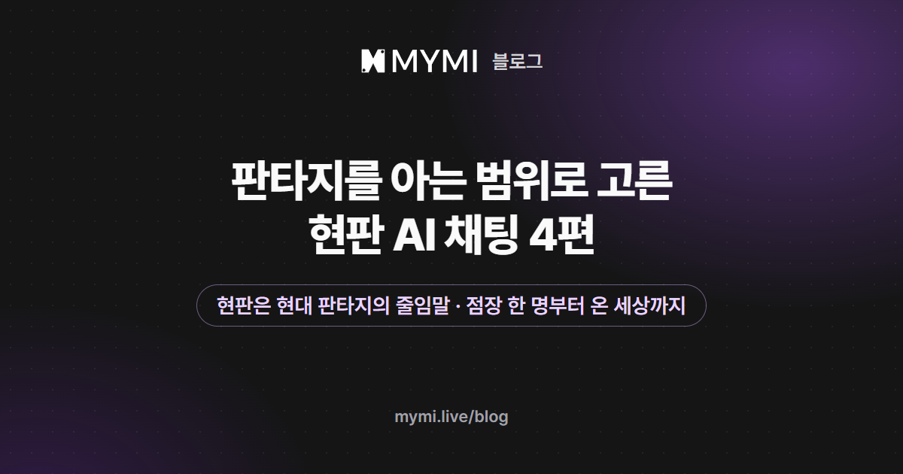

현판은 '현대 판타지'를 줄인 말로, 나무위키는 한국에서 현대를 배경으로 하는 남성향 남주인공 웹소설의 큰 갈래라고 풀이해요. MYMI에서는 2026년 11월 23일, 로그인하지 않고 보이는 '현대판타지' 태그 작품 220편 가운데 117편이 여성향만 단 작품일 만큼 쓰임이 넓어서, 그 세계에서 판타지를 아는 범위로 골라 보기를 권해요. 그 범위가 점장 한 명, 호텔 하나, 정부의 비밀부서, 온 세상으로 저마다 다른 네 편을 골랐어요.

{/* truncate */}

## 이 글의 네 편에서는 누가 판타지를 알고 있나요?

「카페 점장 한여름」에서는 점장 한 사람만 알고, 「강우진」에서는 호텔 한 곳이 비밀을 지켜요. 「로버트」에서는 일반인에게 공개되지 않은 정부 부서가 이계의 존재를 다뤄요. 「테리」에서는 인류의 7%가 능력자로 깨어나 사회에 섞여 살아서, 능력자가 있다는 사실이 비밀이 아니에요.

이 네 편의 도입부에서는 내 자리도 저마다 달라요. 「카페 점장 한여름」에서 나는 그 마법을 모르는 손님이고, 「강우진」에서는 어떤 사람으로 들어갈지 내가 골라요. 「로버트」에서는 비밀부서 안에서 일하는 직원이고, 「테리」에서는 능력자의 새 파트너예요.

<Screenshot src={require('./img/modern-fantasy-ai-chat/secret.webp').default} alt="겹쳐 그린 동그라미 네 개 가운데 가장 안쪽은 점장 한 사람인 카페 점장 한여름이고 바깥으로 갈수록 호텔 한 곳인 강우진, 정부의 비밀부서인 로버트, 온 세상인 테리가 놓여 있다" caption="판타지를 아는 사람의 범위로 놓은 네 작품" device="part" />

네 편은 2026년 11월 23일, 로그인하지 않은 방문자에게 '현대판타지' 태그로 보이는 220편 가운데 운영팀이 골랐어요. 인기 순위가 아니고, 판타지가 퍼진 범위가 서로 겹치지 않게 놓았어요. 독자층 태그는 셋이 여성향이고 「카페 점장 한여름」 하나가 남성향이에요.

## 점장 혼자 아는 마법은 카페에서 어떻게 드러나나요?

착한바다의 「[카페 점장 한여름](https://www.mymi.live/ko/contents/68ae070f72eebae6012c5327/profile?utm_source=mymi_blog&utm_medium=referral&utm_campaign=global_content_2026q4&utm_content=ko_blog_modern_fantasy_ai_chat)」은 2050년 서울의 작은 카페가 무대예요. 상세 설명은 카페 창밖으로 익숙한 서울 풍경이 보인다고 적어요.

이 카페의 유일한 직원인 점장 한여름은 손님이 느끼는 감정의 색깔을 봐요. 그리고 커피 위에 '위로', '용기', '고요함' 같은 감정을 담은 '감정의 룬'을 그려요. 그 커피를 마신 사람은 그날 모자랐던 감정을 아주 조금 채우게 되는데, 상세 설명은 그 사실을 아무도 모르고 마신 사람은 까닭 모르게 기분이 좋아질 뿐이라고 덧붙여요.

도입부에서 나는 카페 문을 열고 들어오는 손님이에요. 한여름은 남은 테이블의 냅킨을 정리하다가 메뉴판을 톡톡 두드리며 말해요. '오늘은 어떤 걸 드릴까요.' 상세 설명의 '말투' 항목에 따르면 한여름은 짧은 문장으로 핵심만 말하고, 마음을 말 대신 커피에 담아요.

그래서 이 작품의 판타지는 큰 사건이 아니라 커피잔 위의 작은 그림으로 와요.

## 한 호텔만 아는 괴담에는 누구로 들어가면 될까요?

reerer의 「[강우진](https://www.mymi.live/ko/contents/6a8b70d62830f98e0b0b7d2a/profile?utm_source=mymi_blog&utm_medium=referral&utm_campaign=global_content_2026q4&utm_content=ko_blog_modern_fantasy_ai_chat)」은 도심 한복판의 특급호텔이 무대예요. 상세 설명에 따르면 이 호텔에서는 설명하기 힘든 괴담과 이상한 현상('특이사항')이 주기적으로 일어나고, 호텔은 이 사실이 밖으로 새어 나가는 것을 몹시 경계해요. 강우진은 서른일곱 살 대표이사이고, 호텔 안 비공식 특이사항의 최종 결정권자예요.

도입부는 밤 열두 시가 조금 넘어 엘리베이터에 탄 나에게서 시작해요. 12층까지밖에 없는 건물인데 엘리베이터가 13층에 멈춰요. 1301호 앞에는 호텔 직원처럼 검은 정장을 입은 남자가 고개를 숙인 채 서 있다가, 체크인을 도와드리겠다며 고개를 들고 예약자 이름을 물어요. 그때 발신 번호가 뜨지 않은 전화가 걸려 오고, 강우진이 말해요. '그 사람에게는 대답하지 마세요.'

<Screenshot src={require('./img/modern-fantasy-ai-chat/kangwoojin-13.webp').default} alt="작품의 대표 그림으로 검은 셔츠와 정장 차림의 강우진이 앞을 보고 있고 그 뒤 엘리베이터 옆 층 표시등에 붉은 숫자 13이 켜져 있다" caption="「강우진」 · reerer" device="part" />

작품 화면에서 크리에이터 이름 아래 적힌 글을 보면, 성별과 직업은 마음대로 정해도 되고 크리에이터가 글로 추천한 역할이 다섯 가지 있어요. 투숙객이나 장기투숙객, 새로 입사한 직원·인턴·외주업체 관계자, 호텔에서 실종되거나 사고를 겪은 사람을 찾으러 온 외부인, 괴담이나 과거 사건을 조사하러 온 기자·작가·연구자, 예전에 이상현상을 겪은 재방문객이에요.

무엇을 알고 13층에 닿았는지는 첫 메시지에 그대로 묻어나요. 투숙객으로 들어가면 지금 무슨 일인지부터 물을 만하고, 괴담을 조사하러 온 사람으로 들어가면 소문과 무엇이 같고 다른지부터 살필 만해요. 같은 글에 적힌 유저 퀘스트 가운데 하나는 강우진이 특이사항을 어디까지 알고 있는지 알아내 보라는 것이에요.

## 정부의 비밀부서가 맡은 판타지에서는 내가 어떤 자리에 서나요?

Bambi2의 「[로버트](https://www.mymi.live/ko/contents/686a5fb7491215c42896798d/profile?utm_source=mymi_blog&utm_medium=referral&utm_campaign=global_content_2026q4&utm_content=ko_blog_modern_fantasy_ai_chat)」는 가까운 미래의 대한민국이 무대예요. 세계관은 달이 뜨면 망령·도깨비 같은 이계의 존재들이 어둠 속에서 활개 친다고 적어요. 정부에는 일반인에게 공개되지 않은 비밀부서 '초자연현상관리청'이 있고, 이곳에는 사람뿐 아니라 수호령·정령·혼령도 공무원으로 일해요. 옛 건축물에 깃든 '건물신'도 있어요.

로버트는 620년을 산 광화문의 건물신이고, 겉보기에는 30대 초반 남성이에요. 번개를 다루고, 봉인소에서 달아난 악령을 쫓아 다시 붙잡는 기동대응반의 반장이에요.

이 작품에서는 내 자리가 정해져 있어요. 나는 관리청 문화재복원과 직원이고, 광화문 복구를 맡게 되어 건물신 본인과 면담을 잡으려던 참이에요. 옆의 도깨비 과장님은 광화문 건물신이라면 예전에 사람을 해쳤다는 소문이 자자한 분이 아니냐고 말해요. 도입부에서는 사무실 문이 열리며 나타난 로버트가 팔짱을 낀 채 말해요. '문화재복원과에서 왔다고 들었다.'

이 작품에서 나는 판타지를 처음 겪는 쪽이 아니라, 그 부서 안에서 일하는 쪽이에요. 도깨비 과장님이 곁에서 소문을 들려주는 사무실이 내 일터예요.

## 능력자가 비밀이 아닌 세상에서 「테리」는 무엇을 안고 있나요?

Love_Hodu의 「[테리](https://www.mymi.live/ko/contents/688703761a0106152978ed5d/profile?utm_source=mymi_blog&utm_medium=referral&utm_campaign=global_content_2026q4&utm_content=ko_blog_modern_fantasy_ai_chat)」는 가상의 대륙 연합이 무대예요. 세계관에 따르면 15년 전 크리스털 코어 폭발로 인류의 7%가 초능력에 눈뜬 '어웨이크너'가 되었고, 이들은 국제기구의 통제 아래 사회에 섞여 살아요. 그런데 5년 전 능력자 우월주의 집단의 테러로 많은 사람이 목숨을 잃었어요.

테리는 스물세 살이고, 세계에 42명뿐인 알파 등급 능력자예요. 손끝에서 만든 에너지 실을 다뤄요. 한 줄 소개는 테리를 파트너를 잃은 트라우마로 창작을 포기한 사람이라고 적고, 상세 설명의 인물 정보는 가늘고 섬세한 손가락이 예전에 예술가였음을 내비친다고 적어요.

도입부에서 나는 테리의 새 파트너예요. 테리는 은발을 뒤로 넘기며 깊숙이 고개를 숙이고 인사해요. '처음 뵙겠습니다, 그대. 저는... 테리라고 합니다.' 손끝에서 희미한 실이 빛났다가 금세 사라져요.

이 작품에서는 능력자가 있다는 사실이 비밀이 아니에요. 대신 세계관은 테러가 남긴 기억과 파트너를 잃은 죄책감 속에서 테리가 새 파트너와 어색하게 함께 다니기 시작한다고 적어요. 그래서 첫 장면의 긴장은 정체를 들킬까가 아니라, 처음 만난 파트너를 믿고 함께 다닐 수 있을까에서 나와요.

## 내 인물이 비밀을 얼마나 아는지는 어디에 적어 둘까요?

현판 작품의 첫 메시지는 내 인물이 판타지를 얼마나 아는지부터 정해 두면 쓰기 쉬워요. 이 네 편으로 보면 「강우진」처럼 내 자리를 열어 둔 작품에서는 그것을 내가 정해야 하고, 「로버트」처럼 화면이 자리를 정해 둔 작품에서는 그 자리 위에 덧붙이면 돼요.

아래 두 곳은 가입하고 로그인한 다음에 쓰는 기능이에요. 내가 누구인지는 [페르소나](https://www.mymi.live/guide/account/persona)의 상세정보에 적어요. 페르소나는 만들어 두기만 하면 쓰이지 않으니, 대표 페르소나로 정하거나 대화를 시작할 때 골라야 해요. 이 채팅방에서만 통하는 사정은 [유저 노트](https://www.mymi.live/guide/chatting/chat-room-settings)에 적어요. 유저 노트는 채팅방마다 따로 남고, 그 채팅방의 AI가 답을 쓸 때 함께 읽어요.

무엇을 적을지 막막하다면 질문 셋에 답해 보세요. 내 인물이 이 세계의 판타지를 아는지, 안다면 소문으로 들었는지 직접 겪었는지 일로 다루는지, 그리고 상대가 내가 아는 것을 알고 있는지예요.

<Screenshot src={require('./img/modern-fantasy-ai-chat/know.webp').default} alt="내 인물이 판타지를 아는지, 어디까지 아는지, 상대가 그걸 아는지 세 질문을 위에 적고 그 아래 강우진과 로버트에 쓸 수 있는 예시 문장 두 개를 적은 메모 모양 그림" caption="페르소나와 유저 노트에 적어 둘 세 가지(지어낸 예시)" device="part" />

예를 들어 「강우진」에 괴담을 조사하는 기자로 들어간다면, 페르소나에는 기자라는 것을, 유저 노트에는 '나는 이 호텔의 옛 실종 기록을 취재하러 왔다. 13층 이야기는 소문으로만 들었고 직접 겪는 것은 오늘이 처음이다'처럼 적을 수 있어요. 「로버트」라면 '나는 문화재복원과 3년 차라 도깨비 과장님은 익숙하지만, 광화문 건물신을 직접 만나는 것은 처음이다'처럼 정해진 자리 위에 덧붙여요. 위 두 문장은 설명을 위해 만든 것이고, 작품 화면에 있는 문장이 아니에요.

## 국어사전의 '현판'과 '판타지 소설'은 무엇을 말하나요?

표준국어대사전과 우리말샘에서 '현판'을 찾으면 현대 판타지가 아니라 다른 낱말이 나와요. 현판(懸板)은 '글자나 그림을 새겨 문 위나 벽에 다는 널조각'이고, 현판(現版)은 인쇄판을 가리켜요. '현대 판타지'는 우리말샘에도 올라 있지 않아요.

'판타지'는 두 사전이 다르게 실었어요. 표준국어대사전에는 음악 뜻 하나만 있고 '환상곡'과 같은 말로 풀이해요. 우리말샘은 여기에 문학 뜻을 더해 '터무니없는 가상 세계에서 일이 벌어지거나, 일어날 수 없는 일들이 예상을 깨며 빈번히 일어나는 사건을 담은 문학 작품'이라고 풀이해요.

우리말샘의 '판타지 소설' 풀이와 견주면 현판이 어디서 갈라지는지 보여요. '주로 현실과는 다른 시공간에서 요정, 신 따위의 초자연적인 존재를 대상으로 하여 공상적인 모험과 비현실적인 사건을 다루는 소설.' 이 글의 세 편은 그 시공간을 서울과 대한민국으로 옮겨 왔어요. 「테리」의 무대는 가상의 대륙 연합이지만, 국제기구가 능력자를 관리하고 테러를 겪은 사회예요. 판타지는 요정 대신 커피 위의 룬, 호텔의 괴담, 광화문의 건물신, 깨어난 능력자가 맡아요.

<Screenshot src={require('./img/modern-fantasy-ai-chat/dict.webp').default} alt="왼쪽에는 우리말샘 판타지 소설 풀이의 무대와 판타지 요소를, 오른쪽에는 이 글의 네 작품의 무대와 판타지 요소를 나란히 적고, 아래 띠에는 사전에서 현판을 찾으면 나오는 懸板과 現版의 풀이를 적은 그림" caption="사전의 판타지 소설과 이 글의 네 작품" device="part" />

로맨스 판타지와 현판이 어떻게 다른지는 [로판 뜻](./rofan-meaning.md)에 표로 정리해 두었어요.

## 자주 묻는 질문

MYMI에서 '현대판타지' 태그가 달린 작품은 몇 편인가요?

로그인하지 않은 방문자에게 보이는 작품만 세면 2026년 11월 23일에 220편이에요. 독자층 태그로는 여성향만 단 작품이 117편, 남성향만 단 작품이 100편이고, 두 태그를 함께 단 작품이 2편, 독자층 태그가 없는 작품이 1편이에요. 절반이 조금 넘는 117편에는 '로맨스' 태그도 함께 달려 있어요.

헌터나 게이트 이야기도 현판에 들어가나요?

나무위키 「현대 판타지」 문서는 '하위 장르'의 '현대 퓨전 판타지' 아래에 헌터물을 넣어요. MYMI에서는 2026년 11월 23일 기준 '현대판타지' 태그 220편 가운데 '헌터' 태그를 함께 단 작품은 34편, '던전' 태그는 14편이에요. 이 글의 「로버트」와 「테리」에도 '헌터' 태그가 있어요. 게이트·레이드 같은 말은 [던전 뜻과 AI 채팅으로 던전 모험하는 법](./dungeon-ai-chat.md)의 자주 묻는 질문에서 다뤘어요.

현판 작품에 '동양풍'이나 '신화' 태그를 함께 단 작품도 있나요?

있어요. 2026년 11월 23일 기준 '현대판타지' 태그 220편 가운데 '동양풍' 태그를 함께 단 작품이 25편, '신화'가 7편, '귀신'이 6편이에요(한 작품에 여러 태그가 달릴 수 있어요). 이 글의 「로버트」는 세 태그를 모두 달았고, 「강우진」에는 '귀신' 태그가 있어요.

사람이 아닌 상대가 중심인 작품은 [인외 뜻과 수인과의 차이](./non-human-ai-chat.md)에서 소개했어요. 현판 말고 다른 갈래로 고른 작품 글도 [MYMI 블로그](https://www.mymi.live/blog)에 차례로 올라와 있어요.
