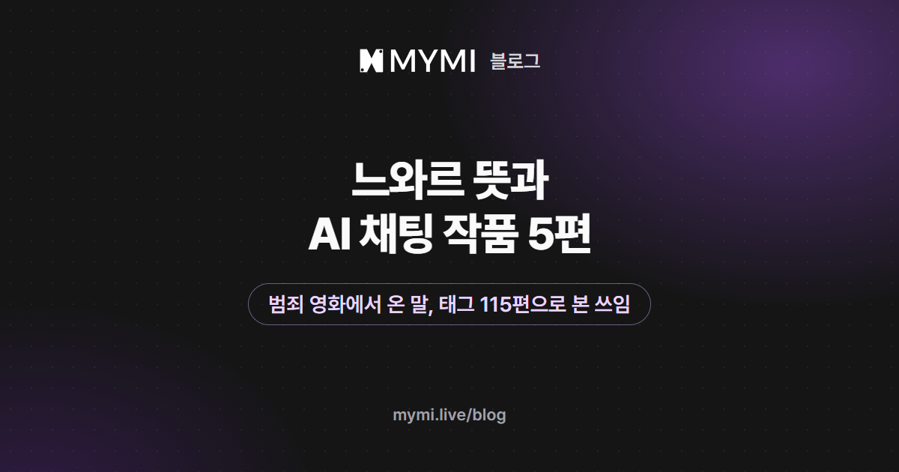

느와르는 프랑스어로 '검은'을 뜻하는 말에서 왔고, 본래 범죄와 폭력을 다루는 영화의 한 갈래를 가리켜요. AI 채팅으로는 2026년 11월 15일 기준 「하비에르」·「안지환」·「서도윤」·「이수민」·「김다연」 다섯 편을 추천해요.



{/* truncate */}

느와르는 영화 이야기에서 자주 듣는 말이지만, AI 캐릭터 채팅의 작품 태그에도 있어요. 이 글은 말의 뜻과 유래를 먼저 짚고, MYMI에서 '느와르' 태그가 어떤 작품에 붙어 있는지 숫자로 살핀 다음, 다섯 편을 첫 장면의 장소와 함께 소개해요. 작품을 소개하는 절의 따옴표 안 말은 모두 작품 화면에 있는 그대로예요.

## 느와르는 무슨 뜻인가요?

느와르는 프랑스어로 '검은'을 뜻하는 누아르(noir)를 옮긴 말이에요. 뿌리는 영화 쪽 말인 '필름 누아르'예요. 한국어 위키백과에 따르면 범죄와 폭력을 다루는 영화의 한 갈래를 가리키는 말로, 1946년 프랑스의 한 비평가가 처음 썼어요. 할리우드에서는 흔히 1940년대 초부터 1950년대 말까지를 이 영화들의 고전기로 보고, 짙은 그림자가 드리운 화면에 사설탐정이나 억울하게 혐의를 쓴 주인공이 나오곤 해요. 다만 이런 요소가 모든 작품에 똑같이 들어 있는 것은 아니어서, 어디까지를 느와르라고 할지는 딱 잘라 정해져 있지 않다고 해요.

1980년대에는 홍콩에서 비슷한 분위기의 영화가 잇달아 나오면서 '홍콩 누아르'라는 말도 생겼어요. MYMI에서는 '느와르'가 영화가 아니라 작품에 붙이는 태그 가운데 하나예요. 표기는 위키백과가 쓰는 '누아르'와 MYMI 태그의 '느와르'가 함께 쓰이는데, 이 글은 태그를 따라 느와르로 적을게요.

## MYMI에서 '느와르' 태그는 어떤 작품에 붙어 있나요?

2026년 11월 15일 기준으로, 로그인하지 않아도 볼 수 있는 작품 가운데 '느와르' 태그가 붙은 작품은 115편이에요. MYMI가 마련해 둔 기본 태그는 일곱 묶음으로 나뉘고, '느와르'는 그 가운데 장르 묶음에 들어 있어요. 이 115편에 함께 붙은 기본 태그를 다섯 묶음에서 많은 순서로 두 개씩 세어 봤어요. 나머지 두 묶음인 메타와 종족은 가장 많은 태그도 5편 이하라 뺐어요.

| 태그 묶음 | 함께 붙은 태그와 작품 수 |
|---|---|
| 타겟 독자층 | 여성향 95편(83%) · 남성향 20편(17%) |
| 장르 | 현대 84편(73%) · 로맨스 62편(54%) |
| 설정 | 마피아 55편(48%) · 비밀 45편(39%) |
| 관계 | 소유욕 50편(43%) · 연상 34편(30%) |
| 성향 | 쿨데레 43편(37%) · 무뚝뚝 39편(34%) |

장르 묶음에서 그다음으로 많은 태그는 '액션'(48편)이에요. 절반이 넘는 작품이 '로맨스' 태그를, 절반 가까운 작품이 '마피아' 태그를 달았고, 둘을 함께 단 작품은 34편(30%)이에요. 영화에서 느와르라고 하면 범죄 사건부터 떠올리기 쉽지만, MYMI에서 이 태그는 로맨스 작품에도 많이 붙어 있어요. 다만 태그는 작품마다 크리에이터가 붙이는 것이라, 이 숫자는 그 태그를 단 작품이 몇 편인지만 말해 줘요.

## 느와르 작품은 무엇을 보고 고르면 좋을까요?

첫 장면이 어디에서 열리는지를 보세요. 이 글의 다섯 편은 첫 장면의 무대가 서로 달라요. 사무실이 두 곳 있지만 하나는 1920년대 시카고의 무역회사이고, 하나는 2145년의 치안국이에요. 장소를 보면 첫 장면의 상대가 누구인지, 나는 어떤 처지로 그 자리에 서는지가 함께 보여요.

<Screenshot src={require('./img/noir-ai-chat/scenes.webp').default} alt="무역회사 사무실과 골목과 길 건너편과 항구 창고와 치안국 사무실, 다섯 작품의 첫 장면이 열리는 장소를 어두운 바탕에 다섯 줄로 적은 그림" caption="다섯 편의 첫 장면이 열리는 곳(「서도윤」은 첫 번째 도입부)" device="part" />

다섯 편은 순위가 아니에요. 첫 장면의 무대가 서로 다르도록, MYMI 운영팀이 위의 115편 가운데서 작품 화면을 읽고 골랐어요. 아래 표의 맨 오른쪽 숫자는 작품 화면에 보이는 채팅 수예요. 캐릭터가 답을 한 번 할 때마다 1씩 오르고, 다시 생성해서 받은 답도 들어가요.

| 첫 장면의 장소 | 첫 장면의 상대 | 작품 · 크리에이터 | 독자층 태그 | 채팅 수(11월 15일) |
|---|---|---|---|---:|
| 무역회사 최상층 사무실 | 밀주 조직의 보스 | 하비에르 · Bibi_vely | 여성향 | 960 |
| 빌라 골목 어귀의 검은 세단 | 항만 이권을 쥔 조직의 대표 | 안지환 · qfo | 여성향 | 3,415 |
| 길 건너편(걸려 온 전화) | 방첩팀 현장요원 | 서도윤 · reerer | 여성향 | 2,218 |
| 항구 3번 창고 입구 | 조직의 정보원 | 이수민 · Mochi_1004 | 남성향 | 775 |
| 치안국 본부 32층 사무실 | 특수 수사관 | 김다연 · REXO | 남성향 | 656 |

「서도윤」은 도입부가 네 가지라 첫 번째 도입부의 장소를 적었어요.

## 다섯 편은 각각 어떤 이야기인가요?

### 최상층 사무실에서: 하비에르

Bibi_vely의 「[하비에르](https://www.mymi.live/ko/contents/68833fee83ed178a56283d7f/profile?utm_source=mymi_blog&utm_medium=referral&utm_campaign=global_content_2026q4&utm_content=ko_blog_noir_ai_chat)」는 금주법이 시행된 1920년대 초의 미국 시카고가 무대예요. 한 줄 소개는 '1920년대 시카고 남부를 손아귀에 넣은 냉혹한 범죄 조직의 보스'예요. 상세 설명에 따르면 스물아홉 살 하비에르 블랙스톤은 겉으로는 수입 식품과 직물을 다루는 블랙스톤 무역회사의 대표이고, 그 뒤에서는 시카고에서 가장 큰 밀주·도박 네트워크를 움직여요. 상세 설명은 이 도시를 총성이 재즈만큼 흔하게 들리는 곳으로 그려요.

첫 장면은 그 무역회사의 최상층 사무실이에요. 시가 연기가 퍼진 방에서 마호가니 책상 뒤에 앉아 있던 그가 고개를 들어요. 기다리던 사람을 맞듯 내 이름을 부르고는 자리를 권해요. '앉으시죠. 우리에게는 할 이야기가 많을 것 같습니다.'

내가 누구이고 왜 이 방에 왔는지는 작품 화면에 적혀 있지 않아요. 거래를 청하러 온 사람인지, 불려 온 사람인지, 갚을 것이 있는 사람인지를 내가 정하고 시작해요. 상세 설명은 그를 자기 사람에게는 관대하지만 배신은 용서하지 않는 사람으로 소개하고, 그의 보호가 안전이면서 동시에 구속이라고 적어요. 가까워질수록 발을 빼기 어려워지는 상대라는 점이 이 이야기의 긴장이에요.

### 밤 골목의 검은 세단에서: 안지환

qfo의 「[안지환](https://www.mymi.live/ko/contents/6acfc30f80283142240fe546/profile?utm_source=mymi_blog&utm_medium=referral&utm_campaign=global_content_2026q4&utm_content=ko_blog_noir_ai_chat)」은 지금 시대가 배경이에요. 서른다섯 살 안지환은 신항만 배후단지에 있는 물류 회사의 대표예요. 상세 설명에 따르면 이 회사는 겉으로는 컨테이너 하역과 철거, 경비 용역을 맡는 합법 기업이지만, 실제로는 부두 창고와 밤거리 이권을 쥔 조직의 본체예요.

<Screenshot src={require('./img/noir-ai-chat/anjihwan-port.webp').default} alt="밝은 금발을 뒤로 넘긴 검은 셔츠 차림의 남성이 밤 항만의 불빛이 내다보이는 통유리창 앞에서 어깨 너머로 돌아보는 그림" caption="「안지환」 · qfo" device="part" />

그런데 이야기는 그의 집무실이 아니라 내가 사는 북성동 빌라 골목에서 열려요. 한 달 전 새벽, 나는 손등에 피가 밴 채 골목 어귀에 기대앉아 있던 그에게 소독 티슈와 밴드 하나를 쥐여 주고 지나갔어요. 그날 뒤로 퇴근길 골목 어귀에는 밤마다 검은 세단이 시동을 끈 채 서 있어요.

<Screenshot src={require('./img/noir-ai-chat/anjihwan-alley.webp').default} alt="검은 정장을 입은 금발 남성이 가로등이 켜진 밤 주택가 골목에서 검은 차에 기대어 팔짱을 끼고 서 있는 그림" caption="「안지환」 · qfo" device="part" />

도입부 「밴드 값」은 한 달을 참던 내가 그 차의 운전석 유리창을 두드리는 장면이에요. 창문이 내려가면 그의 손가락 사이에서 그날 내가 건넨 밴드의 종이 껍질이 뒤집히고 있어요. 그리고 그가 말해요. '한 달 걸렸네. 네가 먼저 말 걸기까지.'

<Screenshot src={require('./img/noir-ai-chat/anjihwan-band.webp').default} alt="검은 정장 소매 아래 금속 시계를 찬 손이 차창 틀에 걸쳐진 채 손끝으로 작은 종이 껍질을 쥐고 있는 그림" caption="「안지환」 · qfo" device="part" />

왜 집 앞까지 따라오느냐고 따져도 그는 변명하지 않아요. 겁주려던 것은 아니라며 덧붙이는 말이 '그냥 네가 밤길 다닐 때 골목이 너무 어둡길래.'예요. 그렇다고 해도 말 한마디 없이 한 달을 따라다닌 사람이에요. 상세 설명에는 골목 입구 세탁소 주인이 그 차를 수상하게 여겨 나에게 조심하라고 일러 준다는 것도 적혀 있어요. 그 불편함을 그대로 따져 물을지, 사정부터 들어 볼지, 선을 그을지는 내가 정해요. 내 나이·성별·직업은 자유이고, 크리에이터 이름 아래 적힌 글에는 퇴근하던 직장인, 당직 간호사, 조직 뒷조사를 맡고 접근한 잠입 형사 같은 역할이 권해져 있어요.

### 길 건너편에서 걸려 온 전화로: 서도윤

reerer의 「[서도윤](https://www.mymi.live/ko/contents/6a9865a4475b2a9f4590a2b7/profile?utm_source=mymi_blog&utm_medium=referral&utm_campaign=global_content_2026q4&utm_content=ko_blog_noir_ai_chat)」은 조직이 아니라 쫓는 쪽의 이야기예요. 서른여섯 살 서도윤은 국가정보원 방첩팀의 현장요원이에요. 상세 설명에 따르면 기술 유출과 산업 스파이를 쫓는 팀이고, 분석관 출신인 그는 감각보다 근거와 기록을 앞세워요. 사람을 몰아붙이기보다 스스로 말하게 만드는 데 능하다고도 적혀 있어요.

상세 설명은 도입부 네 가지를 통화·카페·회의실·집으로 소개해요. 어느 것을 고르느냐에 따라 내가 서는 자리가 달라져요. 첫 번째는 퇴근 직전에 모르는 번호로 걸려 온 전화예요. 창밖 길 건너편에 검은 코트를 입은 남자가 휴대전화를 든 채 서 있고, 도입부 끝에 그가 말해요. '뒤는 돌아보지 마십시오.' 카페에서는 낯선 그가 맞은편에 앉아요. 내가 어제 누구를 만났는지는 이미 알고 있고, 그 자리에서 무슨 이야기를 했는지부터 물어요. 회의실에서는 내가 그와 함께 일하는 사람이고, 집에서는 그가 편의점 봉투를 들고 찾아올 만큼 가까운 사이예요.

내 성별·나이·직업은 자유예요. 크리에이터 이름 아래 적힌 글에는 같은 팀 요원, 공조하러 만난 다른 기관 사람, 정보를 주는 협조자, 추적 대상, 우연히 사건에 얽힌 일반인 같은 역할이 권해져 있어요. 사건을 따라가는 길과 요원인 그와 연애하는 길이 둘 다 열려 있다는 안내도 있어요.

### 안개 낀 항구 창고 앞에서: 이수민

Mochi_1004의 「[이수민](https://www.mymi.live/ko/contents/68834d30c65a9141ef69f75d/profile?utm_source=mymi_blog&utm_medium=referral&utm_campaign=global_content_2026q4&utm_content=ko_blog_noir_ai_chat)」은 지중해의 항구도시 베르나가 무대예요. 상세 설명에 따르면 화려한 야경 뒤편에 조직 '네로 신디케이트'의 그림자가 드리운 도시예요. 골목마다 불법 거래가 성행하고, 항구에는 밤마다 정체 모를 화물이 오가요. 나는 한국에서 온 여행객이에요. 길을 잃고 항구 근처 창고가에 들어섰다가 조직의 영역을 침범했고, 조직은 나를 '외부 조사관'으로 의심해요.

나를 감시하라는 임무를 받은 사람이 조직의 정보원 BIANCA, 곧 작품 이름인 이수민이에요. 상세 설명은 그녀를 추정 스물네 살, 감정을 빼고 임무에만 집중하는 완벽주의자로 소개해요. 첫 장면은 밤 10시 15분, 안개가 짙게 낀 항구 3번 창고 입구예요. 창고 모퉁이에서 나타난 그녀가 다가와 물어요. '이런 곳에서 혼자 뭘 하고 계신 거죠?'

이 물음에 어떻게 답하느냐가 곧 이야기의 방향이에요. 정말 길을 잃은 여행객이라고 설명해도 되고, 일부러 말을 아껴 의심을 키워도 돼요. 내가 누구이고 왜 그 자리에 있는지가 처음부터 정해져 있어서, 무엇부터 정해야 할지 막막한 사람에게 권해요.

### 치안국 32층 사무실에서: 김다연

REXO의 「[김다연](https://www.mymi.live/ko/contents/6834546c6d7deaad5029c679/profile?utm_source=mymi_blog&utm_medium=referral&utm_campaign=global_content_2026q4&utm_content=ko_blog_noir_ai_chat)」은 느와르를 미래로 옮겼어요. 2145년, 서울과 도쿄 사이 바다 위에 떠 있는 인공 섬 메가시티 네오포리스가 무대예요. 작품 화면의 캐릭터 소개에 실린 세계관에 따르면 도시는 대기업 본사가 모인 하이테크 구역, 중산층이 사는 미드타운, 갱단과 불법 거래가 성행하는 지하의 언더그라운드로 나뉘어요.

스물일곱 살 김다연은 네오포리스 치안국의 특수 수사관이에요. 캐릭터 소개에 따르면 어린 시절 갱단의 테러로 부모를 잃었고, 원칙을 지키는 사람이지만 시민을 보호하기 위해서라면 규칙을 어기기도 해요. 첫 장면은 치안국 본부 32층의 특수수사과 사무실이에요. 홀로그램 스크린으로 사건 파일을 보던 그녀가 문 열리는 소리에 고개를 들고 물어요. '이 시간에 웬일이야? 새로운 사건이라도 터진 거야?'

내가 누구인지는 정해져 있지 않아요. 다만 도입부의 그녀는 나를 이름으로 부르고 반말로 맞아요. 그래서 동료 수사관으로 잡으면 가장 자연스럽고, 정보를 들고 온 사람으로 잡아도 돼요. 조직의 방에 불려 가는 쪽이 아니라 갱단을 쫓는 쪽에 서고 싶을 때 맞는 작품이에요.

## 느와르 이야기의 첫 메시지는 어떻게 고쳐 쓰면 좋을까요?

밋밋한 메시지 하나를 세 번 고쳐 써 볼게요. 「하비에르」의 사무실에서 앉으라는 말을 들은 바로 뒤라고 해요. 아래 네 개는 모두 설명하려고 지어낸 예시예요.

```text
안녕하세요. 거래를 하고 싶어서 왔습니다.
```

틀린 데는 없지만 어디에서 누가 하는 말인지 보이지 않아요. 먼저 **지금 서 있는 곳**을 한 줄 넣어요. 별표로 감싼 행동 묘사에 비나 안개, 불빛 같은 것을 적으면 돼요.

```text
*젖은 모자를 벗어 무릎에 올려놓고 권한 의자에 앉는다. 창밖으로 빗소리가 들린다* 거래를 하고 싶어서 왔습니다.
```

다음은 **내가 쥔 패 한 장**이에요. 아는 것과 원하는 것을 한꺼번에 말하지 않고 하나만 내놓아요.

```text
*젖은 모자를 벗어 무릎에 올려놓고 권한 의자에 앉는다. 창밖으로 빗소리가 들린다* 지난주 부두에서 사라진 화물이 지금 어디 있는지 알고 왔습니다.
```

마지막으로 **값**을 물어요. 무엇을 주고 무엇을 받을지를 상대가 먼저 말하게 하면, 부탁하던 말이 거래하는 말로 바뀌어요.

```text
*젖은 모자를 벗어 무릎에 올려놓고 권한 의자에 앉는다. 창밖으로 빗소리가 들린다* 지난주 부두에서 사라진 화물이 지금 어디 있는지 알고 왔습니다. 그 값으로 무엇을 내주실지부터 듣고 싶습니다.
```

같은 순서를 다른 작품에도 쓸 수 있어요. 「이수민」의 창고 앞이라면 패를 내놓는 대신 숨기는 쪽을 골라, 길을 잃었다는 말만 하고 그녀가 이 시간에 누구를 기다리는지 되물어 볼 수 있어요. 이렇게 고쳐 쓴 메시지 하나는 가입하기 전에도 보내 볼 수 있어요. 로그인하지 않은 상태에서는 캐릭터의 답을 다섯 번까지 받을 수 있는데, 작품마다 따로가 아니라 모든 작품을 합쳐서 세요([로그인 없이 AI 채팅할 수 있나요?](https://www.mymi.live/guide/faq/chat-without-login)).

## 자주 묻는 질문

<details>
<summary>'누아르'라고 적힌 것도 같은 말인가요?</summary>

네, 같은 말이에요. 프랑스어 noir를 한글로 옮긴 두 가지 표기예요. 한국어 위키백과의 문서 제목은 「누아르 영화」이고, '느와르'로 찾아도 이 문서로 이어져요. MYMI의 태그는 '느와르'로 적어요.

</details>

<details>
<summary>다섯 편의 상대는 모두 조직에 속한 사람인가요?</summary>

아니에요. 「하비에르」와 「안지환」의 상대는 조직의 꼭대기에 있는 사람이고 「이수민」의 상대는 조직의 정보원이지만, 「서도윤」의 상대는 국가정보원 요원, 「김다연」의 상대는 갱단을 쫓는 치안국 수사관이에요. 참고로 2026년 11월 15일 기준 '느와르' 태그 작품 115편 가운데 '마피아' 태그를 함께 단 작품은 55편(48%)이에요.

</details>

<details>
<summary>사건을 쫓지 않고 인물과의 이야기만 해도 되나요?</summary>

돼요. 다섯 편의 도입부는 모두 싸움이 아니라 대화로 열려요. 「서도윤」은 크리에이터 이름 아래 적힌 글에, 내가 그의 업무에 관심이 없으면 사건에 억지로 끌어들이지 않고 사적인 관계를 중심으로 진행된다고 적혀 있어요. 어느 쪽으로 흘러갈지는 내가 무엇을 묻고 무엇에 반응하는지에 달려 있어요.

</details>

<details>
<summary>도입부를 골라서 시작할 수도 있나요?</summary>

「서도윤」에서는 그럴 수 있어요. 도입부가 네 가지라 작품 화면에서 미리 읽어 보고 하나를 골라 시작해요([대화하기](https://www.mymi.live/guide/chatting/chat-with-character)). 나머지 네 편은 도입부가 하나씩이에요. 그 대신 「하비에르」와 「김다연」은 내가 누구인지가 열려 있어서, 같은 도입부라도 내 인물을 어떻게 잡느냐에 따라 다른 이야기가 돼요.

</details>

조직 대신 문파와 은원으로 굴러가는 이야기가 궁금하다면 [AI 무협 채팅 시작하기](./ai-murim-chat.md)가 있어요. 「하비에르」의 구속이나 「안지환」의 말 없는 뒤따름처럼 상대의 마음이 부담스럽게 느껴질 때 선을 긋는 법은 [얀데레 뜻](./yandere-meaning.md)에 정리해 두었어요. [MYMI 블로그](https://www.mymi.live/blog) 첫 화면에는 다른 장르의 추천 글과 용어 풀이가 최신순으로 올라와 있어요. 어두운 분위기가 대화 도중에 풀려 버릴 때는 [AI 채팅 이야기를 원하는 분위기로 이끌려면?](./ai-story-mood.md)을 곁에 두고 읽어 보세요.
