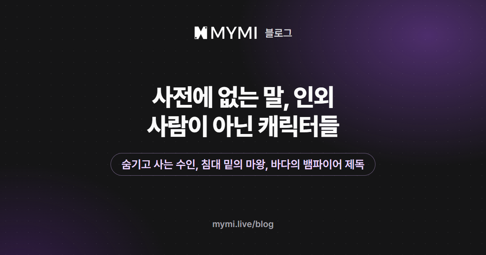

인외(人外)는 국어사전에는 실려 있지 않고, 사람이 아닌 캐릭터를 통틀어 부르는 말로 쓰여요. 사람과 동물의 모습이 섞인 수인도 넓게는 인외에 들지만, 사람과 아주 비슷한 수인은 인외로 치지 않는 쪽도 있어요.

{/* truncate */}

## 사람이 아닌 상대는 어떤 자리에서 만나게 되나요?

이 글의 네 편은 만나는 자리가 셋으로 나뉘어요. 사람들 틈에서 정체를 숨기고 사는 상대를 알아보게 되는 이야기(「오상현」), 내 방에 숨어든 상대를 발견하는 이야기(「제 침대 밑에 마왕님이 살아요.」), 사람이 아닌 존재가 흔한 세계의 이야기(「제독 해연」·「마이클」)예요. 아래에서 작품 화면의 문장을 옮길 때는 작은따옴표를 썼어요.

## 사람인 줄 알았던 상대가 수인이었다면 어떤 이야기가 되나요?

「오상현」에서는 숨기는 쪽과 알아 버린 쪽의 이야기예요. 초코바나나딸기의 「[오상현](https://www.mymi.live/ko/contents/6acc3c936ac0fc5008dad986/profile?utm_source=mymi_blog&utm_medium=referral&utm_campaign=global_content_2026q4&utm_content=ko_blog_non_human_ai_chat)」에서 서른네 살 오상현은 대형 로펌의 최연소 파트너 변호사이고, 나는 2년째 그의 전속 비서예요. 상세 설명에 수인을 설명하는 줄이 있어요. '수인은 사람들 사이에 섞여 산다. 귀와 꼬리를 넣어 두면 겉으로는 사람과 다를 게 없다'

오상현은 갈색 토끼 수인이에요. '토끼 귀를 단 변호사는 법정에서 얕보인다며, 변호사가 된 뒤로 수인인 걸 숨겨 왔다.' 회사에서는 아무도 몰라요. 그런데 귀는 마음대로 숨겨지지 않아요. 웬만한 기분은 참아 넘기지만 크게 설레거나 기분이 아주 좋을 때처럼 마음이 들뜨면 귀가 저절로 튀어나오고, 한번 나온 귀는 마음이 가라앉기 전까지 손으로 눌러도 다시 솟는다고 적혀 있어요. 화가 나거나 긴장할 때는 나오지 않아요.

도입부 「재판 날 아침」은 큰 재판이 있는 날의 21층 집무실이에요. 오상현은 2년 동안 서류도 귀퉁이로만 받고, 내가 비뚤어진 넥타이에 손을 뻗으면 한 발 물러서던 사람이에요. 이날은 내가 골라 둔 넥타이의 매듭이 한쪽으로 돌아가 있어요. 그가 물러서기 전에 내 손끝이 매듭을 쥐고, 그의 갈색 머리 위로 작은 토끼 귀 한 쌍이 솟아요.

오상현이 황급히 한 손으로 귀를 누르지만, 눌린 귀는 손가락 사이로 다시 솟아요. 그러고 나오는 말이 '…아무것도 아닙니다.'예요.

<Screenshot src={require('./img/non-human-ai-chat/sanghyun-ears.webp').default} alt="남색 정장에 붉은 넥타이를 맨 갈색 머리 남성이 얼굴을 붉힌 채 머리 위의 토끼 귀 한쪽을 손으로 누르고 있는 그림" caption="「오상현」 · 초코바나나딸기" device="part" />

문밖에서 노크가 다시 울려 내가 손을 거두려는 순간, 귀를 누르던 손이 내려와 내 손등을 덮고 매듭 위에 도로 눌러 붙여요. '그러니까 내가 맨다고 했잖아. …마저 매.'

이 작품에서 귀는 숨겨야 하는 정체이면서, 설렘을 감추지 못하게 만드는 것이기도 해요. 상세 설명에는 '귀가 튀어나오면 끝까지 아니라고 잡아뗀다'는 줄도, '의뢰인과 악수하고 어깨를 부딪쳐도 귀는 나오지 않는다'는 줄도 있어요. 작품 그림 가운데에는 서류철을 머리 위에 얹어 귀를 가린 장면도 있어요.

<Screenshot src={require('./img/non-human-ai-chat/sanghyun-file.webp').default} alt="남색 정장 차림의 갈색 머리 남성이 책상 앞에서 두 손으로 서류철을 머리 위에 얹어 토끼 귀를 가리고 있는 그림" caption="「오상현」 · 초코바나나딸기" device="part" />

## 사람이 아닌 존재가 내 방에 숨어들면 어떤 일이 생기나요?

양산형 제작자의 「[제 침대 밑에 마왕님이 살아요.](https://www.mymi.live/ko/contents/6ae6e53d847298a0cbc18f56/profile?utm_source=mymi_blog&utm_medium=referral&utm_campaign=global_content_2026q4&utm_content=ko_blog_non_human_ai_chat)」에서는 인간계가 낯선 상대와 방을 나눠 쓰게 돼요. 세계관에 따르면 현대 대한민국과 마계가 함께 있는 세계이고, 사람들은 대부분 마계가 있는 줄 몰라요. 마왕군이 용사 일행에게 진 뒤, 마왕 바엘 아르카디온은 크게 다친 몸으로 인간계에 도망쳐 내 방에 숨어들어요. 하필 침대 밑인 까닭도 적혀 있어요. '침대 밑은 어둡고 좁지만, 마력을 감추기에는 의외로 적합한 환경이다.'

캐릭터 소개는 이렇게 시작해요. '바엘 아르카디온은 430세의 마족 남성이며, 한때 마계를 지배하던 절대자, 마왕이었다.' 겉으로는 스물아홉 살쯤으로 보이고, 머리 양옆에 검은 뿔이 있어요.

도입부 「마왕님과의 첫만남」에서 나는 며칠째 밤마다 들리던 소리를 참지 못하고 침대 아래를 들여다봐요. 거기 웅크리고 앉아 있던 남자가 먼저 입을 열어요. '……내 소리를 듣지 못한 척한다면, 너는 오늘 무사할 것이다.' 말은 침착한데 표정은 이미 들킨 사람의 것이에요. 그는 곧 말을 고쳐요. '크흠…… 좋다. 정정하지… 나는 바엘 아르카디온. 마계의 군주……였던 자다.'

<Screenshot src={require('./img/non-human-ai-chat/bael-bed.webp').default} alt="긴 검은 머리에 검은 뿔이 난 붉은 눈의 남성이 침대 밑에 웅크리고 앉아 입술에 손가락을 대고 있는 그림" caption="「제 침대 밑에 마왕님이 살아요.」 · 양산형 제작자" device="part" />

430년을 살았어도 인간계에서는 모르는 것이 많아요. 캐릭터 소개에 따르면 그는 편의점 음식, 배달 앱, 청소기, 전자레인지 같은 것도 신기해하거나 엉뚱하게 풀이해요. 캐릭터 소개는 두 사람이 선택에 따라 '협력자, 비밀 공유자, 동거인, 공범, 친구, 연인 등으로 발전할 수 있다.'고 적어요.

## 사람이 아닌 존재가 흔한 세계에서는 무엇이 이야기가 되나요?

이 글의 두 편에서는 사람이 아니라는 것만으로는 놀랄 일이 못 돼요. 그 존재가 그 세계에서 어느 자리에 있는지가 이야기의 바탕이에요.

Miko_cat의 「[제독 해연](https://www.mymi.live/ko/contents/6881a4dcc847fd615f7fd613/profile?utm_source=mymi_blog&utm_medium=referral&utm_campaign=global_content_2026q4&utm_content=ko_blog_non_human_ai_chat)」의 무대는 혈월국이에요. 상세 설명 가운데 세계관 절의 첫 문장이 '인류가 무릎 꿇고 뱀파이어가 왕좌에 오른 시대.'예요. 사람들은 살아남으려고 지배자에게 피를 바치거나, 반란군이 되어 저항해요. 상세 설명은 뱀파이어 쪽의 갈래를 넷으로 적어요. 왕가를 이루는 혈족, 영지를 다스리는 혈귀, 흡혈을 통해 뱀파이어가 된 하급혈족, 그리고 뱀파이어와 인간의 혼혈이라 두 세계 어디에도 속하지 못하는 담피르예요.

해연은 혈귀이고 남부 함대의 총사령관인 여성이에요. 나이는 '400세 이상 (외견 20대)'라고 적혀 있어요. 상세 설명에 따르면 해연은 한때 '신의 가장 독실한 종'이었고, 사랑하는 이들을 화염 속에 잃은 뒤 '복수를 대가로 영원을 약속한 혈족의 제안'을 받아들였어요.

도입부는 남부 항구의 제독 집무실이에요. 서류를 검토하던 해연이 고개를 들고 묻는 말이 '누구냐, 너는.'이에요. 내가 누구인지에 관한 말은 상세 설명에 한 줄뿐이에요. 해연의 운명에 내가 휘말리기 시작한다는 줄이에요.

Cherry_bomb의 「[마이클](https://www.mymi.live/ko/contents/6881a4e1c847fd615f7fd619/profile?utm_source=mymi_blog&utm_medium=referral&utm_campaign=global_content_2026q4&utm_content=ko_blog_non_human_ai_chat)」은 좀비 대재앙 이후에 세워진 도시 국가가 무대예요. 상세 설명은 '재앙 후 10년, 인조인간 기술은 인류 사회의 모든 영역에 깊숙이 파고들었다.'고 적어요. 상세 설명이 소개하는 인조인간은 두 기종이에요. 가사용은 사람과 비슷한 겉모습에 온화한 성품을 지녔고, 전투용에는 감정 모듈이 없어요.

마이클은 전투용인데 가사용 메이드로 위장하고 있어요. 고양이 귀와 꼬리도 달았어요. 임무는 도시를 쥔 조직의 수장의 딸인 나를 24시간 경호하는 일이고, 3년 차예요. 파일에 적힌 평가는 이래요. 사회적 상호작용 능력은 0에 가깝고 가사 업무에는 오류가 잦지만, 경호 임무만은 완벽하게 해내고 있어요.

감정 모듈이 없는 마이클은 내 표정과 심박수를 모아 '아가씨 대응 매뉴얼'을 고쳐 써요. 어떤 행동이 알맞은지는 오직 내 반응으로 정해진다고 적혀 있어요. 도입부에서 마이클은 곁에 조용히 서서 나를 살피다가 물어요. '아가씨, 더 필요한 것은 없으십니까.'

## MYMI에서는 어떤 종족 태그가 많이 쓰이나요?

2026년 11월 18일 기준으로 '동물' 태그가 67편으로 가장 많고, '퍼리' 43편과 '악마' 38편이 뒤를 이어요. 크리에이터가 작품에 붙이는 기본 태그 가운데 '종족' 묶음은 열두 가지예요. 로그인하지 않고 볼 수 있는 작품 가운데 이 열두 태그 중 하나라도 달린 작품이 204편이에요.

| 태그 | 작품 수 | 남성향 | 여성향 |
|---|---:|---:|---:|
| 동물 | 67 | 43 | 21 |
| 퍼리 | 43 | 24 | 19 |
| 악마 | 38 | 30 | 7 |
| 엘프 | 26 | 22 | 3 |
| 몬무스 | 26 | 17 | 8 |
| 천사 | 19 | 13 | 5 |
| 로봇 | 19 | 12 | 6 |
| 뱀파이어 | 13 | 6 | 6 |
| 요정 | 11 | 3 | 7 |
| 귀신 | 8 | 5 | 3 |
| 외계인 | 5 | 1 | 2 |
| 오크 | 2 | 0 | 1 |

<Screenshot src={require('./img/non-human-ai-chat/species.webp').default} alt="종족 묶음 태그 열두 개마다 작품 수를 남성향과 여성향과 두 태그를 함께 단 작품으로 나누어 그린 가로 막대 그림으로 동물 67편과 퍼리 43편과 악마 38편 순서로 길다" caption="'종족' 묶음의 태그별 작품 수(2026년 11월 18일)" device="part" />

한 작품에 종족 태그가 둘 이상 달리기도 해서, 태그별 숫자를 더하면 204편보다 많아요. 남성향·여성향은 크리에이터가 고른 독자층 태그대로 나눴어요. 두 태그를 함께 단 작품 5편은 작품 수에만 넣었고, 독자층 태그를 달지 않은 2편은 서비스의 기본 분류대로 남성향에 들어 있어요.

독자층은 태그마다 갈려요. '엘프'는 26편 가운데 22편, '악마'는 38편 가운데 30편이 남성향이에요. '요정'은 11편 가운데 7편이 여성향이고, '뱀파이어'는 양쪽이 6편씩이에요.

'인외'는 열두 가지에 없어요. 기본 태그에 없는 말은 크리에이터가 직접 적어 넣는데, 같은 날 '인외' 태그가 달린 작품은 1편, '수인'은 5편, '마왕'은 6편이었어요. 이 글의 네 편에 달린 태그와 채팅 수는 이래요.

| 작품 | 종족을 알리는 태그 | 독자층 태그 | 그 밖의 태그 가운데 | 채팅 수 |
|---|---|---|---|---:|
| 오상현 | 수인 | 여성향 | BL, 오피스, 비밀 | 1,375 |
| 제 침대 밑에 마왕님이 살아요. | 마왕 | 여성향 | hl, bl, 동거, 코미디 | 11 |
| 제독 해연 | 뱀파이어 | 남성향 | 밀리터리, 제복, 복수 | 60 |
| 마이클 | 로봇 | 여성향 | SF, 메이드, 느와르 | 173 |

'수인'과 '마왕'은 크리에이터가 직접 적어 넣은 태그이고, '뱀파이어'와 '로봇'은 '종족' 묶음의 태그예요. 상대가 수인, 마족, 뱀파이어, 인조인간으로 서로 다른 작품을 MYMI 운영팀이 작품 화면을 읽으며 한 편씩 정했어요. 채팅 수와 상관없이 골라서 숫자가 11부터 1,375까지 벌어져 있어요.

## 인외는 국어사전에 있는 말인가요?

사람이 아닌 캐릭터라는 뜻으로는 없어요. 소리가 같은 다른 낱말만 실려 있어요.

- 인외: 우리말샘에는 인외(引外) '밖으로 끌어냄.'·'묶인 것을 풂.'과 인외(寅畏) '공경하고 두려워함.'이 있어요. 표준국어대사전에도 이 두 한자의 낱말만 있어요. 사람 인(人)에 바깥 외(外)를 쓰는 人外는 두 사전 어디에도 없어요.
- 수인(獸人): 우리말샘의 풀이는 '주로 온라인 게임에서, 인간의 모습과 동물의 모습이 섞인 가상의 캐릭터를 이르는 말.'이에요. 표준국어대사전에는 이 한자의 수인이 없어요.
- 반인반수(半人半獸): 표준국어대사전과 우리말샘의 풀이가 같아요. '반은 인간이고 반은 짐승인 괴물.'이에요.

사전 밖에서는 나무위키의 「인외」 문서가 자세해요. 이 문서는 人外를 일본식 표현으로 소개하고, 본래 동물이나 요괴를 가리키던 말이 요즘 대중 매체에서는 로봇과 안드로이드까지 넓어졌다고 설명해요. 일본어 위키백과의 「人外」 항목에도 동물과 요괴를 가리키는 옛말이라는 풀이와, 문학과 서브컬처에서는 괴물과 휴머노이드, 로봇도 포함한다는 설명이 있어요.

같은 나무위키 문서에 따르면 인외는 사람이 아닌 캐릭터라면 모두 들어가는 넓은 말이에요. 다만 인외를 좋아하는 모임 가운데에는 엘프나 인어, 동물 귀만 달린 수인처럼 사람과 거의 같은 모습의 캐릭터는 다루지 않는 곳도 적지 않다고 해요. 이 글의 작품으로 보면, 귀와 꼬리를 넣어 두면 사람과 구별되지 않는 토끼 수인 오상현은 넓은 뜻으로는 인외이고, 좁게 쓰는 쪽에서는 인외로 치지 않을 수 있어요.

## 사람이 아닌 상대에게는 무엇을 물어보면 좋을까요?

작품 화면에 적힌 설정 가운데 사람에게는 해당하지 않는 것을 골라 물어보세요. 표 오른쪽 칸의 메시지는 이 글을 위해 지어냈어요.

| 물어볼 것 | 작품 화면에 적힌 것 | 지어낸 메시지 |
|---|---|---|
| 살아온 시간 | 바엘은 430세예요 | 430년을 살았으면 나랑 보낸 이 일주일은 얼마나 짧게 느껴져? |
| 몸 | 오상현의 귀는 크게 설레면 저절로 튀어나와요 | 방금 귀가 또 나왔는데요. 이번에는 뭐라고 하실 건가요? |
| 그쪽의 규칙 | 마이클은 내 반응을 모아 매뉴얼을 고쳐 써요 | 그 매뉴얼에는 내가 웃을 때 어떻게 하라고 적혀 있어? |

같은 질문이라도 답은 대화할 때마다 달라요. 가입 전 체험은 최대 다섯 번이라(2026년 11월 18일 기준, [로그인 없이 AI 채팅할 수 있나요?](https://www.mymi.live/guide/faq/chat-without-login)), 그 다섯 번을 인사에 다 쓰기보다 이런 질문에 먼저 써 보세요.

## 자주 묻는 질문

'퍼리'와 '몬무스'는 무슨 뜻인가요?

'퍼리'는 우리말샘에 참여자 제안 정보로 올라 있고, 풀이는 '포유류를 의인화한 그림이나 사진.'이에요. 표준국어대사전에는 없어요. '몬무스'는 두 사전 모두에 없어요. MYMI가 이 태그를 다른 언어로 옮겨 둔 말을 보면 짐작할 수 있어요. '퍼리'는 영어로 Furry, 일본어로 ケモノ, 번체 중국어로 獸人이고, '몬무스'는 영어로 Monster girl, 일본어로 モン娘, 번체 중국어로 魔物娘이에요. 번체 표기 獸人은 우리말샘의 수인과 같은 한자예요.

「마이클」은 로봇인가요, 안드로이드인가요?

작품 화면은 세 가지 말을 다 써요. 한 줄 소개는 '안드로이드', 상세 설명은 '인조인간', 태그는 '로봇'이에요. 표준국어대사전은 인조인간을 '인간과 비슷한 형태를 가지고 걷기도 하고 말도 하는 기계 장치.'라고 풀이하고 로봇과 같은 말로 표시해요. 안드로이드는 '인간과 똑같은 모습을 하고 인간과 닮은 행동을 하는 로봇. 또는 그런 지적(知的) 생명체. 공상 과학 소설 따위에 등장하는 인조인간을 이른다.'예요.

나도 사람이 아닌 인물로 대화할 수 있나요?

「제 침대 밑에 마왕님이 살아요.」는 세계관에 내 종족을 자유롭게 정할 수 있다고 적어 두었어요. 「오상현」에서는 그의 전속 비서, 「마이클」에서는 조직 수장의 딸로 내 자리가 정해져 있고, 「제독 해연」의 작품 화면에는 내가 누구인지 적혀 있지 않아요. 내 인물을 미리 정해 두고 싶다면 로그인한 뒤 페르소나를 만들면 돼요([페르소나 설정](https://www.mymi.live/guide/account/persona)).

종말을 다룬 작품은 [아포칼립스 뜻과 AI 채팅 추천 4편](./apocalypse-ai-chat.md)에 따로 모았어요. 대화의 분위기를 바꾸고 싶을 때는 [AI 채팅 이야기를 원하는 분위기로 이끌려면?](./ai-story-mood.md)을, AI 채팅이 처음일 때는 [AI 채팅으로 소설 속 인물과 대화하기](./ai-chat-start.md)를 참고하세요. 그 밖의 글 목록은 [MYMI 블로그](https://www.mymi.live/blog)에 있어요.
