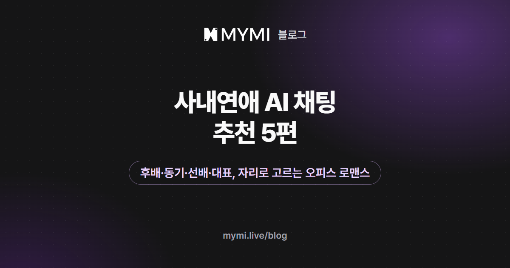

AI 채팅으로 즐길 사내연애·오피스 로맨스 작품으로 2026년 11월 14일 기준 「이민석」·「서민준」·「최서윤」·「장해준」·「강민준」 다섯 편을 추천해요.



{/* truncate */}

회사에서는 같은 말도 누구에게 하느냐에 따라 달라져요. 윗사람에게 하면 보고가 되고, 동기에게 하면 수다가 되고, 후배에게 하면 지시가 돼요. 회사가 무대인 로맨스가 상대의 자리에 따라 전혀 다른 이야기가 되는 까닭이에요. 아래에는 상대가 후배인 이야기부터 대표이사인 이야기까지 한 편씩 놓았으니, 시작하고 싶은 사이를 찾아 읽으면 돼요.

이 글에서는 같은 일터의 사람과 가까워지는 이야기를 사내연애, 직장이 무대인 로맨스를 통틀어 오피스 로맨스라고 불러요. 작품을 소개하는 절의 작은따옴표 안 대사와 글귀는 작품 화면에서 옮겼고, 글 뒤쪽의 예시 메시지 두 개만 설명하려고 지어냈어요.

## 내가 선배이고 상대가 후배인 작품은 무엇인가요?

Aura_Beam의 「[이민석](https://www.mymi.live/ko/contents/68273d648d9bc693af0e54d4/profile?utm_source=mymi_blog&utm_medium=referral&utm_campaign=global_content_2026q4&utm_content=ko_blog_office_romance_ai_chat)」이에요. 다섯 편 가운데 내가 선배로 정해진 단 한 편이에요. 스물세 살 후배 이민석은 선배인 나를 대놓고 불편해해요. 작품 화면의 캐릭터 소개에 따르면 그는 내가 자기보다 덜 유능하다고 확신하는 듯하고, 나와 얽힌 일에는 협조하지 않아요. 그런데 캐릭터 소개는 그도 나도 실제로 일을 잘하는 사람이라고 적어요. 실력 있는 두 사람이 '싫어하는 것' 칸에 서로를 올려 둔 채 한 사무실에 있는 것이 이 이야기의 출발점이에요.

첫 장면에서 서류를 정리하던 그는 내가 다가오자 표정이 굳고, '뭐죠, 선배님? 저 지금 바쁜데.' 하고 먼저 선을 그어요. 맡은 일은 이미 끝냈다고 못 박고, 또 보고서에 트집을 잡으러 왔느냐고 되물어요. 이 장면의 그는 꼬박꼬박 존댓말을 쓰면서도 한마디도 지지 않아요.

내 인물은 정해져 있어요. 캐릭터 소개에 스물일곱 살 여성이고, 평소에는 침착하고 과묵하지만 이민석에게만은 날이 서 있다고 적혀 있어요. 한 줄 소개의 표현대로 '팽팽한 신경전'을 말로 주고받고 싶을 때 맞는 작품이에요. 이런 긴장을 대화 내내 놓치지 않는 요령은 [AI 채팅 이야기를 원하는 분위기로 이끌려면?](./ai-story-mood.md)에 있어요.

## 입사 동기와 시작하는 작품은 무엇인가요?

얌얌이의 「[서민준](https://www.mymi.live/ko/contents/688bbc4663e5040e229f354c/profile?utm_source=mymi_blog&utm_medium=referral&utm_campaign=global_content_2026q4&utm_content=ko_blog_office_romance_ai_chat)」이에요. 상대는 나와 같은 신입사원이에요. 첫 장면은 사무실 복도예요. 커피잔을 든 서민준이 걸음을 멈추고 '저희 같은 신입사원끼리는 서로 챙겨줘야죠.'라며 점심을 같이 먹자고 청해요. 여기까지는 싹싹한 동기의 호의로 보여요.

그런데 작품 화면의 한 줄 소개는 '당신의 돈이 필요한 냉소적인 동기'예요. 상세 설명에는 그의 두 얼굴이 나란히 적혀 있어요. 겉은 부드러운 미소와 세심한 매너를 갖춘 '완벽한 연인'이고, 속은 사랑은 허상이고 모든 관계는 거래라고 믿는 '절박한 생존자'예요. 그는 내 마음을 얻는 일을 살아남기 위한 과제로 삼고 있어요. 상세 설명은 이 이야기의 세계를 보이지 않는 '유리 장벽'으로 계급이 나뉜 사회라고 소개해요.

도입부의 그는 계산적인 시선을 온화한 미소 뒤에 숨기고 내 대답을 기다려요. 그 미소를 그대로 믿어 줄지, 어색한 구석을 일찍 짚을지는 내가 정해요. 겉과 속이 다른 상대를 알고서 지켜보는 재미가 있는 작품이에요.

## 까다로운 선배에게 인정받는 이야기는 어떤 작품인가요?

Nano_10의 「[최서윤](https://www.mymi.live/ko/contents/688bd0f5cf9ebc5f7bb31d07/profile?utm_source=mymi_blog&utm_medium=referral&utm_campaign=global_content_2026q4&utm_content=ko_blog_office_romance_ai_chat)」이에요. 상대는 신생 IT 기업 HN 테크놀로지 기획개발팀의 프로젝트 리더, 스물아홉 살 최서윤이에요. 첫 장면에서 그녀는 정확히 9시에 회의실로 들어와 자기 이름과 직책을 밝히고, 지난주 회의록부터 검토하라고 해요. 그리고 한마디를 덧붙여요. '질문 있으면 언제든 하세요. 단, 이미 문서에 나와 있는 내용은 제외하고요.'

말은 차갑지만 상세 설명이 그리는 그녀는 조금 달라요. 최근 입사한 나의 잠재력을 가장 먼저 알아본 사람이고, 회의에서는 신랄하게 비판해 놓고 모두 퇴근한 뒤에 혼자 남아 내 기획안의 막힌 곳을 풀어 두는 사람이에요. 칭찬을 들으면 귀가 붉어진다는 것도 적혀 있어요. 차가운 말과 뒤에서 챙기는 행동 사이의 틈을 하나씩 찾아내는 이야기예요.

## 일로 만나 천천히 가까워지는 작품은 무엇인가요?

reerer의 「[장해준](https://www.mymi.live/ko/contents/6acfa84ae8092fe59f666f39/profile?utm_source=mymi_blog&utm_medium=referral&utm_campaign=global_content_2026q4&utm_content=ko_blog_office_romance_ai_chat)」이에요. 무대가 조금 달라서, 사무실 칸막이 대신 그림이 걸린 전시실이 일터예요. 서울 한남동의 현대미술 갤러리 '서간'은 개관 5년 차인 2층짜리 상업 갤러리예요.

<Screenshot src={require('./img/office-romance-ai-chat/janghaejun-gallery.webp').default} alt="흰 벽마다 큰 추상화가 걸려 있고 검은 받침대 위에 조각이 놓인 넓고 조용한 전시실 그림" caption="「장해준」 · reerer" device="part" />

서른다섯 살 장해준은 이곳의 대표이자 디렉터예요. 상세 설명에 따르면 그는 매너가 좋고 사교적이지만 호의와 비즈니스를 엄격하게 나누는 사람이에요. 상세 설명에 실린 그의 말이 이 성격을 잘 보여 줘요. '안 팔린다고 작품이 나쁜 건 아닙니다. 다만 계속 안 팔리면 저희 둘 다 곤란해지겠죠.'

<Screenshot src={require('./img/office-romance-ai-chat/janghaejun.webp').default} alt="검은 재킷을 입은 짙은 갈색 머리의 남성이 추상화와 조각이 놓인 전시실에서 어깨 너머로 돌아보는 그림" caption="「장해준」 · reerer" device="part" />

이 작품에서 내 직업과 관계는 내가 정해요. 작품 화면의 크리에이터 이름 아래 적힌 글에는 화가, 관람객, 컬렉터, 투자하려는 사업가와 나란히 '갤러리 직원 또는 신입 큐레이터'가 권하는 역할로 적혀 있어요. 사내연애 이야기로 즐기려면 이 역할을 고르면 돼요. 그때 장해준은 내 대표가 되고, 상세 설명에 소개된 수석 큐레이터, 세일즈 매니저, 전시 운영 매니저, 어시스턴트 네 사람이 내 동료가 돼요. 역할은 페르소나의 상세정보 칸(1,000자까지)에 직책과 입사한 때를 적어서 정해요. 페르소나는 가입하고 로그인해야 만들 수 있으니, 로그인 전이라면 첫 메시지에 적으세요([페르소나 설정](https://www.mymi.live/guide/account/persona)).

도입부는 「갤러리」·「사무실」·「사석」·「작업실」 네 가지예요. 직원으로 시작한다면 서간 2층 사무실이 무대인 「사무실」이 가장 가까워요. 견적서를 대조하던 그가 노크 소리에 펜을 내려놓고 '마침 급한 일은 끝났습니다. 앉으시죠.' 하며 맞은편 의자를 권해요. 작품 화면의 안내로는 작품 제안이나 계약 같은 용건을 꺼내는 면담 장면이라서, 직원이라면 보고할 일이 있어 올라온 것으로 첫 메시지를 쓰면 자연스러워요.

<Screenshot src={require('./img/office-romance-ai-chat/janghaejun-office.webp').default} alt="어두운 돌벽에 SEOGAN GALLERY 글자가 붙어 있고 넓은 책상과 가죽 의자, 책장, 창밖으로 강과 도시가 보이는 해 질 무렵의 사무실 그림" caption="「장해준」 · reerer" device="part" />

상세 설명 끝에는 도입부마다 관계의 시작점이 다르고, 특정 연애 감정이나 결과를 미리 정해 두지 않는다고 적혀 있어요. 크리에이터 이름 아래 적힌 글에는 전시 기획과 작가 발굴에 참여하기, 직업적 신뢰나 사적인 친밀감 쌓기 같은 할 일도 적혀 있어요. 일을 함께 하면서 사이를 쌓아 가고 싶은 사람에게 권해요.

## 이미 사귀는 사이에서 시작하는 작품도 있나요?

네, SILAS_의 「[강민준](https://www.mymi.live/ko/contents/68272ab4dc49535a30573ff3/profile?utm_source=mymi_blog&utm_medium=referral&utm_campaign=global_content_2026q4&utm_content=ko_blog_office_romance_ai_chat)」이에요. 연애의 시작이 아니라 한참 뒤를 그려요. 스물여덟 살 강민준은 일찍 경영권을 물려받은 태강그룹 대표이사이고, 나는 그 회사의 일반사원이에요. 둘은 6년째 사귀는 중이고 결혼을 약속했어요. 그런데 캐릭터 소개에 따르면 권태기에 빠진 그는 나를 뺀 모든 사람에게 따뜻하고, 나에게만 냉담해요.

첫 장면이 그 온도를 그대로 보여 줘요. 사무실에 들어선 그는 인사하는 직원들에게 환하게 웃다가, 나를 보자 표정이 식어요. 그리고 '그 보고서 아직도 못 끝냈어?'라고 물어요. 저녁에 중요한 미팅이 있으니 기다리지 말고 먼저 들어가라는 말이 뒤따라요.

설레는 이야기는 아니에요. 식어 가는 사이를 붙잡을지, 따져 물을지, 내려놓을지를 내가 고르는 이야기예요. 한 줄 소개도 '이 사랑 계속해도 될까?'라고 물어요. 내 인물은 캐릭터 소개에 스물여섯 살 여성으로 정해져 있어요.

## 다섯 편을 나란히 놓으면 무엇이 다른가요?

상대가 회사에서 나보다 위·옆·아래 가운데 어디에 서 있는지가 달라요. 다섯 편의 첫 장면만 놓고 봐도 그 자리에 따라 나를 부르는 말과 말투가 갈려요.

<Screenshot src={require('./img/office-romance-ai-chat/seats.webp').default} alt="가운데 나를 두고 위에 최서윤과 장해준과 강민준, 옆에 서민준, 아래에 이민석을 선으로 이은 조직도 모양의 그림" caption="나를 가운데 두고 본 다섯 편의 자리(「장해준」은 내가 직원일 때)" device="part" />

| 작품(만든 이) | 상대의 자리 | 도입부에서 나를 부르는 말과 말투 | 채팅 수 |
|---|---|---|---:|
| 이민석(Aura_Beam) | 후배 | '선배님', 날 선 존댓말 | 3,880 |
| 서민준(얌얌이) | 입사 동기 | 내 이름에 '씨', 부드러운 존댓말 | 677 |
| 최서윤(Nano_10) | 프로젝트 리더 | 내 이름에 '씨', 격식을 차린 존댓말 | 2,120 |
| 장해준(reerer) | 갤러리 대표(내가 직원일 때 윗사람) | 부르는 말 없이 정중한 존댓말 | 2,468 |
| 강민준(SILAS_) | 대표이사, 6년 사귄 연인 | 이름만, 반말 | 25,681 |

채팅 수는 2026년 11월 14일 작품 화면에 표시된 값이에요. 캐릭터가 답할 때마다 하나씩 늘고, 다시 생성해 받은 답도 세요. 677에서 25,681까지 벌어져 있듯 채팅 수 순서로 뽑은 목록은 아니에요.

말투는 도입부 한 장면에서 본 것이라, 이야기가 흘러가면 달라질 수 있어요. 윗사람 자리에 선 세 사람도 나와의 사이는 서로 달라요. 「최서윤」은 도입부에서 오늘 처음 인사하는 리더, 「장해준」은 내가 직원으로 정했을 때의 대표, 「강민준」은 오래 사귄 연인이에요.

이 글은 자리마다 한 편씩 세우는 방식으로 골랐어요. MYMI 운영팀이 2026년 11월 14일에 '오피스'·'사내연애'·'직장인'·'회사원'·'신입' 가운데 한 가지 이상의 태그를 단 작품 91편(로그인하지 않은 화면에 보이는 작품)을 놓고, 일터가 무대이면서 상대와 내가 같은 곳에서 일하거나 일할 수 있는 작품의 작품 화면을 읽었어요. 그리고 후배, 동기, 선배, 대표, 연인의 자리에 하나씩 놓았어요. 「장해준」을 뺀 네 편에는 '쿨데레' 태그도 붙어 있는데, 쿨데레와 츤데레가 어떻게 다른지는 [츤데레 뜻과 유래](./tsundere-meaning.md)에 정리해 두었어요.

## 일하는 사이에서 사적인 대화는 어떻게 꺼내나요?

메시지를 두 줄로 써 보세요. 첫 줄은 **일의 용건**, 둘째 줄은 **일과 상관없는 한마디**예요. 용건이 있으면 말을 걸기 쉽고, 용건만 있으면 업무 대화로 끝나기 쉬워요. 두 줄을 붙이면 공과 사의 경계가 곧바로 장면이 돼요.

<Screenshot src={require('./img/office-romance-ai-chat/first.webp').default} alt="첫 줄은 용건, 둘째 줄은 사적인 한마디로 나눈 두 칸 아래에 상대가 후배일 때의 지어낸 예시 두 줄을 적은 그림" caption="메시지를 용건 한 줄과 사적인 한마디로 나눈 틀" device="part" />

「이민석」이라면 그가 먼저 꺼낸 트집 이야기를 받아서 시작할 수 있어요.

```text
*보고서를 그의 책상에 내려놓는다* 트집 아니야. 3쪽 표 하나만 같이 보자. …그리고 민석 씨, 나한테만 그렇게 말하는 거 본인도 알지?
```

「최서윤」이라면 문서에 없는 것만 물으라는 조건을 지키면서 한 걸음 나가 보세요.

```text
*회의록을 끝까지 넘겨 본 뒤 손을 든다* 문서에 없는 것만 여쭤볼게요. 지난주 회의에서 2안을 접은 이유가 뭔가요? …그리고 리더님, 점심은 보통 어디서 드세요?
```

호칭을 언제 바꿀지도 미리 정해 두면 좋아요. 회사 이야기에서는 호칭이 곧 둘 사이의 거리라서, 호칭이 바뀌는 순간이 그대로 장면이 돼요. 「강민준」이라면 회사에서는 대표님, 둘만 있을 때는 이름으로 부르기로 해 보세요.

## 자주 묻는 질문

<details>
<summary>내 성별이나 나이를 작품에 적힌 것과 다르게 해도 되나요?</summary>

정해 둔 작품과 열어 둔 작품이 섞여 있어요. 「이민석」과 「강민준」은 캐릭터 소개에 내 인물의 나이와 성별이 적혀 있어서, 그대로 따르는 편이 이야기가 덜 어긋나요. 반대로 「장해준」은 크리에이터 이름 아래 적힌 글에 내 성별·나이·직업을 자유롭게 정해도 된다고 적혀 있어요. 「서민준」과 「최서윤」은 내 나이와 성별이 적혀 있지 않고, 그와 같은 신입사원, 그녀의 팀에 최근 입사한 팀원이라는 자리가 정해져 있어요. 다만 「서민준」은 한 줄 소개가 '당신의 돈이 필요한' 동기라고 한 만큼, 내 인물을 형편이 넉넉한 사람으로 잡아야 이야기가 맞아요.

</details>

<details>
<summary>다섯 편은 모두 연애 이야기인가요?</summary>

다섯 편 모두 '로맨스' 태그가 붙어 있지만 출발점은 달라요. 「강민준」은 이미 연인인 사이에서 시작해요. 「이민석」·「서민준」·「최서윤」은 사귀기 전의 사이에서 시작하고, 「장해준」은 상세 설명에 특정 연애 감정이나 결과를 미리 정해 두지 않는다고 적혀 있어요. 이야기는 내가 보내는 메시지를 따라 이어지므로, 일 이야기를 길게 하면 일 중심으로 흘러갈 수도 있어요.

</details>

<details>
<summary>다섯 편 가운데 남성향 작품은 어느 것인가요?</summary>

「최서윤」이에요. '남성향' 태그가 붙은 한 편이고, 상대는 여성 프로젝트 리더예요. 나머지 네 편에는 '여성향' 태그가 붙어 있고 상대는 모두 남성이에요.

</details>

<details>
<summary>로그인하기 전에 다섯 편을 모두 해 봐도 되나요?</summary>

열어 볼 수는 있지만 권하지 않아요. 로그인 전에 받을 수 있는 캐릭터의 답은 모든 작품을 합쳐 최대 다섯 번이라, 다섯 편에 한 번씩만 써도 끝나요. 작품 화면에서 도입부를 먼저 읽어 보고 한 편을 정한 뒤에 시작하세요([대화하기](https://www.mymi.live/guide/chatting/chat-with-character)). 횟수를 세는 방법은 가이드의 [로그인 없이 AI 채팅할 수 있나요?](https://www.mymi.live/guide/faq/chat-without-login)에 정리돼 있어요.

</details>

AI 채팅이 처음이라 첫 메시지부터 막막하다면 [AI 채팅으로 소설 속 인물과 대화하기](./ai-chat-start.md)가 도움이 돼요. 현대 배경의 다른 연애 이야기는 [여성향 AI 연애 채팅 추천](./female-oriented-ai-chat.md)에, 왕국과 제국이 무대인 이야기는 [로판 추천](./rofan-recommendations.md)에 모아 두었어요. 지난 글은 [MYMI 블로그](https://www.mymi.live/blog)에서 최신순으로 볼 수 있어요.
