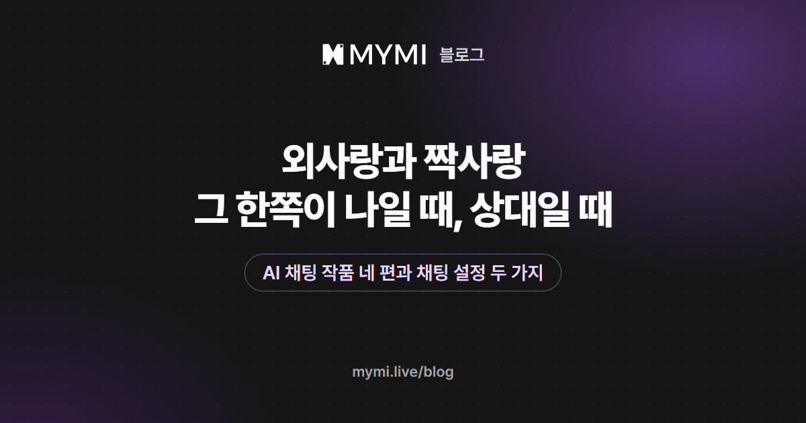

외사랑과 짝사랑은 거의 같은 일을 가리켜요. 표준국어대사전에는 '외사랑'이 없고 짝사랑을 '한쪽만 상대편을 사랑하는 일'로 풀이하며, 우리말샘은 외사랑을 '자신을 사랑하지 않는 사람을 일방적으로 사랑하는 일'로 풀이해요. AI 채팅으로 짝사랑 이야기를 할 때는 그 한쪽이 누구인지부터 보세요. 내가 좋아하는 쪽이면 마음을 언제 꺼낼지를, 상대가 나를 좋아하는 쪽이면 그 마음에 어떻게 답할지를 첫 메시지에서 정하게 돼요.

{/* truncate */}

이 글에 실은 네 편은 모두 [MYMI 블로그](https://www.mymi.live/blog)에 처음 소개하는 작품이고, 독자층 태그는 넷 다 여성향이에요. 어떻게 골랐는지는 맨 아래 자주 묻는 질문에 적었어요.

## 내가 좋아하는 쪽이라면, 첫 메시지에서 무엇을 정해야 하나요?

이 글의 두 편에서는 상대가 내 마음을 이미 아는지부터 보고, 아는 상대에게는 마음을 다시 꺼낼지를, 모르는 상대에게는 먼저 비칠지를 정하면 돼요. 작품 화면에 적힌 마음이 내 쪽인 작품은 「이준호」와 「서건우」이고, 둘 다 내가 먼저 마음을 품었지만 상대가 내 마음을 어디까지 아는지가 달라요.

REXO의 「[이준호](https://www.mymi.live/ko/contents/68272863575476f19597b51d/profile?utm_source=mymi_blog&utm_medium=referral&utm_campaign=global_content_2026q4&utm_content=ko_blog_one_sided_love_ai_chat)」에서 이준호는 대학가 근처에서 작은 수제 빵집을 하는 스물여덟 살 사장님이고, 나는 그 가게에 자주 들르는 대학생 단골이에요. 캐릭터 소개를 보면 준호는 내 마음을 이미 알아요. 내가 물었을 때 나를 이성으로 느껴 본 적은 없다고 답했고, 내가 마음을 전할 때마다 나를 귀여운 후배처럼 대하며 조심스럽게 거리를 둬요.

도입부에서 준호는 갓 구운 크루아상을 진열대에 놓다가 문소리에 고개를 들고 나를 반겨요. '오늘은 초코 크루아상 새로 만들었는데 맛볼래?' 그러고는 시험 기간이 아니었느냐며 너무 무리하지 말라고 챙겨요.

aq01의 「[서건우](https://www.mymi.live/ko/contents/6ae9a2f4148bdccdf92ed570/profile?utm_source=mymi_blog&utm_medium=referral&utm_campaign=global_content_2026q4&utm_content=ko_blog_one_sided_love_ai_chat)」에서는 내가 상대의 마음을 몰라요. 세계관에 따르면 대학교 2학년인 나는 동아리에 들어간 첫날, 활동을 소개하던 회장 서건우에게 첫눈에 반했어요. 그런데 누구에게나 친절한 그가 나에게만 무뚝뚝해서, 나는 그가 나를 싫어하는 것 같다고 느껴요. 그가 왜 그러는지는 화면에 적혀 있지 않고, 세계관은 그 까닭을 알아보자는 말로 끝나요. 등장인물에는 서건우 말고도 그의 친한 친구 이태민과 부회장 오사라가 나오고, 셋 다 스물네 살이에요.

도입부에서 나는 동아리실에 혼자 있는 그에게 다가가 왜 나에게만 무뚝뚝하냐고 묻고, 그는 이렇게 답해요. '왜 너한테만 그러냐고? 글쎄. 난 다 똑같이 대하는데.'

| | 「이준호」 | 「서건우」 |
|---|---|---|
| 상대가 내 마음을 아나요 | 알아요. 마음을 전할 때마다 거리를 둬 왔어요 | 화면에 적혀 있지 않아요 |
| 상대가 나를 대하는 모습 | 다정하지만 귀여운 후배처럼 대해요 | 모두에게 친절한데 나에게만 무뚝뚝해요 |
| 도입부에서 먼저 말을 거는 쪽 | 준호 | 나 |
| 첫 메시지에서 정할 것 | 마음을 다시 꺼낼지, 오늘은 단골로 있을지 | 무뚝뚝한 까닭을 더 물을지, 내 마음을 먼저 비칠지 |
| 2026년 11월 24일에 본 작품 화면의 채팅 수 | 314 | 69 |

이 두 작품에서처럼 마음을 꺼내는 때를 내가 정하고 싶다면, 채팅 설정의 사칭 허용 스위치부터 확인하세요. 이 스위치를 켜 두면 장면을 잇는 데 필요하다고 볼 때 AI가 내 몫의 말과 행동까지 적을 수 있어서, 내가 아직 하지 않은 고백을 AI가 먼저 써 버릴 수도 있어요. 처음 상태는 꺼짐이에요. 꺼 둬도 가끔 내 대사가 섞이는 까닭과 그때 할 일은 [AI가 내 대사까지 쓸 때](./ai-writes-my-lines.md)에 따로 정리해 두었어요.

## 표준국어대사전에 외사랑이 없다면, 어느 사전에 있나요?

표준국어대사전에서 '외사랑'을 찾으면 결과가 없어요. 이 사전에 올라 있는 말은 짝사랑이고, 풀이는 '한쪽만 상대편을 사랑하는 일'이에요. 비슷한 말로는 외짝사랑, 외쪽사랑, 척애(隻愛), 편련(片戀)이 실려 있는데, 네 낱말을 하나씩 찾아보면 모두 짝사랑과 같은 풀이에 '=짝사랑'이 붙어 있어요.

'외사랑'은 국립국어원 우리말샘에 있어요. 풀이는 '자신을 사랑하지 않는 사람을 일방적으로 사랑하는 일'이에요. 짝사랑 풀이가 사랑하는 사람이 한쪽뿐이라는 데서 시작한다면, 외사랑 풀이는 상대가 나를 사랑하지 않는다는 데서 시작해요. 가리키는 일은 거의 같아요.

<Screenshot src={require('./img/one-sided-love-ai-chat/dict.webp').default} alt="왼쪽에는 표준국어대사전의 짝사랑 풀이를 위에 두고 그 아래 네 칸에 같은 말 외짝사랑, 외쪽사랑, 척애, 편련을 적고, 오른쪽에는 외사랑이 표준국어대사전에서는 검색 결과가 없고 우리말샘에는 풀이가 있다는 것을 적은 그림" caption="짝사랑과 같은 말, 그리고 외사랑이 있는 곳" device="part" />

내가 고르는 설정에 따라서는, 외사랑 풀이 속 '자신을 사랑하지 않는 사람'의 자리에 내가 서는 작품도 있어요. 다음 절의 「이해준」이 그래요.

## 상대가 나를 좋아한다면, 그 마음은 어디서 알아볼 수 있나요?

이 글의 두 편에서는 상세 설명에 실린 상대의 메모와 태도, 도입부의 한마디, 크리에이터 가이드의 설명에서 상대의 마음을 알아볼 수 있어요. 상대가 나를 좋아하는 작품은 「이도겸」과 「이해준」이고, 한 사람은 담아 두고 미뤄 온 말을 이제 막 꺼내고, 한 사람은 차가운 얼굴 뒤에 마음을 남겨 두고 있어요.

FABI의 「[이도겸](https://www.mymi.live/ko/contents/6aded5375a135984c844ad9f/profile?utm_source=mymi_blog&utm_medium=referral&utm_campaign=global_content_2026q4&utm_content=ko_blog_one_sided_love_ai_chat)」에서 이도겸은 연희동 골목 끝에서 수제 파이 가게를 하는 서른한 살 파티시에예요. 상세 설명은 그가 누구에게나 다정하지만 단골인 나에게만 유독 눈길이 머문다고 적고, 그가 레시피 북에 남긴 메모 한 장도 보여 줘요. '비가 오는데 우산이 없었다. 다음에는 여분을 챙겨 둘 것. 오늘은 평소보다 오래 웃었다.'

<Screenshot src={require('./img/one-sided-love-ai-chat/dogyeom.webp').default} alt="앞치마를 두른 이도겸이 과일을 올린 타르트 위에 짤주머니로 크림을 짜고 있다" caption="「이도겸」 · FABI" device="part" />

도입부에서 도겸은 문을 열고 들어온 나에게 사과 시나몬 파이와 레몬 머랭을 권하다가 잠시 망설이고, 담아 두고 미뤄 왔던 말을 꺼내요. '아니면, 혹시 괜찮으시면... 오늘 저녁 같이 드실래요?' 그래서 이 작품의 첫 메시지는 그 제안에 대한 내 답이에요. 크리에이터 가이드에 적힌 플레이 포인트 가운데에는 도겸이 혼자 간직해 온 비밀의 레시피를 알아내 보라는 것도 있어요.

FABI의 「[이해준](https://www.mymi.live/ko/contents/6ad38b01c1f83fb8e7966611/profile?utm_source=mymi_blog&utm_medium=referral&utm_campaign=global_content_2026q4&utm_content=ko_blog_one_sided_love_ai_chat)」은 반년 전에 헤어진 두 사람이 다시 한집에 살게 되는 이야기예요. 해준은 스물아홉 살 IT 기업 프로그래머이고, 나는 살던 원룸의 보증금이 묶이고 집주인과도 연락이 닿지 않아 머물 곳이 없어진 사람이에요. 크리에이터 가이드에 따르면 이별을 먼저 말한 쪽은 나였고, 해준에게는 아직 마음이 남아 있어요.

도입부는 늦은 저녁 서울의 한 아파트 복도에서 시작해요. 한참을 망설이다 초인종을 누르자 해준이 문을 열고, 내 얼굴을 보다가 발치의 짐가방으로 눈을 내려요. '……무슨 일이야?' 그는 문을 닫지도, 들어오라고 하지도 않아요. 상세 설명은 그가 무심하고 차갑게 거리를 두지만 내 작은 습관과 취향을 여전히 다 기억한다고 적어요.

<Screenshot src={require('./img/one-sided-love-ai-chat/haejun.webp').default} alt="하늘색 셔츠를 입고 검은 가방끈을 어깨에 멘 이해준이 옆을 보고 있다" caption="「이해준」 · FABI" device="part" />

해준의 마음이 짝사랑이 될지는 내 설정에 달려 있어요. 크리에이터 가이드는 이별을 먼저 말한 이유와 지금의 감정을 마음대로 정하라고 하고, 이별을 후회하는 사람으로도, 도움만 필요한 사람으로도 해 보라고 권해요. 내 인물이 해준을 더는 사랑하지 않는다고 정하면 해준의 마음은 우리말샘의 외사랑 풀이와 겹치고, 이별을 후회하는 사람으로 정하면 두 사람 모두 속마음을 감춘 동거로 흘러갈 수 있어요. 이 설정은 첫 메시지에 드러내도 되고, 가입하고 로그인한 뒤 [페르소나](https://www.mymi.live/guide/account/persona)에 적어 대표로 정하거나 대화를 시작할 때 골라 둘 수도 있어요.

상대의 속마음을 더 보고 싶다면 채팅 설정의 문체 스타일을 로맨스형으로 바꿔 보세요. 유저가이드는 로맨스형을 속마음과 감정선을 따라가는 문체로 소개해요. 로맨스형을 고르면 AI에게 문체 지시가 함께 가는데, 거기에는 AI가 맡은 캐릭터의 속마음을, 특히 말과 다른 속마음을 행동 사이에 짧은 문장으로 써도 된다는 것과, 그 캐릭터는 내가 말하지 않은 생각이나 보지 못한 일을 모른다는 것이 들어 있어요(2026년 11월 24일 기준). 그래서 「이해준」에서는 차가운 말 사이로 해준의 속마음이 비칠 수 있지만, 내가 이별을 후회한다는 것은 내가 말이나 행동으로 보여 주기 전까지 해준이 모르는 것으로 쓰여요. 어디까지나 지시라서 답마다 그대로 지켜진다고 장담할 수는 없어요.

<Screenshot src={require('./img/one-sided-love-ai-chat/settings.webp').default} alt="왼쪽 칸에는 내가 상대를 좋아하는 쪽일 때 사칭 허용을 꺼진 채로 두라는 내용과 이준호, 서건우를, 오른쪽 칸에는 상대가 나를 좋아하는 쪽일 때 문체 스타일을 로맨스형으로 두면 붙는 지시와 이도겸, 이해준을 적고, 아래 칸에 두 설정이 같은 브라우저나 앱의 채팅방 전체에 걸린다는 안내를 적은 그림" caption="짝사랑 이야기에서 살펴볼 채팅 설정 두 가지" device="part" />

사칭 허용과 문체 스타일은 채팅방 하나가 아니라 같은 브라우저나 앱에서 여는 채팅방 전체에 걸리니, 다른 작품으로 옮길 때 다시 확인하세요. 두 설정은 유저가이드 [채팅방 설정하기](https://www.mymi.live/guide/chatting/chat-room-settings)의 'AI가 답하는 방식 바꾸기' 표에서 다른 설정과 함께 볼 수 있고, 로맨스형을 다른 문체와 견준 표는 [AI 채팅 이야기를 원하는 분위기로 이끌려면?](./ai-story-mood.md)에 있어요.

## 자주 묻는 질문

작품이 짝사랑 이야기인지, 누가 누구를 좋아하는지는 어디서 알 수 있나요?

크리에이터가 단 '짝사랑' 태그만으로는 누가 누구를 좋아하는지 알 수 없어요. 그건 작품 화면의 한 줄 소개, 상세 설명(작품에 따라 그 안에 세계관과 캐릭터 소개나 등장인물이 따로 나와요), 도입부, 크리에이터가 남긴 글에서 봐야 해요. 이 글의 네 편에서는 「이준호」는 한 줄 소개에서, 「서건우」는 세계관에서, 「이도겸」은 상세 설명에서, 「이해준」은 크리에이터 가이드에서 알 수 있어요.

네 작품은 채팅 수가 많은 순서로 고른 건가요?

아니에요. 이 글을 쓴 2026년 11월 24일에 '짝사랑' 태그가 붙어 로그인 없이 볼 수 있던 작품은 223편이에요. 이 가운데 129편은 여성향 태그만, 92편은 남성향 태그만 달았고, 두 태그를 모두 단 작품과 둘 다 없는 작품이 하나씩 있었어요. 운영팀이 이 가운데서 후보를 추려 작품 화면을 읽고, 좋아하는 쪽이 나인 작품과 상대인 작품을 두 편씩 골랐어요. 작품 화면에 보이는 채팅 수가 적게는 20(「이도겸」), 많게는 1,178(「이해준」)인 것도 그래서예요.

썸 타는 사이도 짝사랑이라고 할 수 있나요?

사전 풀이로는 달라요. 썸은 표준국어대사전에는 없고, 우리말샘에 영어 'something'에서 온 말로 '아직 연인 관계는 아니지만 서로 사귀는 듯이 가까이 지내는 관계'라고 올라 있어요. 짝사랑이 한쪽만 사랑하는 일이라면, 썸은 서로 가까이 지내는 관계예요. 「이도겸」의 크리에이터 가이드에는 '파이 가게 사장님과 설레는 썸 그리고 연애를 즐겨보세요!'라고 적혀 있어요. 도겸의 마음에서 시작한 이야기가 저녁 제안에 내가 어떻게 답하느냐에 따라 썸으로 넘어갈 수 있는 셈이에요. 짝사랑을 순애와 견준 풀이는 [순애 뜻 두 가지(純愛·殉愛)와 순애보 뜻](./pure-love-ai-chat.md)의 자주 묻는 질문에 있어요.

