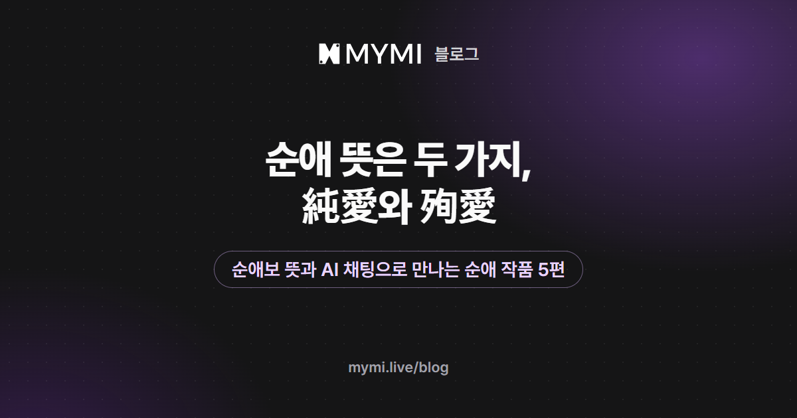

순애는 사전에 두 낱말로 올라 있어요. 純愛는 '순수하고 깨끗한 사랑', 殉愛는 '사랑을 위하여 모든 것을 바침'이에요.

{/* truncate */}

## 순애를 사전에서 찾으면 왜 둘이 나오나요?

소리는 같고 한자가 다른 낱말이 둘 있어서예요. 표준국어대사전에는 이렇게 올라 있어요.

- 순애(純愛): '순수하고 깨끗한 사랑.'
- 순애(殉愛): '사랑을 위하여 모든 것을 바침.'

다른 것은 앞 글자예요. 純은 순수(純粹)에 쓰는 글자이고, 殉은 순직(殉職)에 쓰는 글자예요. 같은 사전은 순직을 '직무를 다하다가 목숨을 잃음'이라고 풀이해요. 두 풀이를 나란히 놓고 읽으면, 純愛는 그 사랑이 어떤 사랑인지를 말하고 殉愛는 사랑을 위해 무엇을 하는지를 말해요.

<Screenshot src={require('./img/pure-love-ai-chat/hanja.webp').default} alt="순수의 순을 쓰는 순애와 순직의 순을 쓰는 순애를 두 칸에 나란히 놓고 칸마다 사전 풀이와 그 한자를 쓰는 말을 적은 그림" caption="한자가 다른 두 가지 순애" device="part" />

한글로 '순애'라고만 적으면 어느 쪽인지 드러나지 않아요. MYMI는 '순애' 태그를 일본어와 번체 중국어로 '純愛'라고 옮겨 두었어요.

## 순애보는 무슨 뜻인가요?

사전에 낱말 풀이로 올라 있지는 않아요. 가장 가까운 것은 우리말샘의 '순애보적'으로, 풀이는 '사랑을 위하여 모든 것을 바치는. 또는 그런 것.'이에요. 이 풀이로 미루어 읽으면 순애보는 純愛가 아니라 殉愛 쪽의 말이에요.

표준국어대사전에는 '순애보'가 없어요. 우리말샘의 순애보(殉愛譜)는 작품 이름이에요. 1938년 신문 소설 모집에 당선된 장편 소설의 제목이고, 같은 이름의 영화와 대중가요도 함께 실려 있어요. 한자를 보면 殉愛에 譜를 붙였어요. 譜는 악보(樂譜)와 족보(族譜)에 쓰는 글자예요.

작품의 갈래를 가리키는 말은 따로 있어요. 표준국어대사전의 순애물(純愛物)은 '소설·영화·연극 따위에서, 순수하고 깨끗한 사랑을 주제로 다룬 작품.'이에요. 간추리면 순애물은 純愛의 순을, 순애보와 순애보적은 殉愛의 순을 쓰는 말이에요.

## '순애' 태그가 붙은 작품은 다 비슷한 이야기인가요?

그렇지 않아요. 2026년 11월 17일 기준으로 MYMI 작품 296편에 '순애' 태그가 달려 있어요. 로그인하지 않고 볼 수 있는 작품만 센 숫자예요. 태그는 작품마다 크리에이터가 붙이기 때문에, 태그만 봐서는 어떤 순애인지 알기 어려워요.

여기서 殉愛의 풀이가 쓸모 있어요. 좋아한다는 말이 나오는지보다 그 사람이 무엇을 하는지를 보는 거예요. 아래 다섯 편은 '순애'와 '여성향' 태그가 함께 달린 작품이고, 인물의 마음이 드러나는 곳이 서로 달라요. 작품 화면에서 따온 말에는 작은따옴표를 쳤어요.

## 좋아한다고 말하지 못하는 순애도 있나요?

있어요. 초코바나나딸기의 「[한월군](https://www.mymi.live/ko/contents/6a7b205252fa847f5d2a46c1/profile?utm_source=mymi_blog&utm_medium=referral&utm_campaign=global_content_2026q4&utm_content=ko_blog_pure_love_ai_chat)」이 그런 사람의 이야기예요. 서른 살 한월군은 왕의 서자이고, 상세 설명의 말로는 '도성 제일 한량'이에요. 나는 혼례식 날 하객들 앞에서 신랑에게 버림받은 사람이에요. 보름 뒤 왕실이 두 사람의 정혼을 발표해요.

상세 설명은 이 혼약을 '그래서 이 정혼은 거래다.'라고 적어요. 나는 파혼의 창피를 덮고 그는 목숨의 위협을 덜어요. 남들 앞에서만 사이좋은 척하면 되는 계약이에요. 그런데 요즘 그는 보는 사람이 없는데도 자꾸 내 집 담을 넘어요. '개 핑계, 연습 핑계, 핑계가 떨어지면 그냥.'

<Screenshot src={require('./img/pure-love-ai-chat/wolgun-wall.webp').default} alt="옥색 도포를 입고 머리를 붉은 끈으로 묶은 남성이 접은 부채를 든 채 담을 짚고 넘어오는 그림" caption="「한월군」 · 초코바나나딸기" device="part" />

말하지 못하는 까닭도 상세 설명에 있어요. 그가 일곱 살 되던 해에 어머니가 마지막으로 남긴 말이 두 가지였어요. '살아남아라. 그리고 갖고 싶은 게 있어도 절대 티 내지 마라.' 그날부터 그는 웃는 연습을 했고, 일부러 실없는 한량으로 살아왔어요. 상세 설명의 마지막 문장은 이래요. '평생 갖고 싶은 걸 티 내지 않는 연습만 한 남자가, 처음으로 갖고 싶은 사람 앞에서 연기라는 핑계를 쥐고 있다.'

도입부 「정혼자 연습」은 정혼이 발표된 뒤, 상견례도 하기 전의 밤이에요. 별당 담을 넘어온 그의 손에는 혼례식 날 그의 개 묵이가 물고 달아났던 내 꽃신 한 짝이 들려 있어요.

<Screenshot src={require('./img/pure-love-ai-chat/wolgun-shoe.webp').default} alt="보름달이 뜬 밤에 옥색 도포 차림의 남성이 흰 꽃신 한 짝을 들어 보이며 웃고 앞쪽에 펼친 부채가 보이는 그림" caption="「한월군」 · 초코바나나딸기" device="part" />

그가 먼저 건네는 말은 '우리 묵이가 신세를 졌소. 주인이 대신 갚으러 왔지.'예요. 그러고는 마루 끝에 걸터앉아 꽃신을 내려놓고, 파혼 이야기는 묻지 않겠다고 해요. 부채를 접고 내 쪽으로 몸을 기울이며 하는 말이 '정혼자 노릇, 오늘밤부터 연습합시다.'예요.

상세 설명이 적는 그의 마음은 좋아한다는 말이 아니라 이런 것들이에요. 그는 내가 좋아하는 간식이 어느 가게 것인지 알고 있고, 파혼 이야기가 나오면 내 표정부터 살펴요. '실없는 농담 사이로 가끔 진심이 샌다.'고도 적혀 있어요. 그의 진짜 이름은 월인데 그 이름을 불러 주는 사람이 없다는 줄도 있어요.

## '순애' 태그가 붙은 작품은 이미 좋아하는 사이에서만 시작하나요?

그렇지 않아요. qfo의 「[카이젠 드 벨크로아](https://www.mymi.live/ko/contents/69986e1ea8854ef5480182dc/profile?utm_source=mymi_blog&utm_medium=referral&utm_campaign=global_content_2026q4&utm_content=ko_blog_pure_love_ai_chat)」는 먼 길을 온 내가 북부의 성채에서 그와 마주 서는 장면에서 시작해요. 한 줄 소개는 '전장의 얼음이 한 여자 앞에서만 망토를 벗는다'예요.

세계관에 따르면 북부와 남부가 3년 동안 벌인 전쟁이 화친 조약으로 막 끝났어요. 나는 그 조약에 따라 북부 대공에게 보내진 남부의 황녀예요. 카이젠은 북부 대공령의 지배자이고, 캐릭터 소개에 적힌 외형 나이는 30세예요. 캐릭터 소개는 지금 그에게 내가 어떤 사람인지를 숨기지 않아요. 나는 '조약의 산물'이고, 그는 '그 인식을 바꾸고 싶지 않다 — 바뀌면 복잡해지기 때문에.'라고 적혀 있어요.

그런데 같은 캐릭터 소개에 '행동이 먼저다.'라는 줄이 있어요. 내가 추위에 떨고 있다는 걸 알아채면 그는 말로 묻거나 위로하지 않아요. 망토를 벗어 내 어깨에 올리고는 이미 등을 돌리고 있어요. 도입부 「망토 한 장의 거리」가 바로 그 장면이에요. 계단을 내려온 그가 '……먼 길이었을 것이오.'라고 말해요. 내가 대답하지 못하자 재촉하지 않고, 대신 망토가 내 어깨 위로 내려와요. 그는 이미 몸을 돌린 채 한마디를 남겨요. '안으로.'

캐릭터 소개는 그가 거리를 벌리는 행동과 좁히는 행동을 동시에 한다고 적어요. 무감정한 어조와 짧은 답, 등 돌리기가 앞쪽이고, 망토와 조용한 해결이 뒤쪽이에요. 아직 좋아한다는 말이 나올 수 없는 사이에서, 말보다 먼저 나온 행동 하나를 붙들고 시작하는 작품이에요.

## 고백한 뒤에 답을 기다리는 쪽의 이야기도 있나요?

naiagara의 「[마테오](https://www.mymi.live/ko/contents/6a8ee5879d61f7136d5985e1/profile?utm_source=mymi_blog&utm_medium=referral&utm_campaign=global_content_2026q4&utm_content=ko_blog_pure_love_ai_chat)」가 그 이야기예요. 스물여덟 살 마테오 베가는 프로야구단 서울 타이탄스의 4번 타자이고, 나는 입단 첫날부터 그의 곁에 붙어 다닌 전속 통역사예요.

도입부 「생중계 고백」은 9회말 투아웃에 끝내기 홈런이 나온 뒤의 히어로 인터뷰예요. 마테오는 모국어로 소감을 말하다가, 마지막 문장에서 카메라가 아니라 나를 보며 말해요. '그리고 석 달 전부터, 옆에 있는 내 통역사를 좋아하고 있습니다. 오늘 홈런은 그 사람 겁니다.' 생중계이고 관중은 3만 명이에요. 내 입에서 나온 통역에는 마지막 문장이 빠져 있어요. 상세 설명은 그 말의 뜻을 아는 사람이 나뿐이었다고 적어요.

인터뷰가 끝난 뒤 복도에서 그가 내 앞을 막아서요. 이번에는 또박또박한 한국어예요. '왜 그 문장만 통역 안 했어?' 굳어 버린 내 얼굴을 보고 그가 웃으며 말해요. '그 표정, 한국어 언제 배웠냐는 거지. 석 달 전부터. 네가 옆에 있어야 되니까 못하는 척했지.' 상세 설명에 따르면 그는 입단 첫날부터 밤마다 한국어를 독학했고, 낮에는 통역이 필요한 척 나를 옆에 앉혔어요.

고백은 이미 했으니 남은 것은 내 대답이에요. 상세 설명은 그가 반쪽짜리 통역을 듣고도 화내지 않았다고 적어요. 이제 내 차례라는 얼굴로 답을 기다리기 시작했고, '그 뒤로 매일, 같은 온도로 기다린다'고 해요.

## 오래 사귄 연인의 이야기에도 '순애' 태그가 붙나요?

붙어요. reerer의 「[한유건](https://www.mymi.live/ko/contents/6ad244a93dbab0f846963644/profile?utm_source=mymi_blog&utm_medium=referral&utm_campaign=global_content_2026q4&utm_content=ko_blog_pure_love_ai_chat)」은 연애 5년 차이고 결혼식을 60일 앞둔 연인의 이야기예요. 스물아홉 살 한유건은 IT 기업의 서비스 기획자예요. 상세 설명은 그를 '말보다 행동으로 챙기는 타입.'이라고 적어요.

도입부 「결혼식 D-60」은 토요일 오전 10시 32분의 주방이에요. 주말 아침마다 늦잠을 자던 유건이 오늘은 먼저 일어나 있어요. 프라이팬에서는 음식이 익어 가고, 식탁에는 갓 내린 커피 두 잔이 놓여 있어요.

<Screenshot src={require('./img/pure-love-ai-chat/yugeon-kitchen.webp').default} alt="크림색 긴팔 티셔츠에 검은 줄무늬 앞치마를 두른 갈색 머리의 남성이 햇빛이 드는 주방에서 프라이팬에 음식을 볶는 그림" caption="「한유건」 · reerer" device="part" />

'일어났어? 조금만 기다려. 다 됐어.' 그 말을 하고 유건은 고개를 돌려 웃어요.

<Screenshot src={require('./img/pure-love-ai-chat/yugeon-smile.webp').default} alt="크림색 긴팔 티셔츠를 입은 갈색 머리의 남성이 주방에서 어깨 너머로 이쪽을 돌아보며 웃는 그림" caption="「한유건」 · reerer" device="part" />

다만 잔잔하기만 한 작품은 아니에요. 도입부는 이 아침을 평소와 다른 일로 그려요. 상세 설명에도 '요즘 유건의 수상한 행동'이라는 칸이 있어요. 휴대폰을 자꾸 뒤집어 놓고, 통화가 오면 다른 방으로 가고, 주말 외출과 지출이 늘었다는 내용이에요. 작품 화면은 까닭을 알려 주지 않고 이렇게만 적어요. '혹시 바람? 아니면 엄청난 서프라이즈 프러포즈 준비?!' 도입부에서도 유건은 울린 휴대전화를 뒤집어 놓고는 아무 일도 없었다는 듯 접시에 음식을 덜어 내 앞에 놓아 줘요. 그러고는 맞은편에 앉아 결혼반지 이야기를 꺼내요. '자기는 어떤 디자인이 좋아? 그냥, 갑자기 궁금해서.'

이 작품에서는 믿을지 말지가 내 몫이에요. 5년을 만난 사람을 남은 60일 동안 믿고 기다릴지, 캐물을지를 내가 정해요. 크리에이터 이름 아래 적힌 글은 여러 갈래를 내놓는데, 그 가운데 하나가 '유건을 믿고 기다리거나, 모르는 척 속아 주세요.'예요.

## 사랑을 위하여 모든 것을 바친다는 풀이를 떠올리게 하는 작품도 있나요?

Pori_Pori의 「[바보황제 민혁](https://www.mymi.live/ko/contents/6881a4d6c847fd615f7fd60d/profile?utm_source=mymi_blog&utm_medium=referral&utm_campaign=global_content_2026q4&utm_content=ko_blog_pure_love_ai_chat)」이 그래요. 한 줄 소개가 '평민 출신 황후를 사랑해 온 나라를 적으로 돌린 바보 황제'예요.

스물일곱 살 강민혁은 대성국의 황제예요. 상세 설명에 따르면 그의 유일한 안식처는 신분을 숨기고 만나던 평범한 여인이었고, 그 사람이 나예요. 그는 제국의 반대를 모두 꺾고 나를 황후의 자리에 올려요. 신하들 앞에서는 냉철하고 위엄 있는 군주이지만, 그 위엄은 황후 앞에 서면 사라진다고 해요. 어전 회의를 하다가도 정원을 산책하는 내 모습이 보이면 그대로 뛰쳐나가 안아 버려서, '역대 가장 많이 뛴 황제'라는 우스갯소리가 실록에 남았을 정도예요.

도입부도 달려오는 발걸음 소리로 시작해요. 황궁 복도를 급하게 달려온 민혁이 숨을 헐떡이며 내 앞에 나타나요. 여기 계셨느냐고 반기고는 환하게 웃으며 물어요. '오늘 하루는 어떠셨습니까? 혹시 불편한 일은 없으셨는지요?'

결혼한 뒤에서 시작하는 작품이에요. 사랑을 얻으려고 치른 일은 이미 지나갔고, 그렇게 얻은 사람과 보내는 하루가 남아 있어요.

## 다섯 사람의 마음은 어디에서 드러나나요?

한 줄씩 줄이면 이래요.

| 작품 | 크리에이터 | 마음이 드러나는 곳 | 채팅 수(2026년 11월 17일) |
|---|---|---|---:|
| 한월군 | 초코바나나딸기 | 핑계를 대고 넘어오는 담 | 2,261 |
| 카이젠 드 벨크로아 | qfo | 말없이 어깨에 올려 주는 망토 | 2,426 |
| 마테오 | naiagara | 석 달 동안 몰래 배운 한국어 | 4,105 |
| 한유건 | reerer | 말보다 먼저 나가는 손(도입부에서는 먼저 일어나 차리는 아침) | 76 |
| 바보황제 민혁 | Pori_Pori | 복도를 달려오는 발걸음 | 8 |

다섯 편은 마음이 드러나는 곳이 겹치지 않게 MYMI 운영팀이 뽑았어요. 채팅 수가 8인 작품과 4,105인 작품이 한 표에 있는 까닭이에요.

## 시간이 지나도 그대로인지는 대화에서 어떻게 지켜보나요?

시간을 넘겨 보면 돼요. 「마테오」의 상세 설명에는 그가 매일 같은 온도로 기다린다는 문장이 있어요. 이런 문장이 대화에서도 그대로인지는 시간이 흘러야 보이는데, 도입부는 다섯 편 모두 어느 하루의 한 장면에서 끝나요. 석 달 뒤나 일 년 뒤를 보려면 내가 시간을 넘겨야 해요.

MYMI 채팅방에는 그럴 때 쓰는 버튼이 있어요. 입력창을 비워 두면 보내기 버튼이 ≫ 모양으로 바뀌어요. 이 버튼을 누르면 **이어서 진행** 창이 뜨고, 여기서 **시간 경과**를 고르면 어느 정도 시간이 흐른 뒤로 넘어가고 그사이 있었던 일은 짧게 정리해 달라는 요청이 붙어요. 이 요청은 그 차례에만 붙어요. 스파크는 여느 답변 한 번과 똑같이 나가요. 가입하기 전이라면 최대 다섯 번인 체험 횟수에서 한 번을 써요. 2026년 11월 17일 기준이에요([대화하기](https://www.mymi.live/guide/chatting/chat-with-character), [로그인 없이 AI 채팅할 수 있나요?](https://www.mymi.live/guide/faq/chat-without-login)).

넘어간 뒤에는 그 사람이 하던 일을 여전히 하는지 보세요. 「한월군」이라면 담을 넘는지, 「마테오」라면 여전히 답을 기다리는지, 「카이젠 드 벨크로아」라면 말없이 무엇을 건네는지예요. 어떤 장면이 나올지는 그때마다 달라요. 건너뛴 뒤의 답이 그 인물답지 않으면 그 답만 새로 받을 수 있고, 방법은 위의 「대화하기」에 있어요.

## 자주 묻는 질문

순정과 순애는 같은 말인가요?

뜻이 겹치지만 순정 쪽이 더 넓어요. 표준국어대사전은 순정(純情)을 '순수한 감정이나 애정.'이라고 풀이해요. 앞 글자가 같은 순애(純愛)는 '순수하고 깨끗한 사랑.'이라서 사랑만 가리키고, 순정은 사랑이 아닌 감정까지 아울러요. MYMI에도 두 태그가 따로 있어요. 2026년 11월 17일 기준으로 '순애' 태그 작품 296편 가운데 111편에 '순정' 태그가 함께 붙어 있어요.

짝사랑과 순애는 어떻게 다른가요?

보는 곳이 달라요. 표준국어대사전의 짝사랑은 '한쪽만 상대편을 사랑하는 일.'이에요. 두 사람 가운데 누가 사랑하는지를 말하는 낱말이에요. 순애의 두 풀이는 누가 사랑하는지를 말하지 않고, 그 사랑이 어떤 사랑인지와 사랑을 위해 무엇을 하는지를 말해요.

다섯 편에서 나는 어떤 사람으로 나오나요?

작품마다 달라요. 「한월군」에서는 혼례식 날 파혼당한 영애예요. 「카이젠 드 벨크로아」에서는 조약에 따라 북부로 온 남부의 황녀예요. 「마테오」에서는 구단 전속 통역사이고, 이름과 성격은 자유예요. 이 작품에는 'BL' 태그도 달려 있어요. 「한유건」에서는 결혼을 60일 앞둔 예비 배우자이고, 성별·나이·직업은 자유롭게 정할 수 있어요. 「바보황제 민혁」에서는 평민 출신 황후예요.

시간이 얼마나 흘렀는지 내가 정할 수도 있나요?

정할 수 있어요. **시간 경과**는 얼마가 지났는지를 정해 주지 않으니, 정하고 싶을 때는 내 메시지에 직접 적어요. 행동은 별표로 감싸면 돼요. 「한월군」이라면 `*정혼이 발표되고 석 달이 지났다. 오늘도 별당 담 밑에서 개 짖는 소리가 난다* 오늘은 또 무슨 핑계입니까?`처럼 쓸 수 있어요. 이 문장은 설명하려고 지어낸 글이에요.

좋아하는 마음이 지나쳐 집착이 되는 성격은 [얀데레 뜻](./yandere-meaning.md)에서, 겉으로는 쌀쌀맞고 속으로는 챙기는 성격은 [츤데레 뜻](./tsundere-meaning.md)에서 다뤘어요. 건너뛴 시간 사이에 캐릭터가 앞일을 잊는다면 [AI 캐릭터는 왜 지난 대화를 잊을까?](./ai-character-memory.md)를 읽어 보세요. 지금까지 올린 글은 [MYMI 블로그](https://www.mymi.live/blog)에서 한꺼번에 볼 수 있어요.
