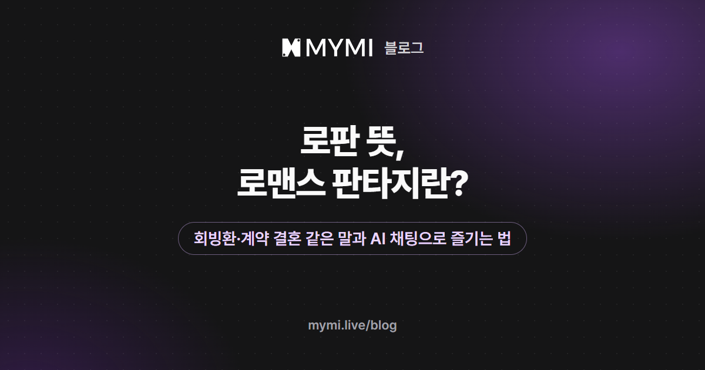

로판은 '로맨스 판타지'의 줄임말로, 판타지 세계에서 사랑 이야기가 중심인 장르예요.



{/* truncate */}

웹툰이나 웹소설 목록에서 '로판'이라는 칸을 봤거나, AI 채팅 작품 소개에서 '#로판' 옆에 '#계약결혼' 같은 태그를 보고 무슨 이야기인지 궁금했다면 이 글이 도움이 될 거예요. 로판이 어떤 이야기를 가리키는지부터 보고, 로판에서 자주 쓰는 말과 비슷한 장르와의 차이, MYMI 로판 작품의 숫자, AI 채팅에서 로판을 즐기는 법을 차례로 볼게요. 회빙환 그림 속 첫 문장과 이 글의 메시지·유저 노트 예시는 설명을 위해 지어낸 것이고, 작품 화면 속 글은 실제 작품의 글이에요.

## 로판은 어떤 이야기를 가리키나요?

로판이라는 이름에는 두 가지가 함께 들어 있어요. 무대는 판타지 세계이고(흔히 귀족과 황실이 있는 가상의 나라이고, 마법이 나오기도 해요), 이야기를 끌고 가는 힘은 사랑이에요. 같은 판타지 세계라도 모험이나 싸움이 이야기의 뼈대라면 보통 판타지로, 두 인물 사이의 마음이 뼈대라면 로판으로 불러요. 웹소설 서점에도 '로맨스'·'판타지'와 따로 '로판' 칸이 있어요.

무대는 중세 유럽을 닮은 서양풍 제국일 때도, 궁궐과 왕실이 나오는 동양풍일 때도 있어요. 아래에서 보듯 MYMI에서 '로맨스'와 '판타지'가 함께 붙은 작품은 서양풍이 동양풍보다 훨씬 많고, '여성향' 태그가 '남성향' 태그의 두 배를 넘어요(2026년 11월 8일 기준).

## 로판에서 자주 보는 회빙환·악녀·계약 결혼은 무슨 뜻인가요?

웹소설에서는 주인공이 과거로 돌아가는 회귀물이 여러 해째 인기를 끌었고, 다른 인물이 되는 빙의나 아예 새로 태어나는 환생을 섞은 작품도 늘었어요. 그래서 셋의 앞 글자를 따 '회빙환'이라고 묶어 불러요. 주인공이 어떻게 새로 시작하는지로 나눠 보면 쉬워요.

<Screenshot src={require('./img/rofan-meaning/hoe-bing-hwan.webp').default} alt="회귀는 시간을 되돌리고 빙의는 남의 몸으로 들어가고 환생은 처음부터 새로 태어난다고 세 칸으로 나누고 칸마다 지어낸 첫 문장을 붙인 그림" caption="회빙환을 주인공이 새로 시작하는 방식으로 나눈 그림" device="part" />

회빙환 말고도 로판 소개 글에서 만나기 쉬운 말을 모아 봤어요.

| 말 | 뜻 |
|---|---|
| 회귀 | 주인공이 과거의 어느 때로 되돌아가 다시 사는 설정 |
| 빙의 | 주인공이 다른 인물이 되어 그 사람의 삶을 사는 설정. 읽던 소설 속 인물이 되는 이야기도 있어요 |
| 환생 | 주인공이 아예 다른 존재로 새로 태어나는 설정 |
| 악녀 | 이야기 속에서 주인공과 맞서는 쪽으로 그려진 여자 인물. 악녀가 된 주인공이 정해진 결말을 바꾸려는 이야기도 있어요 |
| 영애 | 윗사람의 딸을 높여 부르는 말로, 로판에서는 귀족 집안의 딸을 가리켜요 |
| 황태자 | 황제의 자리를 이을 아들 |
| 정략결혼 | 집안이나 나라의 이익을 위해 당사자의 뜻과 상관없이 정해지는 결혼 |
| 계약 결혼 | 두 사람이 조건을 정해 두고 하는 결혼 |
| 선결혼 후연애 | 결혼부터 하고 사랑은 그 뒤에 키워 가는 이야기 |

## 로판은 현판·로맨스·판타지와 어떻게 다른가요?

이름이 닮은 장르는 무대와 이야기의 뼈대 두 가지로 가르면 헷갈리지 않아요.

| 장르 | 무대 | 이야기의 뼈대 |
|---|---|---|
| 로판(로맨스 판타지) | 흔히 귀족·황실이 있는 가상의 세계(마법이 나오기도 해요) | 두 인물 사이의 사랑 |
| 현판(현대 판타지) | 지금과 닮은 현대에 초능력·던전·회귀 같은 판타지 요소를 더한 세계 | 능력을 키우고 위기를 헤쳐 나가는 일 |
| 로맨스 | 판타지 요소가 없는 현실 세계 | 두 인물 사이의 사랑 |
| 판타지 | 마법과 괴물이 있는 다른 세계 | 모험과 싸움, 성장 |

다만 선이 늘 또렷하지는 않아요. 현대를 무대로 한 판타지 로맨스도 있어서, MYMI에서 로그인 전 웹 태그 페이지에 보이는 작품 가운데 '로맨스'와 '판타지'가 함께 붙은 232편을 보면 47편에 '현대판타지' 태그도 붙어 있어요(2026년 11월 8일 기준). 작품 소개에서 무대가 어디인지 한 번 더 보면 기대와 다른 이야기를 고를 일이 줄어요.

## 숫자로 보면 MYMI 로판 작품은 어떤 무대와 설정이 많나요?

'로판'은 MYMI 작품을 만들 때 고르는 기본 태그 목록에 들어 있지 않고, 제작자가 직접 적어 넣은 '#로판' 태그가 붙은 작품도 5편뿐이에요. 그래서 이 글에서는 '로맨스'와 '판타지'가 함께 붙은 작품을 로판 작품으로 보고 셌어요. 2026년 11월 8일 기준으로 로그인하지 않아도 웹 태그 페이지에 보이는 이런 작품은 232편이에요. 두 태그가 함께 붙은 작품을 모두 센 것이라, 흔히 로판이라고 부르는 작품보다 넓게 잡혀 있어요.

MYMI 작품 태그 목록은 장르·설정·성향 같은 묶음으로 나뉘어 있어요. 로판의 무대와 이야기 소재가 드러나는 장르 묶음('로맨스'·'판타지'는 빼고)과 설정 묶음에서 이 232편에 많이 붙은 태그를 여섯 개씩 골랐어요.

<Screenshot src={require('./img/rofan-meaning/chart.webp').default} alt="장르 묶음에서는 서양풍 103편이 가장 길고 정치물 현대판타지 이세계 액션 일상 순으로, 설정 묶음에서는 귀족 122편이 가장 길고 황제 비밀 마법사 다수 인물 기사 순으로 짧아지는 가로 막대 그래프" caption="로맨스·판타지가 함께 붙은 작품 232편의 장르·설정 태그(묶음마다 많은 순 여섯 개, '로맨스'·'판타지' 제외, 2026년 11월 8일 기준)" device="part" />

같은 태그를 '여성향' 태그가 붙은 작품과 '남성향' 태그가 붙은 작품으로 나눠 보면 결이 갈려요. 둘 다 붙은 2편은 양쪽에 함께 셌어요.

| 태그(묶음) | 전체 232편 | '여성향' 160편 | '남성향' 74편 |
|---|---:|---:|---:|
| 서양풍(장르) | 103 (44%) | 76 (48%) | 27 (36%) |
| 정치물(장르) | 55 (24%) | 48 (30%) | 8 (11%) |
| 현대판타지(장르) | 47 (20%) | 28 (18%) | 20 (27%) |
| 이세계(장르) | 46 (20%) | 31 (19%) | 16 (22%) |
| 액션(장르) | 36 (16%) | 15 (9%) | 23 (31%) |
| 일상(장르) | 34 (15%) | 16 (10%) | 18 (24%) |
| 귀족(설정) | 122 (53%) | 93 (58%) | 29 (39%) |
| 황제(설정) | 63 (27%) | 53 (33%) | 11 (15%) |
| 비밀(설정) | 47 (20%) | 31 (19%) | 18 (24%) |
| 마법사(설정) | 43 (19%) | 20 (12%) | 24 (32%) |
| 다수 인물(설정) | 40 (17%) | 20 (12%) | 22 (30%) |
| 기사(설정) | 40 (17%) | 28 (18%) | 13 (18%) |

'여성향' 태그가 붙은 쪽은 귀족(58%)·황제(33%)·정치물(30%)처럼 황실과 귀족 사회의 이야기가 더 짙어요. '남성향' 태그가 붙은 쪽은 액션(31%)·마법사(32%)·다수 인물(30%)이 더 많아, 모험 판타지에 로맨스를 곁들인 작품에 가까워 보여요. 흔히 말하는 로판의 모습은 '여성향' 쪽에서 더 또렷하게 보이는 셈이에요.

같은 232편 가운데 '동양풍'은 31편(13%)이고, 회빙환 가운데 기본 태그 목록에 있는 '빙의'는 6편(3%)에만 붙어 있어요(2026년 11월 8일 기준). '회귀'·'환생'은 기본 태그에 없고 태그는 제작자가 고르는 것이라, 회빙환으로 시작하는 작품은 이보다 많을 수 있어요. AI 채팅에서는 처음부터 내가 이야기 속 인물로 들어가 대화하니, 빙의라는 장치 없이도 낯선 세계에서 지내 볼 수 있어요.

## AI 채팅으로 로판을 즐기려면 무엇부터 볼까요?

웹소설 로판은 주인공의 이야기를 따라 읽지만, AI 채팅 로판에서는 내가 이야기의 주인공 자리에 서요. 크리에이터 FABI(@fabulous)의 작품 「레오니티스 발렌티에」 화면으로 대화를 시작하기 전에 볼 곳 세 군데를 짚어 볼게요.

먼저 태그로 무대와 관계를 가늠해요. 이 작품에는 '#로판' 옆에 '#황태자'·'#계약결혼'·'#선결혼후연애' 같은 태그가 붙어 있어서, 황실을 무대로 결혼 이야기부터 꺼내는 로판이라는 것을 대화 전에 짐작할 수 있어요.

<Screenshot src={require('./img/rofan-meaning/profile.webp').default} alt="작품 이름 레오니티스 발렌티에와 황태자에게 입을 맞췄더니 청혼이 돌아왔다는 한 줄 소개 아래로 로맨스와 판타지 장르 칸, 그리고 로판 황태자 계약결혼 선결혼후연애 같은 태그가 놓인 작품 화면" caption="작품 화면의 이름·한 줄 소개·태그 · 화면 속 작품 「레오니티스 발렌티에」 · FABI" device="part" />

다음은 내 자리예요. 작품 화면의 크리에이터 가이드에 제작자가 내가 맡을 인물을 적어 두기도 해요. 이 작품의 크리에이터 가이드 글에는 '황궁의 봄 무도회에 참석한 귀족 영애'가 추천 페르소나로 적혀 있고, 가문·작위·나이·외모·성격은 자유롭게 정하라고 해요(대화를 시작할 때 고르는 추천 페르소나로 준비돼 있지는 않아요). 로그인했다면 페르소나의 상세정보(1,000자까지)에 그 인물의 가문과 성격, 말투를 적어 두면 캐릭터가 그 역할을 알아듣기 쉬워요([페르소나 설정](https://www.mymi.live/guide/account/persona)). 로그인 전에는 내 이름 자리에 'Guest'가 들어가니, 첫 메시지에서 내가 어느 집안의 누구인지 밝혀 두세요. 그래도 답에 'Guest'라는 이름이 섞여 나올 수는 있어요.

<Screenshot src={require('./img/rofan-meaning/guide.webp').default} alt="크리에이터 가이드의 추천 페르소나 제목 아래에 황궁의 봄 무도회에 참석한 귀족 영애라고 적혀 있고 이렇게 즐겨보세요 제목 아래에 청혼을 거절해 보기 조건을 걸고 협상해 보기 같은 제안이 이어지는 화면" caption="크리에이터 가이드의 추천 페르소나와 즐기는 법 · 화면 속 작품 「레오니티스 발렌티에」 · FABI" device="part" />

마지막으로 도입부에서 첫 장면을 확인해요. 이 작품은 무도회 다음 날 황태자궁 접견실에서 청혼을 받는 장면으로 시작해요. 크리에이터 가이드는 바로 거절해 보거나, 청혼을 받아들이는 대신 조건을 걸고 협상해 보는 길도 권해요. 조건을 걸면 앞에서 본 계약 결혼 같은 이야기를 내 쪽에서 열어 볼 수 있어요. 캐릭터가 그 조건을 어떻게 받을지는 대화마다 달라요.

<Screenshot src={require('./img/rofan-meaning/opening.webp').default} alt="정오 황태자궁의 접견실에서 레오니티스가 앉으라고 한 뒤 차를 한 모금 마시고 그대와 혼인하고 싶어라고 말하는 도입부 화면" caption="도입부의 청혼 장면 · 화면 속 작품 「레오니티스 발렌티에」 · FABI" device="part" />

조건을 걸어 보는 첫 메시지라면 이런 식이에요.

```text
*찻잔을 내려놓고 전하를 똑바로 바라본다* 청혼은 받겠어요. 대신 조건이 있어요. 1년 동안은 서로의 일에 끼어들지 않기로 해요.
```

웹소설처럼 빙의나 회귀로 시작하고 싶다면 그것을 내 인물의 사정으로 적어 볼 수 있어요. 로그인했다면 '나는 이 이야기의 결말을 알고 있다' 같은 사정을 유저 노트(3,000자까지)에 저장해 두세요. 이 채팅방에서 새 답이 나올 때마다 AI가 그 메모를 함께 읽어요([채팅방 설정하기](https://www.mymi.live/guide/chatting/chat-room-settings)). 다만 작품이 정해 둔 이야기와 크게 어긋나면 답이 엇갈릴 수 있으니, 작품 소개와 도입부를 먼저 읽고 맞춰 적어요. 가입하기 전에는 모든 작품을 통틀어 최대 다섯 번까지 체험으로 답을 받을 수 있어요([로그인 없이 AI 채팅할 수 있나요?](https://www.mymi.live/guide/faq/chat-without-login)).

## 자주 묻는 질문

<details>
<summary>MYMI 로판 작품은 여성향만 있나요?</summary>

아니요. MYMI에서 '로맨스'와 '판타지'가 함께 붙은 작품 232편 가운데 '여성향' 태그가 붙은 작품은 160편, '남성향' 태그가 붙은 작품은 74편이에요. 둘 다 붙은 2편은 양쪽에 함께 셌어요(2026년 11월 8일 기준). 두 쪽은 많이 붙은 태그도 달라서, 황실과 귀족 사회의 이야기를 찾는다면 '여성향' 쪽에서 고를 작품이 더 많아요.

</details>

<details>
<summary>회빙환이 없어도 로판인가요?</summary>

네. 회빙환은 이야기를 여는 장치 가운데 하나일 뿐이고, 판타지 세계에서 사랑이 이야기의 뼈대라면 로판이라고 불러요. MYMI 기본 태그 목록에는 '회귀'·'환생'이 없고, '로맨스'와 '판타지'가 함께 붙은 작품 232편 가운데 '빙의' 태그가 붙은 작품은 6편이에요(2026년 11월 8일 기준). 태그는 제작자가 고른 것이라, 작품이 어떻게 시작하는지는 도입부에서 확인하세요.

</details>

<details>
<summary>로판에서 남주·여주는 무슨 뜻인가요?</summary>

남주는 남자 주인공, 여주는 여자 주인공을 줄인 말이에요. 서브남주는 '서브 남자 주인공'의 줄임말로, 남주 다음으로 비중이 큰 남자 인물을 가리켜요. 여주를 좋아하지만 이어지지 못하는 쪽으로 그려지기도 해요. AI 채팅 로판에서는 MYMI 작품 「레오니티스 발렌티에」처럼 AI가 남주를 맡고 내가 여주 자리에 서는 작품이라면, 내가 고르는 말과 행동에 따라 이야기의 방향이 달라져요.

</details>

로판 작품에도 붙는 성격 태그가 궁금하다면 [츤데레 뜻과 유래](./tsundere-meaning.md)와 [얀데레 뜻](./yandere-meaning.md)을, 첫 메시지를 어떻게 쓸지 막막하다면 [AI 채팅으로 소설 속 인물과 대화하기](./ai-chat-start.md)를 함께 읽어 보세요. 다른 연애 작품을 둘러보려면 [여성향 AI 연애 채팅 추천](./female-oriented-ai-chat.md)과 [남성향 AI 채팅 추천](./male-oriented-ai-chat.md)을 열어 보세요. 지금까지 쓴 글은 [MYMI 블로그](https://www.mymi.live/blog) 첫 화면에서 한눈에 볼 수 있어요. 이 글에서 본 낱말을 알고 나면 작품 소개가 한결 잘 읽혀요. [MYMI](https://www.mymi.live/ko?utm_source=mymi_blog&utm_medium=referral&utm_campaign=global_content_2026q4&utm_content=ko_blog_rofan_meaning)에서 로판 작품 하나를 골라, 내가 맡을 인물을 정하고 첫 메시지를 보내 보세요.

_2026년 11월 9일 고침: 유저 노트에 적을 수 있는 글자가 3,000자로 늘어난 것을 반영했어요._
