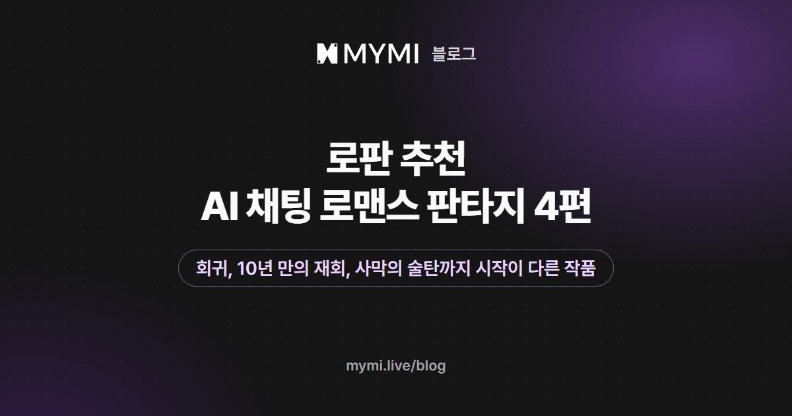

로판을 AI 채팅으로 즐기고 싶다면 2026년 11월 9일 기준 「라시드 알 나시르」·「데미안」·「테오도르 해링턴」·「이베른 드 라우셀」을 추천해요.



{/* truncate */}

로판이라는 말은 알겠는데 AI 채팅으로는 어떤 작품부터 열어 볼지 고민이라면 이 목록에서 골라 보세요. 작품마다 이야기가 어디서 시작하는지, 내가 어떤 인물로 들어가는지, 첫 메시지에서 무엇을 정해 두면 좋은지를 정리했어요. 로판이 무슨 뜻인지부터 궁금하다면 [로판 뜻](./rofan-meaning.md)을 먼저 읽어 보세요. 글에 실은 작품 그림과 도입부 대사는 실제 작품에 있는 것이고, 첫 메시지 예시는 설명을 위해 지어낸 것이에요.

## 네 편은 어떻게 골랐나요?

MYMI에는 작품을 만들 때 고르는 기본 태그에 '로판'이 없어서, 「로판 뜻」 글과 같은 조건(로그인하지 않아도 웹 태그 페이지에 보이는 작품 가운데 '#로맨스'와 '#판타지'가 함께 붙은 작품)으로 후보를 모았어요. 2026년 11월 9일 기준 233편이에요. 대화가 많은 작품부터 차례로 읽어 두 편을 고르고, 아직 대화가 많지 않은 작품에서 두 편을 더했어요. 되도록 이야기가 시작되는 방식이 서로 다른 작품을 골랐어요.

그래서 이 네 편은 인기 순위가 아니라, 운영팀이 작품 화면을 하나씩 읽어 보고 고른 결과예요. 네 편 모두 '여성향' 태그가 붙은 작품이에요.

## 네 편은 어디서 시작하고, 나는 누가 되나요?

| 작품(크리에이터) | 이야기의 시작 | 내가 맡는 인물 | 채팅 수 |
|---|---|---|---:|
| [라시드 알 나시르](https://www.mymi.live/ko/contents/6a8d7fcdebadaba607141d1e/profile?utm_source=mymi_blog&utm_medium=referral&utm_campaign=global_content_2026q4&utm_content=ko_blog_rofan_recommendations)(reerer, @wewewe) | 사막 제국 술탄의 신부 후보들이 모인 연회에서, 비밀 정원으로 불려 간 나에게 그가 황금 열쇠를 내미는 밤(11년 전 사막에서 처음 마주치는 도입부도 있어요) | 술탄이 이미 고른 단 한 사람(성별·직업은 내가 정함) | 1,553 |
| [데미안](https://www.mymi.live/ko/contents/68a3ea21253b03cdeb33cce3/profile?utm_source=mymi_blog&utm_medium=referral&utm_campaign=global_content_2026q4&utm_content=ko_blog_rofan_recommendations)(seunggureui) | 누명을 쓰고 독살당한 왕비가 결혼식을 앞둔 때로 돌아온 날 | 왕비 | 1,327 |
| [테오도르 해링턴](https://www.mymi.live/ko/contents/6acf3bc375a73a1e72270057/profile?utm_source=mymi_blog&utm_medium=referral&utm_campaign=global_content_2026q4&utm_content=ko_blog_rofan_recommendations)(FABI, @fabulous) | 10년 만에 돌아와 보니 첫사랑인 소꿉친구에게 약혼녀가 있을 때 | 후작가의 영애 | 136 |
| [이베른 드 라우셀](https://www.mymi.live/ko/contents/6af05689b5a2003943029243/profile?utm_source=mymi_blog&utm_medium=referral&utm_campaign=global_content_2026q4&utm_content=ko_blog_rofan_recommendations)(reerer, @wewewe) | 전쟁을 끝낸 북부 대공을 집무실·황궁 연회·국경 검문소 가운데 한 곳에서 마주하는 때 | 내가 정함(황실 사절, 정략결혼 상대 등) | 18 |

채팅 수는 작품 화면에 보이는 숫자를 2026년 11월 9일에 옮긴 것으로, 다시 생성해 받은 답까지 함께 센 수예요. 네 편의 첫 번째 도입부에서 대사를 한 줄씩 옮기면 이래요.

<Screenshot src={require('./img/rofan-recommendations/lines.webp').default} alt="작품 이름과 크리에이터 이름 아래에 각 작품 첫 번째 도입부의 대사를 한 줄씩 적은 그림" caption="네 편의 첫 번째 도입부에 실린 대사 한 줄씩(「데미안」은 내가 하는 말)" device="part" />

## 네 편은 각각 어떤 로판인가요?

### 라시드 알 나시르

크리에이터 reerer(@wewewe)의 「[라시드 알 나시르](https://www.mymi.live/ko/contents/6a8d7fcdebadaba607141d1e/profile?utm_source=mymi_blog&utm_medium=referral&utm_campaign=global_content_2026q4&utm_content=ko_blog_rofan_recommendations)」는 사막 제국 자히르가 무대예요. 술탄 라시드의 즉위 11주년 연회에 신부가 되려는 이들이 모였지만, 그는 누구에게도 잔을 들지 않아요. 연회가 한창일 때 시종장이 나를 왕족도 허락 없이 들어갈 수 없는 비밀 정원으로 데려가고, 라시드는 태양궁의 문을 모두 열 수 있는 황금 열쇠를 내밀며 '받아도 좋고, 거절해도 좋다'고 해요.

상세 설명에 따르면 그는 겉으로는 사치스러운 폭군으로 소문났지만 실은 정세에 밝은 군주이고, 오래전 인연인 나에게만 집요하게 구애해요. 도입부를 바꾸면 11년 전 사막에서, 신분을 숨긴 채 다쳐 있던 그를 처음 마주치는 장면부터 시작할 수 있어요. 작품 화면의 크리에이터 이름 아래 적힌 말을 보면 내 성별과 직업은 정할 수 있고, 다른 나라의 왕족이나 연회에 초대된 상인·학자·예술가 같은 처지로 시작해도 돼요. 서양풍 귀족 사회 말고 사막 제국의 궁정에서 펼쳐지는 로판을 찾는다면 맞아요.

### 데미안

크리에이터 seunggureui의 「[데미안](https://www.mymi.live/ko/contents/68a3ea21253b03cdeb33cce3/profile?utm_source=mymi_blog&utm_medium=referral&utm_campaign=global_content_2026q4&utm_content=ko_blog_rofan_recommendations)」은 회귀로 시작해요. 나는 알트리아 왕국의 왕비로, 국왕 데미안이 이웃 나라와의 전쟁에서 데려온 후궁의 계략에 왕을 해치려 했다는 누명을 쓰고 독살당했다가, 결혼식을 앞둔 때로 돌아와요. 도입부의 첫 대사는 예복을 차려입은 그를 맞으며 내가 하는 '어서 오십시오, 국왕 폐하.'예요.

작품 화면의 캐릭터 소개에서 데미안은 왕비를 '부인'이라 부르고, 무표정하고 냉정해 보여도 드물게 웃을 때는 따뜻한 분위기를 풍기는 사람으로 그려져요. 한 번 겪은 결말을 아는 채로 같은 사람을 다시 만나는 이야기예요.

### 테오도르 해링턴

크리에이터 FABI(@fabulous)의 「[테오도르 해링턴](https://www.mymi.live/ko/contents/6acf3bc375a73a1e72270057/profile?utm_source=mymi_blog&utm_medium=referral&utm_campaign=global_content_2026q4&utm_content=ko_blog_rofan_recommendations)」은 열한 살에 사라졌다가 10년 만에 돌아온 후작가 영애의 이야기예요. 소꿉친구 테오도르는 9년을 기다리다 포기하고, 가문을 위해 정략 약혼을 받아들인 참이에요. 크리에이터 가이드에 따르면 내가 왜 사라졌는지, 10년 동안 어디서 무엇을 했는지는 내가 정해요.

<Screenshot src={require('./img/rofan-recommendations/theodore.webp').default} alt="햇살이 드는 정원을 배경으로 금빛 수가 놓인 상의를 입은 갈색 머리의 젊은 남자가 고개를 비스듬히 기울이고 웃는 그림" caption="「테오도르 해링턴」 · FABI" device="part" />

아직 대화가 많지 않은 작품이지만, 재회와 약혼녀가 있는 첫사랑이라는 갈등이 또렷해서 넣었어요. 도입부는 응접실 문턱을 넘다 말고 멈춰 선 그가 한참을 바라보다 '...잘 지낸 거야?'라고 묻는 장면이에요.

<Screenshot src={require('./img/rofan-recommendations/theodore-door.webp').default} alt="열린 문가에 금빛 수가 놓인 연한 색 예복을 입은 젊은 남자가 서서 이쪽을 바라보는 그림" caption="「테오도르 해링턴」 · FABI" device="part" />

### 이베른 드 라우셀

크리에이터 reerer의 「[이베른 드 라우셀](https://www.mymi.live/ko/contents/6af05689b5a2003943029243/profile?utm_source=mymi_blog&utm_medium=referral&utm_campaign=global_content_2026q4&utm_content=ko_blog_rofan_recommendations)」은 2026년 11월 8일에 올라온 새 작품이에요. 8년 동안 이어진 북방 전쟁을 승리로 이끌었지만 잔혹한 결정으로 논란도 많은 북부 대공 이베른과, 그의 군권을 거두려는 황실 사이의 긴장이 무대예요. 한 줄 소개는 '나를 사랑하겠다고? 그대, 사람 보는 눈이 형편없군.'이에요.

<Screenshot src={require('./img/rofan-recommendations/ivern.webp').default} alt="모피 망토를 두르고 늑대 문장 브로치를 단 은발의 남자가 턱 가까이 손을 올린 채 옆을 보는 그림" caption="「이베른 드 라우셀」 · reerer" device="part" />

도입부가 세 개라서 북부 성의 집무실, 황궁 연회, 국경 검문소 가운데 첫 장면을 고를 수 있어요. 크리에이터가 남긴 말에 따르면 내 성별과 직업은 자유롭고, 황실 사절이나 정략결혼 상대, 북부군 장교처럼 여러 처지로 다가갈 수 있어요. 크리에이터 스스로 '공략 난이도 최상'이라고 적은 만큼, 쉽게 마음을 열지 않는 상대와 관계를 쌓아 가는 이야기를 원하는 분께 맞아요.

## 첫 메시지에서 무엇을 정해 두면 좋을까요?

네 편은 내 자리가 정해진 정도가 달라요. 「데미안」·「테오도르 해링턴」은 내 인물의 처지를 작품이 정해 두었고, 「라시드 알 나시르」·「이베른 드 라우셀」은 내가 누구인지부터 정하고 들어가요. 처지가 정해진 작품이라면 첫 메시지에 그 인물의 지금 마음을 한 줄 보태고, 처지를 정하는 작품이라면 내가 누구이고 왜 그 자리에 왔는지를 먼저 밝혀 보세요. 로그인했다면 그 설정을 페르소나 상세정보에 1,000자까지 적어 두고 대화를 시작할 때 고르면 돼요([페르소나 설정](https://www.mymi.live/guide/account/persona)).

「데미안」의 전생 기억이나 「테오도르 해링턴」의 사라졌던 10년처럼 내 인물만 아는 사정이 있다면, 그 사정을 상대에게 언제 밝힐지 정해 두고 시작하면 좋아요. 「데미안」과 「라시드 알 나시르」의 첫 메시지를 지어 보면 아래와 같아요.

```text
*예복 소매 끝을 꼭 쥐고 고개를 든다* 폐하, 혼례를 올리기 전에 한 가지만 약속해 주세요. 무슨 일이 있어도 제 말을 끝까지 들어 주시겠다고요.
```

```text
*난간 위에 놓인 열쇠를 내려다보다가 고개를 든다* 이걸 받기 전에 들어야겠어요. 연회장에 그 많은 사람을 두고, 왜 저인가요?
```

내 인물의 사정이 대화 내내 이어지게 하는 요령은 [로판 뜻](./rofan-meaning.md)의 'AI 채팅으로 로판을 즐기려면 무엇부터 볼까요?' 절과 [AI 채팅으로 소설 속 인물과 대화하기](./ai-chat-start.md)에서 볼 수 있어요. 로그인하기 전에 받을 수 있는 답은 모든 작품을 합쳐 많아야 다섯 번이라, 첫 장면이 가장 끌린 한두 편에 아껴 써 보세요([로그인 없이 AI 채팅할 수 있나요?](https://www.mymi.live/guide/faq/chat-without-login)).

## MYMI에서 로판 작품을 더 찾으려면?

다른 로판 작품을 찾을 때는 작품 화면의 # 태그에 '#로맨스'와 '#판타지'가 함께 있는지 보세요. 홈의 장르 탭이나 태그 목록에서는 한 번에 하나만 고를 수 있어요. 이 두 태그를 보는 까닭과 그런 작품에 어떤 무대·설정이 많은지는 [로판 뜻](./rofan-meaning.md)에 정리해 두었어요.

홈에서 이 글의 네 편처럼 남성 캐릭터가 나오는 작품이 잘 보이지 않는다면, 처음 들어왔을 때 '여성 캐릭터'를 골랐을 수 있어요. 각 탭의 캐릭터 성별을 '전체'나 '남성 캐릭터'로 바꾸면 보여요. 이 글의 네 편은 표와 본문의 작품 이름을 누르면 바로 작품 화면이 열리고, 화면의 **도입부**에서 시작할 장면을 미리 읽고 고를 수 있어요([대화하기](https://www.mymi.live/guide/chatting/chat-with-character)).

## 자주 묻는 질문

<details>
<summary>「라시드 알 나시르」를 11년 전 도입부로 시작해도 본편으로 이어지나요?</summary>

크리에이터가 남긴 말에 따르면 이어져요. 11년 전 도입부를 고르면 그때의 기억을 직접 쌓은 뒤 천일야 연회 본편으로 자연스럽게 넘어가거나, 다른 길로 이야기를 이어 갈 수 있다고 적혀 있어요. 실제로 어떻게 이어지는지는 대화마다 달라요. 도입부는 작품 화면의 **도입부**에서 고르고, 고르지 않으면 첫 번째 도입부인 비밀 정원 장면으로 시작해요.

</details>

<details>
<summary>표의 채팅 수는 무엇을 센 숫자인가요?</summary>

다시 생성으로 받은 답과 MYMI의 다른 언어 화면에서 오간 대화까지 모두 더한 숫자예요. 작품을 고를 때 살펴본 순서는 다시 생성한 답을 뺀 대화 수였어요.

</details>

<details>
<summary>내 인물의 성별을 바꿔서 해도 되나요?</summary>

작품마다 달라요. 「라시드 알 나시르」와 「이베른 드 라우셀」은 내 성별과 직업을 자유롭게 정해도 된다고 크리에이터가 작품 화면에 적어 두었어요. 「데미안」은 왕비, 「테오도르 해링턴」은 후작가의 영애로 내 자리가 정해져 있어요.

</details>

현대 배경의 연애 작품이 궁금하다면 [여성향 AI 연애 채팅 추천](./female-oriented-ai-chat.md)에서 골라 보세요. 로판 말고 다른 주제의 글은 [MYMI 블로그](https://www.mymi.live/blog) 첫 화면에 있어요. 끌리는 시작이 있었다면 표에서 그 작품을 열어 첫 장면부터 읽어 보세요.
