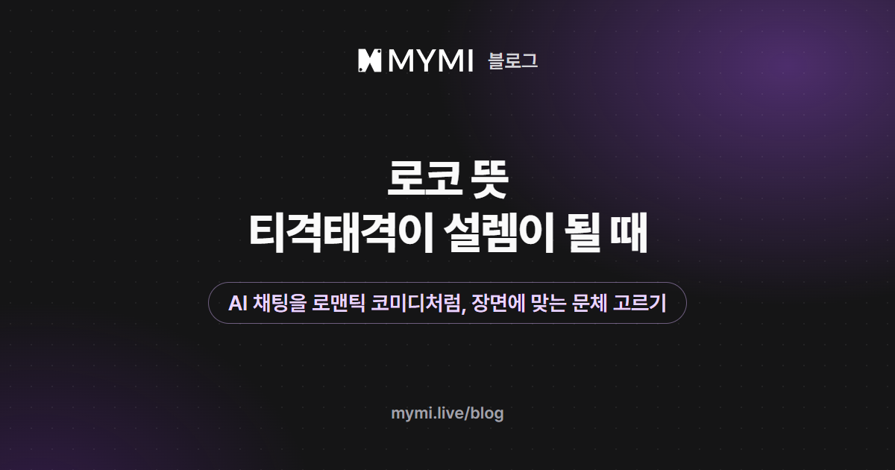

AI 채팅을 로코처럼 즐기려면 두 사람이 쉽게 가까워지지 못하는 까닭을 먼저 정하고 둘만의 장난을 쌓아 가면서, 웃는 장면은 라노벨형, 사이가 움직이는 장면은 로맨스형 문체로 받아 보세요. 로코는 로맨틱 코미디의 준말이에요.

{/* truncate */}

## 「윤태호」에서는 장난이 어디서 설렘으로 바뀌나요?

그가 평소 장난인 줄 알았던 내 행동에서 분위기가 달라지는 순간이에요.

작품 「윤태호」(Blu_Sky)는 아주 어릴 때부터 붙어 다닌 소꿉친구와의 이야기예요. 도입부에서 그는 소파에 누운 채 발끝으로 내 등을 건드리며 휴대폰 게임을 하고, 나를 발받침 취급해요. 그러다 내 표정을 보고는 또 장난을 꾸미는 게 아니냐고 의심해요. "너 그런 표정 지을 때마다 항상 나한테 장난치려고 그러잖아." 웃음은 여기서 나와요. 두 사람에게는 서로 놀리고 장난치는 오랜 버릇이 있어요.

상세 설명 안의 캐릭터 소개는 그다음 장면까지 그려 둬요. 내가 그의 눈앞까지 얼굴을 가져가자 공기가 달라지고, 늘 능청스럽던 그도 긴장한 티를 감추려 손을 가볍게 말아 쥐어요. 장난만 치던 그가 장난이 아닌 순간 앞에서 굳어 버리는 어긋남이 설렘이 되는 자리예요. 이 작품의 독자층 태그는 여성향이고, 장르는 로맨스, 태그에 '코미디'와 '소꿉친구'가 함께 달려 있어요. [「윤태호」 작품 화면](https://www.mymi.live/ko/contents/68274c9e3914600144f07a31/profile?utm_source=mymi_blog&utm_medium=referral&utm_campaign=global_content_2026q4&utm_content=ko_blog_romcom_ai_chat)에서 도입부부터 볼 수 있어요.

이 작품처럼 장난이 쌓인 뒤라야 그 장난을 벗어나는 순간이 도드라져요. 라노벨형 문체 지시도 장면이 필요로 할 때 웃음 사이로 진심이 비치게 하라고 적고 있어요. 그러니 처음 몇 차례는 둘만의 장난과 말버릇을 쌓는 데 쓰고, 장난을 벗어나는 한 걸음은 내 메시지로 내디뎌 보세요. 「윤태호」처럼 어릴 적부터 곁에 있던 사람과 시작하는 작품을 더 찾는다면 [「소꿉친구와 죽마고우·남사친은 어떻게 다를까?」](./childhood-friend-ai-chat.md)를, 서로 미워하며 시작하는 사이는 [「혐관 뜻과 애증 뜻」](./love-hate-ai-chat.md)을 보세요. [MYMI 블로그 첫 화면](https://www.mymi.live/blog)에는 장르와 관계별로 쓴 다른 글도 모여 있어요.

## 티격태격이 금방 끝나지 않으려면 무엇을 정해 두나요?

두 사람이 쉽게 가까워지지 못하는 까닭이에요.

MYMI의 로맨스형 문체 지시는 이야기 속 인물들에게 거리를 둘 구체적인 까닭을 주라고 적고, 그 예로 의무, 옛 상처, 신분, 서로 다른 가치관을 들어요. 그 까닭은 한 번에 사라지지 않고 조금씩 닳아야 해요. 우리말샘이 로맨틱 코미디가 주로 다룬다고 적은 '계급과 성격이 서로 다른' 남녀와도 닮은 데가 있어요.

<Screenshot src={require('./img/romcom-ai-chat/collide.webp').default} alt="두 사람이 바로 가까워지지 못하는 까닭 네 가지인 의무, 옛 상처, 신분, 가치관과 저마다 지어낸 설정 한 줄을 담은 카드" caption="로맨스형 문체 지시가 예로 드는 거리를 두는 까닭 네 가지. 카드 오른쪽의 설정 문장은 꾸며 낸 예시예요" device="part" />

작품이 이미 그 까닭을 정해 두었다면 상세 설명에서 찾아보세요. 따로 적혀 있지 않다면 내 쪽에서 만들 수 있어요. 내 인물의 처지는 [페르소나](https://www.mymi.live/guide/account/persona)의 상세정보에 적은 뒤 대표로 정하거나 대화를 시작할 때 골라 두고, 둘이 부딪치는 까닭은 [유저 노트](https://www.mymi.live/guide/chatting/chat-room-settings)에 한 줄로 남겨 두면 AI가 그 방에서 답을 쓸 때마다 함께 읽어요. 페르소나와 유저 노트는 로그인 뒤에 쓰는 칸이에요.

로맨스형 지시에는 메시지 몇 번 만에 사랑에 빠지거나 한 번의 답 안에서 긴장을 다 풀어 버리지 말라는 내용도 있어요. 상대가 거절하면 이야기 속에서 무언가 바뀔 때까지 그 거절이 이어지게 하라는 내용도요. 로맨스형을 골랐는데 상대가 바로 마음을 받아 주지 않는다면 지시대로 흘러가는 중일 수 있어요. 다만 지시는 방향일 뿐이라 모든 답이 그대로 따른다는 보장은 없어요. 마음이 움직이길 바란다면 작은 친절, 실수, 오해, 함께 보낸 시간처럼 두 사람 사이에 일어난 일을 내 메시지로 만들어 주세요. 다정한 말투나 부탁을 되풀이하는 것만으로는 풀리지 않게 적혀 있어요.

## 웃는 장면과 사이가 움직이는 장면은 어떤 문체로 받나요?

웃음이 필요한 장면은 라노벨형, 두 사람의 사이가 움직여야 하는 장면은 로맨스형에 지시 내용이 맞춰져 있어요. 문체 스타일은 ⋮ 메뉴를 열면 나오는 **채팅 설정** 묶음에 있어요.

<Screenshot src={require('./img/romcom-ai-chat/style-pick.webp').default} alt="다섯 가지 문체 가운데 라노벨형에 보라색 테두리와 체크 표시가 붙은 문체 스타일 화면" caption="라노벨형을 고른 문체 스타일 창. 로맨스형은 맨 아래에 있어요" device="part" />

라노벨형 지시는 웃음이 시끄러운 말보다 타이밍에서 오게 하라고 적어요. 대사는 빠른 받아치기, 어색하게 말 돌리기, 건조한 반응, 장난스러운 과장 쪽을 권해요. 웃음이 나오는 자리로는 치우친 생각, 엇나간 타이밍, 지나친 자신감, 아니라고 우기기, 분위기 엇갈림 다섯 가지를 꼽아요.

<Screenshot src={require('./img/romcom-ai-chat/laugh.webp').default} alt="라노벨형 문체 지시가 꼽는 웃음이 나오는 다섯 자리인 치우친 생각, 엇나간 타이밍, 지나친 자신감, 아니라고 우기기, 분위기 엇갈림을 지어낸 짧은 장면과 함께 담은 카드" caption="라노벨형 문체 지시가 꼽는 웃음의 다섯 자리. 카드 속 장면과 대사는 모두 지어낸 것이에요" device="part" />

연애 장면에 대해서도 라노벨형은 귀엽거나 민망하게, 때로는 아슬아슬하게, 빠르고 읽기 쉽게 가라고 해요. 당황과 긴장, 아니라고 우기기, 타이밍이 고백 못지않게 설렘을 만든다는 거예요.

로맨스형 지시는 같은 장면에 다른 주문을 해요. 놀리는 말을 하더라도 그 아래에 진짜 마음이 있게 하고, 인물이 마음과 반대로 말하더라도 그 속뜻을 소리 내어 설명하지 말라고 해요. 몇 차례에 걸쳐 두 사람이 실제로 가까워지거나 멀어지게 하라고도 적어요. 로맨스형 지시는 작품의 분위기가 코믹하면 그 분위기를 따르라고도 적고 있어서, 문체를 자주 바꾸기 번거롭다면 로맨스형 하나로 이어 가도 돼요.

바꾼 문체는 다음 답부터 들어가요. 방금 받은 답을 **다시 생성**할 때도 지금 골라 둔 문체가 함께 가서, 같은 차례를 새 문체로 받아 견줘 볼 수 있어요. 이렇게 견줄 때도 새 답 하나마다 스파크가 들고, 로그인하지 않았을 때는 남은 체험 횟수에서 한 번씩 빠져요. 문체는 채팅방마다 따로가 아니라 지금 쓰는 브라우저나 앱의 모든 채팅방에 걸리니, 바꿨다면 다른 작품으로 옮기기 전에 원래대로 돌려 두세요. 작품 그대로·소설형·웹소설형까지 다섯 문체를 모두 견줘 보고 싶다면 [「AI 채팅 이야기를 원하는 분위기로 이끌려면?」](./ai-story-mood.md)의 표를 보세요.

## 사전은 로맨틱 코미디를 어떻게 풀이하나요?

우리말샘은 '로맨틱 코미디'를 남녀 사이의 로맨스를 코믹하게 그린 영화의 한 장르로 풀이해요.

<Screenshot src={require('./img/romcom-ai-chat/dict.webp').default} alt="우리말샘의 로맨틱 코미디, 로코, 스크루볼 코미디 풀이와 표준국어대사전의 코미디, 로맨틱하다 풀이, 순화어 낭만 희극을 나란히 정리한 카드" caption="로맨틱 코미디를 두 사전에서 찾아본 결과" device="part" />

같은 풀이에는 계급과 성격이 서로 다른 남녀가 티격태격하다가 최종적으로 행복하게 결합하는 이야기를 주로 다루고, 남녀의 말싸움을 코믹하게 그리는 것이 특징이라는 설명이 이어져요. 1930년대 초에 영화에 소리가 들어오면서 가능해진 장르라는 말도 붙어 있어요. '로코'는 이 말을 줄여 이르는 말로 따로 올라 있어요.

비슷한말로는 '스크루볼 코미디'가 이어져 있어요. 우리말샘은 이 장르가 1930년대 초반에 등장해 후반에 성행했고, 개성 있고 고집 센 두 남녀의 말싸움을 빠른 속도로 펼치는 것이 특징이라고 풀이해요. 라노벨형 지시가 꼽는 빠른 받아치기와도 겹치는 대목이에요.

표준국어대사전에는 '로맨틱 코미디'나 '로코'가 표제어로 없고, 가까운 말로 '코미디'의 첫 뜻(웃음을 주조로 하여 인간과 사회의 문제점을 경쾌하고 흥미 있게 다룬 연극이나 극 형식)과 '로맨틱하다'(낭만적인 데가 있다)가 있어요. 우리말샘의 규범 정보에는 2003년 고시 자료에서 '로맨틱 코미디' 대신 '낭만 희극'을 쓰도록 했다는 내용도 있어요.

## 자주 묻는 질문

판타지 왕궁이 무대여도 로코라고 할 수 있나요?

네, 무대를 정하는 말은 아니라서 그럴 수 있어요. 우리말샘은 로코가 줄인 말인 '로맨틱 코미디'를 영화의 한 장르로 풀이하지만, 같은 사전이 '로코 퀸'을 로맨틱 코미디 장르의 영화나 드라마에서 인기를 얻은 여자 배우로 풀이하듯 드라마에도 쓰이는 말이에요. 판타지 세계를 무대로 한 사랑 이야기는 로판(로맨스 판타지)이라고 부르는데, 로판이면서 티격태격하는 로코인 작품도 있을 수 있어요. 로판은 [「로판 뜻」](./rofan-meaning.md)에서 자세히 다뤘어요.

MYMI 작품 가운데 '코미디' 태그를 단 작품은 남성향과 여성향 중 어느 쪽이 많나요?

남성향이 두 배쯤 많아요. 2026년 11월 26일, 로그인하지 않은 상태로 한국어 화면에서 볼 수 있는 작품을 독자층 태그로 나눈 숫자예요.

| 독자층 태그 | 작품 수 |
|---|---|
| 남성향만 | 52 |
| 여성향만 | 25 |
| 둘 다 | 1 |
| 없음 | 0 |
| 합계 | 78 |

로맨스 태그까지 함께 단 작품은 78편 가운데 55편이에요.

라노벨형으로 바꿨더니 플래그나 히로인 같은 말이 섞여요. 왜 그런가요?

한국어로 받을 때 라노벨형 지시에는 즐겨 쓸 낱말 목록이 붙는데, 그 안에 스킬·스탯·플래그·히로인 같은 게임·이세계 말이 들어 있어요. 그래서 현대 배경의 로코에도 그런 말이 섞일 수 있어요. 거슬린다면 그 답만 로맨스형이나 작품 그대로로 바꿔 다시 생성하고, 다음 웃는 장면에서 라노벨형으로 돌려 두세요.

