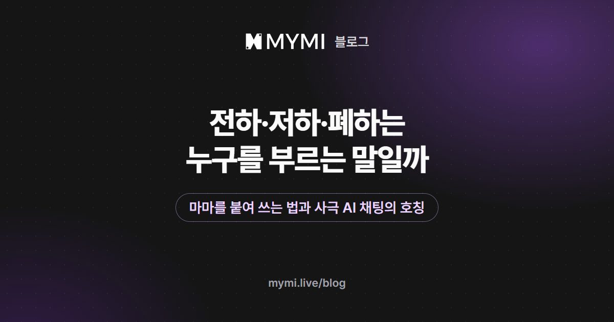

표준국어대사전은 전하(殿下)를 '조선 시대에, 왕을 높여 이르거나 부르던 말'로, 저하(邸下)를 '조선 시대에, 왕세자를 높여 이르거나 부르던 말'로, 폐하(陛下)를 '황제나 황후에 대한 경칭'으로 풀이해요. 마마는 표준국어대사전과 우리말샘 모두 임금과 그 가족에 관련된 말 뒤에 붙어 존대의 뜻을 나타내는 쓰임을 싣고, '대비마마'·'대왕마마'를 예로 들어요. 사극 AI 채팅에서는 작품 화면에서 상대의 자리를 보고 부르는 말을 고르고, 이야기 속에서 그 자리가 바뀌면 유저 노트에 바뀐 호칭을 적어 두세요.

{/* truncate */}

아래에서는 MYMI 작품 두 편의 화면을 예로 들어 호칭이 어디에 나오는지 보고, 두 사전의 풀이와 이야기 도중에 호칭을 바꾸는 법을 차례로 적었어요. 츤데레·로판 같은 다른 낱말의 뜻도 [MYMI 블로그](https://www.mymi.live/blog)에서 찾아볼 수 있어요.

## 사극 작품에서는 호칭을 보고 무엇을 알 수 있나요?

이 글의 두 편처럼, 누가 누구를 무엇이라고 부르는지를 보면 그 인물과 내가 이야기 속에서 어떤 자리에 있는지 알 수 있어요. 작품 화면의 한 줄 소개, 상세 설명, 도입부에서 찾으면 돼요.

FABI의 「[이현](https://www.mymi.live/ko/contents/6ac4e27a26c110c7af2a3508/profile?utm_source=mymi_blog&utm_medium=referral&utm_campaign=global_content_2026q4&utm_content=ko_blog_royal_titles_ai_chat)」은 한 줄 소개부터 이현의 대사 '어서 오시오, 빈궁.'이에요. 상세 설명에 따르면 이현은 국왕의 적장자로 8년째 세자 자리를 지키고 있는 스물두 살 왕세자이고, 나는 한양 외곽에 사는 한미한 사대부 집안의 외동딸이에요. 어느 날 난데없이 왕세자빈 책봉 교지가 내려오고, 나는 까닭을 알 수 없는 간택으로 동궁전에 들어가게 돼요.

<Screenshot src={require('./img/royal-titles-ai-chat/palace1.webp').default} alt="검은 관을 쓰고 금색 용무늬를 수놓은 검은 옷을 입은 이현이 궁궐 기둥 옆에 서 있다" caption="「이현」 · FABI" device="part" />

도입부는 혼례 날, 붉은 비단으로 꾸민 별궁의 혼례청에서 시작해요. 악기 소리가 멎자 문밖에서 '저하께서 드십니다.'라는 목소리가 들리고, 문이 열리며 혼례복 차림의 이현이 들어와요. 이현은 내 앞에 멈춰 서서 '어서 오시오, 빈궁.' 하고 말한 뒤 희미하게 웃으며 '나의 빈.'이라고 덧붙여요. 문밖의 목소리가 그를 '저하'로 이르고 그가 나를 '빈궁'이라고 부르는 두 마디가, 상세 설명의 교지와 주요 인물 소개가 적은 자리와 맞아떨어져요. 그는 왕세자이고, 나는 세자빈이에요.

<Screenshot src={require('./img/royal-titles-ai-chat/marry.webp').default} alt="구슬 장식이 늘어진 관을 쓰고 금색 무늬가 놓인 남색 예복을 입은 이현이 정면을 보고 있다" caption="「이현」 도입부에서 '저하께서 드십니다.' 다음에 나오는 그림 · FABI" device="part" />

말끝도 함께 보면 좋아요. 도입부의 이현은 '어서 오시오'처럼 하오체를 써요. 표준국어대사전은 하오체를 '상대편을 보통으로 높이는 종결형으로, 현대 국어의 구어에서는 거의 쓰지 않는다'고 풀이해요.

민트의 「[김연우](https://www.mymi.live/ko/contents/68c0d574ba488bfb5e495af7/profile?utm_source=mymi_blog&utm_medium=referral&utm_campaign=global_content_2026q4&utm_content=ko_blog_royal_titles_ai_chat)」에서는 상대가 나를 부르는 말이 내 자리를 알려 줘요. 상세 설명에 따르면 김연우는 조선 궁중 수라간에서 일하는 서른 살 남자 조리사, 대령숙수예요. 표준국어대사전은 대령숙수를 '조선 시대에, 궁중의 잔치 때 음식 만드는 일을 맡아 하던 남자 조리사'로 풀이하는데, 작품 화면에는 잔치 이야기가 없고 김연우는 임금님 수라상을 맡으며 공주의 처소에도 상을 올려요. 도입부는 그림 다음 첫 줄이 곧 그의 대사 '공주마마, 맛은 괜찮습니까?'라서, 나는 첫마디부터 공주로 이야기에 들어가요.

## 전하·저하·폐하는 사전에서 누구를 가리키나요?

표준국어대사전에서 전하는 조선 시대의 왕을, 저하는 조선 시대의 왕세자를 높여 부르던 말이고, 폐하는 황제나 황후에 대한 경칭이에요. 그래서 「이현」처럼 세자인 인물은 사전 풀이로 보면 '전하'가 아니라 '저하'예요.

<Screenshot src={require('./img/royal-titles-ai-chat/titles.webp').default} alt="왼쪽에는 높여 부르는 말인 폐하, 전하, 저하의 사전 풀이를, 오른쪽에는 왕실 사람을 이르는 말인 중전, 빈궁, 후궁의 사전 풀이를 적고, 아래에 마마가 쓰이는 방식을 적은 그림" caption="부르는 말 셋과 왕실 사람을 이르는 말 셋, 마마를 사전 풀이대로 옮긴 그림" device="part" />

부르는 말과 함께 왕실 사람을 이르는 말도 알아 두면 작품 화면을 읽기 쉬워요. 위 그림 오른쪽의 중전·빈궁·후궁은 사전에 다른 뜻도 함께 실려 있어서, 아래 자주 묻는 질문에 따로 적었어요.

## '마마'는 어떻게 붙여 쓰나요?

왕실 사람을 높이는 '마마'는 '대비마마', '대왕마마'처럼 앞말 바로 뒤에 붙어요. 표준국어대사전과 우리말샘 모두 마마의 넷째 뜻을, 임금 및 그의 가족과 관련된 명사 뒤에 붙어 '존대'의 뜻을 나타내는 말로 풀이하고 이 두 낱말을 붙여 적은 예로 들어요.

'마마' 한 낱말의 첫 뜻은 두 사전 모두 '벼슬아치의 첩을 높여 이르던 말'이고, 그다음으로 집집마다 찾아다니며 천연두를 앓게 한다는 여신, '천연두'를 일상적으로 이르는 말이라는 뜻이 실려 있어요. 그러니 AI 채팅에서 상대를 부를 때도 「김연우」의 도입부처럼 누구의 자리인지를 앞에 붙이면, 누구를 부르는지가 분명해져요.

## 이야기 속에서 자리가 바뀌면 호칭은 어떻게 바꾸나요?

바뀐 호칭을 그 채팅방의 유저 노트에 적어 두세요. 저하는 왕세자를, 전하는 왕을 부르는 말이라, 이야기를 오래 이어 가다 세자가 왕위에 오르는 장면을 쓰면 부르는 말도 함께 바뀌어야 해요.

유저 노트는 채팅방 하나에만 저장되는 메모라, 같은 작품이라도 방마다 다르게 적을 수 있어요. 이 메모는 그 방에서 AI가 답을 쓸 때마다 참고 자료로 들어가요. 로그인한 뒤 채팅방 오른쪽 위 ⋮ 메뉴의 채팅 설정에서 3,000자까지(2026년 11월 25일 기준) 쓸 수 있는데, 길게 쓸수록 메시지마다 드는 스파크가 늘 수 있으니 호칭처럼 꼭 지켜야 할 줄만 짧게 적어요. 아래 그림은 「이현」으로 이야기를 이어 가는 경우를 두고 설명을 위해 지어낸 유저 노트예요.

<Screenshot src={require('./img/royal-titles-ai-chat/note.webp').default} alt="유저 노트 네 줄 가운데 세자다를 왕위에 올랐다로, 저하를 전하로, 세자빈을 왕비로, 빈궁을 중전으로 고쳐 쓴 예시" caption="「이현」 뒷이야기를 가정한 유저 노트 예시" device="part" />

내 쪽의 자리는 페르소나에도 적어 둘 수 있어요. 페르소나의 이름 칸은 캐릭터가 나를 부르는 이름이니 내 이름을 쓰고, 세자빈·공주 같은 역할과 등장인물과의 관계는 1,000자까지 들어가는 상세정보에 적어요. 이미 이어 가던 방이라면 그 방의 ⋮ 메뉴 채팅 설정에서 페르소나를 열어 상세정보의 '세자빈'을 '왕비'로 고치고 저장하면, 그다음 답부터 고친 내용으로 이어져요. 새로 만든 페르소나는 대표로 정해 두거나 대화를 시작할 때 프로필 아이콘에서 골라야 새 대화에 쓰여요. 자세한 위치는 유저가이드 「[채팅방 설정하기](https://www.mymi.live/guide/chatting/chat-room-settings)」와 「[페르소나 설정](https://www.mymi.live/guide/account/persona)」에 있어요. 오래 이어 간 대화에서 AI가 설정을 놓치는 까닭과 바로잡는 법은 [AI 캐릭터는 왜 지난 대화를 잊을까?](./ai-character-memory.md) 글이 따로 다뤄요.

## 자주 묻는 질문

빈궁은 세자빈만 가리키는 말인가요?

첫 뜻으로는 세자빈과 같은 사람을 가리켜요. 표준국어대사전은 세자빈을 '왕세자의 아내'로 풀이하고 같은 말로 '왕세자빈'을 들며, 빈궁의 첫 뜻도 '왕세자의 아내'예요. 다만 두 사전 모두 빈궁의 다른 뜻으로 '임금의 후궁 가운데 지위가 가장 높은 사람'과 '조선 시대에, 빈(嬪)이나 세자빈이 거처하던 곳'을 싣고 있어서, 작품에서 누구를 빈궁이라고 부르는지는 앞뒤 설정과 함께 봐야 해요. 「이현」에서는 교지가 나를 왕세자빈으로 봉해요.

중전은 왕비와 같은 사람을 가리키나요?

네. 표준국어대사전은 중전(中殿)의 첫 뜻을 '왕비가 거처하던 궁전', 둘째 뜻을 ''왕비'를 높여 이르던 말'로 풀이하고, 두 뜻 모두 같은 말로 '중궁전'을 들어요.

후궁은 누구를 가리키는 말인가요?

표준국어대사전은 후궁의 첫 뜻을 '제왕(帝王)의 첩'으로 풀이하고, 비슷한 말로 '빈잉'을 들어요. 둘째 뜻은 사람이 아니라 '주되는 궁궐의 뒤쪽에 있는 궁궐'이에요.

서양풍 작품에서도 국왕을 '폐하'라고 부르나요?

그렇게 부르는 작품도 있어요. 사전 풀이로 폐하는 황제나 황후에 대한 경칭이지만, 이 블로그의 [로판 추천](./rofan-recommendations.md) 글에 실은 「데미안」에서는 도입부의 내 첫 대사가 '어서 오십시오, 국왕 폐하.'예요. 작품이 정한 호칭이 사전 풀이와 다를 수 있으니, AI 채팅에서는 그 작품 화면에 나온 호칭을 따르면 돼요.

