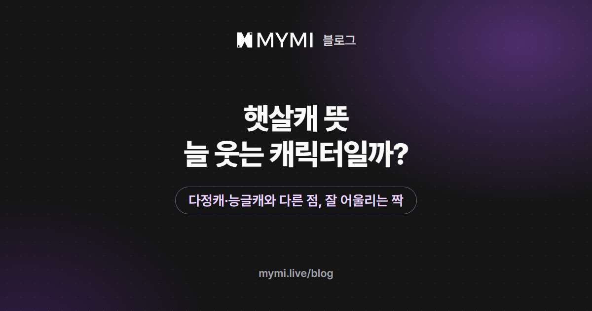

햇살캐는 햇살처럼 밝고 따뜻한 기운으로 주변을 환하게 만드는 성격의 캐릭터를 뜻해요.



{/* truncate */}

AI 캐릭터 채팅에서 햇살캐를 만나면 대화가 밝게 흘러가지만, 내가 어떤 사람으로 마주하느냐에 따라 이야기가 꽤 달라져요. 햇살캐가 내 닫힌 마음을 두드리는 이야기가 될 수도 있고, 거꾸로 내가 햇살이 되어 무뚝뚝한 캐릭터를 웃게 만드는 이야기가 될 수도 있죠. 이 글은 그 두 가지를 고르는 법을 가운데 두고, 말뜻과 비슷한 성격과의 차이, MYMI '#햇살' 작품의 태그 숫자를 함께 담았어요.

## 햇살캐는 어떤 캐릭터를 말하나요?

'햇살'에 캐릭터의 줄임말 '캐'를 붙여, 햇살 같은 성격의 인물을 부르는 말이에요. 여자 주인공이면 '햇살여주', 남자 주인공이면 '햇살남주'처럼 쓰기도 해요. 사전에 올라 있는 말은 아니에요. 웹소설·웹툰을 이야기할 때 인물을 짧게 부르는 말이라 쓰임새가 넓은 편이고, 대개 이런 모습을 함께 떠올려요.

- 잘 웃고 표정이 밝아요.
- 낯선 사람에게도 먼저 말을 걸어요.
- 곁에 있는 사람이 처져 있으면 기운을 북돋우려 해요.
- 일이 꼬여도 오래 가라앉지 않고 다시 해 보자고 해요.

곁에 있으면 마음이 편해지는 '치유계' 캐릭터를 햇살캐라고 부르기도 해요. MYMI에서는 작품을 만들 때 고르는 기본 태그 가운데 성격을 고르는 '성향' 묶음에 '햇살'이 있어요. 같은 묶음에 츤데레·다정·능글·무뚝뚝 같은 태그가 함께 들어 있어요.

## 햇살캐는 다정캐·능글캐와 무엇이 다른가요?

셋 다 상대에게 먼저 다가가는 쪽으로 그려질 때가 많아서 한 인물을 두고 함께 쓰기도 해요. 이 글에서는 셋을 상대에게 무엇으로 다가오는지로 견줘 볼게요. 그림의 대사와 이 글의 예시는 모두 설명하려고 지어낸 것이라 실제 작품 속 대사가 아니에요.

<Screenshot src={require('./img/sunshine-character/compare.webp').default} alt="일이 꼬여 풀이 죽은 상대에게 햇살캐는 같이 나가자며 분위기를 바꾸고, 다정캐는 따뜻한 것을 챙겨 오고, 능글캐는 장난스럽게 받아치는 모습을 지어낸 대사로 보여 주는 카드" caption="같은 장면에서 세 성격이 보이는 반응" device="part" />

햇살캐는 분위기를 바꾸는 쪽이에요. 상대가 처져 있으면 같이 나가자고 끌어내서라도 웃음이 나는 쪽으로 데려가요. 다정캐는 상대에게 필요한 것을 먼저 알아채고 채워 주는 쪽이고, 능글캐는 여유 있게 받아치며 상대를 당황하게 만드는 데서 재미가 나요. 성격이 섞이면 다정한 햇살캐는 밝게 챙겨 주는 인물이 되고, 능글맞은 햇살캐는 장난이 많은 밝은 인물이 돼요.

## 햇살캐는 왜 무뚝뚝하거나 어두운 인물과 자주 짝을 이루나요?

대비가 이야기를 만들어서예요. 밝게 다가가는 인물과 좀처럼 마음을 열지 않는 인물이 만나면, 닫혀 있던 쪽이 조금씩 달라지는 과정이 그대로 이야기의 줄기가 돼요. 무뚝뚝한 인물이 처음으로 먼저 말을 거는 장면처럼 작은 변화도 크게 다가오죠. 영어권에서도 이런 짝을 '그럼피/선샤인(grumpy/sunshine)', 곧 투덜이와 햇살이라고 부르며, 여러 매체에서 자주 쓰는 로맨스 구도로 소개해요.

MYMI '#햇살' 작품에는 따뜻한 결의 성향 태그가 함께 붙은 경우가 더 많지만, 차갑거나 어두운 결이 함께 붙은 작품도 적지 않아요. 2026년 11월 10일 기준으로 웹 태그 페이지에서 로그인하지 않고 볼 수 있는 '#햇살' 작품 119편을 세어 봤어요.

| 함께 붙은 성향 태그 | 작품 수 |
|---|---:|
| 다정·능글·순정 가운데 하나 이상 | 84편(71%) |
| 쿨데레·츤데레·까칠·무뚝뚝·음침 가운데 하나 이상 | 40편(34%) |
| 위 두 쪽이 모두 붙은 작품 | 26편(22%) |

다만 태그는 작품 단위로 붙어서, 두 인물이 짝을 이룬 것인지 한 인물이 두 결을 다 지닌 것인지는 태그만으로 알 수 없어요(40편 가운데 22편은 '다수 인물' 태그가 붙은 작품이에요). 태그에 '햇살'과 '무뚝뚝'·'까칠'이 함께 있다면 두 결의 인물이 함께 나올 수도 있으니, 상세 설명에서 누가 어느 쪽인지 보고 내 자리를 정하세요.

## AI 채팅에서 햇살캐 이야기를 즐길 때 내 쪽은 어떻게 정하나요?

햇살캐의 밝음은 받아 줄 상대가 있을 때 살아나요. AI 캐릭터 채팅에서는 내가 그 상대가 되니, 내 쪽을 어떤 사람으로 정하느냐에 따라 이야기의 결이 달라져요.

<Screenshot src={require('./img/sunshine-character/ways.webp').default} alt="밝은 캐릭터가 나오는 작품에서 내 페르소나를 말수 적은 사람으로 정하는 방법과, 무뚝뚝하거나 까칠한 캐릭터가 나오는 작품에서 내 페르소나를 밝은 사람으로 정하는 방법을 위아래로 적은 카드" caption="내 페르소나에 따라 달라지는 두 가지 방법" device="part" />

1. **햇살캐를 만나는 쪽:** 한 줄 소개와 도입부에 밝은 캐릭터가 보이는 작품을 고르고, 내 페르소나를 말수가 적고 낯을 가리는 사람으로 정해요. 햇살캐가 다가오고 내가 조금씩 마음을 여는 이야기를 즐기기 좋아요. 짧게 답하거나 대답 대신 화제를 돌리는 식으로 내 캐릭터의 결을 지키면 대비가 또렷해져요.
2. **내가 햇살캐가 되는 쪽:** 한 줄 소개와 도입부에 무뚝뚝하거나 까칠한 캐릭터가 보이는 작품을 고르고, 내 페르소나를 먼저 웃으며 말을 거는 밝은 사람으로 정해요. 닫혀 있던 캐릭터가 조금씩 풀어지는 흐름을 내 쪽에서 이끌어 볼 수 있어요.

어느 쪽이든 대화를 시작하기 전에 작품 화면의 상세 설명과 크리에이터 가이드부터 읽어 보세요. 누가 햇살 쪽이고 어떤 장면이 나올 수 있는지 제작자가 적어 두기도 하고, 같은 성격의 캐릭터라도 작품마다 다루는 장면이 많이 달라요. 로그인하기 전에는 내 페르소나를 만들 수 없고, 작품에 제작자가 준비한 추천 페르소나가 있으면 그것만 고를 수 있어요. 그럴 때는 첫 메시지에 내 캐릭터가 어떤 사람인지 한두 줄 적어 두고 시작해 보세요.

페르소나는 대화에서 내가 맡을 인물의 이름과 설정을 정해 두는 기능이에요. 로그인한 뒤 마이페이지 → 페르소나 설정에서 만들 수 있고, 상세정보 칸(1,000자)에는 내가 맡을 인물이 어떤 사람이고 상대 캐릭터와 어떤 사이인지 적어요. 새로 만든 페르소나를 대표로 정하지 않았다면 대화를 시작할 때 작품 화면의 대화 시작하기 오른쪽에 있는 작은 프로필 아이콘에서 고르고, 이미 대화 중이라면 ⋮ 메뉴의 채팅 설정 → 페르소나에서 바꿔요([페르소나 설정](https://www.mymi.live/guide/account/persona)). 아래는 1번 방법으로 쓴 상세정보 예시예요. ○○처럼 비워 둔 곳은 상대 캐릭터 이름으로, 관계는 작품 소개와 도입부에 맞게 바꿔 쓰세요.

```text
이름은 하윤. 스물여섯 살. 말수가 적고 낯을 가린다.
칭찬을 들으면 대답 대신 화제를 돌린다.
○○와(과)는 같은 층에 사는 이웃이고, 오늘 처음 인사를 나눴다.
```

<Screenshot src={require('./img/sunshine-character/persona.webp').default} alt="햇살캐를 만나는 쪽은 말수가 적고 낯을 가리는 스물여섯 살 하윤, 내가 햇살캐가 되는 쪽은 먼저 웃으며 인사하지만 싫다는 말은 존중하는 스물일곱 살 다온으로 적은 페르소나 상세정보 예시 두 가지를 담은 카드" caption="두 방법에 맞춘 페르소나 상세정보 예시" device="part" />

AI 햇살캐가 매번 비슷한 말로 들뜨기만 한다면, 로그인한 뒤 유저 노트에 '○○은(는) 상대가 힘들어 보이면 농담을 멈추고 조용히 곁에 있는다'처럼 밝음 말고 다른 결을 적어 두거나, 다시 생성 창에서 '반복 없이'를 골라 보세요. 새 답을 받을 때도 스파크가 한 번 더 들고, 로그인하지 않았다면 남은 체험 횟수가 하나 줄어요. 유저 노트는 [채팅방 설정하기](https://www.mymi.live/guide/chatting/chat-room-settings), 다시 생성 창은 [대화하기](https://www.mymi.live/guide/chatting/chat-with-character)에 쓰는 법이 있고, 둘을 언제 쓰면 좋은지는 [AI 채팅 이야기를 원하는 분위기로 이끌려면?](./ai-story-mood.md)에 정리돼 있어요.

## '#햇살' 작품 119편에는 어떤 성향 태그가 같이 달렸나요?

2026년 11월 10일 기준 같은 119편에 함께 붙은 성향 태그를 많은 순으로 세어 봤어요. 성향 태그는 MYMI 기본 태그 가운데 인물의 성격을 나타내는 묶음이에요.

<Screenshot src={require('./img/sunshine-character/chart.webp').default} alt="다정 69편이 가장 길고, 순정 37편, 쿨데레와 능글 22편, 츤데레 21편, 까칠 16편, 무뚝뚝 13편, 히어로/히로인과 소심 10편, 얀데레 8편으로 이어지는 가로 막대 그래프" caption="'#햇살' 작품 119편에 함께 붙은 성향 태그 상위 10개(2026년 11월 10일)" device="part" />

| 함께 붙은 성향 태그 | 작품 수 |
|---|---:|
| 다정 | 69편(58%) |
| 순정 | 37편(31%) |
| 쿨데레 | 22편(18%) |
| 능글 | 22편(18%) |
| 츤데레 | 21편(18%) |
| 까칠 | 16편(13%) |
| 무뚝뚝 | 13편(11%) |

'다정'이 함께 붙은 작품이 절반을 넘어요(58%). 밝은 결과 다정한 결이 한 작품에 함께 들어 있는 경우가 많다는 뜻이고, 한 인물이 둘 다인지는 작품의 상세 설명에서 확인해야 해요. 같은 날 같은 119편의 다른 태그와 캐릭터 성별도 세어 봤어요.

| 구분 | 작품 수 |
|---|---:|
| 성향 태그가 '햇살' 하나뿐 | 18편(15%) |
| 태그 '로맨스' | 88편(74%) |
| 태그 '현대' | 76편(64%) |
| 태그 '일상' | 73편(61%) |
| 여성 캐릭터 작품 | 70편(59%) |
| 남성 캐릭터 작품 | 47편(39%) |
| 캐릭터 성별을 하나로 정하지 않은 작품 | 2편(2%) |

성향이 아닌 태그 가운데서는 '로맨스'(74%)·'현대'(64%)·'일상'(61%)이 각각 절반이 넘는 작품에 붙어 있어요(2026년 11월 10일 기준).

## 자주 묻는 질문

<details>
<summary>햇살캐의 반대말은 무엇인가요?</summary>

정해진 반대말은 없어요. 다만 이야기에서 햇살캐의 맞은편에는 무뚝뚝하거나 어두운 인물이 자주 놓여서, 그런 인물을 반대편처럼 여기기도 해요. MYMI 성향 태그로 치면 '무뚝뚝'·'까칠'·'음침' 쪽이에요.

</details>

<details>
<summary>햇살캐는 늘 밝기만 한가요?</summary>

아니에요. 밝음은 기본값일 뿐이라, 속상하거나 지칠 때도 있는 인물로 그릴 수 있어요. 늘 웃던 인물이 처음으로 웃음을 잃는 장면은 이야기에서 큰 전환점이 되기도 하죠. AI 채팅에서 그런 면도 보고 싶다면 로그인한 뒤 유저 노트에 '○○은(는) 힘든 일을 혼자 삼키는 편이다'처럼 적어 두세요.

</details>

<details>
<summary>내 페르소나를 햇살캐로 만들려면 무엇을 적나요?</summary>

밝게 다가가는 모습과 함께, 상대가 싫다고 하면 물러서는 선도 적어 두세요. 상대가 원하지 않는데도 계속 다가가는 장면은 밝음보다 부담으로 읽힐 수 있거든요. 예를 들어 상세정보에 '스물일곱 살. 처음 보는 사람에게도 먼저 웃으며 인사한다. 상대가 퉁명스러워도 금방 물러서지 않지만, 싫다는 말은 바로 존중한다. ○○와(과)는 같은 회사에 새로 온 동료다.'처럼 적을 수 있어요.

</details>

차갑게 굴다가 속마음을 들키는 성격이 궁금하다면 [츤데레 뜻과 유래](./tsundere-meaning.md)부터 읽어 보세요. 첫 메시지에 무엇을 쓸지 막막하다면 [AI 채팅으로 소설 속 인물과 대화하기](./ai-chat-start.md)에서 쓰는 요령과 실제 화면을 볼 수 있어요. 캐릭터 성격을 가리키는 말을 더 알고 싶다면 [MYMI 블로그](https://www.mymi.live/blog)의 용어 풀이 글을 이어서 읽어 보세요. [MYMI](https://www.mymi.live/ko?utm_source=mymi_blog&utm_medium=referral&utm_campaign=global_content_2026q4&utm_content=ko_blog_sunshine_character)는 가입하기 전에도 다섯 번까지 대화를 체험할 수 있고, 그 횟수를 세는 법은 [로그인 없이 AI 채팅할 수 있나요?](https://www.mymi.live/guide/faq/chat-without-login)에 있어요. 내 페르소나를 쓰려면 로그인해 하나 만들어 두고 대화를 시작할 때 프로필 아이콘에서 고르세요. 로그인한 뒤의 대화에는 스파크가 들어요.
