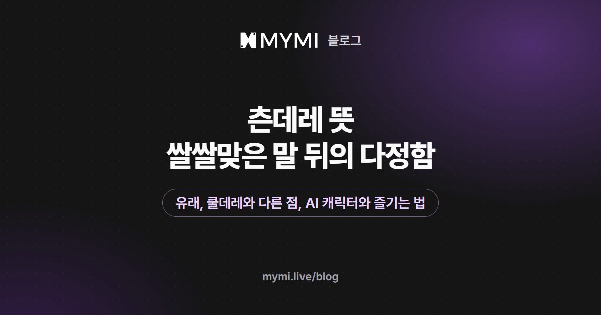

츤데레는 겉으로는 쌀쌀맞게 굴지만 속으로는 상대를 아끼고 챙기는 성격을 뜻해요.



{/* truncate */}

"딱히 너 주려고 산 거 아니거든." 하고 고개를 돌리면서, 내가 좋아하는 음료를 책상에 툭 올려 두고 가는 사람. 이런 인물을 두고 츤데레라고 해요. 말과 행동이 어긋나는 그 틈이 츤데레를 보는 재미예요. 이 글에서는 말의 유래와 비슷한 말과의 차이를 짚고, AI 캐릭터 채팅에서 츤데레가 실제로 어떻게 그려지는지 화면으로 보여 드릴게요. 따옴표로 든 예시 대사와 유저 노트 예시는 설명을 위해 지어낸 것이고, 「서한결」 화면과 거기서 따온 글은 그대로예요.

## 츤데레는 어디서 온 말인가요?

일본어 '츤츤(ツンツン)'과 '데레데레(デレデレ)'를 합친 말이에요. 츤츤은 새침하게 쌀쌀맞은 모양을, 데레데레는 좋아하는 마음에 풀어져 살갑게 구는 모양을 나타내요. 2002년 무렵 일본 인터넷에서 미소녀 게임 인물들을 두고 쓰이기 시작했다고 알려져 있고, 2005년 무렵부터 게임 팬 밖으로도 널리 퍼졌어요. 우리말에서도 이제 익숙한 말이 됐어요.

같은 츤데레라도 쓰임이 두 갈래예요.

| 갈래 | 이런 모습 | 예시(지어낸 대사) |
|---|---|---|
| 시간이 지나며 풀리는 츤데레 | 처음에는 쑥스러움을 감추려고 차갑게 굴다가, 어떤 계기를 지나면 솔직하게 다정해져요 | 첫 만남 "귀찮게 하지 마." → 몇 주 뒤 "…늦으면 연락 정도는 해." |
| 장면에 따라 바뀌는 츤데레 | 평소나 남들 앞에서는 퉁명스럽다가, 둘만 남거나 상대가 다쳤을 때 다정함이 새어 나와요 | 모두 앞에서 "알아서 해." → 둘만 남자 "다친 데는 없어?" |

어느 쪽이 먼저였는지는 자료마다 말이 갈리고, 지금은 두 쓰임이 함께 쓰여요.

## 쿨데레·까칠과는 어떻게 다른가요?

츤데레다운 점은 '부정'에 있어요. 다정한 행동을 해 놓고도 들키면 "그런 거 아니야"라고 둘러대요. 비슷해 보이는 말과 견주면 이렇게 달라요.

| 말 | 겉으로 보이는 모습 | 다정함은 |
|---|---|---|
| 츤데레 | 퉁명스러운 말, 부정부터 하는 버릇 | 행동으로 먼저 새어 나오고, 들키면 더 세게 부정해요 |
| 쿨데레 | 감정 표현이 적고 담담한 태도 | 처음엔 다가가기 어렵지만 가까워질수록 호의를 드러내요. 날 세워 부정하지는 않아요 |
| 까칠 | 예민하고 날 선 말투 | 성격의 결을 말할 뿐, 다정함이 숨어 있다는 뜻은 들어 있지 않아요 |

이 말들은 한 작품에 함께 붙기도 해요. 2026년 11월 6일 기준, 웹 태그 페이지에서 로그인하지 않았을 때 보이는 MYMI의 '츤데레' 작품은 216편이에요. 이 가운데 103편에 '까칠'이, 67편에 '다정'이, 55편에 '쿨데레'가 함께 붙어 있고, '까칠'과 '다정'이 함께 붙은 작품도 26편이에요. 그래서 '츤데레' 하나보다 함께 붙은 태그까지 읽어야 작품의 결이 잘 보여요.

## AI 캐릭터 채팅에서 츤데레는 어떻게 보이나요?

대개 퉁명스러운 말 끝에 상대를 챙기는 말이나 행동이 따라붙는 답으로 보여요. MYMI에서는 작품 화면의 태그로 츤데레 인물을 미리 알 수 있어요. 공식 크리에이터 초코바나나딸기의 작품 「서한결」은 발레단 수석 무용수와 그가 직접 파트너로 고른 군무 단원의 이야기로, '#까칠'과 '#츤데레'가 함께 붙어 있어요.

<Screenshot src={require('./img/tsundere-meaning/tags.webp').default} alt="장르 칸 로맨스와 BL 아래로 여성향 애증 까칠 츤데레 같은 해시태그가 두 줄로 나열된 작품 화면" caption="작품 화면의 태그(화면 속 작품 「서한결」 · 초코바나나딸기)" device="part" />

도입부에서 그는 내가 밥을 거르고 온 것도, 손목을 사리는 것도 단번에 알아채고, 긴장하면 숨을 참는 버릇을 "아직도 못 고쳤네"라고 짚어요. 그러고는 그 '아직도'가 무슨 뜻인지 묻기도 전에 "별 뜻 없어."라고 먼저 둘러대요. 걱정하는 티는 다 나는데 걱정이라고는 끝까지 말하지 않는 것, 바로 츤데레의 '부정'이에요.

<Screenshot src={require('./img/tsundere-meaning/intro.webp').default} alt="손목을 왜 빼냐고 묻고 별 뜻 없다며 둘러대는 노란 대사가 기울임 서술 사이에 나오는 도입부 화면" caption="작품 도입부(화면 속 작품 「서한결」 · 초코바나나딸기)" device="part" />

로그인하지 않은 채로, 손목을 등 뒤로 숨기며 "네 시간이요. 그래도 오늘 리프트는 문제없어요."라고 답해 봤어요. 로그인하지 않아도 답은 최대 5번까지 받아 볼 수 있어요([로그인 없이 AI 채팅할 수 있나요?](https://www.mymi.live/guide/faq/chat-without-login)). 돌아온 답은 숨긴 손목부터 붙잡고 거칠게 몰아세우다가, "오늘 파트너링 끝나고 한 발짝도 나가지 마. 테이핑 새로 갈고, 네 발로 걸어 나갈 수 있을 때 보낼 테니까."라는 지시로 끝났어요. 걱정을 걱정이라 하지 않고 지시로 내놓는 것도 츤데레다워요.

이 작품에는 '까칠'·'소유욕' 태그도 붙어 있어 말도 행동도 거칠게 나와요. 앞에서 본 '함께 붙은 태그'가 이런 결을 미리 알려 줘요. 날 선 말은 츤데레의 '츤'이지만, 손목을 거칠게 붙잡는 모습은 츤데레라기보다 '소유욕' 쪽에 가까워요. 이런 장면이 싫다면 '소유욕'이 붙지 않은 작품을 고르거나, 로그인한 뒤 아래 유저 노트 예시처럼 선을 그어 두세요.

제작자가 작품 화면에 적어 둔 안내에는 명령어도 있어요.

<Screenshot src={require('./img/tsundere-meaning/commands.webp').default} alt="명령어 아래 상태창은 파트너링 수첩, 사물함은 그가 말없이 놓고 간 것이라고 적힌 제작자의 안내" caption="제작자가 작품 화면에 적어 둔 명령어 안내(화면 속 작품 「서한결」 · 초코바나나딸기)" device="part" />

입력창에 '!사물함'을 보내자, 그가 내 사물함에 말없이 넣어 둔 압박 테이핑과 냉찜질 팩, 그리고 "대충 감고 잘 생각 마라."로 시작하는 쪽지가 카드로 떴어요. 쪽지 말투는 여전히 퉁명스러운데 물건은 정성스러워요.

<Screenshot src={require('./img/tsundere-meaning/locker.webp').default} alt="답 끝의 챙기는 대사 아래로 사물함 명령을 보내자 압박 테이핑과 냉찜질 팩과 퉁명스러운 쪽지가 담긴 카드가 뜬 화면" caption="답 끝의 한마디와 !사물함 명령으로 띄운 카드(화면 속 작품 「서한결」 · 초코바나나딸기, 캐릭터의 답변은 AI가 생성한 내용)" device="part" />

이런 카드는 제작자가 만들어 둔 화면(컴포넌트)을 AI가 대화 중에 띄우는 것이라, 작품마다 있기도 하고 없기도 해요. 명령어도 보통 메시지처럼 답 하나로 세니, 보낼 때마다 스파크나 로그인 전 체험 횟수를 써요.

## 츤데레 캐릭터와 대화가 잘 풀리려면?

츤데레의 다정함은 틈에서 나와요. 무리하거나 무언가를 숨기는 모습, 위험한 순간처럼 걱정할 거리를 건네거나 둘만 남는 장면을 만들면 데레가 새어 나오기 쉬워요. 위 화면에서도 숨긴 손목 하나가 사물함 속 테이핑과 냉찜질 팩으로 돌아왔어요. 반대로 "고마워요"라고 바로 말하면 "그런 거 아니라니까"처럼 부정이 먼저 돌아오기 쉬운데, 그 부정까지가 이 성격의 재미예요.

다만 AI가 그리는 츤데레는 대화가 길어지면 균형이 흔들릴 때가 있어요. 날 선 말투가 무뎌져 그냥 다정한 인물처럼 굴기도 하고, 반대로 거친 말만 이어져 다정함이 보이지 않기도 해요.

이럴 때는 마지막 답 아래 둥근 화살표(다시 생성하기)를 눌러, 다시 생성 창에서 '캐릭터 설정대로'를 고르거나 창 맨 아래 칸에 '말은 퉁명스럽게, 걱정은 행동으로만'처럼 적어 새 답을 받아 보세요. 새로 받은 답도 한 번의 답이라 스파크(로그인 전에는 체험 1회)를 써요. 창에 적은 부탁은 그 한 번에만 들으니, 오래 지키게 하려면 로그인한 뒤 유저 노트에 이 인물의 말버릇과 지켜 줬으면 하는 선을 규칙으로 남겨 두는 편이 좋아요.

```text
서한결은 고맙다는 말을 바로 받지 않고, 걱정은 말보다 행동으로 보인다.
다정한 말은 둘만 있을 때 짧게 하고, 들키면 아니라고 둘러댄다.
말투가 퉁명스러워도 상대를 깎아내리거나 모욕하지는 않는다.
걱정이 돼도 상대의 몸을 거칠게 붙잡거나 밀치지 않는다.
```

답을 다시 받는 자세한 방법은 유저가이드 [대화하기](https://www.mymi.live/guide/chatting/chat-with-character)에, 다시 생성 창의 다른 선택지와 유저 노트 쓰는 법은 [AI 채팅 이야기를 원하는 분위기로 이끌려면?](./ai-story-mood.md)에, 유저 노트가 있는 자리는 유저가이드 [채팅방 설정하기](https://www.mymi.live/guide/chatting/chat-room-settings)에 있어요.

## MYMI에서 츤데레 캐릭터는 어떻게 찾나요?

작품 화면의 '#츤데레'를 누르면 [츤데레 태그 페이지](https://www.mymi.live/ko/tag/%EC%B8%A4%EB%8D%B0%EB%A0%88?utm_source=mymi_blog&utm_medium=referral&utm_campaign=global_content_2026q4&utm_content=ko_blog_tsundere_meaning)로 가요. 정렬순(인기순·주간 인기순·최신순)으로 순서를 바꾸고 캐릭터 성별(전체·여성 캐릭터·남성 캐릭터)로 좁힐 수 있어요. 웹에서는 '비슷한 태그'에서 관련 태그로 옮겨 갈 수도 있어요. 2026년 11월 6일 기준, 앞의 216편 가운데 남성 캐릭터 작품은 122편, 여성 캐릭터 작품은 92편이에요(나머지 2편은 캐릭터 성별을 하나로 정하지 않아 두 필터에 다 나와요).

2026년 11월 6일 기준으로 츤데레 작품에 어떤 태그가 흔히 함께 붙는지, 이 216편의 태그를 독자층을 나타내는 '여성향'·'남성향'은 빼고 많은 순으로 세어 봤어요.

| 함께 붙은 태그 | 작품 수 |
|---|---:|
| 로맨스 | 172편 |
| 현대 | 139편 |
| 까칠 | 103편 |
| 일상 | 103편 |
| 판타지 | 74편 |
| 소유욕 | 73편 |
| 무뚝뚝 | 68편 |
| 다정 | 67편 |
| 플러팅 | 67편 |

'까칠'이나 '애증'이 함께 붙은 작품은 날 선 말이 많은 쪽, '다정'이나 '순애'가 붙은 작품은 다정함이 일찍 보이는 쪽일 수 있어요. 다만 츤데레 태그 페이지는 '츤데레' 하나로만 작품을 모으고 목록 카드에는 태그가 나오지 않아서, 다른 태그는 작품 화면을 열어야 보여요. 작품 화면에서는 태그와 함께 상세 설명과 도입부 한 장면도 읽어 보세요. 츤과 데레가 어떤 비율로 섞였는지 대화를 시작하기 전에 가늠할 수 있어요. 처음 고르는 요령은 [AI 채팅으로 소설 속 인물과 대화하기](./ai-chat-start.md)에 정리해 두었어요.

## 자주 묻는 질문

<details>
<summary>츤데레는 남자 캐릭터에게도 쓰나요?</summary>

네. 처음에는 주로 여자 인물을 두고 썼지만 지금은 성별과 상관없이 써요. MYMI 웹 태그 페이지에서 로그인하지 않았을 때 보이는 츤데레 작품 216편도 남성 캐릭터 작품이 122편으로, 여성 캐릭터 작품 92편보다 많아요(2026년 11월 6일 기준).

</details>

<details>
<summary>츤데레와 얀데레는 어떻게 다른가요?</summary>

츤데레는 좋아하는 마음을 감추려고 차갑게 구는 성격이고, 얀데레는 좋아하는 마음이 지나쳐 집착이 되는 성격이에요. 츤데레는 마음을 숨기는 쪽으로, 얀데레는 마음이 넘치는 쪽으로 엇나간다고 기억하면 쉬워요.

</details>

<details>
<summary>츤데레와 쿨데레 태그가 함께 붙은 작품도 있나요?</summary>

네. 2026년 11월 6일 기준 MYMI 웹 태그 페이지의 츤데레 작품 216편 가운데 55편에 '쿨데레'가 함께 붙어 있어요. 태그는 작품 단위로 붙어서 한 인물이 둘 다라는 뜻은 아닐 수 있어요. 상세 설명과 도입부에서 누가 어떤 말투로 나오는지 먼저 확인해 보세요.

</details>

어떤 결의 츤데레가 끌리는지 감이 왔다면, [츤데레 태그 페이지](https://www.mymi.live/ko/tag/%EC%B8%A4%EB%8D%B0%EB%A0%88?utm_source=mymi_blog&utm_medium=referral&utm_campaign=global_content_2026q4&utm_content=ko_blog_tsundere_meaning)에서 작품을 몇 편 열어 보고 첫 장면이 마음에 드는 한 편부터 시작해 보세요. 여자 캐릭터가 나오는 작품부터 보고 싶다면 [남성향 AI 채팅 추천](./male-oriented-ai-chat.md)을, 남자 캐릭터 작품이라면 [여성향 AI 연애 채팅 추천](./female-oriented-ai-chat.md)을 먼저 열어 보세요. 대화 요령을 다룬 다른 글들은 [MYMI 블로그](https://www.mymi.live/blog)에 있어요.
