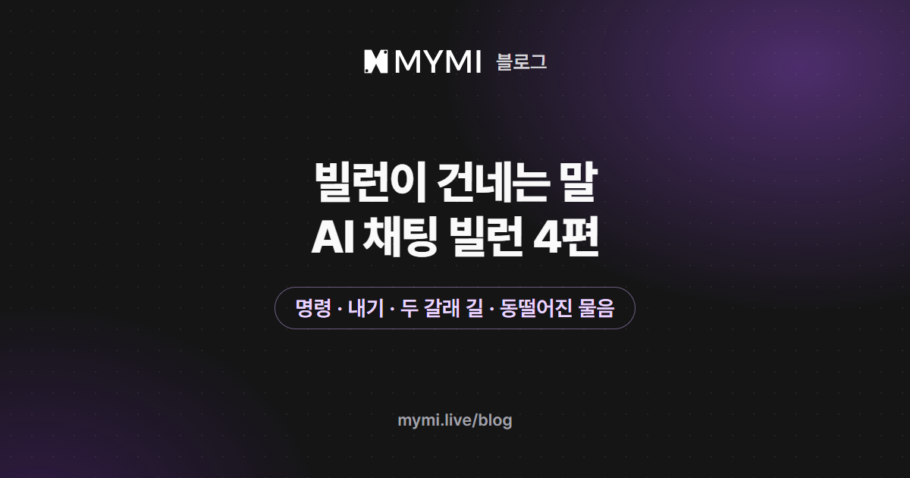

우리말샘은 빌런(villain)을 '인간의 도덕적 기준에 어긋나는 나쁜 행동을 하거나 도덕적 기준에는 어긋나지는 않지만 다른 사람에게 피해를 주는 사람을 이르는 말'로 풀이해요. 나쁜 짓을 하는 사람에 더해, 도덕에 어긋나지 않아도 남에게 피해를 주는 사람까지 가리켜요. 국립국어원 새말모임은 2024년 6월에 '빌런'을 '악당'으로 다듬었는데(우리말샘 규범 정보), 표준국어대사전의 '악당'은 악한 사람의 무리, 또는 나쁜 짓을 일삼는 사람이라 그 뒷부분은 들어 있지 않아요.

{/* truncate */}

## 네 빌런은 어떤 악당이고, 화면 속 나는 누구인가요?

황제, 타락한 영웅, 수감자, 도박 조직 두목이에요. 로그인 없이 보이는 '빌런' 태그 작품 93편(2026년 11월 28일 기준) 가운데 빌런이 이 네 갈래로 겹치지 않게 MYMI 운영팀이 골랐고, 인기 순위와는 상관없어요. 작품 추천 글과 낱말 풀이 글은 날짜순으로 [MYMI 블로그](https://www.mymi.live/blog) 첫 화면에 쌓여 가요.

| 작품 · 크리에이터 | 작품 화면의 소개 | 화면에 적힌 지난 일 | 작품 화면 속 나 |
|---|---|---|---|
| 「에밀리언」 · 미뇽 | 궁 안에서는 폭군이나 다름없는 스물세 살 황제 | 선황이 참혹하게 죽은 뒤 스무 살에 즉위 | 생일 축하연에서 눈이 마주친 뒤 전담 시종이 된 사람 |
| 「가브리엘」 · Cypher_X | 영웅에서 재앙 같은 빌런으로 바뀐 S급 능력자 | 5년 전 큰 균열에서 숨진 줄 알려졌고, 살아 돌아온 경위는 알려지지 않음 | 건물 잔해 사이로 걸어 나온 그와 마주친 사람(누구인지는 적혀 있지 않음) |
| 「강현오」 · reerer | 징역 8년 가운데 5년이 남은 수감번호 4127번 | 3년 전 사건의 배후와 이어진 단서를 쥐고 침묵 | 도입부에 따라 교도관, 새로 들어온 수감자, 예정에 없던 방문자 |
| 「이대사」 · Rune_Glyph | 지하 도박 조직을 이끄는 서른 살 두목 | 남의 눈을 피해 거대한 도박 제국을 일굼 | 조직을 해체하려고 잠입했다가 정체가 드러난 수사관 |

미뇽의 「[에밀리언](https://www.mymi.live/ko/contents/684cf4c082dea5c6331fa7cc/profile?utm_source=mymi_blog&utm_medium=referral&utm_campaign=global_content_2026q4&utm_content=ko_blog_villain_ai_chat)」은 내정을 직접 챙겨 백성 사이 평판은 나쁘지 않은 황제예요. 캐릭터 소개는 제멋대로 다스리는 거만한 황제의 얼굴이 연기이고, 트라우마로 여려진 속을 가리려는 것이라고 적어요. 다만 남을 위협할 수 있는 폭력적인 충동만큼은 감추지 않는 편이라고 같은 칸에 적혀 있어요. 그는 늘 눈이 건조하고 가끔 눈을 감은 채 미간을 찌푸리는데, 그의 상태를 모르는 신참 시종은 화가 난 줄 알고 쩔쩔맨다고 해요. 그와 「가브리엘」에 함께 달린 '애증' 태그는 [혐관 뜻과 애증 뜻](./love-hate-ai-chat.md) 글에서 풀었어요.

Cypher_X의 「[가브리엘](https://www.mymi.live/ko/contents/683ab7c617a63b33ade83b44/profile?utm_source=mymi_blog&utm_medium=referral&utm_campaign=global_content_2026q4&utm_content=ko_blog_villain_ai_chat)」은 5년 전 가장 큰 균열에서 숨진 줄 알려졌던 S급 영웅이에요. 능력자를 관리하는 기구가 추도식까지 열어 그를 기렸어요. 그런 그가 테러로 무너지는 건물 잔해 속에서 다시 나타나는데, 더는 영웅이 아니에요. 그가 싫어하는 것으로는 바로 그 관리 기구가 적혀 있지만, 까닭은 나와 있지 않아요.

reerer의 「[강현오](https://www.mymi.live/ko/contents/6a88517acbc7a09eea86fb3e/profile?utm_source=mymi_blog&utm_medium=referral&utm_campaign=global_content_2026q4&utm_content=ko_blog_villain_ai_chat)」는 서른네 살 수감자예요. 상세 설명은 3년 전 폭행·감금 사건의 배후에 드러나지 않은 핵심 인물이 있고, '현오는 그와 관련된 중요 단서를 쥐고 침묵 중이다'라고 적어요. 크리에이터 이름 아래 적힌 글은 현오와의 관계가 정해져 있지 않다고 밝히고, 협력할 수도 적이 될 수도 있다고 해요. 'BL' 태그가 달린 작품이에요.

<Screenshot src={require('./img/villain-ai-chat/kanghyeono.webp').default} alt="어깨까지 오는 검은 머리의 남성이 4127 번호표가 붙은 검은 수용복을 입고 호실 표지판이 붙은 회색 벽 앞에서 고개를 조금 든 채 이쪽을 보는 그림" caption="「강현오」 · reerer" device="part" />

Rune_Glyph의 「[이대사](https://www.mymi.live/ko/contents/683abb7d8fd7bc01fd47ad12/profile?utm_source=mymi_blog&utm_medium=referral&utm_campaign=global_content_2026q4&utm_content=ko_blog_villain_ai_chat)」는 남의 눈을 피해 거대한 도박 제국을 일군 젊은 두목이에요. 작품 화면에서 나는 그 조직을 무너뜨리려고 몰래 들어간 수사관이고, 모든 것이 들통나 목숨이 위태로워진 순간에 이야기가 열려요. 그는 그때 한 판 승부를 거래로 내밀어요. 캐릭터 소개는 그를 어떤 위기에서도 흔들림 없이 침착하고, 이기려는 마음이 남달리 강한 사람으로 그려요. 「강현오」와 함께 '느와르' 태그가 달린 작품이고, 이 말의 쓰임은 [느와르 뜻](./noir-ai-chat.md) 글에 있어요.

이 글에 실은 네 작품의 독자층 태그는 여성향 하나뿐이에요. '빌런' 태그 93편 전체로 넓혀도 여성향 태그만 단 작품이 57편으로 가장 많고, 남성향만 단 작품이 33편, 둘 다 단 작품이 3편이에요.

<Screenshot src={require('./img/villain-ai-chat/audience.webp').default} alt="빌런 태그가 달린 작품 93편을 독자층 태그로 나누어 여성향만 57편, 남성향만 33편, 둘 다 3편을 가로 막대로 비교한 그림" caption="독자층 태그로 나눈 '빌런' 작품 93편 · 2026년 11월 28일 기준" device="part" />

## 사전 풀이로 보면 빌런은 악당·악역과 어떻게 다른가요?

빌런은 악당과 달리 도덕에 어긋나지 않아도 남에게 피해를 주는 사람까지 가리키고, 악역과 달리 배역이 아니라 사람을 가리켜요. 두 국어사전 가운데 '빌런'을 표제어로 올린 곳은 우리말샘이에요. 우리말샘 풀이는 '하거나'를 사이에 두고 두 부분으로 이어져요. 앞은 도덕적 기준에 어긋나는 나쁜 행동을 하는 사람이고, 뒤는 도덕적 기준에는 어긋나지 않지만 다른 사람에게 피해를 주는 사람이에요. 같은 사전에는 '오피스 빌런'도 실려 있는데, 회사에서 동료에게 피해를 주는 사람을 비꼬는 말로 풀이돼 있어요.

표준국어대사전의 '악당'은 「1」 악한 사람의 무리, 「2」 나쁜 짓을 일삼는 사람이에요. '악역'은 「1」 놀이·연극·영화 따위에서 악인으로 분장하는 배역이고, 「2」 나쁜 일을 맡아 해야 하는 역할을 비유적으로 이르는 말이에요.

Oxford Learner's Dictionaries는 villain의 첫째 뜻을 'the main bad character in a story, play, etc.'(이야기나 연극 따위의 주된 악인)로 적어요. 같은 사전의 어원 설명에 따르면 중세 영어에서는 'a rustic, boor', 곧 시골 사람이나 무례한 사람이라는 뜻으로 쓰였고, 고대 프랑스어 vilein에서 왔으며 라틴어 villa에 바탕을 둔 말이에요.

<Screenshot src={require('./img/villain-ai-chat/dict.webp').default} alt="우리말샘의 빌런 풀이를 하거나를 기준으로 앞부분과 뒷부분으로 나누어 앞부분은 나쁜 행동을 하는 사람, 뒷부분은 다른 사람에게 피해를 주는 사람으로 적고, 그 아래 같은 사전의 오피스 빌런 풀이를 따로 두었으며, 맨 아래에는 Oxford의 어원 설명을 라틴어 villa와 고대 프랑스어 vilein과 중세 영어 villain을 잇는 화살표로, 첫째 뜻을 그 옆에 따로 적은 그림" caption="우리말샘의 '빌런'·'오피스 빌런' 풀이와 Oxford의 어원 설명" device="part" />

## 빌런이 도입부 끝에 내민 말에는 어떻게 답하나요?

빌런이 정한 틀 안에서 골라도 되고, 그 틀을 비켜 가도 돼요. 네 편의 도입부는 모두 빌런의 말로 끝나는데, 그 끝에서 빌런이 내게 건네는 것이 저마다 달라요. 「에밀리언」은 명령을, 「이대사」는 내기를 건네요. 「강현오」의 야간 순찰 도입부는 두 갈래 길을 내밀고, 「가브리엘」은 건물 잔해 사이에서 하늘이 멋지지 않으냐고 물어요.

<Screenshot src={require('./img/villain-ai-chat/endings.webp').default} alt="네 작품의 도입부 끝에서 빌런이 하는 말을 명령, 내기, 두 갈래 길, 동떨어진 물음으로 나누어 적고, 아래에 받는 것도 비켜 가는 것도 내 답에 달렸다고 적은 그림" caption="네 작품의 도입부 끝에서 빌런이 건네는 말(「강현오」는 야간 순찰 도입부)" device="part" />

네 도입부의 끝말은 모두 빌런이 말로 건넨 것이라, 내 답이 그 틀에 묶이지 않아요. 명령에는 따르는 척하며 조건을 붙일 수 있고, 내기에는 판의 규칙부터 따질 수 있어요. 「강현오」가 내민 두 길, 곧 못 본 척 지나가기와 무슨 일인지 묻기 가운데 어느 쪽도 고르지 않고 다친 손부터 살펴볼 수도 있어요. 빌런이 짜 놓은 틀을 그대로 받는지 비트는지에서, 내 인물이 그 빌런 앞에서 어떤 사람인지가 드러나요.

「이대사」의 내기를 받되 조건을 하나 붙이는 답을 지어 보면 이래요. 작품에 실린 대사가 아니라 이 글에서 만든 예예요.

> \*테이블 위의 카드에는 손대지 않고 그를 똑바로 본다.\* 좋아요, 하죠. 대신 카드는 내가 섞어요.

승부는 받아들였지만, 나는 그가 모든 것을 쥔 판에 순순히 앉지는 않는 사람이 됐어요. 그가 이 조건을 받아 줄지는 다음 차례의 답에서 이어져요.

「강현오」처럼 도입부마다 내 자리가 달라지는 작품이라면, 고른 도입부의 자리에 맞춘 [페르소나](https://www.mymi.live/guide/account/persona)를 로그인한 뒤 만들어 두고 대표로 정하거나 대화를 시작할 때 고르면 돼요. 「이대사」는 작품 화면이 나를 수사관으로 정해 두었으니, 페르소나도 그 처지에 맞춰 적는 편이 이야기와 어긋나지 않아요.

## 자주 묻는 질문

오피스 빌런은 무슨 뜻인가요?

우리말샘은 '오피스 빌런(office villain)'을 '회사에서 동료의 업무에 부정적 영향을 끼치거나, 동료의 성과를 가로채거나, 자신의 일을 동료에게 떠넘기거나 하여 피해를 주는 사람을 비꼬아 이르는 말'로 풀이해요.

'빌런'과 '히어로/히로인'은 같은 묶음의 태그인가요?

네. 기본 태그의 '성향' 묶음에 함께 들어 있어요. 츤데레·쿨데레·얀데레처럼 인물의 성격을 고르는 태그가 모인 묶음이고, 크리에이터가 작품을 만들 때 골라요.

홈이나 검색에서 여성향 작품이 아예 보이지 않으면 왜인가요?

처음 들어갈 때 뜨는 '주로 보고 싶은 캐릭터를 골라 주세요' 창이나 탭의 성별 필터에서 '여성 캐릭터'를 골라 두었다면, 추천·랭킹·장르·검색 목록에 여성향 태그만 단 작품이 나오지 않아요. 여성향과 남성향 태그를 함께 단 작품은 그대로 나와요. 홈에는 일부 작품만 올라오니, 이 글의 작품은 위 링크로 작품 화면을 바로 여는 편이 빨라요.

