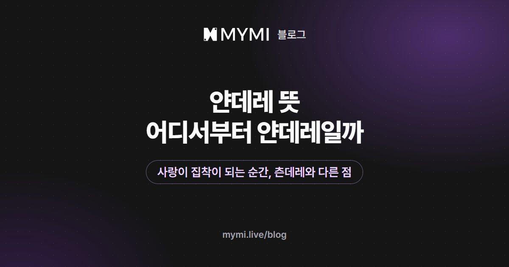

얀데레는 좋아하는 마음이 지나쳐 집착이 되는 성격을 뜻해요.



{/* truncate */}

작품 소개에서 '#얀데레'를 보고, 설레는 이야기인지 무서운 이야기인지 망설인 적이 있나요? 얀데레는 다정함과 위태로움이 한 인물 안에 같이 있는 성격이라, 어떤 결인지 알고 고르면 훨씬 편하게 즐길 수 있어요. 뜻과 유래부터 짚고, 얀데레를 네 단계로 나눠 본 다음, MYMI 작품 데이터와 AI 캐릭터 채팅에서 선을 그어 두는 법까지 차례로 볼게요.

## 얀데레의 '얀'과 '데레'는 무슨 뜻인가요?

'얀'은 마음이 병들었다는 뜻의 일본어 '얀데루(病んでる)'에서, '데레'는 좋아하는 사람 앞에서 마음이 녹아 다정해지는 모양을 가리키는 '데레(デレ)'에서 따 왔어요. 좋아하는 마음이 너무 커진 나머지 마음까지 병든 것처럼 보이는 캐릭터를 꾸미는 말이죠. 실제 마음의 병을 가리키는 의학 용어는 아니에요. 2005년 무렵 일본에서 나온 게임과 TV 애니메이션을 계기로 널리 알려졌다고 해요.

정의가 딱 정해진 말은 아니어서 쓰는 사람마다 뜻이 조금씩 달라요. 그래서 같은 '#얀데레'가 붙은 작품이라도 결이 꽤 달라요.

## 어디서부터 얀데레라고 하나요?

어디서부터라는 정해진 선은 없어요. 다만 좋아하는 사람을 질투하고 챙기는 것만으로는 보통 얀데레라고 하지 않아요. 이 글에서는 상대가 고를 일을 대신 정하려 드는지를 기준으로 네 단계로 나눠 볼게요. 이 글의 따옴표 대사와 유저 노트 예시는 모두 설명을 위해 지어낸 것이고, 실제 작품에서 따온 말이 아니에요.

<Screenshot src={require('./img/yandere-meaning/ladder.webp').default} alt="질투 확인 통제 고립 네 단계에 대사를 붙이고 통제와 고립 두 단계를 얀데레다운 구간으로 표시한 그림" caption="이 글이 나눈 네 단계" device="part" />

| 단계 | 예시 대사 | 달라지는 것 |
|---|---|---|
| 1. 질투 | "그 사람이랑 그렇게 친했어?" | 좋아하면 흔히 생기는 마음이에요 |
| 2. 확인 | "답장이 왜 늦었어? 지금 어디야?" | 불안이 커져 상대를 늘 확인하려 들어요 |
| 3. 통제 | "그 사람이랑은 이제 연락하지 마." | 상대가 고를 일을 대신 정하려 들어요 |
| 4. 고립 | "나만 있으면 되잖아. 다른 사람은 필요 없어." | 상대의 세상을 자기 하나로 좁히려 들어요 |

이 나눔으로 보면 얀데레다운 긴장은 3·4단계에서 짙어져요. 다만 그건 어디까지나 이야기 속 일이에요. 현실에서 2단계처럼 어디서 누구와 있는지 늘 확인받거나, 3·4단계처럼 연락과 만남이 막힌다면 사랑의 크기가 아니라 경계해야 할 신호예요. 그런 일을 겪고 있다면 혼자 견디지 말고 믿을 만한 사람이나 상담 창구(청소년상담 1388, 여성긴급전화 1366)에 이야기하고, 급할 때는 112에 신고하세요.

## 얀데레는 츤데레·소유욕과 어떻게 다른가요?

셋 다 좋아하는 마음에서 시작하지만 엇나가는 방향이 달라요. 츤데레는 마음을 숨기려고 차갑게 굴다가 들키면 아니라고 둘러대요. 쌀쌀맞은 모습과 다정한 모습 사이를 오가는 데서 재미가 나오죠. 얀데레는 좋아하는 마음이 너무 커져 병든 쪽으로 기운 인물이에요. 다정한 말과 지나친 집착이 한 인물 안에 함께 있어서, 웃으며 건넨 말에 무서운 속뜻이 숨어 있곤 해요.

<Screenshot src={require('./img/yandere-meaning/compare.webp').default} alt="츤데레는 마음을 숨긴다 얀데레는 마음이 넘친다 소유욕은 독차지하려는 마음이라고 세 칸으로 견준 그림" caption="좋아하는 마음이 엇나가는 방향으로 견준 세 말" device="part" />

소유욕은 상대를 독차지하려는 마음을 가리키는 말로, 얀데레보다 넓게 쓰여요. 독차지하고 싶은 마음이 강해도 상대의 선택을 존중한다면, 앞의 네 단계로는 얀데레까지 가지 않은 셈이에요. MYMI에서는 '소유욕'이 작품 태그로 따로 붙는데, 얀데레 작품 대부분에 함께 붙어 있어요.

## MYMI 얀데레 작품에는 어떤 태그가 함께 붙나요?

MYMI 웹의 '#얀데레' 태그 페이지는 얀데레를 '사랑이 지나쳐 집착이 되는' 캐릭터로 소개하고, 비슷한 태그로 '소유욕'을 함께 보여 줘요.

<Screenshot src={require('./img/yandere-meaning/tag-page.webp').default} alt="얀데레 태그 제목과 인기순 버튼 아래로 사랑이 지나쳐 집착이 되는 캐릭터라는 소개와 로맨스 현대 소유욕 여성향 남성향 비밀 같은 비슷한 태그가 놓인 화면" caption="MYMI 웹 '#얀데레' 태그 페이지 윗부분(로그인 전)" device="part" />

2026년 11월 7일 기준으로 '얀데레' 태그가 붙은 MYMI 작품 가운데 로그인하지 않아도 보이는 작품은 130편이에요. '남성향'·'여성향'처럼 독자층만 알려 주는 태그를 제외하고 이 130편에 많이 붙은 태그를 차례로 보면, '소유욕'이 105편(81%)으로 가장 많아요.

<Screenshot src={require('./img/yandere-meaning/chart.webp').default} alt="소유욕 105편이 가장 길고 로맨스 현대 판타지 애증 연인 일상 비밀 쿨데레 능글 순으로 짧아지는 가로 막대 그래프" caption="얀데레 작품 130편에 함께 붙은 태그 상위 10개(2026년 11월 7일 기준)" device="part" />

| 태그 | 함께 붙은 작품 | 비율(130편 중) |
|---|---:|---:|
| 소유욕 | 105편 | 81% |
| 로맨스 | 97편 | 75% |
| 현대 | 69편 | 53% |
| 판타지 | 45편 | 35% |
| 애증 | 42편 | 32% |
| 연인 | 39편 | 30% |
| 일상 | 35편 | 27% |
| 비밀 | 34편 | 26% |
| 쿨데레 | 34편 | 26% |
| 능글 | 33편 | 25% |

상위 10개 밖의 태그 몇 개만 더 봐도 결이 갈려요. 같은 날 같은 130편에서 센 숫자예요.

| 태그 | 붙은 작품 | 읽히는 결 |
|---|---:|---|
| 다정 | 32편 | 다정함이 앞서는 쪽일 수 있어요 |
| 순애 | 17편 | 다정함이 앞서는 쪽일 수 있어요 |
| 속박 | 28편 | 위험한 장면이 짙은 쪽일 수 있어요 |
| 빌런 | 25편 | 위험한 장면이 짙은 쪽일 수 있어요 |

다만 한 작품에 태그가 여러 개 붙어서, '다정'과 '빌런'이 함께 붙은 작품도 있어요. 제작자가 작품 화면의 상세 설명이나 크리에이터 가이드에 어떤 장면이 나올 수 있는지 주의사항을 적어 두기도 하니, 어느 작품을 열든 대화를 시작하기 전에 태그와 함께 읽어 보세요.

## AI 캐릭터 채팅에서 얀데레 이야기를 편하게 즐기려면?

얀데레 이야기의 재미는 위태로운 긴장에 있지만, 내 쪽에서 미리 선을 그어 둘 수 있어요. 세 가지를 해 두면 좋아요.

1. **결을 보고 고르기:** 앞에서 본 태그와 상세 설명으로 다정함이 앞서는 쪽인지 위험한 장면이 짙은 쪽인지 먼저 가늠해요.
2. **유저 노트에 선 적어 두기:** 로그인한 뒤 ⋮ 메뉴의 채팅 설정 → 유저 노트(3,000자까지)에 적고 저장하면, AI가 그 채팅방에서 답할 때마다 참고해요([채팅방 설정하기](https://www.mymi.live/guide/chatting/chat-room-settings)). 집착은 감정 표현으로만 보이게 하고, 넘지 말았으면 하는 행동은 분명히 적는 식이에요. 아래 예시의 ○○ 자리에는 인물 이름을 넣어요.
3. **선을 넘은 답은 다시 받기:** 마지막 답의 다시 생성하기(둥근 화살표)를 누르고 다시 생성 창에서 '유저 노트대로'를 고르면, 유저 노트를 다시 확인해 반영해 달라는 부탁과 함께 새 답을 받아요. 그 한 번만 따로 부탁하고 싶다면 창 맨 아래 칸에 '위협하는 말 없이'처럼 적어요. 로그인 전에는 유저 노트가 없으니 맨 아래 칸에 적는 쪽을 쓰세요. 다시 받을 때마다 스파크가 들고, 로그인 전이라면 체험 횟수를 한 번 써요([대화하기](https://www.mymi.live/guide/chatting/chat-with-character)).

```text
○○은(는) 질투를 말로 드러내지만, 상대의 휴대폰을 뒤지거나 연락을 막지는 않는다.
○○은(는) 상대를 가두거나 다치게 하지 않고, 스스로를 해치는 말도 하지 않는다.
집착은 질투를 말로 털어놓기, 작은 일에도 서운해하기 같은 감정 표현으로만 보인다.
```

## 자주 묻는 질문

<details>
<summary>얀데레와 집착은 같은 말인가요?</summary>

비슷하지만 가리키는 것이 달라요. 집착은 한 사람에게 매달리는 마음 그 자체이고, 얀데레는 좋아하는 마음이 그런 집착으로 지나쳐 병든 듯 보이는 캐릭터를 가리켜요. MYMI에서 작품을 만들 때 고르는 기본 태그에는 '집착'이 없어서, 로그인 전 웹 태그 페이지의 얀데레 작품 130편 가운데 '집착' 태그는 1편뿐이고 105편이 '소유욕'을 달고 있어요(2026년 11월 7일 기준).

</details>

<details>
<summary>얀데레 캐릭터와 대화하다가 무서워지면 어떻게 하나요?</summary>

참지 말고 흐름을 바꿔요. 다시 생성 창 맨 아래 칸에 '위협하는 말 없이'처럼 적어 그 답만 다시 받을 수 있고, 로그인했다면 유저 노트에 넘지 말았으면 하는 선을 적어 둘 수 있어요. 그래도 불편하면 대화를 멈추고, '다정'이나 '순애'가 붙은 작품처럼 결이 다른 이야기로 옮겨 가도 괜찮아요.

</details>

<details>
<summary>얀데레 대사는 어떤 식인가요?</summary>

다정한 말 속에 상대를 다 알고 싶어 하거나 대신 정하려는 마음이 비치는 경우가 많아요. 예를 들어 "오늘도 기다렸어. 늦을 줄 알았으면 데리러 갔을 텐데."는 상대의 하루를 놓치지 않으려는 말로, 앞의 네 단계로 치면 2단계쯤이에요. "그 모임엔 안 가도 돼. 필요한 건 내가 다 해 줄게."처럼 다정한 말투로 상대가 고를 일을 대신 정하기 시작하면 얀데레의 색이 짙어져요.

</details>

츤데레와 나란히 놓고 보고 싶다면 [츤데레 뜻과 유래](./tsundere-meaning.md)를, 얀데레 이야기를 원하는 분위기로 끌고 가는 방법은 [AI 채팅 이야기를 원하는 분위기로 이끌려면?](./ai-story-mood.md)을 함께 읽어 보세요. 작품을 처음 고른다면 [AI 채팅으로 소설 속 인물과 대화하기](./ai-chat-start.md)가 길잡이가 되고, 다른 글은 [MYMI 블로그](https://www.mymi.live/blog)에서 이어서 볼 수 있어요. [MYMI](https://www.mymi.live/ko?utm_source=mymi_blog&utm_medium=referral&utm_campaign=global_content_2026q4&utm_content=ko_blog_yandere_meaning)에서 작품을 열면, 대화를 시작하기 전에 작품 화면의 태그와 상세 설명부터 확인해 보세요.

_2026년 11월 9일 고침: 유저 노트에 적을 수 있는 글자가 3,000자로 늘어난 것을 반영했어요._
