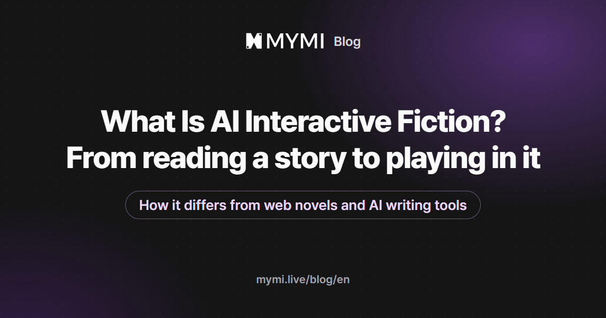

AI interactive fiction is a story where AI plays the characters and you play the lead, moving the plot forward through conversation.



{/* truncate */}

You don't read a finished manuscript from start to finish. A scene opens, you write what you say and do, and a character answers. That answer becomes the next scene. Two people can open the same work and walk away with different stories.

This post uses MYMI as the example. Four terms come up often there, so it helps to know them first.

| Term | Meaning |
|---|---|
| Work | One story, with its world, its characters and an opening scene |
| Character | A person in the story, played by AI |
| Persona | The name and role you use inside a work |
| Intro | The opening scene that appears as soon as you start a chat |

## How is it different from web novels and AI writing tools?

The biggest difference is where you stand. With a web novel you are a reader following the plot the author chose. In AI interactive fiction you are the lead, acting inside the scene. It also does a different job from AI writing tools, even though the names sound alike.

| | Web novel | AI writing tool | AI interactive fiction |
|---|---|---|---|
| Who writes | The author | AI, following your instructions | You and AI, taking turns |
| Your role | Reader | The person requesting a draft | The lead in the story |
| When the next scene appears | When the next chapter is posted | When you ask again | Right after you send a message |
| Starting over from the same opening | The same text | A newly generated draft | A different story, depending on your choices |

A writing tool exists to hand you a finished draft. Interactive fiction exists for the experience of stepping into a story and dealing with its characters. "AI fiction" can mean either one, so it saves time to decide which you are looking for.

## How does a scene unfold?

On MYMI, a scene moves in this order.

1. Read the work's description and pick the scene to start from (the Intro).
2. When the intro appears, write your line or action and send it.
3. The character responds, and the story moves one step forward.
4. If the reply doesn't fit, regenerate the last reply or edit it yourself.

<Screenshot src={require('./img/intro-list.webp').default} alt="The Intro box on a work page opened into a list of five scenes, Audition, Meeting, Off the Record, Home and Set, with Audition selected" caption="Tap the Intro box on a work page to choose which scene to start from (work shown: Han Do-kyung · reerer)" device="part" />

Wrap an action in asterisks and it shows in a different color from dialogue. The line below is an example made up for this post.

```text
*opens the window and looks down at the alley* That sound just now. Did you hear it too?
```

If you can't think of what to say, you can send with the input box empty. The character then carries the story forward. This still counts as one message.

You can also choose how the story looks. The Novel view, which opens by default, runs narration and dialogue together as continuous prose, so the scene you built by chatting reads like a novel. If you prefer speech bubbles, switch to the Chat view. If you want to page through the scene with the art behind the text, switch to the 1:1 view. Whichever view you choose, it is the same conversation.

<Screenshot src={require('./img/view-novel.webp').default} alt="A chat room in Novel view where the intro's narration runs in white italic text and the character's line appears in bold yellow" caption="Novel view. Narration and dialogue use different colors and read as continuous prose (work shown: Han Do-kyung · reerer, intro: Set)" device="part" />

<Screenshot src={require('./img/view-chat.webp').default} alt="Chat view with the character art filling the top of the screen and the same intro text inside a speech bubble below it" caption="The same scene in Chat view (work shown: Han Do-kyung · reerer)" device="part" />

<Screenshot src={require('./img/view-1to1.webp').default} alt="1:1 view with the character art as the background and a large text panel layered over it, the panel holding narration and dialogue" caption="The same scene in 1:1 view (work shown: Han Do-kyung · reerer)" device="part" />

To switch views, tap the palette icon at the top right of the chat room and use the first row of UI Settings. There is also a Story view, which puts the art in the background and lets you read on as prose.

<Screenshot src={require('./img/ui-mode.webp').default} alt="The UI Settings panel opened from the palette icon, with a UI Mode row at the top showing Chat, 1:1, Novel and Story with Novel selected, and font size, font family and text color options below" caption="Palette icon → UI Settings. Font size, font family and the colors of dialogue and narration are set here too" device="part" />

As of November 13, 2026, these are the numbers worth knowing on MYMI.

| Item | Value |
|---|---|
| Characters per message | 1,000 |
| Messages you can send without logging in | Up to 5 (regenerating counts) |
| How often new events are added to long-term memory | Every 10 exchanges |
| Characters in a User Note | 3,000 (a longer note can cost extra Sparks per message) |

For where the buttons sit around the input box and under each reply, see [Chatting](https://www.mymi.live/guide/en/chatting/chat-with-character) in the guide.

## What genres are there?

Each work on MYMI carries genres chosen by its creator. In the Genres tab on Home you can pick one of 13 genres, including Romance, Fantasy, Wuxia, Sci-fi, Slice of life, Comedy and Mystery & thriller, and sort by Popular, Weekly popularity or Newest. Hashtags on each work tell you more about its mood and setting.

Genres and tags are only hints. Read the description and the intro, and pick a scene that makes you want to answer the first line. That is usually the easiest way in.

## How do I start?

1. Open [MYMI](https://www.mymi.live/en?utm_source=mymi_blog&utm_medium=referral&utm_campaign=global_content_2026q4&utm_content=en_blog_ai_interactive_novel) in your browser. The Android and iPhone apps use the same account.
2. On your first visit, a prompt asks which characters you mainly want to see. Choose "Female characters", "Male characters" or "Show me everything", and Home adjusts to match.
3. Choose a work from the Picks, Ranking, Genres or Search tab on Home and tap "Start chatting".
4. Without logging in, you can try up to 5 messages. Regenerating a reply counts as one.
5. If you want to keep going, you can sign up right from that screen. Your trial chat moves to the new account, and from then on each reply uses Sparks, MYMI's in-app currency for chatting.

Creating your own persona and writing a User Note need a login. During the trial, pick one of the work's Recommended personas if it has any, or say who your character is in your first message.

## Frequently asked questions

<details>
<summary>Does the AI write the whole story for me?</summary>

By default you write your own lines and actions, and the AI handles the characters and the scene. If you turn on "Let AI write my actions" in Chat Settings, the AI may also write what you do and say. If you turn on "Story Booster", it creates events more actively. How much to hand over is your call. The settings are explained in [Chat room settings](https://www.mymi.live/guide/en/chatting/chat-room-settings).

</details>

<details>
<summary>Can I start the same work over from the beginning?</summary>

Choose an intro on the work page and tap "Start new chat". A new chat room is created and the old one stays as it is. You can also bookmark a point you like and branch a new chat room from it to try a different direction. The steps are in [Chat room settings](https://www.mymi.live/guide/en/chatting/chat-room-settings).

</details>

<details>
<summary>Will it forget earlier events in a long chat?</summary>

There is a limit to how much the AI can refer to at once, so it can miss things from earlier on. MYMI adds new events to a long-term memory summary every 10 exchanges and keeps important moments as memory fragments. For facts that must hold, write them in the User Note (up to 3,000 characters) and the AI refers to them with every reply. The User Note needs a login, and a longer note can cost extra Sparks per message. Memory fragments are not used during the logged-out trial. For details, see [Long-term memory & memory fragments](https://www.mymi.live/guide/en/chatting/memory-book).

</details>

<details>
<summary>Should I use the website or the app?</summary>

Either works. The website and the Android and iPhone apps share one account, so if you log in with the same social account you signed up with, you can continue a chat on another device. One catch: the apps have no X sign-in, and the Android app has no Apple sign-in. If you signed up that way, open the website in Chrome or Safari on your phone instead. For the logged-out trial, see [Can I chat with AI without logging in?](https://www.mymi.live/guide/en/faq/chat-without-login).

</details>
