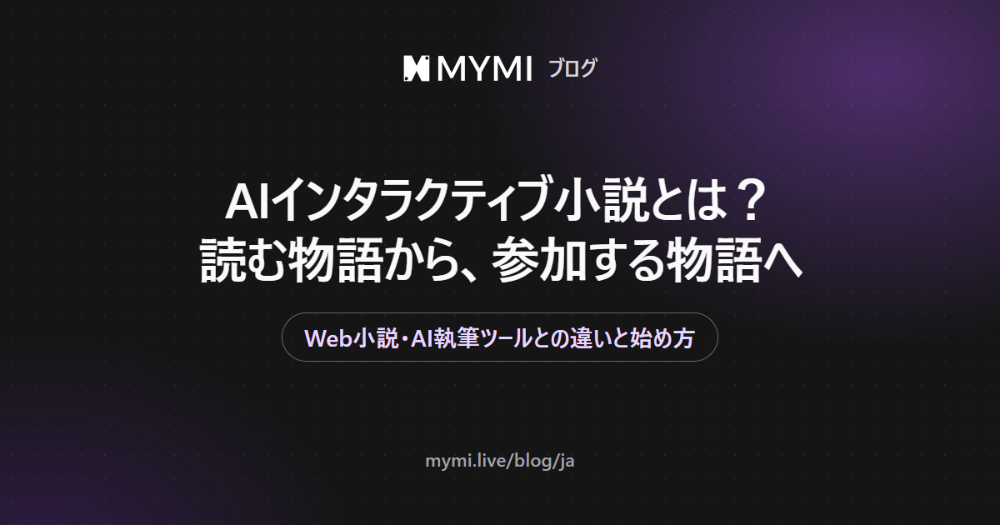

AIインタラクティブ小説は、AIが登場人物を演じ、あなたが主人公として会話で物語を進めていく小説です。



{/* truncate */}

完成した原稿を最初から最後まで読むものではありません。場面が一つ開くと、あなたが自分のセリフや行動を書き、登場人物がそれに応えて次の場面が生まれます。そのため、同じ作品を開いても、人によって残る物語が変わります。

この記事ではMYMIを例に説明します。MYMIでよく使う言葉を先に四つだけ押さえておくと読みやすくなります。

| 言葉 | 意味 |
|---|---|
| 作品 | 世界観と人物、最初の場面までをまとめた一つの物語 |
| 登場人物 | AIが演じる人物 |
| ペルソナ | 作品の中であなたが使う名前と役割 |
| イントロ | 会話を始めるとすぐに開く最初の場面 |

## Web小説やAI執筆ツールと何が違いますか？

いちばんの違いは、あなたが立つ場所です。Web小説では作者が決めた筋を追う読者ですが、AIインタラクティブ小説では場面の中で自分から動く主人公になります。名前の似ているAI執筆ツールとも、やることが違います。

| | Web小説 | AI執筆ツール | AIインタラクティブ小説 |
|---|---|---|---|
| 書く人 | 作者 | あなたの指示を受けたAI | あなたとAIが交互に |
| あなたの役割 | 読者 | 原稿を頼む人 | 物語の中の主人公 |
| 次の場面ができるとき | 次の話が公開されたとき | もう一度頼んだとき | あなたがメッセージを送った直後 |
| 同じ始まりからやり直すと | 同じ文章 | 新しく作られた原稿 | あなたの選び方で変わる展開 |

執筆ツールは完成した原稿を手に入れるのが目的です。インタラクティブ小説は、物語の中に入り、登場人物とやり取りする体験そのものが目的です。「AI小説」という言葉がどちらも指すことがあるので、探しているのがどちらなのかを先に決めておくと迷いません。

## 一つの場面はどう進みますか？

MYMIでは、一つの場面が次の順番で進みます。

1. 作品の紹介を読み、どの場面（イントロ）から始めるかを選びます。
2. イントロが開いたら、自分のセリフや行動を書いて送ります。
3. 登場人物がそれを受けて応え、物語が一歩進みます。
4. 返答がしっくりこなければ、最後の返答を再生成するか、自分で直します。

<Screenshot src={require('./img/intro-list.webp').default} alt="作品画面のイントロ欄を開いたリストに、オーディション、会議、プライベート、自宅、撮影現場の五つの場面が並び、オーディションが選ばれている画面" caption="作品画面のイントロ欄を押すと、どの場面から始めるかを選べます（画面の作品「ハン・ドギョン」 · reerer）" device="part" />

行動はアスタリスクで囲んで送ると、セリフと違う色で表示されます。次の一行は説明のために作った例です。

```text
*窓を開けて路地を見下ろす* 今の音、あなたにも聞こえましたか？
```

何を言えばいいか迷ったら、入力欄を空のまま送ってもかまいません。そのときは登場人物が先に物語を進めます。これも会話1回として数えます。

読む画面も選べます。最初に開く「小説」表示は、地の文とセリフをひと続きの文章として見せるので、会話で作った場面が小説のように読めます。吹き出しに慣れているなら「チャット」表示に、絵を背景に、1ページずつめくりながら読みたいなら「1:1」表示に変えられます。どの表示を選んでも、中身は同じ会話です。

<Screenshot src={require('./img/view-novel.webp').default} alt="小説表示のチャットルームで、イントロの地の文が斜体の白い文字で続き、人物のセリフが黄色い太字で表示されている画面" caption="「小説」表示。地の文とセリフが色を分けて、ひと続きの文章として並びます（画面の作品「ハン・ドギョン」 · reerer、イントロ「撮影現場」）" device="part" />

<Screenshot src={require('./img/view-chat.webp').default} alt="チャット表示で、画面の上に人物の絵が大きく見え、その下の名前の札と吹き出しの中に同じイントロの文章が続いている画面" caption="同じ場面を「チャット」表示で開いたところ（画面の作品「ハン・ドギョン」 · reerer）" device="part" />

<Screenshot src={require('./img/view-1to1.webp').default} alt="1対1表示で、人物の絵を背景に大きな文章の枠が重なり、枠の中に地の文とセリフが続いている画面" caption="同じ場面を「1:1」表示で開いたところ（画面の作品「ハン・ドギョン」 · reerer）" device="part" />

表示は、チャットルーム右上のパレットのアイコンを押すと開く「UI設定」のいちばん上の行で切り替えます。絵を背景に敷いて小説のように読み進める「ストーリー」表示もあります。

<Screenshot src={require('./img/ui-mode.webp').default} alt="パレットのアイコンで開いたUI設定の画面で、いちばん上のUIモードの行にチャット、1対1、小説、ストーリーが並んで小説が選ばれており、その下に文字サイズ、フォント、文字の色の欄がある画面" caption="パレットのアイコン → UI設定。文字サイズやフォント、セリフと地の文の色もここで変えられます" device="part" />

2026年11月13日時点で、MYMIで覚えておくとよい数字は次のとおりです。

| 項目 | 値 |
|---|---|
| メッセージ1通に書ける文字数 | 1,000文字 |
| ログインせずに送れる回数 | 最大5回（再生成を含む） |
| 長期記憶に新しい出来事を書き足す間隔 | 会話10回ごと |
| ユーザーノートに書ける文字数 | 3,000文字（長く書くほど、メッセージごとに必要なスパークが増えることがあります） |

入力欄のボタンや返答の下のボタンの位置は、ガイドの[会話する](https://www.mymi.live/guide/ja/chatting/chat-with-character)で確認できます。

## どんなジャンルがありますか？

MYMIの作品には、クリエイターが選んだジャンルが付いています。ホームのジャンルタブでは、ロマンス、ファンタジー、武侠、SF、日常、コメディ、ミステリー・スリラーなど13のジャンルから一つを選び、人気順・週間人気順・新着順で並べ替えられます。作品ごとのハッシュタグを見ると、雰囲気や設定がもう少し詳しくわかります。

ジャンルやタグは手がかりにすぎません。紹介文とイントロまで読んで、最初の一言を返したくなる場面かどうかで選ぶと、入りやすい作品が見つかります。

## どうやって始めますか？

1. ブラウザで[MYMI](https://www.mymi.live/ja?utm_source=mymi_blog&utm_medium=referral&utm_campaign=global_content_2026q4&utm_content=ja_blog_ai_interactive_novel)を開きます。AndroidとiPhoneのアプリも同じアカウントで使えます。
2. 初めて開くと、主に見たいキャラクターをたずねる画面が出ます。「女性キャラクター」「男性キャラクター」「すべて見たい」から選ぶと、ホームがそれに合わせて表示されます。
3. ホームのおすすめ・ランキング・ジャンル・検索のタブから作品を選び、「会話を始める」を押します。
4. ログインしていない状態では、最大5回まで会話を試せます。返答の再生成も1回として数えます。
5. 続けたくなったら、その画面からそのまま登録できます。体験中の会話は新しいアカウントに引き継がれ、それ以降は返答を受け取るたびに、会話に使うMYMIの通貨「スパーク」が必要になります。

自分のペルソナを作ることとユーザーノートは、ログインしてから使える機能です。体験のあいだは、作品に「おすすめペルソナ」があればそれを選ぶか、最初のメッセージで自分がどんな人物なのかを一言添えて始めると、場面に入りやすくなります。

## よくある質問

<details>
<summary>AIが物語を全部書いてくれるのですか？</summary>

基本的には、あなたのセリフと行動はあなた自身が書き、AIは登場人物のセリフと場面の描写を受け持ちます。チャット設定で「AIによるユーザーの行動描写を許可」をオンにすると、AIがあなたの行動やセリフも書けるようになり、「ストーリーブースター」をオンにすると、AIがより積極的に出来事を起こします。どこまで任せるかはあなたが決められます。設定の場所は[チャットルームの設定](https://www.mymi.live/guide/ja/chatting/chat-room-settings)にあります。

</details>

<details>
<summary>同じ作品を最初からやり直せますか？</summary>

作品の画面でイントロを選んで「新しい会話を始める」を押すと、新しいチャットルームができ、元のチャットルームもそのまま残ります。気に入った地点をブックマークしておけば、そこから分かれた新しいチャットルームで別の展開を試すこともできます。手順は[チャットルームの設定](https://www.mymi.live/guide/ja/chatting/chat-room-settings)にあります。

</details>

<details>
<summary>会話が長くなると、前の話を忘れませんか？</summary>

AIが一度に参照できる量には限りがあるので、前のほうを取りこぼすことがあります。そこでMYMIは、会話10回ごとに新しい出来事を長期記憶のあらすじに書き足し、大事な瞬間は記憶の断片として残します。必ず守ってほしい設定は、ユーザーノートに3,000文字まで書いておくと、返答のたびに参照されます（ログインが必要で、長く書くほどメッセージごとのスパークが増えることがあります）。ログインせずに体験しているあいだは、記憶の断片は使われません。くわしくは[長期記憶と記憶の断片](https://www.mymi.live/guide/ja/chatting/memory-book)をご覧ください。

</details>

<details>
<summary>Webとアプリ、どちらで使えばいいですか？</summary>

どちらでもかまいません。WebとAndroid・iPhoneのアプリは同じアカウントを使うので、登録したときと同じソーシャルアカウントでログインすれば、続きの会話を別の端末でも進められます。ただし、アプリにはLINEとXのログインがなく、AndroidアプリにはAppleのログインもありません。その方法で登録した場合は、スマートフォンでもChromeやSafariでWebを開いてログインしてください。ログインなしの体験については[ログインなしでAIチャットできますか？](https://www.mymi.live/guide/ja/faq/chat-without-login)にまとめています。

</details>
