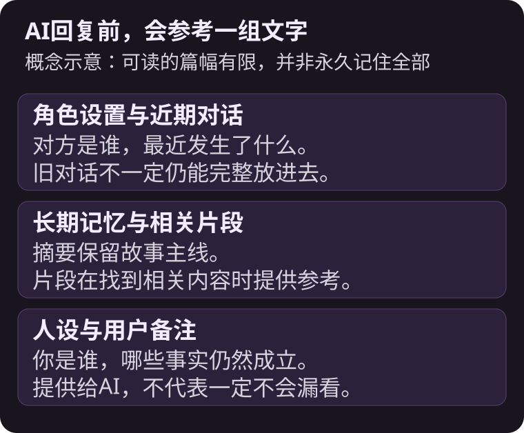
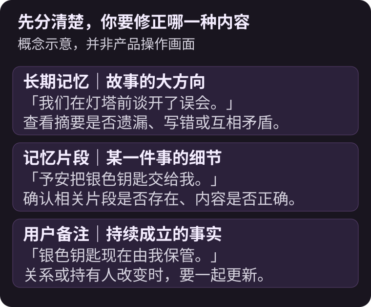
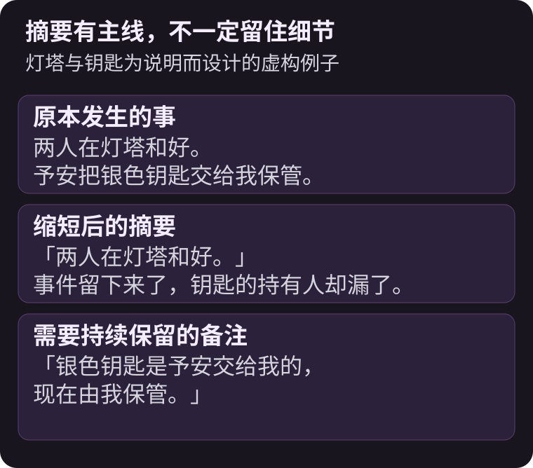
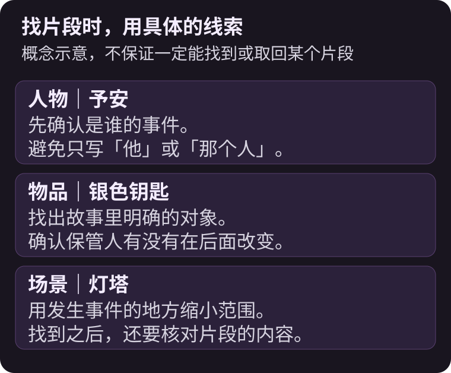

AI角色会忘记先前的事，常见原因是每次回复能参考的文字有限；较早的对话被缩成摘要后，具体细节可能没有留下来。


{/* truncate */}

昨天才约好见面的地点，今天却像第一次听到；已经和好的两人，又为同一件事吵起来。这不一定是你设置写得不够长，也可能是角色这次取得的上下文不完整，或新旧设置互相矛盾。

先找出是哪一种情况，再决定要改回复、改记忆，还是补上备注，比把整个故事重写一次更有方向。

## AI每次回复，究竟读到了什么？

在MYMI这类角色聊天中，服务会把角色与世界观设置、近期对话、整理过的剧情，以及相关备注交给模型。模型根据这一包内容写下一则回复，并不是自己永久记住所有聊天。



故事变长后，较早的对话不一定还能整段放进去。摘要可能留下「两人在灯塔和好」，却漏掉「银色钥匙由谁保管」。如果这把钥匙正好是下一幕的重要线索，就会让人觉得AI偏偏忘了最重要的部分。灯塔与钥匙是本文为说明而设计的例子。

## MYMI的三种记忆，该怎么分？

截至2026年11月8日，可以这样理解：

| 种类 | 主要保留什么 | 何时参考 | 你可以做什么 |
|---|---|---|---|
| 长期记忆 | 已发生事件的大方向与顺序 | 每次回复 | 查看并修正错误摘要 |
| 记忆片段 | 个别事件的内容 | 找到与当前场景相关的片段时 | 查看、搜索、修改或删除 |
| 用户备注 | 希望持续遵守的关系与设置 | 每次回复 | 自己写下并更新，最多3,000字（较长时每次回复额外使用Spark） |

长期记忆每对话10次，会把新发生的事情接在后面。它也有篇幅限制，太长时旧内容会缩短合并，仍然太长时会删掉一部分。记忆片段则不会每次全数放进回复，而是挑出与目前对话相关的内容。



**用户备注不是保证AI永不出错的开关。**它能让重要事实持续被提供给AI，但模型仍可能忽略或误解。备注越清楚、矛盾越少，越容易让角色接回正确的关系。

## 忘记约定或叫错名字时，先做哪一件事？

先停在出错的那则回复。若它仍是最后一则、也没有被书签锁住，可以重新生成或直接编辑。若已经继续聊了很多句，后面的剧情可能也沿用了那个错误。

接着看**长期记忆**：是摘要根本没记下来，还是记成另一种说法？有错的行可以修正。不要只在备注添加正确版本，却让记忆里的错误版本继续留下来。



接着确认**记忆片段**里的**使用记忆片段**是否打开。若已关闭，这间聊天室当次停留期间的回复就不会取用片段。如果AI一直提到不相干的旧事，再核对相关片段，必要时修改或删除；搜索时用人物名字、物品或场景，比只输入「那件事」更容易确认内容。



具体按钮与修改限制，请看[长期记忆与记忆片段](https://www.mymi.live/guide/zh-Hans/chatting/memory-book)。

## 备注怎么写，才不会越补越乱？

把「目前仍然成立的事实」留下来，避免把整段故事再贴一次。以下都是前述虚构例子的备注：

```text
银色钥匙是予安在灯塔前交给我的，现在由我保管。
我们已经谈开那次误会，目前是互相信任的搭档。
予安称呼我为「店长」。
```

这比「他应该记得上次那件事，不要再乱写」清楚：人物、物品与现在的关系都说出来了。

- 用固定名字与称呼，同一个人不要一段写暱称、一段又换新称号。
- 关系改变时，改掉旧句子，不要同时保留「彼此不信任」与「已经和好」。
- 少用「昨天」「三天前」这类随剧情时间改变的说法。
- 不必写满，备注越长，每次回复可能多用Spark；先留下后面场景真正会用到的事实。

下一句对话也可以自然地带回线索：

```text
*从口袋拿出银色钥匙* 这是你在灯塔前交给我的，还记得吗？
```

这能让AI重新看到具体事实，也给相关记忆片段更明确的线索，但仍不是一定会取回某个片段的保证。

## 常见问题

<details>
<summary>把长期记忆改好，就能一直保留吗？</summary>

不一定。修改过的摘要仍可能在之后的整理中缩短、合并或删除。持续重要的设置可以另外放进用户备注，并在关系改变时更新。

</details>

<details>
<summary>用户备注和人设有什么不同？</summary>

人设主要描述你扮演谁，例如名字、身份与个性；用户备注可补上这间聊天室现在的关系与事实。两者都会供AI参考。原始人设清单的修改不会自动改掉既有聊天室，需要在那间聊天室重新加载或修改。

</details>

<details>
<summary>同一部作品开新聊天室，备注也会一起过去吗？</summary>

一般重新开始的聊天室不会带入旧房间的备注。从书签创建分支则会复制分支当下的用户备注与人设；若其中写了书签之后才发生的事，要在新房间调整。备注保存在聊天室，换设备登录同一账号后仍可使用。

</details>

<details>
<summary>未登录的体验也有这些记忆吗？</summary>

体验对话较短，会以近期对话继续故事，不使用记忆片段，也不能打开用户备注。若要把体验聊天室带到新账号，请从当时使用的浏览器或App登录按钮直接注册；另开其他浏览器或App注册不会自动带过去。

</details>

有一段正在进行的故事，可以回到[MYMI](https://www.mymi.live/zh-Hans?utm_source=mymi_blog&utm_medium=referral&utm_campaign=global_content_2026q4&utm_content=zh-Hans_blog_ai_character_memory)先找出那个需要修正的事实。刚开始接触时，先读[AI互动小说是什么？](./ai-interactive-novel.md)与[第一句对话怎么写？](./ai-chat-start.md)，其他文章则在[MYMI博客](https://www.mymi.live/blog/zh-Hans)。
