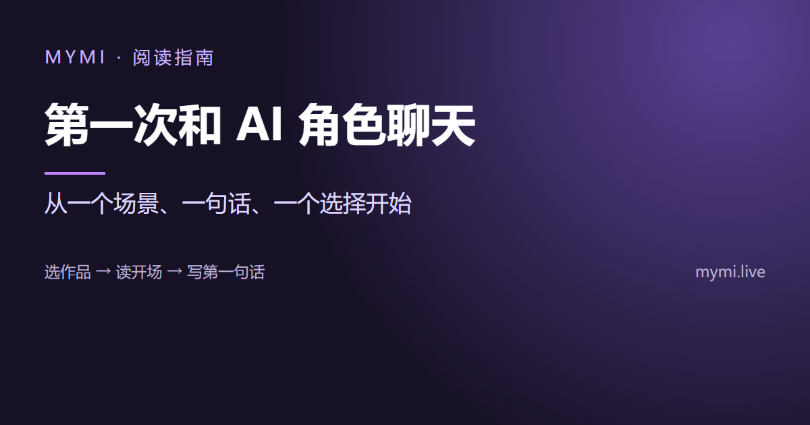
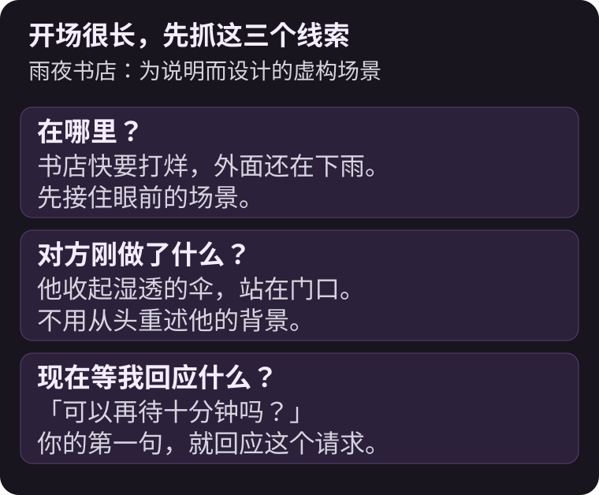
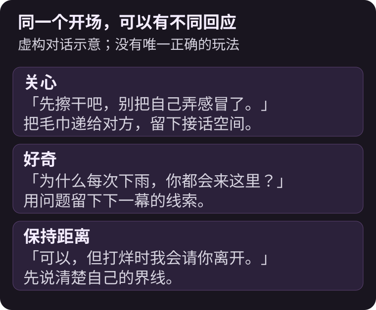
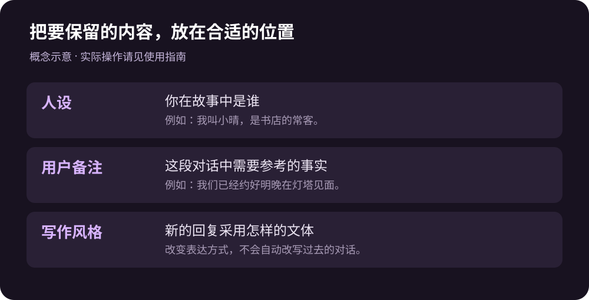
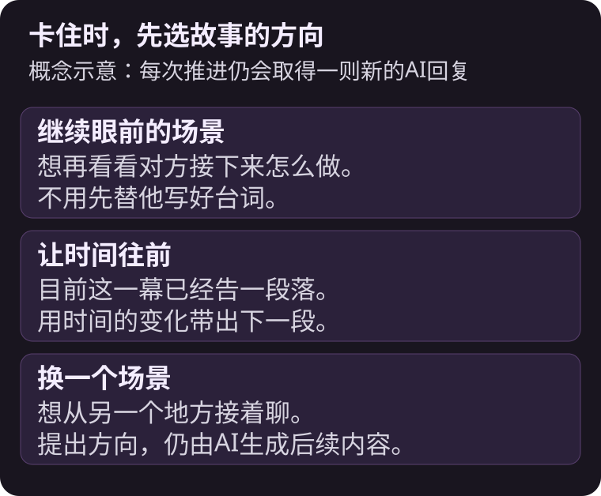

先选一个你想参与的开场场景，接住角色最后的话或动作，再送出自己的一个动作与一句台词，就能开始第一轮交互。



{/* truncate */}

不知道要聊什么，不一定是你不会写故事。有时只是把角色聊天当成问答：问了名字、兴趣，接着就没有话题。换成「我现在就在这个场景里，会做什么」，通常更容易找到下一句。

这篇用为了说明而设计的**雨夜书店**情节示范；它不是MYMI作品、用户纪录或实际AI回复。互动故事和一般问答的差别，也可以先看[AI互动小说是什么？](./ai-interactive-novel.md)。

## 第一部作品，要看什么来选？

先挑你想参与的关系或情境，再看角色图片。想慢慢熟悉，可以找日常相处；想有事情可做，可以找调查、冒险或共同解决问题的开头。

打开作品后，重点看三件事：

| 要看什么 | 问自己什么 |
|---|---|
| 一句话介绍与标签 | 这个关系与氛围是我想体验的吗？ |
| 开场白 | 我看得懂现在发生了什么，也想接下去吗？ |
| 我的角色位置 | 我是熟人、搭档，还是刚好经过的人？ |

MYMI首页可从推荐、排行、类型或搜索找作品。排行榜适合发现作品，但开场白能不能让你想回应，比排名更直接。若作品有不同开场白，也可以选一个比较容易进入的场景。

## 开场很长，要抓哪一句？

先找出「在哪里」「对方刚做了什么」「现在等我回应什么」。不用重述整段背景。

假设开场最后是：书店快打烊了，门口的人收起湿透的伞，问你能不能再待十分钟。你现在要接的是这个请求，并不需要从头问他叫什么名字。



如果开场已经写了你把门打开，可以把那件事当成已发生的背景，从下一个动作接下去。若整个前提都不想接受，换一个开场或作品，也比一开始就花很多句推翻背景更轻松。

## 第一则消息怎么写，才容易接下去？

用「一个动作＋一句台词」开始。例如：

```text
*把门口的毛巾递给你* 可以，但你得先告诉我，为什么每次下雨都会来这里？
```

动作回应了对方淋雨的状态，问句则留下可以揭开的线索。它没有替对方决定答案，也没有一次写完后面几幕。



你也可以只想平静相处：「先坐下吧，打烊前我再叫你。」没有哪一句才是正确玩法。重要的是对当下的事做出回应，并保留对方接话的空间。

MYMI可用星号包住动作，例如 `*把毛巾递过去*`，让动作和台词以不同样式显示。刚开始不用把格式、人物背景与完整剧情一次写齐。

## 想固定名字与关系，该放在哪里？

**人设**用来设置你在故事中是谁。**用户备注**则可以留下这间聊天室持续要用到的关系与事实，例如「我是书店店长；我们刚认识，还不知道对方的职业」。这两项都需要登录才能自行编辑。



截至2026年11月8日，人设的详细信息可写1,000字，用户备注最多可写3,000字。备注较长时，每次回复可能额外使用Spark，费用以画面显示为准。不是写越满越好。先放与目前场景有关的信息，关系改变后再更新。

**写作风格**调整的是叙述方式，例如偏小说描写或较轻快的台词节奏。它不等于改变两人的关系。详细操作放在[聊天室设置](https://www.mymi.live/guide/zh-Hans/chatting/chat-room-settings)，避免只想改称呼时，却一直切换文体。

## 卡住了，或回复不是我想要的，怎么办？

如果只是想不到台词，让输入框保持空白，就可以点 **≫**，在**继续推进**中选择方向。选择时间流逝、场景转换等，是请AI往那个方向再写一轮，不是保证出现某段预写剧情。



如果最后一则回复写错了关系，先重新生成或直接编辑，再往下聊。删除则不同：它会连引发这则回复的上一则用户消息一起删掉。只想换一个回答时，先考虑重新生成。加入书签后，该回复与前面的消息也会受到修改限制。

聊久了才开始忘记约定，可以接着看[AI角色为什么会忘记设置？](./ai-character-memory.md)。

## 常见问题

<details>
<summary>只能从选项里选一句话吗？</summary>

不必，主要的交互方式是自己输入台词与动作。「继续推进」提供的是故事方向，并不会限制你只能从固定台词中选择。

</details>

<details>
<summary>还没注册，也能先试聊吗？</summary>

截至2026年11月8日，未登录最多可取得5次体验回复，重新生成也计入；可用次数可能因先前体验而较少。若想把聊天室带到新账号，请直接从体验中的浏览器或App登录按钮注册。完整条件请看[不登录可以使用AI聊天吗？](https://www.mymi.live/guide/zh-Hans/faq/chat-without-login)。

</details>

<details>
<summary>每次回复都会花Spark吗？</summary>

登录后，一般聊天会依选用的AI模型使用Spark。模型价格与活动可能调整，选择模型时请确认画面显示的价格；重新生成与继续推进也会取得新的回复。现行说明在[AI模型指南](https://www.mymi.live/guide/zh-Hans/chatting/ai-models)。

</details>

<details>
<summary>手机聊到一半，能在电脑接着聊吗？</summary>

登录同一账号后，可以接续该账号的聊天室。人设与用户备注会留在聊天室；写作风格等偏好则分别保存在目前的浏览器或App，需要各自调整。

</details>

到[MYMI](https://www.mymi.live/zh-Hans?utm_source=mymi_blog&utm_medium=referral&utm_campaign=global_content_2026q4&utm_content=zh-Hans_blog_ai_chat_start)挑一个你愿意回应的开场，先送出一句就好。更多故事与对话的阅读方法，请看[MYMI博客](https://www.mymi.live/blog/zh-Hans)。
