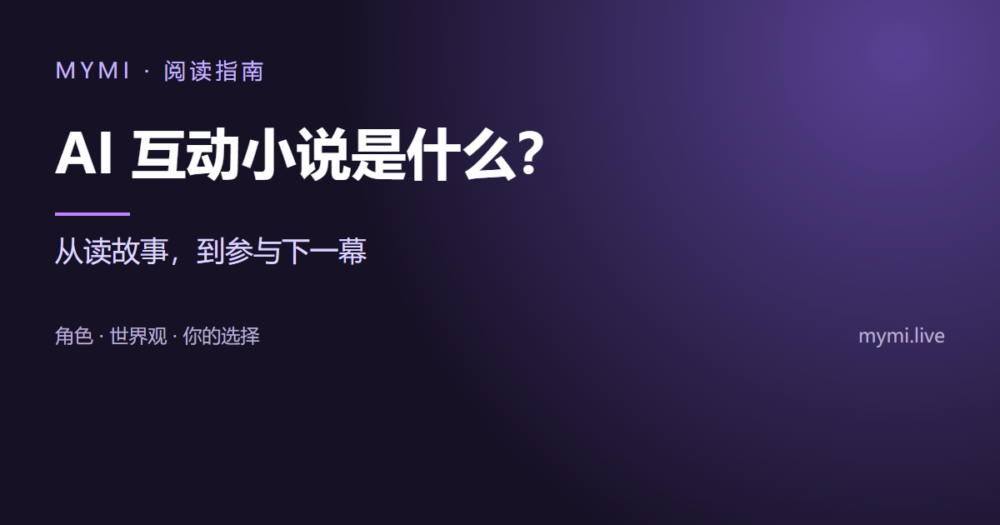
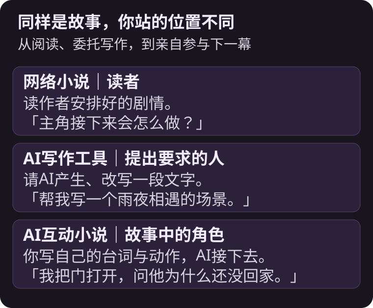
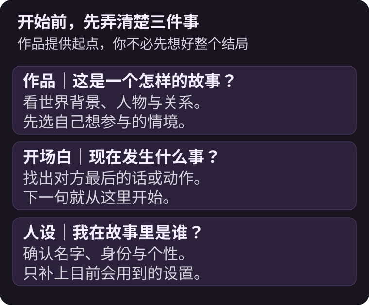
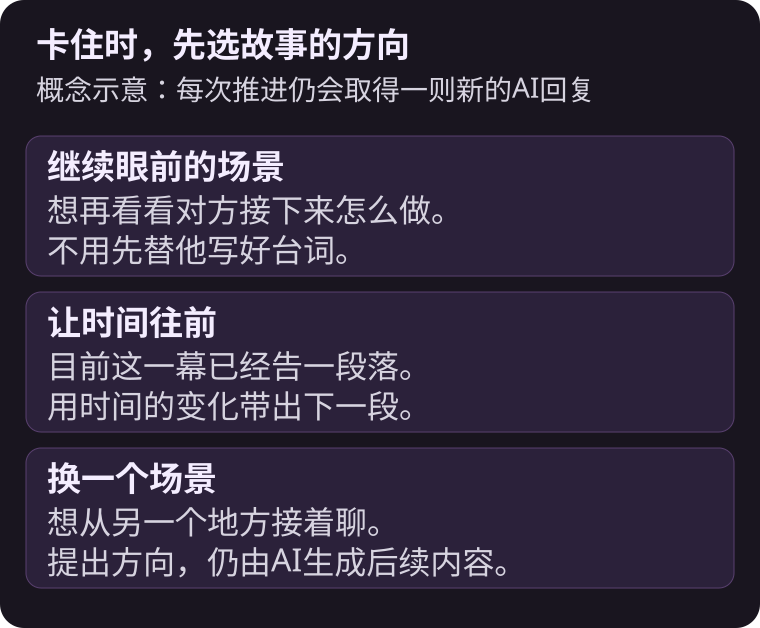
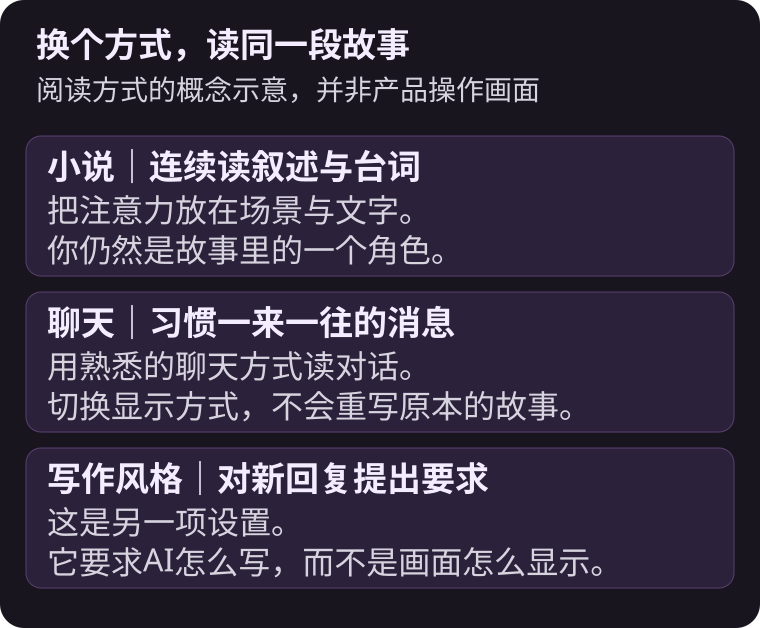

AI互动小说是由AI扮演故事角色、你也以角色身份参与，通过一来一往的台词与动作共同推进的故事。



{/* truncate */}

读网络小说时，你可能想过：「如果主角那时候没有离开呢？」在互动小说里，你可以直接让自己的角色留下来，看看对方怎么回应。你不必先写好整个故事，也不是每次只能从几个固定选项中挑一个。

以下以MYMI的角色聊天为例。文中的雨夜书店与灯塔情节是为了说明而设计的例子，不是平台作品的剧情或实际用户对话。

## 和网络小说、AI写作工具差在哪里？

差别在于你想得到一篇完成的文章，还是想亲自参与故事发展。

| 比较项目 | 网络小说 | AI写作工具 | AI互动小说 |
|---|---|---|---|
| 你的位置 | 读者 | 提出写作要求的人 | 故事中的角色 |
| 主要做什么 | 阅读作者安排好的剧情 | 请AI产出或修改文章 | 写下自己的台词与动作 |
| AI负责什么 | 不一定使用AI | 按要求产生文字 | 扮演对方并延续场景 |
| 同一个开头再来一次 | 通常读到同样内容 | 可取得另一份稿件 | 可能因回应不同而有不同走向 |



例如，角色问你要不要一起查看楼上的声响。你可以跟上去，也可以先问他是不是知道什么。这些回应会成为AI接下来参考的内容，但不代表每个要求都会被精准运行，也没有保证能到达的固定结局。

## 「作品」「开场白」「人设」各是什么？

MYMI把创作者准备好的世界、人物与开场场景称为一部**作品**。它提供故事起点，不是一整本已经写完的小说。

**开场白**是你走进故事时已经发生的那一幕。**人设**则是你在故事里使用的名字与身份。对方是谁、你是谁、你们为什么会遇见，通常能从作品介绍与开场白找到线索。

不必一开始就追求复杂的世界观。先选一个你看完开头就想回一句话的情境，往往更容易投入。喜欢慢慢试探关系，可以找日常或浪漫情节；喜欢线索与选择，可以从奇幻冒险或悬疑情境开始。作品的标签只是线索，仍要读介绍与开场白，确认实际内容是不是你想看的。



## 一来一往要怎么写？

先接住场景里已经发生的事，再留下对方能回应的空间。例如书店楼上突然传来声响，你可以这样写：

```text
*把书放回柜台，抬头看向楼梯* 刚刚那个声音，你也听到了吗？
```

动作交代了你在做什么，问句把下一步交给对方。你不用同时替对方写好「他点头，拉着我上楼」，那会把原本可以交互的部分也决定掉。

如果想不到下一句，让输入框保持空白，就可以用 **≫** 打开**继续推进**，选择让故事继续的方向。它会取得一次新的AI回复，仍计入试用次数或使用Spark。



想看更多第一句的例子，接着读[AI角色聊天怎么开始？](./ai-chat-start.md)。

## 看起来像聊天，还是像小说？

两种都可以。MYMI的阅读显示方式会改变文字与图片的呈现，不会把同一间聊天室改成另一个故事。喜欢连续读叙述与台词，可以选**小说**；习惯消息往返的样子，可以选**聊天**。这些是阅读方式，和**写作风格**对AI回复提出的文体要求不同。



详细按钮位置放在[聊天室设置](https://www.mymi.live/guide/zh-Hans/chatting/chat-room-settings)，这里先记住：换显示方式，是换个方式读同一段对话。

## 常见问题

<details>
<summary>AI会连我的台词一起写吗？</summary>

基本上由你写自己的台词与动作，AI负责对方和场景。即使如此，AI偶尔仍可能写到你的部分。可以修正最后一则回复，并在设置中确认「允许AI描写我的行动」是否关闭。打开这个选项只是允许AI在需要时这样写，不保证每次都会写。

</details>

<details>
<summary>同一部作品可以重新开始吗？</summary>

可以在作品页打开新的聊天，原本的聊天室会保留。想从中途改走另一条路，可以利用书签创建分支。书签会限制原对话的修改，所以加入之前先确认内容，详细条件请看[书签与分支](https://www.mymi.live/guide/zh-Hans/chatting/chat-room-settings#书签与分支)。

</details>

<details>
<summary>故事变长后，AI还记得前面的事吗？</summary>

不一定能记住每个细节。MYMI会整理长期记忆，也会取用相关的记忆片段；你还可以把重要设置放进用户备注。但AI仍可能漏看或误解。原因与修正方式，另见[AI角色为什么会忘记设置？](./ai-character-memory.md)。

</details>

<details>
<summary>一定要先下载App吗？</summary>

不必，可以先在浏览器打开MYMI。App 暂未提供简体中文界面，可以使用繁体中文等现有语言；网页、Android与iPhone App可使用同一个账号接续聊天。使用Apple账号的人在Android上请从网页登录。未登录的体验有次数限制，详细条件请看[不登录可以使用AI聊天吗？](https://www.mymi.live/guide/zh-Hans/faq/chat-without-login)。

</details>

想试试自己在故事里会怎么选，可以到[MYMI](https://www.mymi.live/zh-Hans?utm_source=mymi_blog&utm_medium=referral&utm_campaign=global_content_2026q4&utm_content=zh-Hans_blog_ai_interactive_novel)找一个想接话的开场。更多阅读与对话的方法，收在[MYMI博客](https://www.mymi.live/blog/zh-Hans)。
