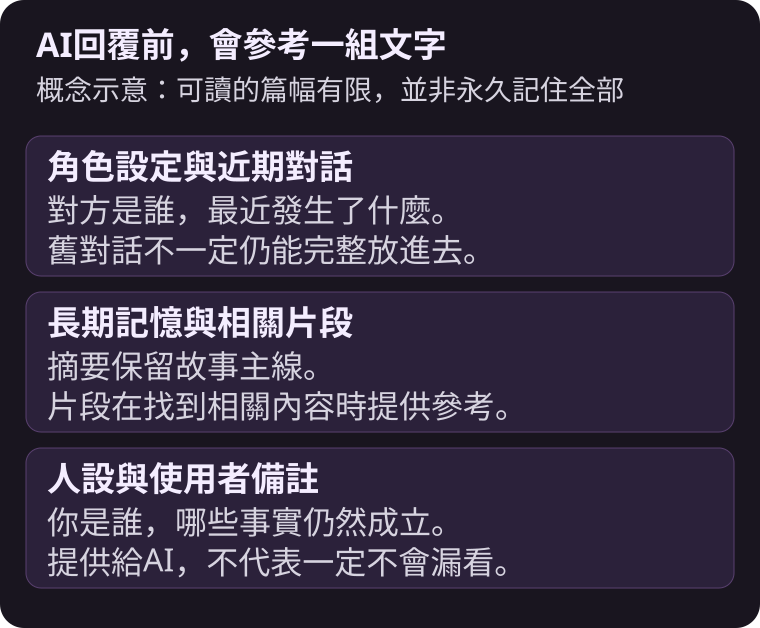
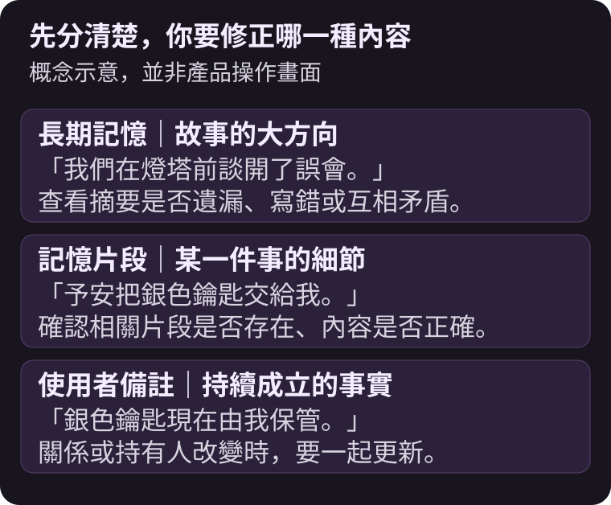
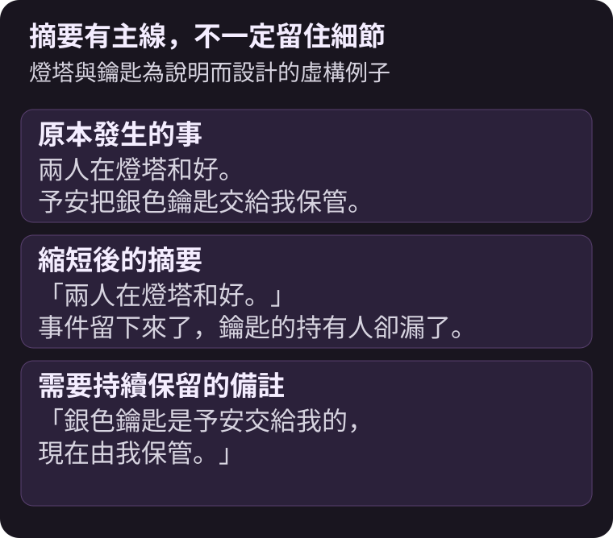
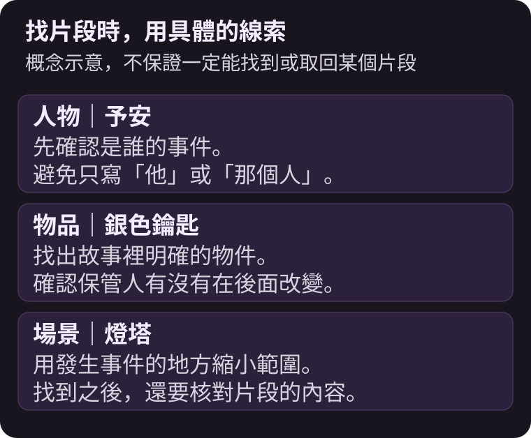

AI角色會忘記先前的事，常見原因是每次回覆能參考的文字有限；較早的對話被縮成摘要後，具體細節可能沒有留下來。


{/* truncate */}

昨天才約好見面的地點，今天卻像第一次聽到；已經和好的兩人，又為同一件事吵起來。這不一定是你設定寫得不夠長，也可能是角色這次取得的上下文不完整，或新舊設定互相矛盾。

先找出是哪一種情況，再決定要改回覆、改記憶，還是補上備註，比把整個故事重寫一次更有方向。

## AI每次回覆，究竟讀到了什麼？

在MYMI這類角色聊天中，服務會把角色與世界觀設定、近期對話、整理過的劇情，以及相關備註交給模型。模型根據這一包內容寫下一則回覆，並不是自己永久記住所有聊天。



故事變長後，較早的對話不一定還能整段放進去。摘要可能留下「兩人在燈塔和好」，卻漏掉「銀色鑰匙由誰保管」。如果這把鑰匙正好是下一幕的重要線索，就會讓人覺得AI偏偏忘了最重要的部分。燈塔與鑰匙是本文為說明而設計的例子。

## MYMI的三種記憶，該怎麼分？

截至2026年11月7日，可以這樣理解：

| 種類 | 主要保留什麼 | 何時參考 | 你可以做什麼 |
|---|---|---|---|
| 長期記憶 | 已發生事件的大方向與順序 | 每次回覆 | 查看並修正錯誤摘要 |
| 記憶片段 | 個別事件的內容 | 找到與當前場景相關的片段時 | 查看、搜尋、修改或刪除 |
| 使用者備註 | 希望持續遵守的關係與設定 | 每次回覆 | 自己寫下並更新，最多2,000字 |

長期記憶每對話10次，會把新發生的事情接在後面。它也有篇幅限制，太長時舊內容會縮短合併，仍然太長時會刪掉一部分。記憶片段則不會每次全數放進回覆，而是挑出與目前對話相關的內容。



**使用者備註不是保證AI永不出錯的開關。**它能讓重要事實持續被提供給AI，但模型仍可能忽略或誤解。備註越清楚、矛盾越少，越容易讓角色接回正確的關係。

## 忘記約定或叫錯名字時，先做哪一件事？

先停在出錯的那則回覆。若它仍是最後一則、也沒有被書籤鎖住，可以重新生成或直接編輯。若已經繼續聊了很多句，後面的劇情可能也沿用了那個錯誤。

接著看**長期記憶**：是摘要根本沒記下來，還是記成另一種說法？有錯的行可以修正。不要只在備註新增正確版本，卻讓記憶裡的錯誤版本繼續留下來。



接著確認**記憶片段**裡的**使用記憶片段**是否開啟。若已關閉，這間聊天室當次停留期間的回覆就不會取用片段。如果AI一直提到不相干的舊事，再核對相關片段，必要時修改或刪除；搜尋時用人物名字、物品或場景，比只輸入「那件事」更容易確認內容。



具體按鈕與修改限制，請看[長期記憶與記憶片段](https://www.mymi.live/guide/zh-TW/chatting/memory-book)。

## 備註怎麼寫，才不會越補越亂？

把「目前仍然成立的事實」留下來，避免把整段故事再貼一次。以下都是前述虛構例子的備註：

```text
銀色鑰匙是予安在燈塔前交給我的，現在由我保管。
我們已經談開那次誤會，目前是互相信任的搭檔。
予安稱呼我為「店長」。
```

這比「他應該記得上次那件事，不要再亂寫」清楚：人物、物品與現在的關係都說出來了。

- 用固定名字與稱呼，同一個人不要一段寫暱稱、一段又換新稱號。
- 關係改變時，改掉舊句子，不要同時保留「彼此不信任」與「已經和好」。
- 少用「昨天」「三天前」這類隨劇情時間改變的說法。
- 不必填滿2,000字，先留下後面場景真正會用到的事實。

下一句對話也可以自然地帶回線索：

```text
*從口袋拿出銀色鑰匙* 這是你在燈塔前交給我的，還記得嗎？
```

這能讓AI重新看到具體事實，也給相關記憶片段更明確的線索，但仍不是一定會取回某個片段的保證。

## 常見問題

<details>
<summary>把長期記憶改好，就能一直保留嗎？</summary>

不一定。修改過的摘要仍可能在之後的整理中縮短、合併或刪除。持續重要的設定可以另外放進使用者備註，並在關係改變時更新。

</details>

<details>
<summary>使用者備註和人設有什麼不同？</summary>

人設主要描述你扮演誰，例如名字、身分與個性；使用者備註可補上這間聊天室現在的關係與事實。兩者都會供AI參考。原始人設清單的修改不會自動改掉既有聊天室，需要在那間聊天室重新載入或修改。

</details>

<details>
<summary>同一部作品開新聊天室，備註也會一起過去嗎？</summary>

一般重新開始的聊天室不會帶入舊房間的備註。從書籤建立分支則會複製分支當下的使用者備註與人設；若其中寫了書籤之後才發生的事，要在新房間調整。備註儲存在聊天室，換裝置登入同一帳號後仍可使用。

</details>

<details>
<summary>未登入的體驗也有這些記憶嗎？</summary>

體驗對話較短，會以近期對話繼續故事，不使用記憶片段，也不能開啟使用者備註。若要把體驗聊天室帶到新帳號，請從當時使用的瀏覽器或App登入按鈕直接註冊；另開其他瀏覽器或App註冊不會自動帶過去。

</details>

有一段正在進行的故事，可以回到[MYMI](https://www.mymi.live/zh-TW?utm_source=mymi_blog&utm_medium=referral&utm_campaign=global_content_2026q4&utm_content=zh-TW_blog_ai_character_memory)先找出那個需要修正的事實。剛開始接觸時，先讀[AI互動小說是什麼？](./ai-interactive-novel.md)與[第一句對話怎麼寫？](./ai-chat-start.md)，其他文章則在[MYMI部落格](https://www.mymi.live/blog/zh-TW)。
