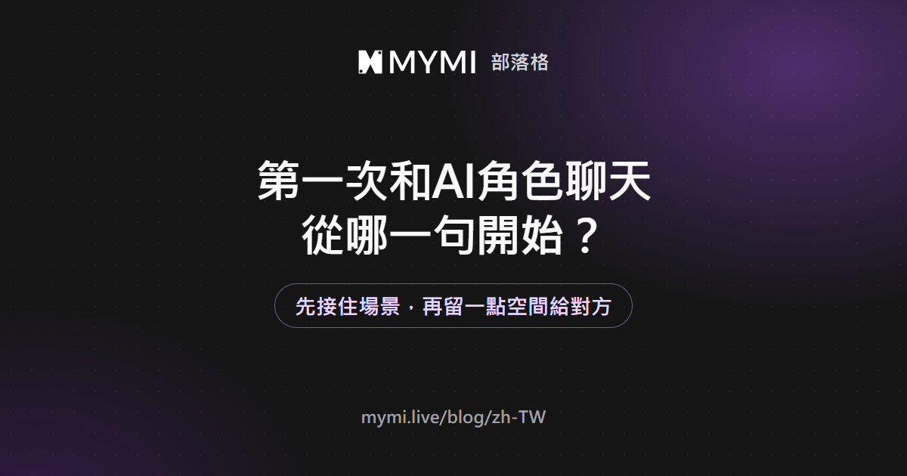
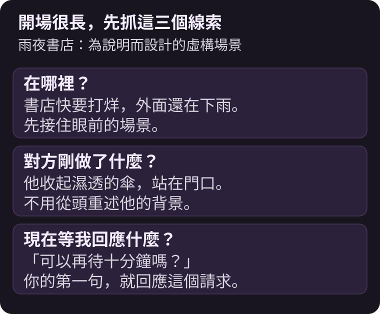
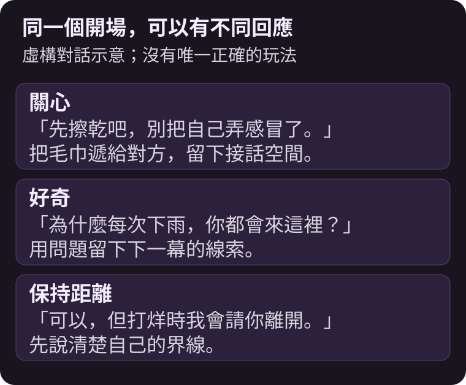
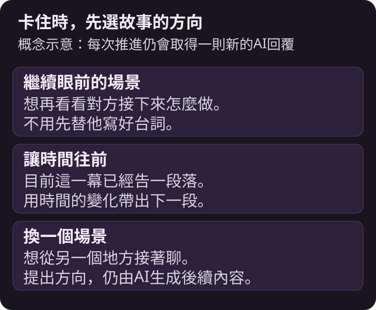

先選一個你想參與的開場場景，接住角色最後的話或動作，再送出自己的一個動作與一句台詞，就能開始第一輪互動。



{/* truncate */}

不知道要聊什麼，不一定是你不會寫故事。有時只是把角色聊天當成問答：問了名字、興趣，接著就沒有話題。換成「我現在就在這個場景裡，會做什麼」，通常更容易找到下一句。

這篇用為了說明而設計的**雨夜書店**情節示範；它不是MYMI作品、使用者紀錄或實際AI回覆。互動故事和一般問答的差別，也可以先看[AI互動小說是什麼？](./ai-interactive-novel.md)。

## 第一部作品，要看什麼來選？

先挑你想參與的關係或情境，再看角色圖片。想慢慢熟悉，可以找日常相處；想有事情可做，可以找調查、冒險或共同解決問題的開頭。

打開作品後，重點看三件事：

| 要看什麼 | 問自己什麼 |
|---|---|
| 一句話介紹與標籤 | 這個關係與氛圍是我想體驗的嗎？ |
| 開場白 | 我看得懂現在發生了什麼，也想接下去嗎？ |
| 我的角色位置 | 我是熟人、搭檔，還是剛好經過的人？ |

MYMI首頁可從推薦、排行、類型或搜尋找作品。排行榜適合發現作品，但開場白能不能讓你想回應，比排名更直接。若作品有不同開場白，也可以選一個比較容易進入的場景。

## 開場很長，要抓哪一句？

先找出「在哪裡」「對方剛做了什麼」「現在等我回應什麼」。不用重述整段背景。

假設開場最後是：書店快打烊了，門口的人收起濕透的傘，問你能不能再待十分鐘。你現在要接的是這個請求，並不需要從頭問他叫什麼名字。



如果開場已經寫了你把門打開，可以把那件事當成已發生的背景，從下一個動作接下去。若整個前提都不想接受，換一個開場或作品，也比一開始就花很多句推翻背景更輕鬆。

## 第一則訊息怎麼寫，才容易接下去？

用「一個動作＋一句台詞」開始。例如：

```text
*把門口的毛巾遞給你* 可以，但你得先告訴我，為什麼每次下雨都會來這裡？
```

動作回應了對方淋雨的狀態，問句則留下可以揭開的線索。它沒有替對方決定答案，也沒有一次寫完後面幾幕。



你也可以只想平靜相處：「先坐下吧，打烊前我再叫你。」沒有哪一句才是正確玩法。重要的是對當下的事做出回應，並保留對方接話的空間。

MYMI可用星號包住動作，例如 `*把毛巾遞過去*`，讓動作和台詞以不同樣式顯示。剛開始不用把格式、人物背景與完整劇情一次寫齊。

## 想固定名字與關係，該放在哪裡？

**人設**用來設定你在故事中是誰。**使用者備註**則可以留下這間聊天室持續要用到的關係與事實，例如「我是書店店長；我們剛認識，還不知道對方的職業」。這兩項都需要登入才能自行編輯。

<Screenshot src={require('./img/chat-settings.png').default} alt="聊天設定選單中的使用者備註、人設與寫作風格" caption="想固定自己的身分，用人設；想留下這段對話的事實，用使用者備註。" device="part" />

截至2026年11月7日，人設詳細資料可寫1,000字，使用者備註可寫2,000字，但不是寫越滿越好。先放與目前場景有關的資訊，關係改變後再更新。

**寫作風格**調整的是敘述方式，例如偏小說描寫或較輕快的台詞節奏。它不等於改變兩人的關係。詳細操作放在[聊天室設定](https://www.mymi.live/guide/zh-TW/chatting/chat-room-settings)，避免只想改稱呼時，卻一直切換文體。

## 卡住了，或回覆不是我想要的，怎麼辦？

如果只是想不到台詞，讓輸入框保持空白，就可以點 **≫**，在**繼續推進**中選擇方向。選擇時間流逝、場景轉換等，是請AI往那個方向再寫一輪，不是保證出現某段預寫劇情。



如果最後一則回覆寫錯了關係，先重新生成或直接編輯，再往下聊。刪除則不同：它會連引發這則回覆的上一則使用者訊息一起刪掉。只想換一個回答時，先考慮重新生成。加入書籤後，該回覆與前面的訊息也會受到修改限制。

聊久了才開始忘記約定，可以接著看[AI角色為什麼會忘記設定？](./ai-character-memory.md)。

## 常見問題

<details>
<summary>只能從選項裡選一句話嗎？</summary>

不必，主要的互動方式是自己輸入台詞與動作。「繼續推進」提供的是故事方向，並不會限制你只能從固定台詞中選擇。

</details>

<details>
<summary>還沒註冊，也能先試聊嗎？</summary>

截至2026年11月7日，未登入最多可取得5次體驗回覆，重新生成也計入；可用次數可能因先前體驗而較少。若想把聊天室帶到新帳號，請直接從體驗中的瀏覽器或App登入按鈕註冊。完整條件請看[不登入可以使用AI聊天嗎？](https://www.mymi.live/guide/zh-TW/faq/chat-without-login)。

</details>

<details>
<summary>每次回覆都會花Spark嗎？</summary>

登入後，一般聊天會依選用的AI模型使用Spark。模型價格與活動可能調整，選擇模型時請確認畫面顯示的價格；重新生成與繼續推進也會取得新的回覆。現行說明在[AI模型指南](https://www.mymi.live/guide/zh-TW/chatting/ai-models)。

</details>

<details>
<summary>手機聊到一半，能在電腦接著聊嗎？</summary>

登入同一帳號後，可以接續該帳號的聊天室。人設與使用者備註會留在聊天室；寫作風格等偏好則分別儲存在目前的瀏覽器或App，需要各自調整。

</details>

到[MYMI](https://www.mymi.live/zh-TW?utm_source=mymi_blog&utm_medium=referral&utm_campaign=global_content_2026q4&utm_content=zh-TW_blog_ai_chat_start)挑一個你願意回應的開場，先送出一句就好。更多故事與對話的閱讀方法，請看[MYMI部落格](https://www.mymi.live/blog/zh-TW)。
