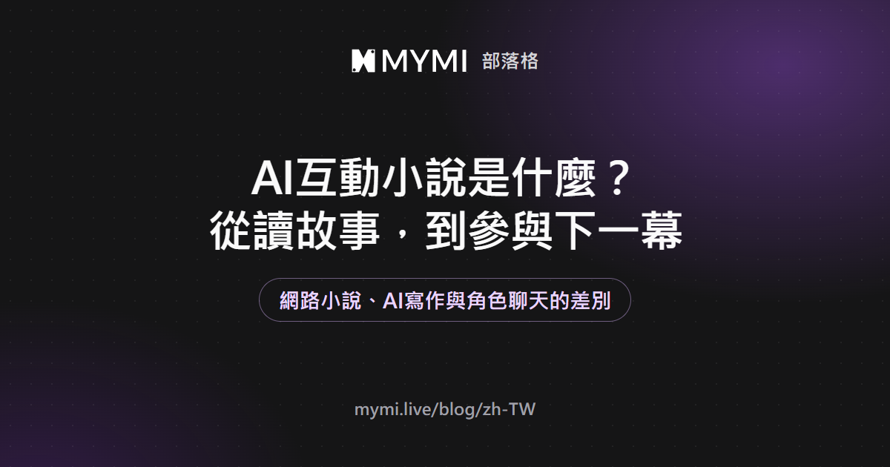
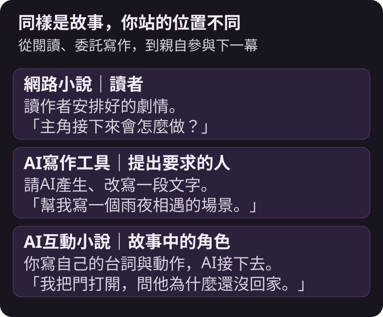
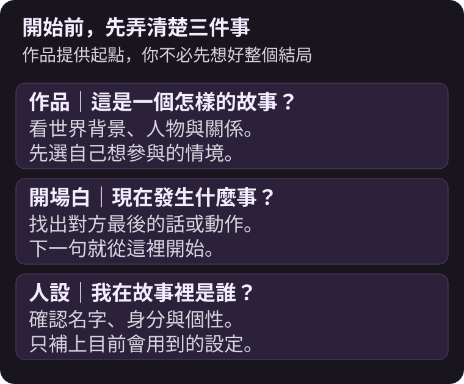
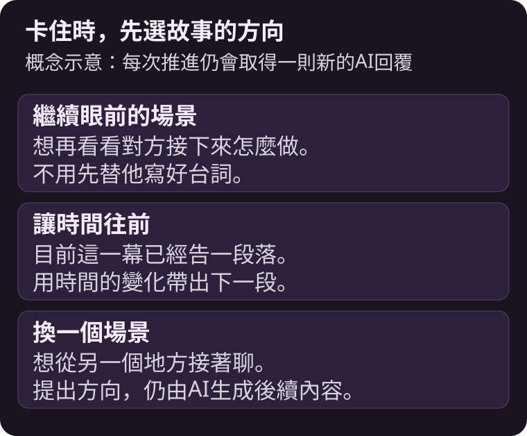
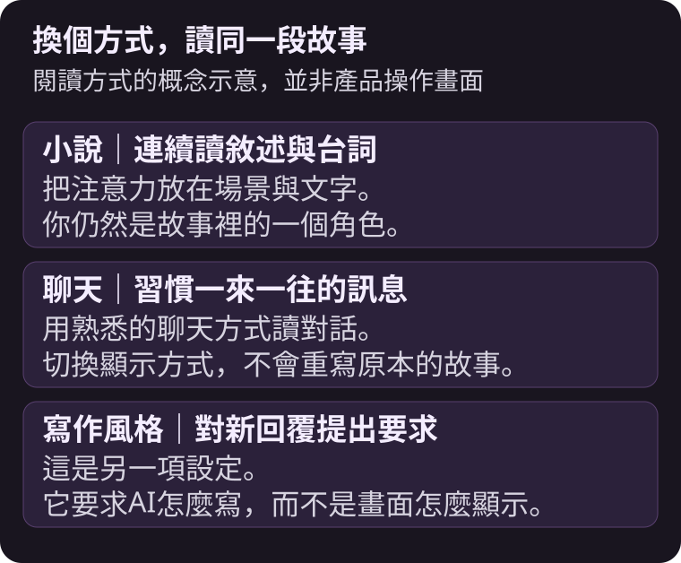

AI互動小說是由AI扮演故事角色、你也以角色身分參與，透過一來一往的台詞與動作共同推進的故事。



{/* truncate */}

讀網路小說時，你可能想過：「如果主角那時候沒有離開呢？」在互動小說裡，你可以直接讓自己的角色留下來，看看對方怎麼回應。你不必先寫好整個故事，也不是每次只能從幾個固定選項中挑一個。

以下以MYMI的角色聊天為例。文中的雨夜書店與燈塔情節是為了說明而設計的例子，不是平台作品的劇情或實際使用者對話。

## 和網路小說、AI寫作工具差在哪裡？

差別在於你想得到一篇完成的文章，還是想親自參與故事發展。

| 比較項目 | 網路小說 | AI寫作工具 | AI互動小說 |
|---|---|---|---|
| 你的位置 | 讀者 | 提出寫作要求的人 | 故事中的角色 |
| 主要做什麼 | 閱讀作者安排好的劇情 | 請AI產出或修改文章 | 寫下自己的台詞與動作 |
| AI負責什麼 | 不一定使用AI | 按要求產生文字 | 扮演對方並延續場景 |
| 同一個開頭再來一次 | 通常讀到同樣內容 | 可取得另一份稿件 | 可能因回應不同而有不同走向 |



例如，角色問你要不要一起查看樓上的聲響。你可以跟上去，也可以先問他是不是知道什麼。這些回應會成為AI接下來參考的內容，但不代表每個要求都會被精準執行，也沒有保證能到達的固定結局。

## 「作品」「開場白」「人設」各是什麼？

MYMI把創作者準備好的世界、人物與開場場景稱為一部**作品**。它提供故事起點，不是一整本已經寫完的小說。

**開場白**是你走進故事時已經發生的那一幕。**人設**則是你在故事裡使用的名字與身分。對方是誰、你是誰、你們為什麼會遇見，通常能從作品介紹與開場白找到線索。

不必一開始就追求複雜的世界觀。先選一個你看完開頭就想回一句話的情境，往往更容易投入。喜歡慢慢試探關係，可以找日常或浪漫情節；喜歡線索與選擇，可以從奇幻冒險或懸疑情境開始。作品的標籤只是線索，仍要讀介紹與開場白，確認實際內容是不是你想看的。



## 一來一往要怎麼寫？

先接住場景裡已經發生的事，再留下對方能回應的空間。例如書店樓上突然傳來聲響，你可以這樣寫：

```text
*把書放回櫃檯，抬頭看向樓梯* 剛剛那個聲音，你也聽到了嗎？
```

動作交代了你在做什麼，問句把下一步交給對方。你不用同時替對方寫好「他點頭，拉著我上樓」，那會把原本可以互動的部分也決定掉。

如果想不到下一句，讓輸入框保持空白，就可以用 **≫** 開啟**繼續推進**，選擇讓故事繼續的方向。它會取得一次新的AI回覆，仍計入試用次數或使用Spark。



想看更多第一句的例子，接著讀[AI角色聊天怎麼開始？](./ai-chat-start.md)。

## 看起來像聊天，還是像小說？

兩種都可以。MYMI的閱讀顯示方式會改變文字與圖片的呈現，不會把同一間聊天室改成另一個故事。喜歡連續讀敘述與台詞，可以選**小說**；習慣訊息往返的樣子，可以選**聊天**。這些是閱讀方式，和**寫作風格**對AI回覆提出的文體要求不同。



詳細按鈕位置放在[聊天室設定](https://www.mymi.live/guide/zh-TW/chatting/chat-room-settings)，這裡先記住：換顯示方式，是換個方式讀同一段對話。

## 常見問題

<details>
<summary>AI會連我的台詞一起寫嗎？</summary>

基本上由你寫自己的台詞與動作，AI負責對方和場景。即使如此，AI偶爾仍可能寫到你的部分。可以修正最後一則回覆，並在設定中確認「允許AI描寫我的行動」是否關閉。開啟這個選項只是允許AI在需要時這樣寫，不保證每次都會寫。

</details>

<details>
<summary>同一部作品可以重新開始嗎？</summary>

可以在作品頁開啟新的聊天，原本的聊天室會保留。想從中途改走另一條路，可以利用書籤建立分支。書籤會限制原對話的修改，所以加入之前先確認內容，詳細條件請看[書籤與分支](https://www.mymi.live/guide/zh-TW/chatting/chat-room-settings#書籤與分支)。

</details>

<details>
<summary>故事變長後，AI還記得前面的事嗎？</summary>

不一定能記住每個細節。MYMI會整理長期記憶，也會取用相關的記憶片段；你還可以把重要設定放進使用者備註。但AI仍可能漏看或誤解。原因與修正方式，另見[AI角色為什麼會忘記設定？](./ai-character-memory.md)。

</details>

<details>
<summary>一定要先下載App嗎？</summary>

不必，可以先在瀏覽器開啟MYMI。網頁、Android與iPhone App可使用同一個帳號接續聊天；使用Apple帳號的人在Android上請從網頁登入。未登入的體驗有次數限制，詳細條件請看[不登入可以使用AI聊天嗎？](https://www.mymi.live/guide/zh-TW/faq/chat-without-login)。

</details>

想試試自己在故事裡會怎麼選，可以到[MYMI](https://www.mymi.live/zh-TW?utm_source=mymi_blog&utm_medium=referral&utm_campaign=global_content_2026q4&utm_content=zh-TW_blog_ai_interactive_novel)找一個想接話的開場。更多閱讀與對話的方法，收在[MYMI部落格](https://www.mymi.live/blog/zh-TW)。
